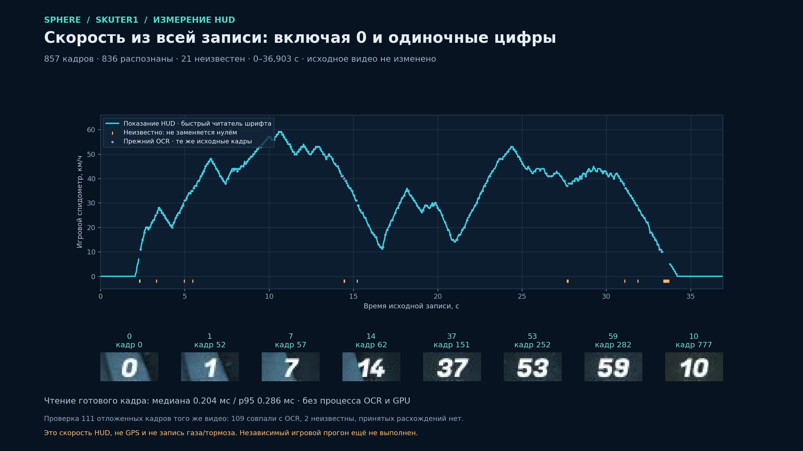
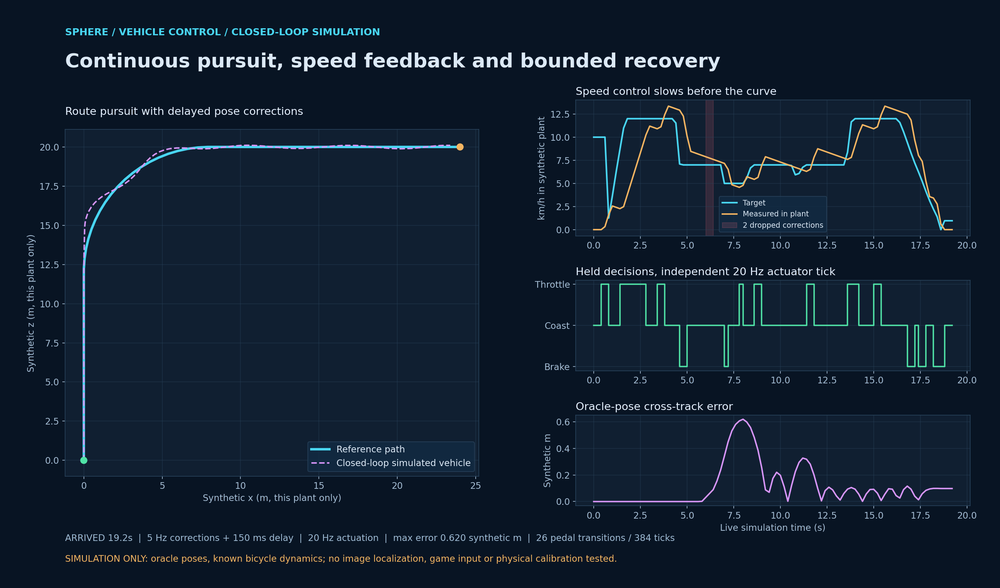
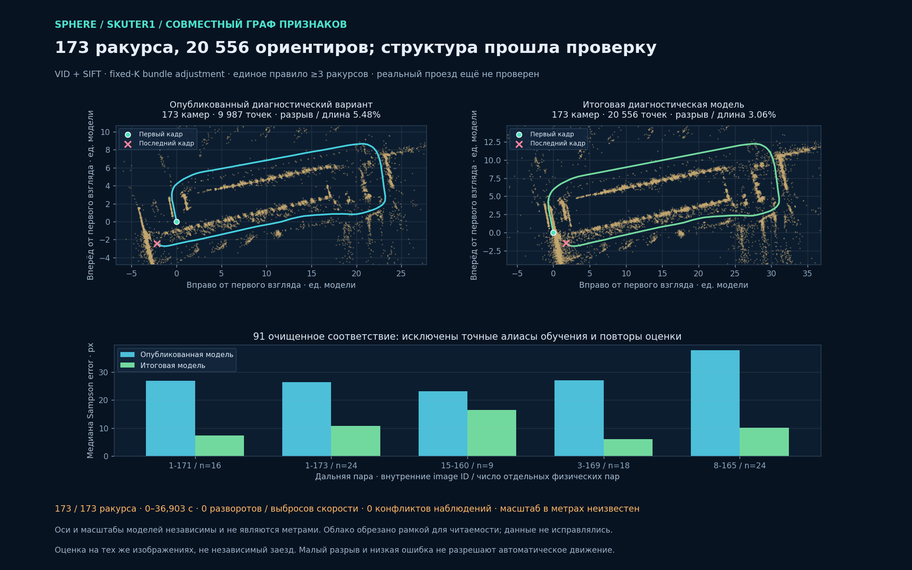

# Запись и повтор автомобильного маршрута: состояние на 2 ноября 2026

В код добавлены автомобильный контроллер, чтение скорости из того же свежего кадра и отдельный веб-сценарий проверки. Веб установлен, обработчик перезапущен. Это ещё не подтверждённый автономный проезд: основное задание `skuter1` остаётся `failed/resource_guard`. Последняя модель с **173 ракурсами и 20 556 ориентирами прошла структурные и геометрические проверки и опубликована как предпочтительная диагностическая схема**, но ещё не получила допуск живой навигации. Нельзя использовать количество точек, готовый HUD-профиль или красивую визуализацию как разрешение движения.

Пакет относится к записи `skuter1`, заданию `6a77040681d142ec97d51831a22785fb`: 857 кадров, 1920×1080, 0–36,903 с. История исправления часов записи и восстановления начала сохранена в [отчёте за 1 ноября](../2026-11-01/SKUTER1-INPUT-CLOCK.md). Результаты ниже относятся к разным видам проверок, а не складываются в один «успешный игровой тест». Исходные квитанции и размеры файлов перечислены в [индексе доказательств](vehicle-teach-repeat-evidence/index.json).

## Контроллер и веб-сценарий

Новый `VehicleRouteFollower` использует локализованное положение, ближайший участок пути и цель впереди. Скорость ограничивается операторским пределом, формой пути и подтверждёнными показаниями HUD; управление не является воспроизведением записанных клавиш. Контур коррекции и удержание контактов разделены: новое решение корректирует удерживаемое управление, а просроченное решение переводит его в нейтраль. Источник, последовательность кадра, время получения и подтверждение Android проверяются отдельно.

Зафиксированный контракт: `sphere-vehicle-plan-v1` / `applied_vehicle_v1`, возраст решения до 450 мс, удержание ответа до 350 мс. По умолчанию предел скорости — 15 игровых км/ч, допустимая настройка — 1–30; длительность автомобильной проверки по умолчанию 300 с, диапазон 60–1800 с. Это пределы ограниченного первого теста, не доказательство готовности к 100–350 км/ч. При потере подтверждений восстановление выполняется в нейтрали, а не продолжением старого газа. [Backend-контракт и ограничения](vehicle-teach-repeat-evidence/backend-verification.json).

Автомобильная проверка требует подготовленной основной карты навигации, связанного с тем же источником профиля скорости и явного подтверждения, что камера следует за транспортом. Свободные свайпы камеры во время движения здесь не выполняются; связь камеры и кузова физически не откалибрована. Предпочтительная диагностическая схема `fixed-k-fused-173-supported-diagnostic` не подменяет навигационный допуск; прежняя `full-173-endpoints-diagnostic` сохранена отдельно. GPS/миникарта не объявляются достоверным мировым положением. Избегание препятствий и безопасность дорожной поверхности этим этапом не подтверждены.

Браузер остаётся владельцем кадров и ввода. При скрытии вкладки контакты освобождаются; автоматический подхват возможен после возвращения вкладки и свежих подтверждений. Непрерывное unattended/headless-исполнение и работа на ста окнах этим сценарием не реализованы и не проверены. HTTP-поставка и статический стенд ниже отделены от пользовательской IAB-страницы, доступ к которой в этой проверке отсутствовал.

Скорость из настоящего HUD уже участвует в автомобильном контроллере. Существующий `motor_worker/minimap.py` остаётся наблюдателем GPS-линии в теневом режиме: его результат сейчас не объединяется с автомобильным рулением, не подтверждает локализацию или прибытие. Один текущий `SparseRoute` ограничен 240 выбранными ракурсами и разрывами не больше секунды. Полный сценарий записи/повтора на 8–10 минут не продемонстрирован; ему нужна поддержанная организация подмаршрутов, а не обещание, что минутный тест автоматически масштабируется.

Сценарий веба использует существующие классы контактов и отдельный протокол `vehicle_live_v1`. Проверены удержание/освобождение педалей, конечные состояния, отсутствие одновременного газа и тормоза, свежесть ответа и поведение при отказах. Эти проверки использовали имитацию endpoint и ACK; Android не подключался. [Frontend-проверка](vehicle-teach-repeat-evidence/frontend-verification.json).

## Скорость из исходной записи и свежего кадра

Прежний Tesseract-фильтр принимал только поддержанные двузначные результаты и оставлял одиночные цифры, ноль и неоднозначное `14` неизвестными. Это правило не ослаблялось. Для явно выбранного `black_russia_scooter_v1` добавлен отдельный небольшой банк измеренных глифов и чтение области спидометра из уже декодированного кадра 960×540. Ошибка геометрии кадра, непонятный глиф или истёкшее время обработки возвращают неизвестное значение. `confidence` здесь означает сходство бинарного глифа, а не калиброванную вероятность правильности.

Банк построен по части кадров той же записи: используются прежние OCR-метки с confidence ≥85 и отдельно визуально проверенный ноль первого кадра. На 111 отложенных кадрах той же записи 109 принятых результатов совпали с OCR, два оставлены неизвестными; принятых расхождений не было. Это проверка согласованности с прежним OCR на том же материале, а не независимая точность распознавания. Восемь сохранённых кропов отдельно просмотрены: `0`, `1`, `7`, `14`, `37`, `53`, `59`, `10`. [Проверка глифов, gzip](vehicle-teach-repeat-evidence/hud-font-proxy-validation.json.gz), [происхождение кропов](vehicle-teach-repeat-evidence/hud-visible-crops-provenance.json).

Вся запись обработана за 9,656 с: **836 из 857** показаний распознаны, 21 оставлено неизвестным. Начало и конец содержат распознанный видимый ноль; диапазон наблюдений — 0–59 игровых км/ч. На 400 чтениях восьми кропов медиана составляла 0,204 мс, p95 0,286 мс, максимум 1,104 мс; это время чтения уже готового изображения, без приёма видео, JPEG-декодирования и локализации. [Результат обработки](vehicle-teach-repeat-evidence/hud-outcome.json), [публикация и измерения](vehicle-teach-repeat-evidence/hud-publication.json).

В исходный job добавлен связанный с источником `vehicle-speed-reference`: полный профиль, квитанция и `COMPLETE`. SHA исходных файлов, состояния, CANCEL, основной геометрии и выбранной схемы не изменились. Читатель не интерполирует через неизвестные значения и разрывы больше 0,2 с, не экстраполирует за пределы записи. Для живого управления скорость должна относиться к тому же свежему кадру, что и поза. Начальный стоящий участок не разрешается обходить выдуманной минимальной скоростью: цель выбирается по движущемуся участку геометрии. Показания HUD не являются записью нажатий газа/тормоза или доказательством метрического масштаба мира. [Полный профиль, gzip](vehicle-teach-repeat-evidence/hud-profile.json.gz), [связи и ограничения](vehicle-teach-repeat-evidence/hud-profile-receipt.json).

Найден и исправлен отдельный разрыв веб-сценария: status API читал старую Tesseract-сводку с 226 принятыми наблюдениями из 286, хотя новый полный профиль уже существовал. Новый `read_display_status` предпочитает проверенный быстрый профиль; присутствующий повреждённый профиль возвращает отказ, а не скрывается за прежним готовым результатом. Для `skuter1` возвращаются 836/857 и 21 неизвестное наблюдение; график ограничен 429 корзинами, из которых 16 содержат неизвестные данные. Неизвестные значения и разрывы не соединяются. Это сводка для отображения: контроллер читает полный профиль отдельно.

При холодном чтении проверяются SHA источника и артефактов. Повторные запросы используют ограниченный кэш, проверяют изменения файлов и возвращают независимую копию результата. На исходном job первое чтение заняло 154,64 мс, медиана 100 повторов — 2,81 мс, p95 — 3,38 мс; повторных полных чтений видео при этих запросах не было. Изменение прогресса SfM само по себе не заставляет заново хешировать видео. 63 проверки быстрого/прежнего HUD и service прошли; Ruff нового модуля и тестов прошёл. В `c8847506` быстрый профиль включён перед индексированием изображений и SfM; для этого явного поддержанного preset прежний OCR-процесс не запускается повторно. Историческая telemetry не переписывается, прочие presets продолжают прежний путь. Канонические снимки нового коммита сохранены отдельно в `sources-c8847506` с обратимым gzip. Совместная регрессия workflow дала **95 passed, 7 subtests**; после перезапуска API подтверждён контракт `source_bound_font_display_v1`. [Измерение](vehicle-teach-repeat-evidence/hud-display-status-smoke.json), [узкие тесты](vehicle-teach-repeat-evidence/hud-display-status-tests.txt), [workflow-регрессия](vehicle-teach-repeat-evidence/hud-display-workflow-tests.txt).

## Что проверено на синтетическом контуре

Контроллер прошёл модель движения велосипеда с **готовыми истинными позами**, выдаваемыми испытателем. Исполнитель работал на 20 Гц, коррекции на 5 Гц, задержка коррекции 150 мс; две коррекции намеренно потеряны. В этой модели получено `arrived` за 19,2 с, максимальное поперечное отклонение 0,620 условного для модели метра, скорость на повороте не превысила 8,748 км/ч при операторском пределе 15. Было пять тиков нейтрали из-за истечения решения, четыре ожидания повторного подтверждения и 26 переходов педали на 384 исполнительных тиках. [Данные испытания, gzip](vehicle-teach-repeat-evidence/controller-oracle-plant.json.gz).

Эти метры принадлежат только испытательной модели. Кадровая локализация, игра, настоящий стик, камера транспорта и прохождение исходной улицы этим испытанием не проверялись. Факт достижения синтетической цели не является результатом автомобильного проезда в Black Russia.

## Проверки геометрии и итоговая диагностическая модель

В отдельном SIFT/LightGlue-графе добавлены проверенные дальние связи начала и конца. Инкрементальное восстановление дало компоненты на 146 и 43 камеры. Основная компонента начинается на 5,312 с и имеет шесть эвристических резких смен направления. Объединение отклонено как `component_merge_sim3_inconsistent`; восстановление крайних кадров не устранило причины отказа. Ни одна новая компонента не содержит обе стороны ни одной из шести дальних пар, поэтому сравнение новых поз на этих удержанных ограничениях невозможно. [Отказ повтора](vehicle-teach-repeat-evidence/loop-v3-failure.json.gz), [объединение, gzip](vehicle-teach-repeat-evidence/loop-postprocess-merge.json.gz), [удержанные ограничения](vehicle-teach-repeat-evidence/loop-heldout-constraints.json).

Дополнительно найдены повторы наблюдений одной 3D-точки в одном изображении. В клонах удалены только 4767/407 наблюдений с точно одинаковыми пиксельными координатами; позы, XYZ и исходная таблица координат признаков сохранены бит-в-бит. Остались 3380/343 групп с различными координатами, поэтому обе модели всё ещё не проходят строгую структурную проверку. Удаление точных SIFT-алиасов не исправляет позы и не разрешает остальной конфликт. [Наблюдения](vehicle-teach-repeat-evidence/loop-observation-audits.json), [нормализация клонов](vehicle-teach-repeat-evidence/loop-alias-normalization.json).

Следующая отдельная CPU-проба использовала глобальное SfM на копии базы. Калибровка оценила фокус 2257,545 px вместо исходного предположения 2304 px; фокус 601 px не навязывался. Это оценка алгоритма, не физическая калибровка. Глобальное позиционирование дошло до `NO_CONVERGENCE`; затем до завершения bundle adjustment задачу остановил ресурсный контроль: PowerShell-проверка тома истекла по времени и вернула отсутствие измерений. В том же испытании быстрые счётчики показывали не менее 11,51 ГиБ доступной RAM, не более 77,63% commit и максимум 278,14 МиБ суммарного RSS родителя и native-процесса. Это **отказ получения измерения, не доказанная нехватка памяти**. Собственный процесс остановлен, завершённая модель не принята, защищённые файлы не изменены. [Результат](vehicle-teach-repeat-evidence/global-loop-result.json.gz), [калибровка копии](vehicle-teach-repeat-evidence/global-loop-calibration.json), [остановка native-процесса](vehicle-teach-repeat-evidence/global-loop-mapping-receipt.json).

В collector разделены получение состояния диска, проверка здоровья тома и свежий native-снимок RAM/commit. Ошибка PowerShell больше не пропускает вызов `GetPerformanceInfo`: квитанция сохраняет компонент ошибки и отдельное время измерения. Отсутствующее здоровье тома всё равно не считается разрешением запуска; проверка не заменяется старым снимком и не отменяется. Это изменение диагностирует настоящий источник отказа, но не превращает остановленный global-SfM опыт в успешный.

Дополнительный task-owned монитор выполняет свежую полную проверку при допуске, а затем обновляет здоровье того же Win32 volume GUID одним фоновым процессом. Здоровый результат действует только в этой задаче до 30 с; RAM/commit и свободное место читаются заново при каждом запросе. Изменение тома, новое предупреждение или истёкшее подтверждение не разрешают воспользоваться прежним здоровым снимком. На настоящем Windows-процессе первый запрос занял 1,419 с, следующий 1,916 мс, запуск фонового обновления 9,579 мс; закрытие остановило и убрало собственный процесс. 73 теста монитора/guard прошли. Это измерение монитора, не FPS управления. [Реальная проверка](vehicle-teach-repeat-evidence/task-monitor-smoke.json), [версия и тесты](vehicle-teach-repeat-evidence/task-monitor-verification.json).

После этого выполнен один разрешённый повтор глобального метода **из уже откалиброванной копии базы**, без нового matching и калибровки. Он завершился за 64,719 с и восстановил 172/173 камер с крайними кадрами 0–36,903 с. Монитор не оборвал опыт: доступная RAM не опускалась ниже 8,23 ГиБ, суммарный RSS родителя и native-процесса достигал 277,37 МиБ; возраст здорового подтверждения тома не превышал 15,58 с. Bundle adjustment изменил окончательный фокус до 683,336 px; это отличается от начальной оценки калибратора и также не является истинной калибровкой камеры. [Квитанция повтора, gzip без потери байтов](vehicle-teach-repeat-evidence/global-resume-result.json.gz).

Отношение разрыва концов к длине этой модели уменьшилось до 0,49% против 5,48% опубликованной модели. На пяти непустых удержанных дальних парах медианы Sampson error снизились с 28,97/26,93/21,11/30,82/37,84 до 6,06/9,46/18,37/22,33/12,39 px. Однако шесть резких изменений направления, три выброса скорости, 6177 дополнительных наблюдений в повторяющихся image-группах и высокие остатки сохраняются. У 875 из 46091 наблюдения ошибка больше 4 px. Поэтому проба **не принята**: малая близость концов и уменьшение ошибки пары ещё не подтверждают точную траекторию. Исправление недостающего ракурса также не дало пригодной позы. Новая модель не опубликована и не разрешает движение; исходники и первый неудачный опыт сохранены. [Качество и движение](vehicle-teach-repeat-evidence/global-resume-assessment.json), [наблюдения](vehicle-teach-repeat-evidence/global-resume-observations.json), [удержанные пары](vehicle-teach-repeat-evidence/global-resume-heldout.json.gz).

Позднейшая проверка выявила дополнительное ограничение этого сравнения: разделение SIFT-строк на обучение и оценку не гарантировало разделения физических соответствий. Из 99 оценочных строк семь совпадают с обучающими по точным координатам, ещё одна повторяет другую оценочную пару. После исключения таких алиасов остаётся 91 отдельное физическое соответствие: 16/24/9/0/18/24 по шести связям. Поэтому прежние числа Sampson сохранены как исторический результат с возможной утечкой между выборками; они не доказывают независимое улучшение. Следующие сравнения используют одинаковые очищенные пары для baseline и кандидата. [Проверка алиасов](vehicle-teach-repeat-evidence/loop-alias-heldout-audit.json).

Последующий метод объединил исходные VID-признаки и отдельные SIFT-признаки в одной проверяемой базе, вместо смешивания поз уже готовых моделей. Исходные координаты и соответствия сохранялись в своих пространствах индексов; точные алиасы выделены отдельно. Подготовленная база содержит 291 935 строк признаков и 687 123 геометрически проверенных соответствия. Нового извлечения признаков, Torch или ручного редактирования поз в этой пробе не было. Первая попытка остановилась на истёкшем подтверждении здоровья тома во время калибровки; глобальный решатель тогда не запускался. [Пространство индексов, gzip](vehicle-teach-repeat-evidence/fused-graph-namespace.json.gz), [проверка переноса](vehicle-teach-repeat-evidence/fused-graph-namespace-audit.json), [предыдущий отказ](vehicle-teach-repeat-evidence/fused-graph-first-probe-refusal.json).

Разрешённый повтор совместного графа завершился за 125,969 с, из них native global mapper — 117,110 с на двух выделенных CPU без GPU. Восстановлены **173/173 ракурса, 0–36,903 с, 21 571 модельная 3D-точка**; экспорт содержит 21 556 точек. Максимальный промежуток между восстановленными ракурсами — 0,285 с; эвристика не нашла резких разворотов или выбросов скорости. На одинаковых 91 очищенном физическом соответствии медианы Sampson error по пяти непустым связям уменьшились с 26,78/26,31/23,14/26,99/37,84 до 9,49/11,73/15,54/7,66/11,00 px. Это улучшение на соответствиях той же записи, не независимая проверка положения или точности в метрах. [Квитанция, gzip](vehicle-teach-repeat-evidence/fused-graph-result.json.gz), [native-команда](vehicle-teach-repeat-evidence/fused-graph-global-native-receipt.json), [очищенное сравнение](vehicle-teach-repeat-evidence/fused-graph-clean-heldout.json.gz).

У этого сырого промежуточного варианта проверка отрицательная: найдены 1268 групп повторных наблюдений одной 3D-точки в одном изображении, включая разные координаты с расстоянием до 7,92 px. Из 138 116 наблюдений 2333 имеют ошибку больше 4 px. Хотя временные и общие геометрические эвристики прошли, строгая структурная проверка отказала; `navigation_qualified` и `execution_qualified` остаются false. Этот промежуточный вариант не подменял опубликованную модель и не разрешал управление. Минимальная доступная RAM в испытании — 6,98 ГиБ, максимум суммарного RSS parent/native — 505,54 МиБ, commit — до 81,23%. Собственные batch-процессы имели BelowNormal-приоритет, процесс измерения здоровья — Normal; максимальный возраст подтверждения тома — 10,844 с. Пороги и срок действия подтверждений не отменялись. [Оценка модели](vehicle-teach-repeat-evidence/fused-graph-assessment.json), [наблюдения](vehicle-teach-repeat-evidence/fused-graph-observations.json).

Далее в отдельном клоне удалены **целиком 945 треков**, содержащих повтор одного изображения; бесконфликтные треки не отбирались по форме маршрута. Перед оптимизацией позы, K, все измеренные 2D-координаты и сохранённые XYZ оставались бит-в-бит исходными. Выполнен один robust bundle adjustment с фиксированными intrinsics. Его первый сырой аудит был отклонён: среди оставшихся точек находились 70 двухракурсных треков, исключённых из активной оптимизации с минимальной длиной три ракурса. Их XYZ остались вне преобразованной оптимизатором системы отсчёта; восемь наблюдений пяти таких треков оказались за камерой, а сводка проекции содержала NaN и огромные cached errors. Этот промежуточный отказ сохранён. [Все 945 удалённых ID и привязка полной квитанции](vehicle-teach-repeat-evidence/whole-track-filter-summary.json.gz), [сырой BA-результат, gzip](vehicle-teach-repeat-evidence/whole-track-ba-result.json.gz), [исходный отказ наблюдений, gzip](vehicle-teach-repeat-evidence/whole-track-ba-observations.json.gz).

Итоговый клон использует единое правило: **оставить трек только при наличии как минимум трёх разных зарегистрированных изображений**. Удалены все 70 неподдержанных двухракурсных треков, а не только пять с отрицательной глубиной. Оптимизированные позы, K, все 2D-измерения и XYZ 20 556 оставшихся ориентиров сохранены бит-в-бит относительно BA-выхода; пересчитан только производный кэш ошибок через native `update_point_3d_errors()`. Дополнительной оптимизации, ручной правки поз и принудительного замыкания не выполнялось. Полная квитанция 70 удалений включена в пакет; большой слой координат/наблюдений 945 треков оставлен локально и привязан SHA/размером в компактной сводке. [Правило и все удаления, gzip](vehicle-teach-repeat-evidence/supported-3view-provenance.json.gz).

**Итог: 173 камеры, 20 556 ориентиров, 130 081 наблюдение; ноль конфликтов изображений, нарушений обратных ссылок, отрицательных глубин или неопределённых проекций.** Средняя фактическая ошибка наблюдения — 0,888 px, медиана 0,581 px, p95 2,810 px; средний производный point-error cache — 0,9732 px. Весь диапазон 0–36,903 с сохранён, временные и геометрические проверки прошли. На прежних 91 очищенном физическом соответствии медианы итоговой модели — 7,26/10,81/16,50/6,07/10,15 px против 26,78/26,31/23,14/26,99/37,84 у опубликованной. Это диагностический допуск модели, не доказанная мировая точность: независимые свежие кадры, навигационный допуск и живой автомобильный проезд ещё проверяются отдельно. [Итоговая квитанция, gzip](vehicle-teach-repeat-evidence/supported-3view-result.json.gz), [оценка](vehicle-teach-repeat-evidence/supported-3view-assessment.json), [те же очищенные пары](vehicle-teach-repeat-evidence/supported-3view-clean-heldout.json).

Итоговая геометрия опубликована в исходный job как `fixed-k-fused-173-supported-diagnostic` и выбрана предпочтительной для просмотра. Прежний указатель сохранён; SHA 16 защищённых файлов, включая исходное видео, основную геометрию, состояние и CANCEL, не изменились. Основная карта навигации не заменена, разрешение на управление не добавлено. [Квитанция публикации](vehicle-teach-repeat-evidence/supported-diagnostic-publication.json).

Оси каждого верхнего графика направлены вправо/вперёд от его собственной первой камеры и имеют независимый условный масштаб. Точки за рамкой скрыты только при отображении; визуализация не меняет XYZ или позы финальной модели. Это проекция виденных ориентиров, а не доказанная карта дорожной поверхности или готовый проезд. [Привязка финального изображения](vehicle-teach-repeat-evidence/supported-3view-figure-receipt.json).

## Перенос модели в текущий локализатор

Первый экспорт в существующий runtime RootSIFT создал только 2026 локализационных ориентиров, заново триангулируя другие признаки вместо прямого использования 20 556 измеренных 3D-треков. В восьми соседних опорных ракурсах 4,049–5,478 с поддержки оказалось недостаточно; карта получила `route_map_has_unobserved_sections` и не была допущена. Это отдельный отказ экспорта локализатора, а не отмена структурной проверки исходной модели.

На 159 запросах из той же записи, исключавших все 173 опорных source indices, получены 63 состояния `localized`, 30 `confirming`, 66 `unknown`. Доля `localized` — 39,6%; этого недостаточно для непрерывного управления. Это не независимый игровой проход: остальные кадры находятся близко к опорным, используется синтетическое время получателя, ввод в игру отсутствует. В испытателе было три recovery-кандидата против восьми в production; параметры после результата не подбирались. Даже малая ошибка найденных поз не скрывает пропуски. [Результат первого экспорта и запроса](vehicle-teach-repeat-evidence/first-native-localization-export-outcome.json).

Для старта автомобильный контроллер требует три последовательных свежих подтверждения, как минимум 24 pose-inlier и confidence HUD не ниже 80. Число запросов с 80 и более pose-inlier — лишь описательная статистика, не порог допуска. Для проверки переноса существующих 3D-треков к runtime-дескрипторам выполнен отдельный опыт с сохранением измерений; дополнительного восстановления геометрии для него не требовалось.

Такой перенос проверен отдельно и **отклонён**. Получены 1524 runtime-ориентира вместо 2026 у baseline. На тех же 159 source indices: 59 `localized` (37,11%), 22 `confirming`, 78 `unknown` против прежних 63/30/66; слабых соседних участков стало десять вместо восьми. Медиана вычисления — 116,33 мс, p95 263,77 мс, максимум 1598,33 мс против 109,28/171,63/3056,46 мс у baseline. Это время обработки запроса в испытателе, не полная задержка живого потока. Новый вариант не улучшил готовность или долю локализованных кадров и не принят в основной экспорт. [Сравнение](vehicle-teach-repeat-evidence/measured-anchor-comparison.json), [квитанция builder](vehicle-teach-repeat-evidence/measured-anchor-builder-receipt.json), [результат](vehicle-teach-repeat-evidence/measured-anchor-outcome.json).

Из 20 556 3D-треков 15 106 не получили допустимой связи с runtime-признаками, ещё 3704 не имели поддержки в трёх runtime-ракурсах; геометрия при этом не изменялась. Поэтому число точек в модели и число пригодных для текущего локализатора ориентиров — разные показатели. В экспортной части было не меньше 7,44 ГиБ доступной RAM, при локализации — 7,19 ГиБ; ресурсных отказов не было, максимальные измеренные Private Bytes процесса — 335,38 МиБ. Это подтверждает нынешний разрыв совместимости признаков/поддержки карты, а не необходимость десятков гигабайт для одной локализации.

Фактически испытанный исходник builder сохранён с SHA `3f94a83e…95ef43`. После опыта исправлены отбор medoid по окончательному подмножеству и учёт общей квоты native-строк; исправленная версия прошла 44 узких теста, но в этом actual trial не выполнялась. В `bd3260a5` она зафиксирована как отдельный optional offline-инструмент сравнения и не включена в canonical exporter. SHA исправленного и испытанного вариантов различаются и указаны в сравнении; unit-pass не подменяет повторный runtime-результат. [Испытанный builder, gzip](vehicle-teach-repeat-evidence/measured-anchor-actually-tested-builder.py.gz), [исправленные unit-тесты](vehicle-teach-repeat-evidence/measured-anchor-corrected-unit-tests.txt), [сохранность источника, gzip](vehicle-teach-repeat-evidence/measured-anchor-source-preservation.json.gz). Снимки исправленного коммита — `sources-bd3260a5`.

В `c02582bd` добавлены отдельные счётчики причин отклонения триангулируемых runtime-треков; геометрические пороги не ослаблены. Это диагностическое изменение, которое позволяет отличать потерю поддержки карты от ресурсного отказа. Канонические исходники и тесты закреплены в `sources-c02582bd` индекса. В текущем сквозном испытании препятствие — слабая поддержка runtime-карты, а не доказанная нехватка RAM.

Следующий pose-guided RootSIFT вариант также не улучшил результат: 1168 ориентиров, 13 неподдержанных соседних участков и 52/159 `localized` (32,70%) против baseline 2026/8/63. Одинаковы query indices, опорные RGB, K, source model и параметры, кроме revision метода. Первая попытка за 54,125 с закончилась переполнением квоты логирования scaffold, без карты или локализационного результата; это не доказанный отказ алгоритма или памяти. Свежий повтор с ограничением частоты записи логов завершён за 107,781 с без ослабления проверок. Из него 30,54 с заняли 10 538 вызовов guard, а 0,97 с — запись доказательств; эти числа не являются benchmark реального управления. [Первая остановка](vehicle-teach-repeat-evidence/guided-v1-scaffold-refusal.json), [полное сравнение второго опыта](vehicle-teach-repeat-evidence/guided-v2-comparison.json), [время callback](vehicle-teach-repeat-evidence/guided-v2-callback-metrics.json).

В этом варианте ratio считался после поиска двух эпиполярно допустимых кандидатов среди восьми ближайших дескрипторов. Это отличается от обычного сравнения двух ближайших дескрипторных соседей с последующей геометрической проверкой. Испытанный вариант `3761ec17` сохранён отдельно; `dac067dd` задаёт стандартный порядок Global2NN-Lowe-before-F без ослабления порогов эпиполярности, проекции, параллакса или поддержки. Оба инструмента остаются вне canonical exporter.

Последний фактический guided-опыт со стандартным порядком дал **3059 ориентиров, минимум 25 ориентиров в соседстве, ноль неподдержанных участков**: проверка поддержки карты пройдена. Однако на прежних 159 кадрах локализованы только 66 (41,51%) против baseline 63 (39,62%); ещё 29 `confirming`, 64 `unknown`. Все 63 ранее локализованных кадра сохранились, добавлены три, но интервалы 5–15 с и 25–30 с всё ещё не содержали `localized`. Исправление matching повышает поддержку экспортируемой карты, но не решает непрерывную локализацию. [Итог последнего опыта](vehicle-teach-repeat-evidence/guided-v3-outcome.json), [сравнение всех вариантов](vehicle-teach-repeat-evidence/guided-v3-comparison.json), [изменение порядка проверки](vehicle-teach-repeat-evidence/guided-v3-algorithm-diff.patch).

На кадре 6,609 с найден лишь `confirming`-кандидат с 27 inlier на участке 14,235–14,435 с, расхождение source time 7,626 с. Это отмечено как временная неоднозначность, а не известная ошибка мировой позы; принятого управления не было. Медиана обработки — 127,89 мс, p95 212,01 мс, максимум 1518,30 мс; пять вычислений уже превышали бюджет свежести 250 мс, включая два `localized`, до добавления транспортной задержки. Идентичны 173 массива опорных признаков, source/RGB/query indices, K, трасса камер, masks и pipeline.

Последняя попытка заняла 110,703 с, все три guided-попытки вместе — 272,609 с, включая прежний отказ scaffold и отрицательный вариант. Builder занял 50,184 с, из них 30,285 с — resource callbacks и 19,899 с — остальная работа; это не realtime-benchmark. Полный результат и отклонённые альтернативы сохранены. Последний вариант **не заменяет canonical exporter, не публикует карту и не повышает navigation/execution status**. На этой серии алгоритмические опыты завершены. [Проверки источника и параметров](vehicle-teach-repeat-evidence/guided-v3-export-receipt.json.gz), [разбор времени](vehicle-teach-repeat-evidence/guided-v3-callback-metrics.json).

## Отдельное наблюдение по миникарте

Независимый от 3D-экспорта offline-канал сопоставлял изображения миникарты через ORB и partial affine. На тех же 159 не опорных source indices получено **152 геометрически проверенных совпадения изображения**, 93 из них эвристически однозначны; 147 совпадают с опорным временем в пределах секунды. Все 66 кадров, на которых baseline 3D был `unknown`, получили проверенное совпадение миникарты в пределах секунды, 44 — эвристически однозначное. На слабом участке 4–5,5 с совпали все шесть запросов, пять однозначны. Время записи использовалось только после image-only поиска для оценки результата. [Сводка](vehicle-teach-repeat-evidence/minimap-observation-summary.json), [полный результат, gzip](vehicle-teach-repeat-evidence/minimap-observation-result.json.gz).

Три проверенных совпадения имели расхождение source time больше двух секунд: 33,116/3,344/2,747 с; все помечены неоднозначными. Расхождение времени не измеряет физическую ошибку положения: запись почти возвращается в исходное место. Смещение центра и угол в этой пробе относятся к affine-преобразованию пикселей миникарты, а не к игровым координатам, метрическому положению, камере или прибытию. Сопоставление проходило на той же записи с близкими соседними кадрами, не на независимой игровой сессии; синтетические сдвиги и повороты отдельно помечены.

Проба завершилась за 36,17 с. Медиана вычисления запроса — 138,17 мс, p95 264,02 мс, максимум 447,71 мс; максимальные измеренные Private Bytes — 184,52 МиБ, 67 ресурсных проверок без отказов. Это полезное дополнительное наблюдение на местах потери 3D-сопоставления, но автоматическое объединение с рулением, fallback и подтверждение прибытия не включены. Существующий GPS-line shadow и этот новый offline-опыт не следует считать одним готовым навигатором. [Привязка сохранённых изображений эксперимента](vehicle-teach-repeat-evidence/minimap-observation-figure-receipt.json).

## Последняя проверка настоящего HTTP-пути

Отдельный временный сервер исполнил production-код `432aa6a1`, обычные проверки ready/start и JPEG-протокол автомобильного наблюдения. В него за 36,95 с поданы **277 настоящих неопорных кадров** сохранённой записи по реальному монотонному времени; source time использовалось только для расписания, не для локализации. Опорные кадры исключены; просроченные кадры пропускались, очередь не накапливалась. Это другой набор/плотность запросов, не прямое повторение сравнения 159 кадров. Production API на 3342 не вызывался этим испытанием, Android не подключался, motion feedback всегда false. [Итог](vehicle-teach-repeat-evidence/isolated-vehicle-http-result.json), [настоящий запрос старта](vehicle-teach-repeat-evidence/isolated-vehicle-http-start.json).

Трекер вернул 174 `localized`, 28 `confirming`, 75 `unknown`; контроллер — 21 предложение `following`, затем 231 терминальный нейтральный ответ `vehicle_progress_discontinuity`. Первое терминальное состояние на 5,945 с возникло после повторного узнавания позиции на 10,24 медианных шага вперёд за 2,331 с при фиксированном пределе шесть шагов. Этот сдвиг согласуется с принятой трассой той же записи; он не доказывает ошибку позы. Перед разрывом контроллер предлагал тормозить при HUD27 и пределе15, а запись продолжала ехать и показала HUD41 при повторном узнавании. Видео не реагирует на тормоз/нейтраль, поэтому это **open-loop проверка протокола, не доказанный сбой замкнутого игрового управления или успешный проезд**. Все 47 ответов до первого terminal детерминированно воспроизведены без расхождений, повторного HTTP или vision inference. [Разбор остановки, gzip](vehicle-teach-repeat-evidence/isolated-vehicle-http-terminal-audit.json.gz), [воспроизводящий код, gzip](vehicle-teach-repeat-evidence/isolated-vehicle-http-terminal-reproducer.py.gz).

Возраст результата от представления декодированного кадра перед JPEG/HTTP до ответа: медиана 30,27 мс, p95 165,97 мс, максимум 296,57 мс. Три запроса превысили 250 мс; истёкших 450/350-мс decision leases на момент ответа не было. Это не полная задержка Android→браузер→ввод. Физических действий и ACK от Android не было, прибытие не доказано. Сам сервер закрыт, точные временные fixture-файлы удалены, источник/runtime и production PID38860 сохранены. [Cleanup и хеши, gzip](vehicle-teach-repeat-evidence/isolated-vehicle-http-cleanup.json.gz).

Ограничение измерения ресурсов этой пробы существенно: 80 host-проверок прошли без замечаний, минимум доступной RAM — 10,90 ГиБ; фактический worker сообщал до 115,89 МиБ Private Bytes после ответов, а не непрерывно. Внешний счётчик 0,90 МиБ относился к venv-launcher и не является пиком worker. Windows Job на 2 ГиБ был настроен на launcher, но отдельное членство настоящего worker не зафиксировано; непрерывный предел private memory worker этим опытом не доказан. Эти ограничения не скрываются за малой sampled-цифрой. [Границы доказательств](vehicle-teach-repeat-evidence/isolated-vehicle-http-limits.json), [SHA полных локальных артефактов](vehicle-teach-repeat-evidence/isolated-vehicle-http-artifact-hashes.json).

## Проверки и поставка

Основной код зафиксирован и отправлен коммитом `1b68f20d`. Канонические снимки этого коммита находятся в каталоге `sources` [индекса](vehicle-teach-repeat-evidence/index.json); байты банка глифов в Git совпадают с закреплённым SHA `07bf4627…f7a56bac`. Нормализация переводов строк банка могла бы нарушить эту проверку, поэтому для этого артефакта задано сохранение байтов. [Проверка байтов](vehicle-teach-repeat-evidence/font-byte-proof.json).

Зафиксированы 132 backend-теста и 61 subtest, 160 frontend-тестов и проверка TypeScript. Отдельные HUD-проверки дали 35 passed. Затем совместный запуск root с настоящим PyAV и native-окружением завершился **215 passed, 75 subtests**. Это пересекающиеся наборы: их числа нельзя складывать как количество независимых проверок. Ранние frontend-тесты предшествуют окончательному уточнению подписей причин в UI; результат полной проверки поставляемого коммита приведён ниже. [Backend-лог](vehicle-teach-repeat-evidence/backend-tests.txt), [frontend-квитанция](vehicle-teach-repeat-evidence/frontend-verification.json), [совместный прогон](vehicle-teach-repeat-evidence/joint-regression.txt).

Первый полный канонический frontend-CI на `1b68f20d` завершился отказом: 2998 из 2999 тестов, 223 из 224 suites прошли. Не прошёл тест удержания автомобильного решения между коррекциями: ожидалось три вызова, получено два при асинхронном расписании fake timers. В испытателе введены явно отложенные ответы с прежними точными утверждениями; возрастные ограничения продуктового контроллера не ослаблены. Исходный отказ и сырой лог сохранены. UTC-идентификатор запуска `20261101T203006Z-55c0f188` корректен для локальной даты 2 ноября. [Полный отказ CI](vehicle-teach-repeat-evidence/frontend-first-full-ci.json), [Jest-лог, gzip](vehicle-teach-repeat-evidence/frontend-first-full-jest.log.gz).

Повторный полный CI на `29e545d54b84c2d8bf760ee9747183e5e9d2a54f` прошёл: **2999/2999 тестов, 224 suites, без пропусков**, семь обязательных шагов. Статус опубликован с readback ID `57793832100`. Отдельно прошли 45 целевых тестов Node 24 и 100 повторов конкретного расписания (в повторном запуске 44 остальных теста намеренно пропущены). [Финальный CI](vehicle-teach-repeat-evidence/frontend-final-full-ci.json.gz), [сырой Jest-лог, gzip](vehicle-teach-repeat-evidence/frontend-final-full-jest.log.gz), [повторы](vehicle-teach-repeat-evidence/frontend-timing-repeated.json).

Монитор и его включение в route-only обработку зафиксированы в `d1a4a1c2`; 86 регрессионных тестов прошли. Плотная legacy-обработка не переведена на новый монитор, а task-owned доказательство здоровья не переносится между заданиями. Снимки этого коммита сохранены отдельно в `sources-d1a4a1c2`, не заменяя первоначальные исходники. API перезапущен с PID 48248: подтверждены `attached_camera_hud_binary_hold_v1`, `task_volume30_fresh_native_v1`, отсутствие активного живого сеанса, отказ 403 без авторизации и неизменность защищённых артефактов. Эта перезагрузка предшествовала последнему исправлению отображения HUD. [Тесты включения](vehicle-teach-repeat-evidence/task-monitor-integration-tests.txt), [краткая квитанция API](vehicle-teach-repeat-evidence/api-reload.log), [полная квитанция, gzip](vehicle-teach-repeat-evidence/api-reload-receipt.json.gz).

После `c8847506` и исправления приоритетов `da15cf64` обработчик перезапущен повторно: **PID 1868**, все три новых контракта, включая `source_bound_font_display_v1`, подтверждены; активного живого сеанса нет. Приоритет BelowNormal относится к собственным CPU batch-процессам route-only; собственный процесс измерения здоровья запускается Normal, чтобы не наследовать пониженный приоритет. Глобального изменения приоритетов приложений нет. 112 регрессионных тестов прошли, канонические снимки изменений сохранены в `sources-da15cf64`. Повторно подтверждены отказ 403 без авторизации и неизменность защищённых артефактов. Это проверка запущенной версии API, не нажатий в игре. [Регрессия приоритетов](vehicle-teach-repeat-evidence/priority-regression-tests.txt), [краткая финальная квитанция](vehicle-teach-repeat-evidence/api-reload-v2.log), [полная квитанция, gzip](vehicle-teach-repeat-evidence/api-reload-v2-receipt.json.gz).

Затем исправлен отдельный production-путь подготовки навигации: `432aa6a1` создаёт собственный `TaskResourceMonitor` на одну попытку PREP и закрывает его в `finally` при успехе, отказе, отмене или исключении. Callback до измерения проверяет точное совпадение target с захваченной попыткой; отмена учитывается на уровне job и attempt. Пороговые значения профиля, свежесть native RAM/commit/disk и срок здорового volume-proof 30 с не менялись; доказательство не переносится между попытками. 127 тестов и 16 subtests прошли, включая 23 новых целевых теста. Фактические пользовательские задания и ввод этими тестами не запускались. [Проверка и SHA](vehicle-teach-repeat-evidence/navigation-prep-monitor-verification.json), [лог](vehicle-teach-repeat-evidence/navigation-prep-monitor-tests.txt), снимки — `sources-432aa6a1`.

Эта оптимизация касается callback дочерней подготовки. Стартовый допуск, отдельная родительская проверка каждые три секунды и default/live-путь сохраняют полный collector. Нельзя описывать изменение как удаление всех PowerShell-проверок; на каждый кадр живой локализации их и прежде не выполняли. Это также не меняет измеренные времена прежних offline-экспериментов задним числом.

Последняя перезагрузка API из `432aa6a1` подтверждена: **PID 38860**, launcher 51388, watchdog 4444; прежний PID1868 относится к предыдущим квитанциям. Все три health-контракта подтверждены, live-сеанс отсутствует, без авторизации возвращается 403. Установленный UI458/imagefd8ba и SHA 486 защищённых артефактов, включая видео, control/state/START/CANCEL, выбранную альтернативу и её квитанции, сохранены. [Последний reload](vehicle-teach-repeat-evidence/api-reload-v3.log), [полная квитанция, gzip](vehicle-teach-repeat-evidence/api-reload-v3-receipt.json.gz).

Веб-образ из `29e545d5` собран и установлен: image `sha256:d8cf74b843b00b442a5e1c9ec3c6cd94cd836d121e7d7cea00b7c962932390f1`. Перед успешной установкой сохранены отказ preflight и откат после ошибочной проверки русской строки в установочном скрипте. Кодировка проверки исправлена, затем использован тот же успешно собранный образ. Итоговые HTTP-проверки охватили две страницы, 31 asset, оба worker и маркеры новых контрактов. Сохранены 45 остальных контейнеров, полная конфигурация и уникальная карта окружения UI, mounts, API, OTA и 456 защищённых артефактов. [Сводка поставки](vehicle-teach-repeat-evidence/delivery-summary.json), [полная установка, gzip](vehicle-teach-repeat-evidence/delivery-installed.json.gz), [предыдущий отказ](vehicle-teach-repeat-evidence/delivery-install-v2-failure.json), [откат](vehicle-teach-repeat-evidence/delivery-rollback.json).

Изолированная статическая SSR-проверка компонента показала заблокированный `skuter1`, предел 15 км/ч и 300 с; ошибок и предупреждений консоли не было. Это не проверка hydration или пользовательской IAB-страницы: доступ к локальному браузеру не был доступен, игровые команды не выполнялись. Основной маршрут по-прежнему не получил навигационный допуск, поэтому установка контроллера и веба не равна проверенному автономному проезду. Сырые большие квитанции в этом пакете сжаты gzip без потери байтов; индекс содержит SHA и размер как сжатых, так и исходных данных и отметку проверки обратного преобразования.

Последняя поставка — **`45801659e1d2122ed4aa50ffd89341074228e541`**, image `sha256:fd8ba0f63407e496db40a47a46b3fbe5f77380c8a1c5aa2ff74ae869e4c87eeb`, healthy на 3015. В ней исправлена непрерывность графика скорости при прореживании длинных записей: большой шаг отображаемых корзин сам по себе больше не означает пропущенные исходные кадры. Неизвестные значения и реальные разрывы продолжают разделять линию. Это исправление представления, не изменение данных скорости или управляющего профиля. Снимки изменения — `sources-45801659`.

Канонический CI последней версии: **3000/3000 тестов, 224 suites, без пропусков, все семь обязательных шагов**, опубликованный/readback-статус `57795808433`. Сборка заняла 119,828 с, выполнена один раз. Проверены 26 страниц и 72 клиентских ресурса каноническим package probe, затем две страницы, 31 asset, оба worker и нужные контрактные маркеры при установке. Сохранены остальные 45 контейнеров, полная карта окружения/конфигурации/mounts, API PID1868, OTA и 479 защищённых файлов, включая выбранную схему 20 556 точек и HUD-профиль. Откатов и повторных сборок этой поставки не было; предыдущие квитанции сохранены. [Итог последней поставки](vehicle-teach-repeat-evidence/ui458-delivery-summary.json), [полная установка, gzip](vehicle-teach-repeat-evidence/ui458-installed.json.gz), [CI](vehicle-teach-repeat-evidence/ui458-full-ci.json.gz), [Jest-лог, gzip](vehicle-teach-repeat-evidence/ui458-full-jest.log.gz).

Отдельный статический SSR-стенд показал реальные данные HUD `skuter1` — 836 известных, 21 неизвестное наблюдение, 429 отображаемых корзин — и явно подписанную синтетическую проверку разрыва. Консоль без ошибок; это всё ещё не hydration/IAB-приёмка и не игровой ввод. Установка не повышала навигационный статус маршрута.

## Основания выбранного подхода

В [Nav2 Regulated Pure Pursuit](https://docs.nav2.org/jazzy/configuration_and_development/configuration_guide/controller_plugins/configuring_regulated_pp/) используются цель впереди по пути, зависимость lookahead от скорости и снижение скорости при большой кривизне. Это основания для структуры регулятора, а не готовая настройка GTA-подобной игры: нужны проверенные положение, кинематика и пределы исполнительного устройства.

[QVPR teach-repeat](https://github.com/QVPR/teach-repeat) сопоставляет изображения и корректирует повторяемую последовательность целей, но опирается также на колёсную одометрию и интегрированную позу робота. У текущей игры нет проверенного эквивалента такой одометрии; удержание педали заданное время не заменяет её. Поэтому измеренная скорость HUD используется как дополнительное наблюдение, а не как истинная мировая координата.

[Документация COLMAP](https://colmap.github.io/faq.html) рекомендует проверять калибровку перед глобальным восстановлением, если надёжные intrinsics неизвестны. В установленной 4.2.1 доступны и калибровка view graph, и глобальное SfM; калибратор изменяет базу, поэтому опыт выполнялся на копии. [Снимок возможностей установленной версии](vehicle-teach-repeat-evidence/global-capabilities.json.gz).

В [исходной работе Lowe, §7.1](https://www.cs.ubc.ca/~lowe/papers/ijcv04.pdf) ratio сравнивает дескрипторные расстояния до ближайшего и следующего соседа. [Официальный пример OpenCV 4.13](https://docs.opencv.org/4.13.0/d1/de0/tutorial_py_feature_homography.html) выполняет `knnMatch(k=2)` и ratio до последующей RANSAC-проверки геометрии. Поэтому требование двух уже эпиполярно допустимых кандидатов — отдельная эвристика, а не то же самое условие Lowe. Это основание для исправления порядка проверки, не доказательство улучшения на `skuter1` без отдельного измерения.

## Состояние сквозного сценария

- UI `45801659` установлен; API `432aa6a1`, PID38860, запущен с новыми контрактами. Текущее health и сохранность подтверждает [последний reload](vehicle-teach-repeat-evidence/api-reload-v3.log), [его полная квитанция](vehicle-teach-repeat-evidence/api-reload-v3-receipt.json.gz) и [независимый readback после HTTP-пробы](vehicle-teach-repeat-evidence/final-independent-readback-v2.json). [Ранний readback](vehicle-teach-repeat-evidence/final-independent-readback.json) при PID1868 сохранён как исторический, не текущий. IAB-приёмка отдельно не выполнена.
- Схема 173 камер / 20 556 ориентиров опубликована для просмотра и прошла диагностические проверки. Основной `skuter1` всё ещё `failed`, прежняя primary-геометрия и CANCEL сохранены, готовой допущенной карты навигации нет.
- Последний Global2NN-Lowe-before-F прошёл проверку поддержки карты, но дал только 66/159 `localized` и не обеспечил непрерывную локализацию. Он не повышен до canonical exporter или навигации. Миникарта дала дополнительное наблюдение, которое пока не управляет персонажем или транспортом.
- Изолированная HTTP-проверка настоящего production-кода прошла старт и вернула действительные предложения управления, но остановила open-loop воспроизведение после разрыва прогресса; Android-команд, замкнутого проезда и прибытия не было.
- Реальный автоматический проезд A→B, фоновая работа без вкладки, сто окон и 8–10 минут полного маршрута не подтверждены. Называть весь сценарий готовой автономией пока нельзя.
