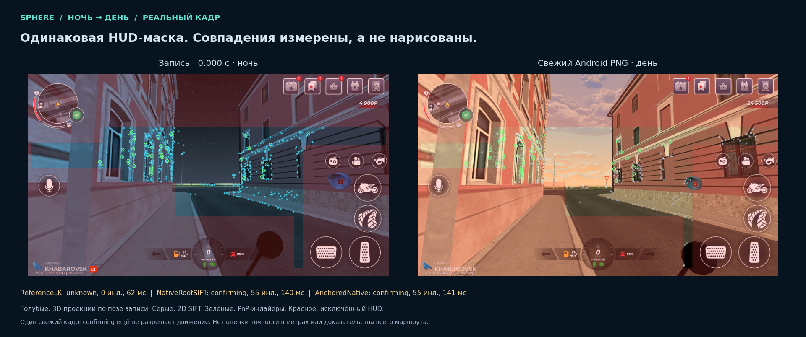

# Day/night localization failure on the real skuter1 scene

Evidence: [hashed manifest](day-night-evidence/manifest.json),
[fresh comparison](day-night-evidence/fresh-masked-comparison.json),
[sequence experiments](day-night-evidence/sequence-experiments.json),
[learned matcher experiments](day-night-evidence/learned-matcher-experiments.json),
[final direct512 proof](day-night-evidence/direct512-proof.json),
[photometric normalization](day-night-evidence/photometric-proof.json),
[installed delivery](day-night-evidence/runtime-delivery.json).

**Current boundary:** the installed changes improve diagnosis and distinguish
initial acquisition from tracking loss. The stronger day/night matchers below
remain private, unqualified experiments. Successful autonomous driving, a stable
5 Hz perception loop and capacity for hundreds of emulators are not established.

## Actual failure

The live archive `f0f98bebce2a4323af8466fe191fb8aa` belongs to the correct
historical geometry `75e491be5dff83a4566414c903cc1c666dfb96b88ca0c713e7565de102bff1aa`.
Its retained 12 JPEGs were real 960×540 gameplay frames. All returned unknown,
zero inliers and a neutral vehicle plan. Median compute was 44.09 ms, maximum
113.60 ms. The earlier resource refusal and map-selection mismatch do not explain
this new failure.

Replaying the first, middle and last retained JPEG through the actual installed
Reference-LK algorithm reproduced the failure in 78–94 ms. All three proposed
reference views retained zero LK correspondences, so no PnP pose was verified.
The scene was visibly daytime, while the map was recorded at night. Its camera
view also differed. This is a measured patch-matching failure; the data do not
isolate lighting as the only contributing factor.

## Fresh frame and HUD check

A fresh screenshot was taken with `adb exec-out screencap -p` from the only
connected Android emulator, serial `emulator-5554`, at
`2026-11-03T16:57:00.879877Z`. It was 1920×1080 and contained the game, without
a Windows title bar. No game input was sent. The server's display label “11”
was not independently mapped to that ADB serial; the visible scene matches the
reported location.

The map/query exclusion-mask arrays were byte-identical. The HUD remaining
visible in the original stream does not imply that it is admitted as feature
coordinates. The same recorded mask was used for the comparison.

Its SHA-256 is `4fc84e852a6d26135c22a84e1f8cf86959f79ccf361c1db675911c29659580b2`.
Only 132,813 of 518,400 pixels (25.6198%) remain eligible. This aggressive mask
is a separate limitation, not proof of a reference/live mask mismatch or of
optimal exclusion. Changing it requires a separately bound export and evaluation;
the current comparison did not silently change it.

| Method on the fresh frame | Result | Inliers | Compute |
| --- | --- | ---: | ---: |
| Current measured Reference-LK | Unknown | 0 | 62 ms |
| Historical native RootSIFT, actual global retrieval and PnP | Confirming | 55 | 140 ms |
| Existing native Anchored localizer | Confirming | 55 | 141 ms |

The native result had median reprojection error 0.243 px and approximately
8.068° view rotation relative to reference zero. These are internal geometric
measurements, not independent metric ground truth. A single confirming image
does not authorize movement. The scientific comparison distinguishes projected
3D points, query 2D features and actual verified correspondences.

The plot's 578 blue marks are projections of reference 3D landmarks, not 578
recognized live landmarks. The query has 450 detected 2D features, 55 PnP inliers
and 46 inlier IDs also observed by reference zero. Native correspondences use
the historical SIFT suffix-row mapping, measured pixel coordinates and reciprocal
3D tracks. The five native model file hashes were unchanged. Re-detecting nearby
pixels and assuming that they identify the same 3D landmark was not substituted
for those bindings.

## Experiments preserved, without runtime promotion

- Gradient-thumbnail retrieval plus newly detected SIFT associated within one
  pixel of native observations produced at most 15 mutual correspondences.
  This did not meet the existing 24-correspondence requirement.
- Raising query SIFT to 4096/8192 features retained the fresh result, but still
  failed the middle archived frame. The last frame reached 23 inliers, below
  the controller's 24-inlier gate.
- On all 12 archived daytime JPEGs, the unchanged native Anchored localizer
  produced three localized, five confirming and four unknown responses.
- A private variant allowed verified current-image PnP from live-to-live native
  anchor tracking during confirmation. All three fixed descriptor-age variants
  (0.8/2/5 seconds) produced four localized, five confirming and three unknown
  responses. Increasing the descriptor age did not fix frame six: its optical
  flow retained seven of 40 points. Flow computation took 7–13 ms.
- All 89 unrelated images were actually matched in the fresh-negative pass;
  no confirming/localized result was accepted. Each daytime-to-unrelated
  transition also rejected the first unrelated frame and all following 89.

The sequence experiments used an explicit virtual 0.2-second receiver cadence.
The archived source samples were approximately 0.511–0.802 seconds apart.
These experiments do not demonstrate dense real-time tracking or successful
driving. Native SIFT and private hybrid families remain unqualified for runtime
promotion; the historical geometry and installed matching gates are preserved.

One further CPU-only experiment isolated a lighter hypothesis before accepting
learned matching as necessary: three fixed normalizers (CLAHE clip 2 with 8×8
and 16×16 tiles, and global histogram equalization), each applied identically
to reference/query images, crossed with the unchanged thumbnail shortlist and
the genuine native RootSIFT global top-three shortlist. All 24 predeclared
queries on the four actual daytime fixtures were unknown, with no verified PnP
candidate. At most 19 anchors survived status, forward/backward consistency and
the frozen mask **before** applying the photometric-error threshold. Therefore
simply raising that threshold would not fix this experiment. The owned run
finished in 10.344 seconds, with no Torch/GPU, source edits or map promotion.
This result does not rule out all possible photometric tracking algorithms.

## Learned matching, latency and the final bounded variant

All variants used the pinned local LightGlue source and weights, with no
downloads. The CPU run completed only two of four predeclared fixtures within
its owned 120-second limit: approximately 53 and 56 seconds per image. The
partial result is retained as a failure of realtime performance.

GPU matching recovered strong unique geometric candidates on all four daytime
fixtures (58–111 best inliers). Warm full-query computation was approximately
343–406 ms, above the unchanged 250 ms pose freshness limit. Caching references
and reusing one SIFT pass removed duplicate work, but the 1024-query-feature
FP32 variant still took 322–353 ms. FP16 did not improve that experiment.

An asynchronous prototype used one background initializer and one latest-frame
slot, without a queue of stale queries. It published measured landmark anchors,
never an old pose. The front path tracked those anchors onto the current image
and ran absolute PnP with the original current-frame timestamp, unchanged
geometry/motion gates, 250 ms pose age and three distinct confirming images.
Its 12 front calls had median 13.85 ms and maximum 25.30 ms; all original frame
ages were at most 31 ms. Nevertheless, only one result was localized, four were
confirming and seven were unknown. Solving latency alone did not solve tracking.
The separate 89 negative images exercised the initializer, not 89 asynchronous
transition scenarios.

The final predeclared matrix reduced query attention and used four CPU cores:

| Variant | Four daytime fixtures | Timing and boundary |
| --- | --- | --- |
| One SIFT pass, 512 eligible query features, 1024 reference features, FP32 GPU | Four confirming results; 78 / 99 / 52 / 62 inliers | 207.8–250.5 ms; two receiver ages exactly 250 ms |
| Same pipeline with 768 query features | One confirming, three expired | Geometric candidates on all four; timing worse |
| Direct512, all 12 archived daytime frames | Four localized, six confirming, two unknown | Actual serial cadence 4.165 Hz; compute p50 232.97 ms, p95 254.69 ms, max 257.95 ms |
| Direct512, all 89 unrelated images | 89 unknown, zero verified PnP candidates | Every query actually executed all three matching hypotheses; five also expired |

The 250.5 ms perf-counter value can coexist with an exactly 250 ms age under
Windows monotonic clock quantization. This is a boundary acceptance with no
useful timing margin, not grounds to extend the TTL or describe stable 5 Hz.
Direct replay targeted 200 ms intervals serially; it was not an independent
5 Hz producer. Its state counts cannot be compared to the asynchronous and
virtual-clock runs as though the temporal protocols were identical.

Two residual failures are identifiable without guessing their visual cause:

- Day frame six had three candidate references, but only 8 / 10 / 12 exact
  native 3D correspondences. No PnP candidate passed. This was insufficient
  support, not a timeout.
- Day frame ten had three verified candidates with 55 / 59 / 46 inliers, but
  the original receiver age reached 265 ms. Its answer was correctly expired.

The final owned run lasted 35.875 seconds, closed all owned processes and left
107 source hashes unchanged. Peak GPU allocation was about 231 MiB (262 MiB
reserved). Minimum observed free host RAM was about 10.06 GiB. These are one
bounded experiment's measurements, not per-window resource requirements or a
fleet capacity claim. Cold startup and query-independent cache warmup are
separate from the warm timing above.

## Implementation boundary after the experiments

A supported recovery method must have its own source-bound native feature
contract, immutable shared warm model/reference caches and independent
qualification. It cannot inherit the Reference-LK receipt merely because both
use the same historical geometry. The fast live-to-live path still needs
current-image verification, bounded anchor age, source-change cancellation,
negative transitions and dense independent gameplay evaluation. A smooth
controller cannot repair an unverified visual pose by keeping the gas pressed.

The short later screen recording contained the Android launcher after the game
had closed. It was excluded from gameplay evidence. No new route recording or
return to the online start point was needed for the tests documented here.

## Diagnostic correction

The API and bounded frame archive now retain allowlisted candidate, retained-LK
and verified-PnP counts, plus finite stage timings. The existing 12-frame/2 MiB
ring preserves its first two frames and recent failure tail, so acquisition
evidence is not discarded. Raw feature arrays and descriptors are excluded.
These are the first two admitted diagnostic samples (at least 0.5 seconds
apart), not the first two frames of the original video. This worker ZIP archive
is separate from the browser's up-to-60-frame diagnostic archive.

The web distinguishes initial acquisition from loss of a previously confirmed
position. It reports “Ищем положение по ориентирам; педали отпущены” before
the first confirmed position. Diagnostic counts have a reserved-height row;
they do not change pose or input admission.

## Installed code and validation

Backend changes are committed at `1d91059f59bd3affbe1732692a8f3e3c95e9949e`.
The local API was reloaded and served
`route_localization_diagnostic_contract=bounded_stage_counts_first2_tail_v1`.
Source-bound map, reaction and pose-verification contracts were preserved; 850
protected assets and all other containers were verified unchanged. No game
input was sent.

The web is installed from `aeadc6c59883dc683bcdafb68cf89af7ddfa8e08`, image
`sha256:deff0807b2f25a069e92ee2f28d740c70ea30fc190b7acf7b3e43b9b4c86843e`.
That follow-up commit fixes bounded GitHub status readback retries in local CI,
not the route algorithm. Canonical frontend CI passed 3,256 tests in 240 suites,
TypeScript and the required packaging/probe steps. Installation verified HTTP
pages, 31 client assets and two workers; authenticated browser hydration and
driving were not acceptance checks. UI configuration, OTA and 65 other
containers were preserved. The installed matching algorithm remains
Reference-LK; the experimental LightGlue variants were not promoted.

Backend targeted validation passed 40 tests and 16 subtests. The independently
run frontend slice passed 62 tests in three suites. The CI readback change passed
33 tests and Ruff. Full raw operational receipts remain local; the published
evidence is a bounded allowlisted summary with their byte hashes.

## Primary research context

Day/night localization against a model captured under one condition is the
explicit task of the [long-term localization benchmark](https://www.visuallocalization.net/).
[HLoc](https://github.com/cvg/Hierarchical-Localization) implements hierarchical
retrieval, local feature matching and pose estimation;
[LightGlue](https://github.com/cvg/LightGlue) provides learned local matching.
Benchmark results are motivation for experiments, not evidence of success on
these game frames. No requirement to record one route per hour has been added.
