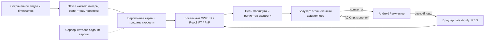
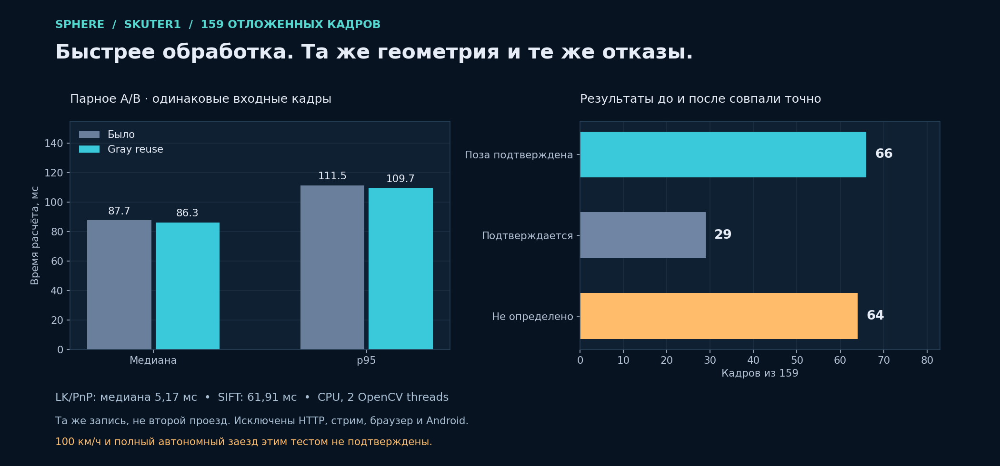
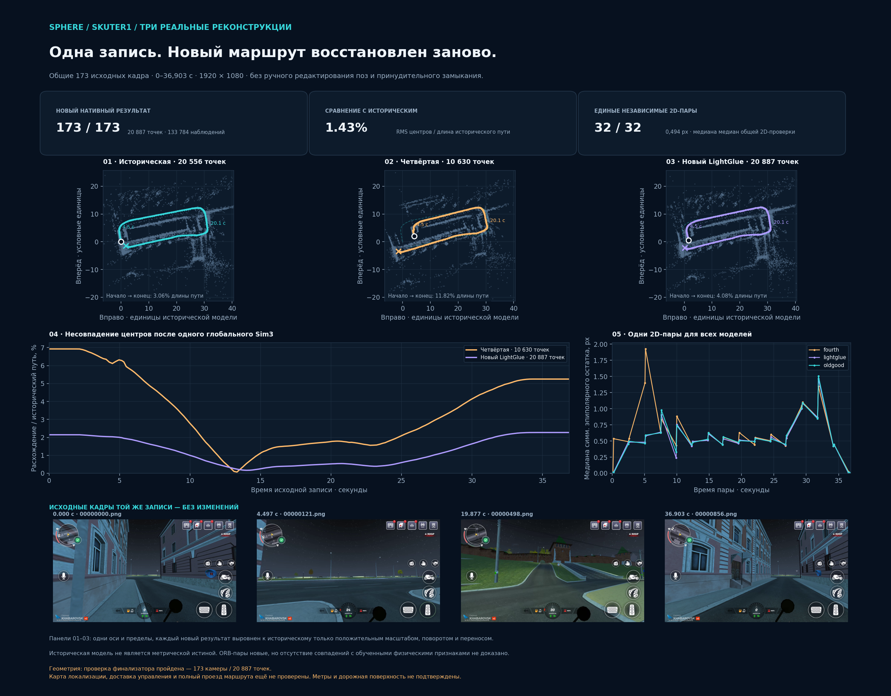
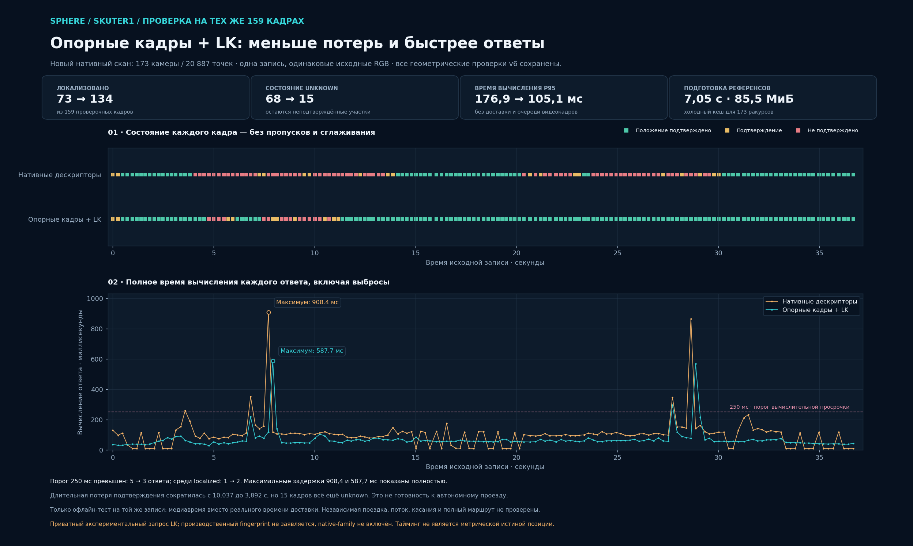

# Скорость повторения маршрута и размещение вычислений

3 ноября 2026, Asia/Yekaterinburg. Проверка исходников и сохранённых игровых
отчётов; новые игровые команды в этой проверке не отправлялись. Полный
автономный проезд, объезд препятствий и управление на 100 км/ч не подтверждены.
Предыдущая установка: [единая схема и 3D](../2026-11-02/UNIFIED-ROUTE-WORKSPACE.md).
Последующая поставка в рамках этой проверки: веб `eac17b51`, локальный API
`7c73ec3f`; новая геометрия skuter1 173 / 20 887 опубликована для просмотра.
Границы установки и отдельная проверка runtime-карты приведены в конце отчёта.

## Где работает нынешний контур

| Задача | Фактическая реализация | Предлагаемое размещение |
| --- | --- | --- |
| Сохранение исходника | Браузер получает H.264 Android, сохраняет запись; фактические FPS измеряются отдельно от запрошенного профиля | Рядом с источником; исходник и timestamps сохранять без повторного кодирования |
| Построение камер, точек и reference map | Локальный обработчик `127.0.0.1:3342` запускает отдельные CPU/native workers | Локальная ограниченная очередь либо выделенный reconstruction worker; это отдельная задача от движения |
| Свежая локализация | Браузер отправляет свежий JPEG; loopback Python выполняет RootSIFT/LK/PnP | На хосте эмулятора или рядом в LAN; перенос на удалённый сервер требует измерить полную задержку |
| Выбор цели и скорости | `WalkRouteFollower` / `VehicleRouteFollower` в том же локальном обработчике | Вместе с локализатором, с изолированным состоянием каждого агента |
| Подача стика, педалей, камеры | Браузер владеет `TeachingContacts`, контактами и сроком разрешения; Android подтверждает применение | Android выполняет ввод и аварийное освобождение; перенос всего perception в APK пока не реализован |
| Сайт и основной API | Выбор записей, устройств, результатов и управление заданиями | Сервер координирует; каждый realtime-поворот не обязан проходить через интернет |

По уточнению пользователя, default — локальная обработка на рабочей станции
с эмуляторами; удалённая подготовка остаётся опцией. Доступ браузера к локальному
обработчику требует установленного и запущенного сервиса, разрешённых Origin
и capability, а не только разрешения браузера. Сам Android остаётся лёгким
исполнителем capture/input/ACK. Это описание текущих границ и предлагаемого распределения, а не готовый
распределённый сервис. Сейчас `Jobs` допускает одну активную подготовку,
`RouteWorkspaces.live` — один общий live-сеанс. Фиксированные четыре OpenCV
threads и восемь HTTP slots не дают доказанной ёмкости сотен окон. Для этого
нужны отдельные per-agent session/mailbox, общий immutable map cache, лимиты
CPU и измерения одновременной нагрузки. Нельзя умножать результат одного
кадра на число окон и выдавать это за проверенную производительность.

## Почему 5 Гц не означает плавное управление

На 100 км/ч объект проходит 27,78 м/с, то есть 5,56 м за 200 мс. Это арифметика
скорости из HUD, не доказательство метрического масштаба SfM. Пять тяжёлых
сверок в секунду — возможная целевая частота, но её достаточно только при
приемлемых задержках, ошибках позы, запасе видимости и откалиброванном управлении.
Текущий transport default — 15 км/ч, hard cap — 30 км/ч; ограничение сохранено.

Нужны разные частоты: свежий source stream; дешёвое сопровождение видимых
ориентиров; периодическая абсолютная сверка с картой; выдача удерживаемого
стика/педали с плавным изменением цели. Старый ответ не становится свежим,
если чаще вызывать таймер. Неизвестная поза не получает разрешение на газ.
В текущем localizer абсолютная descriptor-проверка требуется не реже 0,8 с;
LK переносит подтверждённые 3D-якоря между кадрами с новым PnP. Это не воспроизведение
записанных клавиш. Работа с исходным видео в обе стороны полезна для offline
геометрии; будущее наблюдение в живой игре недоступно.

## Исправления этой проверки

1. `PilotCommandLoop` отделяет изменение стика/руля от прихода localization reply.
   При активной принятой цели он вызывает actuator с интервалом 20 мс; существующий
   slew limiter формирует промежуточные векторы. Каждый вызов сохраняет исходный
   deadline ответа. Потеря источника, neutral, abort, закрытие и expiry уничтожают
   цель; новый permit без новой цели не запускает движение. Педали остаются
   бинарными удерживаемыми контактами, без PWM и повторяющихся DOWN.
2. Возврат транспортного руля к прямому направлению теперь проходит тот же slew
   limiter. Аварийный neutral по-прежнему центрирует и освобождает сразу.
3. В CPU-supervisor подготовки и экспорта повторная проверка `poll()` после
   трёхсекундного ожидания предотвращает замену уже завершённого результата
   последующим `resource_guard`. Длительная route-only задача получает собственный
   `TaskResourceMonitor`: RAM/commit/disk читаются свежими, volume proof действует
   до 30 с и обновляется принадлежащим задаче фоновым процессом. Dense-ветка
   сохраняет прежний collector. Порогов RAM, commit, качества и отмены не снижали.
4. LK и RootSIFT используют один подготовленный grayscale текущего кадра.
   Повторный RGB→gray/resize при descriptor-проверке убран; extractor, маски,
   соответствия, PnP и пороги остаются теми же. Ограниченные stage timings
   позволяют отличать SIFT, coarse search и candidate matching/PnP.
5. Read-only `route_reactivity` дополняет анализ сохранённых отчётов: отдельно
   считает кадр→ответ, backend compute и submission→applied ACK. Повторные или
   неоднозначные native keys не спариваются. Номер source frame и native-input
   sequence принадлежат разным пространствам; их нельзя соединить ради ложной
   метрики «кадр→Android». Прореженные/обрезанные отчёты не подтверждают cadence.

Отдельный review нашёл ошибку обновления неизменившейся цели: unsent MOVE,
ожидавший ACK, сохранял старый deadline даже после принятия новой команды с
теми же округлёнными координатами. Новый permit обновляет только ожидающее
событие; уже отправленная команда и её ACK identity остаются неизменными.
Таймер с прежним permit и устаревший source этого сделать не могут.
Вторая регрессия проверяет interleaved очередь: MOVE руля → DOWN газа → новый
MOVE руля. Устаревшие unsent MOVE заменяются только внутри одного удерживаемого
жеста, через чужие контакты, сохраняя чужие deadlines и собственные DOWN/UP.
Свежий руль не продлевает старое разрешение на газ.

## Что измерено

Парная A/B-проба использовала 159 кадров `skuter1`, исключённых из списка
173 reconstruction views. Одинаковый RGB, mask, reference map, OpenCV 4.13 и
seed; порядок baseline/candidate чередовался для каждого кадра. Это та же
запись, а не независимый проезд. Clock для pose freshness синтетический;
измерение wall time включает gray/SIFT/LK/PnP, исключает HTTP/stream/browser/Android.

| Показатель | Baseline | Gray reuse |
| --- | ---: | ---: |
| Compute p50 | 87,68 мс | 86,29 мс |
| Compute p95 | 111,46 мс | 109,66 мс |
| Descriptor frame p95 | 115,46 мс | 110,67 мс |
| localized / confirming / unknown | 66 / 29 / 64 | 66 / 29 / 64 |

Публичный компактный [summary](reactivity-evidence/paired-compute-summary.json)
содержит producer/source hashes и ограничения опыта. PNG построен из измеренных
значений; ось времени начинается с нуля, чтобы не преувеличивать небольшой выигрыш.

Все 159 результатов позы, inliers, состояния, причины и прогресса совпали
точно. Сохранены 44 `route_pose_not_verified` и 20 `route_pose_discontinuity`;
ускорение не устранило потери локализации. Медианы отдельных стадий candidate:
gray 0,65 мс, SIFT 61,91 мс, coarse 7,78 мс, candidate matching/PnP 11,19 мс,
LK/PnP 5,17 мс. Это отдельные условные распределения, их нельзя складывать
как медиану одного общего пути. Sampled private максимум процесса с двумя
tracker objects — 120,48 МиБ; это не общий ресурс всех служб и не оценка capacity.

На этом Windows-хосте read-only full resource collect занял 3191,57 мс;
task-monitor admission — 1175,51 мс, пять последующих samples — 1,33–1,51 мс.
Это выигрыш надзора offline-процесса, не ускорение SfM на тысячи раз.

Повторный анализ пяти сохранённых игровых отчётов от 31 октября отделяет
новые вычислительные пробы от исторического gameplay. Например, в полном по
счётчику отчёте `d34d4383` p95 кадр→ответ — 190,87 мс, compute — 152,33 мс,
submit→applied ACK — 20,88 мс, интервалы между сохранёнными fresh/following
corrections p95 — 269,26 мс, max — 604,30 мс. Завершение:
`walk_camera_response_not_observed`. Это не скутерный тест новой версии.
В `c5ac7959` счётчик сообщает больше наблюдений, чем сохранено: большие
интервалы его прореженной выборки не доказывают длительность реальной паузы.
ACK не доказывает пройденные метры или отсутствие столкновения.

Приватные receipts: `.local-pilot/route-gray-reuse-20261103-v1/{result,summary}.json`,
`.local-pilot/route-preparation-monitor-20261103-v1/verification.json`,
`.local-pilot/route-reactivity-20261103-v1/reports.json`. Исходные видео и
historical reports не изменялись. Проверки реализации и delivery фиксируются
отдельно после завершения, без выдачи offline-пробы за live acceptance.

Публичные копии: [монитор подготовки](reactivity-evidence/preparation-monitor-verification.json),
[исторические игровые отчёты](reactivity-evidence/historical-reactivity-summary.json),
[хеши](reactivity-evidence/manifest.json). Текстовые evidence hashes используют
UTF-8 LF; вложенные producer hashes относятся к исходным приватным bytes.

## Проверка реализации и граница установки

Backend commit `71d5ac33`: 216 tests и 59 subtests PASS, OpenCV 4.13, 9,56 с.
Отключён autoload посторонних pytest plugins; `asyncio_mode` даёт одно
предупреждение конфигурации. Проверялись localization/background tracking,
supervisors, service/workspace, monitor и reactivity reports; это не полный
backend CI. CLI анализатора проверен как direct script и как `python -m`.

Frontend commit `08caf8d8`: профильные 108 tests / 7 suites PASS, TypeScript
PASS, ESLint — 0 errors / 2 прежних hook warnings. Есть настоящий
`TeachingContacts` с mock transport и медленными ACK, Workbench lease,
deadline/abort/source-loss/queue-boundary tests; Android/gameplay не запускались.
Commits отправлены в `codex/enterprise-audit-20260905`.

Read-only preflight перезагрузки API не прошёл: Windows вернул PID владельца
порта 3342 равным 0 при успешном HTTP 200. CIM показывает возможную цепочку
21156 → 21376 → 17532 (`pythonw` watchdog), отличающуюся от исторической;
сама по себе цепочка не доказывает владение портом. Helper не приобрёл handles
для завершения, не остановил процессы и не перезапустил обработчик. Это не
отказ качества карты и не `resource_guard`. Изменения backend нельзя объявить
установленными на основании только исходников или старых health contracts.
Отказ: `.local-pilot/route-runtime-delivery-20261103-v1/preflight-refusal.json`.

Полная frontend CI и установка этой версии записываются отдельным результатом;
профильные тесты сами по себе не означают, что веб уже обновлён.

### Фактическая доставка и новый прогон

Полный local frontend CI `20261102T211809Z-5bc38dd3`: **3184/3184 tests,
234 suites**, action contract, вспомогательные проверки и TypeScript PASS.
Linux image source `08caf8d891fc3efb370dac773d0f0586c2cc48aa` собран и проверен
на 26 pages / 72 assets. На 3015 установлен image
`sha256:8669e14ea1fabc6e2dd4e4ad518217fb35ba5340b43cde08bfbf2cac71b524f2`.
[Runtime proof](reactivity-evidence/web-runtime.json): healthy, сохранены 65
остальных контейнеров, полный ENV/HostConfig/Mounts и 596 существовавших assets.
31 HTTP asset совпал с файлами установленного image; два worker SHA совпали с
source. API не перезапускался; browser hydration и игровой заезд не проверялись.

Две предварительные supplemental установки откатились на прежний image:
первая не прошла точное сравнение HostConfig (полевая причина не была сохранена);
вторая прошла config guards, но файловая HTTP-проверка ошибочно трактовала
`%5Bid%5D` как имя каталога. Исправленный проверяющий код однократно декодирует
URL с проверкой допустимого пути. До третьей установки этот HTTP proof прошёл
на старом image без swap. Негативные receipts и rollback сохранены; это не
три успешных установки. Финальная третья проверка прошла с точным config guard.

При доступных ресурсах полный bounded fused v7 действительно завершился:
173/173 cameras, 14 712 points, 0–36,903 с, reprojection 0,904 px,
0 rapid reversals / 0 speed outliers. Calibrator с measured-K завершился за
0,421 с. Candidate занял 355,4 с, outer — 368 с. [Краткий результат](reactivity-evidence/v7-result-summary.json).
Это принятая геометрия, а не допущенный автономный маршрут.

Canonical adjacent export дал 2024 ориентира и 8 слабых соседств на 4,049–5,478 с
(min12 при пороге24), поэтому был отклонён. Отдельный generic guided builder
на тех же новых позах и свежих признаках дал 3067 ориентиров / 0 слабых соседств.
Baseline на тех же feature arrays совпал точно. Это экспериментальный derived
export; default builder и native-family qualification не изменены.
На 159 held-out queries получено 68 localized / 28 confirming / 63 unknown,
p95 126,77 мс. При JPEG960/92, recovery8 и wall clock обработано 157 кадров
(2 latest-only skips): 64 / 30 / 63, p95 compute207,30 мс, receiver age225,2 мс,
sampled private117,46 МиБ. Остаются участки без localized около 11,2 и 9,1 с.
Первый production-shaped harness имел будущие timestamps и исключён из выводов;
во втором исправлены ожидание clock и проверка неотрицательного entry age.
Его scheduled arrival включает задержку воспроизведения и не является точной
browser/HTTP/Android цепочкой. Эти результаты не разрешают обещать плавный проезд.

### Исправление ошибочной смены предпочтительного результата

Новый v7 был опубликован как отдельная source-bound диагностическая геометрия,
но его смена на preferred была преждевременной: formal gates не доказывают
превосходство над прежним пользовательским baseline. После обратной связи
предпочтение восстановлено побайтно на **fixed-k-fused-173-supported-diagnostic,
173 камеры / 20 556 точек**, geometry SHA `75e491be5dff83a4566414c903cc1c666dfb96b88ca0c713e7565de102bff1aa`.
V7 сохранён отдельным вариантом; старые данные не удалялись. Изменялась только
выборка просмотра, не primary/control/CANCEL/state/navigation или допуск ввода.
Publication и restore receipts находятся в `.local-pilot/skuter1-v7-publication-20261103-v1`
и `.local-pilot/skuter1-v7-preference-restore-20261103-v1`.

Одного восстановления server preference оказалось недостаточно для старого
клиента: его эвристика «больше камер» могла снова выбрать v7 при равенстве173.
Поэтому опубликованная папка v7 после проверки абсолютных путей и всех хешей
перемещена целиком в приватный архив опыта. Удаления нет. Каталог снова содержит
ровно прежние три alternatives; preferred и все 596 прежних assets сохранены.
Квитанции: `unpublish-move-receipt.json` и `unpublish-verification.json` в папке
publication. До улучшения paired evidence v7 не предлагается пользователю.

Дополнительная проверка четырёх пользовательских скриншотов установила:
83/1586 primary и 163/166 alternatives принадлежат другому job
`c667f86cc9de4a378fb12e5269981a6e`, capture `a4574c036f4149b898b12e263ef98205`
(`zaezd888`), а не `skuter1`/`6a770406`/`36ae7f3f`. Это устанавливает происхождение
геометрии, но само по себе не доказывает, какую запись пользователь выбрал:
нужны frontend source fences и видимая подпись. В NavigationRouteContext найден
выбор alternative по максимальному числу камер вместо server preferred — такой
критерий качества неверен. Исправление привязки и подписей проверяется отдельно.

Правило продолжения: хороший preferred baseline сохраняется; candidate сначала
сравнивается на том же исходнике визуально и по held-out локализации/покрытию/
стабильности. Большее число точек, отсутствие эвристических warnings и малый
reprojection error не являются разрешением заменить его. Плохой или неизвестный
результат остаётся отдельно маркированным, без автоматического переключения.

### Проверка исправленного выбора и привязки

Commit `1d3f581d` исправляет выбор и source fences; профильные 111 tests / 9 suites,
TypeScript PASS, product ESLint 0 errors / 2 прежних hook warnings. Имя записи,
capture ID и job ID видны непосредственно у живой схемы и в просмотре. Известный
source manifest SHA проверяется до принятия статуса и показа списка/геометрии.
Поздний ответ другого job не появляется под новым заголовком; старый ready status
не передаётся новому job с тем же manifest. Выбор вручную сохраняется в пределах
одной identity. Каталог выбирает server preferred, а не максимальное число камер;
до получения каталога primary не появляется промежуточно. Исторический ресурсный
отказ и порог новой задачи больше не называются замером текущей RAM.

Изолированная браузерная проверка actual React/WebGL/H.264 прошла 11/11:
прежний173/20556 выбран вместо mock-конкурента240; видна точная identity;
при смене SHA исчезают старая карта и source frame; 3D использует тот же baseline.
API замокирован, видео и геометрия читались без изменения; user IAB/profile/OPFS
не открывались, ввода в игру не было. Собственный headless browser и сервер
закрыты. Receipt: `.local-pilot/corrective-route-browser-20261103-v1/browser-evidence.json`.
PNG: `output/playwright/corrective-route-20261103-v1/`. Это проверка промежуточного
исходника; финальная установленная версия и её отдельные квитанции указаны ниже.

### Новые попытки: ошибка декодера и сохранение предыдущего результата

Две новые попытки того же `skuter1`, `7e9ce4ba…` и `2ae754f2…`, завершились
3 ноября с `ModuleNotFoundError: No module named 'av'`, ещё до SfM. Их manifest
SHA совпадает с исходной записью. Это не нехватка ОЗУ и не отказ качества видео.
`setup_reconstruction` устанавливает PyAV рядом с pinned pycolmap, отдельно от
GPU venv. После добавления раннего чтения HUD этот каталог подключался слишком
поздно — только перед SfM. Commit `58b264da` подключает тот же установленный
каталог до первого декодирования HUD и индекса; пакеты и GPU venv не менялись.

Свежий процесс AMD Python без `av` в site-packages успешно загрузил изолированный
PyAV 16.1.0, прочитал три настоящих кадра 1920×1080 и HUD 0 км/ч за 0,236 с.
Все пять исходных файлов сохранили SHA; проба остановлена до индексирования и
SfM. 60 профильных тестов прошли, включая оба порядка запуска route-only/dense.
Это проверка устранения данной ошибки запуска, не полный новый прогон маршрута.

Старый `resource_guard` у `6a770406…` относится к 1 ноября, 14:43:04.
Его итоговый snapshot и конкретная подпричина не сохранены; приписывать этот
отказ нынешней RAM или двум свежим ошибкам декодера нельзя. Отдельный v6-прогон
2 ноября действительно зафиксировал 5,918 ГиБ при пороге 6 ГиБ — это другой
запуск и не доказательство OOM. Текущая свободная DDR5 не является историческим
значением доступной памяти, commit или свободного диска.

Во время установки веба пользователь создал новую попытку: инвентарь вырос с
604 до 612 защищённых файлов. Существующие файлы и OTA не изменились. Строгая
проверка установки обнаружила изменение состава и откатила UI на прежний08c.
Новые задания не удалялись и не отменялись. Это сохранённая отрицательная
квитанция установки, а не повреждение исходного видео. Повторная установка
должна проверять свежий полный инвентарь; ослабления этого guard не было.

### Реальная четвёртая попытка и отдельный отказ карты

Пользователь запустил `f3033bb704d4460fb8ed27a613427cc1` с тем же исходным
manifest. После исправления decoder initialization она завершила SfM:
**173/173 камеры, 10 630 native-точек, 0–36,903 с**, mean reprojection 1,305 px.
Основной этап занял 245,6 с. HUD принял 836/857 наблюдений; ошибки `av` нет.
Камеры, интервалы и проверки геометрии пройдены. Исходные файлы не подменялись.

Следующий автоматический этап не использует все native-наблюдения напрямую:
он строит отдельную RootSIFT-карту для локализации свежих JPEG. Получено 2011
ориентиров. На участке **4,049–5,478 с** восемь соседств имеют менее 24
ориентиров, минимум 13, поэтому карта отклонена. Это не отсутствие камер или
кадров в исходнике и не нехватка RAM. Количество точек 3D-сцены нельзя выдавать
за количество пригодных текущему локализатору соответствий.

Native-модель прежней хорошей схемы найдена и сверена с geometry SHA `75e491…`:
173 камеры / 20 556 точек / 130 081 наблюдение / минимум 189 наблюдений на ракурс.
Пять native bin-файлов сверены по хешам. Это другая реконструкция; её модель
сохранена, не заменена новой попыткой и не принудительно замкнута в кольцо.
Подготовка runtime-карты из неё проверяется отдельно. Точность совпадения улиц
нельзя доказать одним количеством точек или красивой проекцией.

Сравнение producer receipts установило разницу алгоритмов. У хорошей модели:
объединение VID/LK и независимых SIFT-строк, 726 806 измеренных соответствий
между 1339 парами, global mapper, фильтрация 945 конфликтующих треков, robust
fixed-K BA (SOFT_L1, scale2, mintrack3), затем удаление 70 коротких треков.
У четвёртой попытки — FB-LK на 1280×720, incremental mapper и слияние компонентов;
native-модель содержит 80 377 наблюдений. 149 749 входных LK-наблюдений — другой
счётчик, не число наблюдений принятой native-модели. Fused-recovery не вызывался:
ветка запускается при отказе геометрии, но не при более позднем отказе runtime-карты.
Включение fused само по себе также не доказывает устранение descriptor-отказа.

Уточнение по первичному receipt: ранее здесь ошибочно стояло 480×270 — это
разрешение отдельного этапа отбора движения, а не SfM-трекинга. В
`prepared/database.tracks.json` четвёртой попытки указано `trackingResolution:
[1280,720]`; SHA этого файла —
`212a2634eb782d9c11309fbc9ffa06b9c408f53bd3f020c7190df26bf911cddc`.
Исходная квитанция сравнения сохранена; исправление опубликовано отдельно.

### Повторная проверка формы маршрута на одинаковых кадрах

173 положения исторической модели и четвёртой попытки привязаны к одним и тем
же исходным кадрам и timestamps. Их native-позы совпадают с соответствующими
geometry JSON без изменения матриц. Одно положительное глобальное Sim3
выравнивание, без отражения, деформации или принудительного замыкания петли,
оставляет RMS расхождения центров 4,019% длины исторического пути; p95 разницы
ориентации — 17,162°. Отношение разрыва старт/финиш к собственной длине пути
составляет 3,059% у исторической и 11,824% у четвёртой модели. Это относительное
расхождение двух решений; ни одно не объявляется метрической истиной.

На 21 короткой паре участка 3,65–5,862 с заново измерены взаимные ORB-совпадения.
Их общий для двух моделей отбор использует только новую 2D-геометрию, затем
исключает точки в пределах 1 px от ранее подогнанных наблюдений обеих моделей.
На этих 2492 парных наблюдениях старая модель имеет меньшую медианную ошибку
в 20/21 пар: медиана ошибок по парам **0,534 против 1,437 px**. На всех сырых
взаимных совпадениях без геометрического отбора вывод тот же — 20/21, 0,596
против 1,560 px. Камеры при проверке не оптимизировались; положительная глубина
сама по себе не выбирает более точную модель.

Эта проверка объясняет, почему равное количество зарегистрированных ракурсов
не гарантирует равную форму пути. Исходник тот же, это не новый независимый
заезд. Полный quantitative receipt и изображения опубликованы в
`reactivity-evidence`; исходные модели сохранены.

На одной и той же хорошей модели заново проверены три метода подготовки:

| Экспорт runtime-ориентиров | Ориентиры | Localized / 159 | p95 compute | Самая долгая потеря localized |
| --- | ---: | ---: | ---: | ---: |
| Legacy RootSIFT | 2026 | **107** | 165,75 мс | 8,232 с |
| Generic guided | 3059 | 90 | 210,28 мс | 8,665 с |
| Exact native IDs/descriptors | 3756 | 60 | 201,74 мс | 11 с |

Все 159 source index/time/RGB SHA совпали между опытами; policy v6, K, профиль
и 173 позы одинаковы. Guided устранил восемь слабых соседств, но ухудшил
локализацию; один `confirming` оказался на 7,626 с от нужного участка. Native
сохранил точные POINT3D_ID/XYZ/дескрипторы/visibility, однако 72 из 73 unknown
были no-fit. Эти варианты не опубликованы и не приняты для движения. Это
медиа-clock тест той же записи: медленные ответы нельзя считать живыми permits.

Дополнительный native-query в исходном разрешении 1920×1080 ухудшил результат:
15 localized, p95 581 мс, 147/159 вычислений дольше 250 мс; только десять
offline-localized уложились в 250 мс. Эта ветка отклонена. Проба не доказывает,
что более высокое разрешение бесполезно вообще: исторический native detector
recipe не квалифицирован, менялся только query extractor этого опыта.

Отдельная версия world-quota 8192→маска→top2048 на 960×540 дала 3136 ориентиров
и 116 offline-localized, но семь слабых соседств сохранились (min15), в 5–10 с
по-прежнему нет localized. p95 366 мс; 22 ответа превысили 250 мс. Поэтому
увеличение числа признаков не принято автоматически. Первую пробу остановило
протухание volume-health proof после timeout, при свободных 14,19 ГиБ RAM и
46,78 ГиБ диска. Повторена только query-часть в новом процессе со свежей проверкой;
TTL и guards не ослаблялись. Это не OOM и не отказ пользовательской четвёртой попытки.

[LightGlue](https://github.com/cvg/LightGlue) сопоставляет измеренные ключевые
точки между изображениями. Сам matcher не выдаёт готовый контроллер маршрута.
[COLMAP предупреждает](https://colmap.github.io/faq.html#choosing-between-sift-aliked-and-loma-features)
о несовместимости разных типов признаков. В Sphere даже для родственных SIFT
вариантов необходимы точные recipe/fingerprint и отдельная проверка query;
количество native-точек не доказывает совместимость runtime-дескрипторов.

### Временной допуск движения позы

В старом runtime bound использовалось `5 × median(reference step) × max(dt,0.2)`.
Это скрытое предположение о плотности опорных кадров. Для v7-кандидата 77 из 172
переходов самой записанной траектории превышали такой допуск при исходных
timestamps. Это проверка внутренней согласованности, не независимая истинность
геометрии. Commit `d359771d` использует кэшированную локальную скорость камеры
по source time: окно ±0,5 с возле предыдущего подтверждённого progress и явно
заданный запас 25%. Быстрый отдалённый участок не повышает допуск в медленном.
Freshness 250 мс, три подтверждения, PnP/inliers, пространственная поддержка,
коридор, угловой допуск и смена источника остаются прежними.

Парный private replay на **тех же 159 отложенных кадрах** дал 68→95 localized;
discontinuity 20→3, no-fit 42→42. Три кадра регрессировали, а 30 улучшились;
alias по времени более 2 с среди candidate-localized не обнаружен. Остаётся
разрыв 8,665 с. p95 compute 136,96→139,16 мс. Один candidate-localized в
медиа-clock проверке занял 352 мс: это **не** допустимая живая поза. Отдельная
real-clock проба 354 мс корректно вернула `route_frame_expired_during_localization`.
Медиа-clock replay не является квалификацией живого управления.

202 теста + 118 subtests по локализации, сопровождению и регуляторам прошли;
ещё 58 service-тестов проверили новый health policy. Удвоение плотности
линейно подразделённых reference-сегментов не меняет новый motion bound;
сильный скачок с проверенными соответствиями по-прежнему отклоняется.
Эта инвариантность относится только к motion bound: зависимость corridor и
ambiguity от плотности остаётся открытой. Формат/fingerprint дескрипторов
не изменён; `verificationPolicy` отдельно сообщает v6. Новая runtime-политика
сама по себе не принимает v7-геометрию и не разрешает ввод по неготовой карте.

### Прямые native-наблюдения вместо повторного поиска SIFT

Приватная проверка использовала 16 976 настоящих POINT3D_ID и 83 957 измеренных
2D-наблюдений хорошей модели. Для каждого из 173 опорных кадров выбиралось
182–512 пространственно распределённых точек внутри текущей маски. Кандидаты
находились по masked thumbnail текущего кадра (top3 по всей карте), без времени
исходника или sequence как подсказки. FB-LK переносил измеренные reference-точки
на свежую картинку; далее работали прежние PnP, image support, positive depth,
v6 motion и три подтверждения. Искусственных XYZ или дескрипторов не создавалось.

На тех же 159 отложенных кадрах получено **128 localized / 15 confirming /
16 unknown**, против 107 localized у legacy. p50/p95 66,52/137,20 мс;
максимальная потеря localized сократилась с 8,232 до 3,692 с. Два номинальных
localized заняли более 250 мс и не являются допустимыми живыми ответами.
Временных aliases >2 с нет, но независимый геймплей, полный wall-clock replay
и новые frozen-RGB negatives не проверялись. Это отдельный solver prototype,
а не qualified export существующей native-family: старый SparseRoute использован
только как неизменная привязка trace/K/profile, его support не квалифицирует
новый метод. В продукт эта ветка пока не перенесена.

Ещё один ограниченный опыт проверил миникарту без GPS-линии на тех же 159
RGB-кадрах. Измеренные ORB/RANSAC Sim2 дали 154 проверенных image-matches,
152 в пределах секунды от source-reference, но это не ошибка мировой позы.
93 «однозначных» относятся только к шести отобранным кандидатам, не ко всей
карте. BF shortlist имел p95 1415 мс и 16/159 ответов дольше 250 мс; LSH —
1467 мс и 148/159. Основной хвост пришёлся на глобальный retrieval, а не на
извлечение ORB. Причина хвоста по нагрузке ОС не доказана. Комбинация с 3D/LK
остановлена **до запуска**, поскольку один вспомогательный этап уже не прошёл
временной бюджет. Выигрыш fusion не измерен и не заявляется. GPS-нейтральный
observer в текущем продукте не заменён этим приватным прототипом.

### Промежуточная установка перед проверкой сильного реконструктора

Веб **`19ee3b847f7069f278fd720f84d0daacda5cce79` установлен на 3015**.
Canonical CI: 3204/3204 теста, 236 suites, все семь шагов и types PASS;
run `20261102T235749Z-e48d2b14`. Linux package probe: 26 страниц / 72 assets.
На установленном UI проверены две страницы, 31 asset по точным байтам и два
worker SHA. Сохранены 798 защищённых файлов, OTA, ENV/HostConfig/Mounts и все
65 остальных контейнеров. [Квитанция веба](reactivity-evidence/final-web-runtime.json).

Бэкенд загружен из **`d359771d`** и отвечает actual policy v6. Перезапускались
только подтверждённые процессы API через held creation-time handles; оба
настроенных watchdog остались прежними. PID владельца порта не выдаётся за
доказанный; ownership подтверждён точной task/venv/argv/ancestry цепочкой.
Источник, задания, состояния, CANCEL и результаты не менялись. Запрос без
capability получает 403. [Квитанция API](reactivity-evidence/final-backend-runtime.json).

В неудачной попытке теперь доступна карточка **«Предыдущий результат этой записи
сохранён»** и кнопка **«Открыть сохранённый результат»**. Это работает и после
ошибки декодера, и когда SfM завершён, а навигационная карта отклонена — как
в реальной четвёртой попытке. До явного нажатия выбранная попытка не меняется;
исходное видео видно независимо от наличия геометрии. Прошлый ресурсный отказ
подписан как сохранённый результат прошлого запуска, не текущий замер RAM.

Read-only lookup ограничен восемью известными попытками и двумя запросами
одновременно, проверяет source SHA и исключает запоздалые ответы. Capability
не попадает в DOM. Профильные проверки: 85 тестов; отдельный браузер с настоящими
двумя геометриями и H.264 прошёл 12/12. HTTP и запись OPFS в этой проверке
имитировались, пользовательский профиль и игра не затрагивались. Это не приёмка
автономного проезда. Хорошая старая схема сохранена; её просмотр не меняет
отклонённый navigation state на ready и не разрешает движение сам по себе.

## Камера, HUD и задачи следующего этапа

Пешая камера уже имеет двухосные ACK-serialized MOVE с 16-мс scheduling;
цель выбирается по свежим localization replies. Фактический cadence зависит
от ACK и кадров. Начальная калибровка gain/sign/touch-slop, большой yaw/pitch
или неопределённая поза могут требовать остановки. Новый actuator loop стика
не доказывает устранение всех этих остановок. Vehicle-режим предполагает
связанную с корпусом камеру и поворачивает транспорт рулём; независимый drag
камеры разрушил бы эту связь. В режиме свободной камеры нужна другая модель.

Миникарта и GPS-линия пока не добавлены как новый навигатор. HUD speed adapter
явно привязан к Black Russia; без подходящего speed adapter текущая транспортная
ветка не является универсальной. Внешние газ/тормоз в эмуляторе не становятся
записанными input labels: пиктограмма педали и скорость дают наблюдение с
неизвестной точностью. Скорость не определяет однозначно нажатие газа/тормоза.

Распознавание ориентиров уже использует компьютерное зрение. Для предметов
или квестов нужен дополнительный цикл detect→track→approach→interact→verify
с отдельной моделью/профилем задачи. Для объезда нужны свежие dynamic objects,
свободная поверхность, оценка дистанции и footprint/торможение транспорта.
Разреженные points и красивый Gaussian не доказывают свободный коридор.
Первый отдельный проверяемый этап — обнаружить опасное препятствие и остановить;
затем локальный обход и возвращение на подтверждённый путь. Это ещё не реализованный
в данной поставке collision layer.

## Сопоставление с готовыми методами и порядок проверки

У [Nav2 Regulated Pure Pursuit](https://docs.nav2.org/jazzy/configuration_and_development/configuration_guide/controller_plugins/configuring_regulated_pp/)
есть velocity-scaled lookahead и снижение скорости по кривизне. Их принцип
применим, но готовые настройки в метрах нельзя подставить в неизвестный SfM scale.
[Nav2 MPPI](https://docs.nav2.org/rolling/configuration_and_development/configuration_guide/controller_plugins/mppi_controller/configuring_mppic/)
оптимизирует кандидаты движения и учитывает costmap, footprint и динамику.
Он не восстанавливает необходимые данные автоматически из произвольного видео.

[FFI-VTR](https://arxiv.org/abs/2507.12800) и [код авторов](https://github.com/wangjks/FFI-VTR)
показывают другой вариант teach-and-repeat: граф ключевых кадров и минимизация
feature flow без требования плотной реконструкции. Это направление для
сравнительного offline-эксперимента, не уже подключённый controller Sphere.
[MixVPR teach-and-repeat](https://arxiv.org/abs/2610.09631) исследует более дешёвое
place recognition. Retrieval может предлагать участок карты; authority движения
должна оставаться за геометрической проверкой, чтобы похожий фасад не стал позой.

Установка проверенных исправлений выполнена. Открытый главный разрыв — экспорт
и узнавание ориентиров, а не количество нарисованных 3D-точек. Нельзя автоматически
принимать guided/native/world-quota только за формальное покрытие: измеренные
query-результаты выше показали регрессии. Прямой reference-LK требует отдельного
source-bound production-контракта, cache quotas, negative-тестов, wall-clock
проверки и сравнения с независимым игровым проходом; пока это приватный прототип.

После этого нужны replay с задержками ACK/кадра, потерями позы, остановкой/подхватом
и обеими осями камеры; независимый медленный проезд с реальными timestamps и
world-progress; затем ступенчатое повышение скорости с измерением braking/
steering response. Критерий успеха — полный маршрут без ручных повторных
запусков, а не красивая линия или большое число ACK. Новая запись сама по себе
не исправляет обнаруженные ошибки конвейера; исходный `skuter1` сохранён для
дальнейшего сравнения.

### Исправление разрыва удержания и интерактивная схема

В тесте с настоящими `PilotCommandLoop` и очередью `TeachingContacts`, fake-clock,
независимым потоком 30 FPS и ACK за 5 мс воспроизведён разрыв разрешения движения.
Поправки приходят в 5 Hz, обработка занимает 150/175/200 мс; проверены фазы
0/7/19 мс. Старый предел `min(capture+350, answer+250)` давал девять возвратов
стика в центр за каждый двухсекундный проход. Это не необходимость отпускать
контакт после каждого ракурса, а недостаточный запас между разрешениями.

Предел теперь `min(capture+450, answer+250)`: при стабильной задержке обработки
150–200 мс и ровных ответах 5 Hz остаётся 50 мс запаса до следующей поправки.
Джиттер прихода ответа уменьшает этот запас. Предел 250 мс после ответа, отказ
при возрасте ответа от 250 мс, независимый контроль свежего RGB и ACK сохранены.
Таймер не продлевает разрешение: это делает только новый принятый ответ.
Во всех девяти сценариях переход вперёд → вперёд-влево сохраняет один DOWN,
использует MOVE и не возвращает стик в центр между корректировками. Проверены
также джиттер обработки и ACK 150 мс, потеря ответа, потеря потока, истечение
разрешения и отсутствие автоматического возобновления старой команды.
Смежные 134 теста / 7 наборов проходят. Это стенд ввода, а не пройденный в игре
маршрут; остановки для проверки чувствительности камеры остаются отдельным
ограничением. Подписи camera-turning/feedback/recentering больше не утверждают,
что стик в центре: в этих стадиях квалифицированное движение может продолжаться.

2D-схема поддерживает масштаб 1–8× вокруг курсора, перетаскивание, клавиши,
«Вписать» и виды «Маршрут», «Облако + путь», «Исходные цвета». Преобразуется
только представление; исходные позы, точки и допуск управления не изменяются.
Обратное преобразование для выбора учитывает фактически отрисованный SVG,
включая переход компаса. В изолированном браузере проверены 15 действий на
реальной geometry 173/20 556 и исходном H.264: после 158% масштаба, сдвига и
поворота 90° камера 51 открывает исходный кадр 284 / 10,655 с. Перетаскивание
не вызывает seek; другая геометрия сбрасывает вид; мобильный экран 390 px
не имеет горизонтального переполнения. Пользовательский профиль, OPFS и
Android-ввод в проверке не использовались.

## Воспроизведение сильной геометрии skuter1

Старый результат 173 / 20 556 не был обычным VIDEO-only incremental SfM.
Проверены его настоящие producer receipts, feature rows и native-модели:
видеотреки объединялись с RootSIFT–LightGlue, затем использовались global SfM,
удаление конфликтующих целых треков и robust bundle adjustment с фиксированными
intrinsics. В обычной route-only ветке сильный вариант пропускался, когда
первая геометрия уже проходила минимальный gate. Кроме того, старый fused
fallback по умолчанию использовал BF, а не LightGlue. Это разные алгоритмы;
порог «пригодна для дальнейшей проверки» не означает «лучший результат».

Добавлен отдельный ограниченный backend
`pinned_rootsift_lightglue_temporal_float_loop_q512_v1` с закреплёнными кодом и
весами. Временные и нетемпоральные пары сохраняют отдельные feature namespaces;
предложения замыкания проверяются геометрически. Принудительное стягивание
начала и конца, отражение сцены, перенос камер из старой модели или ручная
правка маршрута не применялись.
Новый вариант использует CUDA для обеих групп пар; исторический использовал
CUDA для временных и CPU для шести отдельно выбранных пар. Это различие
зафиксировано, а исторический ручной список пар не перенесён в общий алгоритм.

### Что действительно вычислено

На тех же 173 исходных ракурсах получены следующие native-измерения:

| Модель | Камеры | 3D-ориентиры | Наблюдения | Медиана / p95 проекции, px |
| --- | ---: | ---: | ---: | ---: |
| Историческая удачная | 173 | 20 556 | 130 081 | 0,581 / 2,810 |
| Четвёртая обычная попытка | 173 | 10 630 | 80 377 | 1,039 / 3,167 |
| Новый LightGlue + видеотреки | 173 | 20 887 | 133 784 | 0,591 / 2,850 |

У нового результата минимум 194 подтверждённых ориентира на ракурс, ноль
повторных или неверных reciprocal observations и ноль nonpositive depth.
Каждая поза, intrinsic, XY и сохранённая XYZ проверены на неизменность при
финализации; записанная native-модель перечитана и сравнена с исходной.
Это проверка внутренней геометрии, не точность в игровых метрах.

Общая проверка использует один замороженный набор 32 временно выбранных пар
из 48 кадров для всех трёх моделей. Новые ORB-соответствия не использовались
для подгонки проверяемых поз; исключены HUD и полный footprint descriptor.
Физическая новизна признаков относительно training не доказана, поэтому это
диагностика, а не независимая приёмка управления. Медиана медиан по одинаково
отфильтрованным 2D-парам: 0,537 px у четвёртой попытки, 0,495 у старой удачной
и 0,494 у новой. Новый результат лучше четвёртого на 22/32 парах. Отличие от
старого мало; на raw-парах старый немного лучше. Заявления «новый всегда лучше»
или «точность 99%» эти данные не поддерживают.

Для сравнения формы применён только один proper Sim3 к целой модели.
RMS различия центров, нормированный на длину исторического пути: 4,019% для
четвёртой попытки и 1,434% для нового результата. Старый путь не является
ground truth; этот процент нельзя трактовать как физическую ошибку проезда.
Остаток между началом и концом не был принудительно стянут.

### Найденные отказы и фактические ресурсы

Первый свежий LightGlue-прогон построил 873 пары и объединённые 727 214
соответствий, но остановился на ограничении времени `view_graph_calibrator`.
Это не OOM. Проверенный same-source prior нельзя брать из модели после
ENDPOINT_LK: четыре новых observation namespaces не совпадают с исходной БД.
До восстановления концов есть корректная модель 169 / 10 630 с точным
соответствием строк; только она использована для numeric intrinsics prior.

Уточнённая политика пропускает calibrator только для LightGlue-кандидата,
когда строгий same-source numeric prior действительно применён. Native
verification выполняется после его установки; global mapper уточняет focal.
Для BF и неподтверждённого prior прежний calibrator сохраняется. Это соответствует
[рекомендации COLMAP](https://colmap.github.io/faq.html#choosing-between-incremental-global-and-hierarchical-sfm):
global SfM требует хороших focal priors; calibrator нужен при отсутствии
надёжных intrinsics и изменяет БД, поэтому работа ведётся на копии.

Повторный native этап использовал проверенный cache первого свежего matching,
а не повторно вычислял LightGlue. Global mapper: 94,875 с / peak private около
515 МиБ; BA: 23,438 с / около 303 МиБ. Затем обнаружен отдельный TypeError:
native rejected pair `(rows=0, cols=2, data=NULL)` ошибочно читался через
`np.frombuffer(None)`. Парсер исправлен; повреждённые непустые строки по-прежнему
отклоняются. 75 профильных тестов и Ruff прошли.

Уже вычисленная BA-модель финализирована отдельно за 10,234 с без Torch,
повторной оптимизации и изменения измерений. Всё дерево процессов закрыто;
минимум свободной памяти в ходе этого опыта — 12,72 ГиБ RAM и 25,93 ГиБ commit.
Это не замер текущего состояния машины. Первые ошибочные receipts
сохранены; итог нельзя описывать как один холодный бесшовный production-прогон.

### Каталог и оставшийся автоматический переход

Новый source-bound вариант `lightglue-fused-173-20887-review` добавлен в обе
связанные попытки `skuter1` как схема для просмотра. У исходной попытки
предпочтительный старый вариант 20 556 сохранён. У четвёртой попытки прежде
не было diagnostic preference; при новом выборе записи доступен новый вариант.
Ручной выбор пользователя не сбрасывается. Primary, navigation state,
исходное видео и модели не заменялись. Производственные read-only handlers
проверили обе схемы; authenticated HTTP и пользовательская OPFS-сессия отдельно
не проверены. Схема доступна в каталоге, это не допуск управления.

Общий automatic route-only путь пока не выбирает этот LightGlue backend:
он всё ещё пропускает fused, если базовая геометрия принята. Нельзя скрыть этот
разрыв подписью «готово». Следующий production-переход должен сравнивать один
ограниченный сильный кандидат с сохранённым baseline до ENDPOINT_LK, сохранять
backend/calibration/source fingerprints и отдельно проверять фактическую карту
локализатора на свежих кадрах. Только число точек или красивый рисунок не дают
права подменить baseline и включить газ. Локализация, камера и полный live-проезд
новой модели на момент этого геометрического отчёта не квалифицированы.

### Проверка runtime-экспорта новой геометрии

После этого геометрического отчёта выполнен отдельный приватный опыт:
неизменённый native exporter получил проверенную производную финализатора.
Это не обычный selected-engine результат: исходный failed receipt скопирован
побайтно с `accepted=false`, происхождение явно обозначено `derived_finalizer`.
Успешная геометрическая финализация не переписана задним числом в успешное
выполнение всего конвейера. Точные hashes моделей, feature rows, masks,
extractor и source frames проверены перед экспортом.

Получены 3 837 native-ориентиров. У всех 173 reference views теперь достаточно
статической поддержки: минимум 27 на ракурс, 66 в окрестности, слабых интервалов
по существующему support gate нет. Но фактический localizer на тех же 159
неотобранных исходных RGB-кадрах дал только 73 localized / 18 confirming /
68 unknown. Это хуже старого обычного rebuilt-RootSIFT варианта 107 / 12 / 40,
хотя лучше прежнего native варианта 60 / 26 / 73. В новой карте остаются
длительные потери локализации в частях 4–14 и 20–30 секунд.

p50/p95 compute — 103,14 / 176,91 мс, максимум 908,42 мс; пять кадров превысили
250 мс даже без транспорта/браузерной задержки, включая один localized.
Временное расхождение одного localized кадра — 2,163 с; остановки в конце
записи не позволяют считать это пространственной ошибкой без ground truth.
Этот replay одной записи не является независимым игровым сеансом.

Весь опыт занял 53,812 с, peak private около 341 МиБ, Torch не импортировался.
558 защищённых source hashes не изменились, все принадлежащие процессы закрыты.
Runtime-кандидат не принят и не установлен для движения. Слабое место теперь
измерено: даже достаточная поддержка сохранённых ракурсов не гарантирует,
что выбранное семейство дескрипторов найдёт их на свежем кадре. Нельзя лечить
это простым снятием support gate или увеличением таймера удержания газа.

### Прямое сопровождение измеренных ориентиров: новый сравнительный опыт

Отдельно проверен тот же ранее замороженный private Reference-LK класс на
новых 20 887 native-ориентирах. Он берёт настоящие `image.points2D` и
`POINT3D_ID → XYZ`, максимум 512 пространственно распределённых наблюдений на
reference. Thumbnail текущего кадра предлагает top3 по всей карте; затем
измерения переносятся forward/backward LK и проходят прежние PnP/image/v6
проверки. Время исходного query и номер ответа не использовались для поиска.
Дескрипторы или новые XYZ не синтезировались; классу не передавалась правильная
позиция из видео. Это отдельный private query fingerprint, не нынешний
production localizer.

| На одинаковых 159 query | Native-дескрипторы | Прямой Reference-LK |
| --- | ---: | ---: |
| Ответы localized / confirming / unknown | 73 / 18 / 68 | 134 / 10 / 15 |
| p50 / p95 compute, мс | 103,14 / 176,91 | 58,08 / 105,14 |
| Максимум compute, мс | 908,42 | 587,69 |
| Compute больше 250 мс, всего / localized | 5 / 1 | 3 / 2 |

Все состояния и timings доступны в [общей выборке](reactivity-evidence/reference-lk-same159-comparison.json).
Самая долгая потеря localized сократилась с 10,037 до 3,892 с; это всё ещё
недостаточно для непрерывного управления без остановки.

Холодная подготовка 173 reference grayscale заняла 7,047 с; cache — 85,5 МиБ,
минимум 188 настоящих native-наблюдений на ракурс. Query phase — около 20 с;
всё дерево процесса — 30,672 с / peak private около 303 МиБ. В ходе сравнения
query RGB, source/model hashes и solver gates не менялись. Сценарий первой
попытки завершился до query из-за повторного keyword в harness; её отрицательный
receipt сохранён, единственная фактическая выборка 159 query выполнена новой
попыткой после исправления этой опечатки. Cold cache создан заново.

Это улучшение измерений, но не готовность к включению: 15 unknown остаются,
два localized вычислялись дольше 250 мс. Проигрывание использует media clock
одного исходника; отрицательные сцены, независимый gameplay, полная
Android→decision→ACK задержка и непрерывное управление не проверены. Native
family не включена, production fingerprint и основная runtime-карта не
подменены. Перенос должен сохранить точные source-bound reference rows,
ограниченный общий cache, проверки ложного узнавания и прежние сроки разрешения
ввода; иначе скорость может быть получена ценой неверной позы.

## Последняя проверенная поставка этой работы

Веб `eac17b51` установлен на `127.0.0.1:3015`. Его CI: 237 suites / 3 229 tests,
без падений; TypeScript и lint входят в проверенный build. OCI index, manifest
и config проверены раздельно. Две отданные страницы, 31 client asset и два
worker совпали с установленным image по bytes/SHA. Сохранены приложение,
ENV/mounts/OTA и 65 остальных контейнеров; image tarball не создавался.
Приёмка интерактивной карты 15/15 выполнена отдельно в изолированном браузере,
а не в пользовательском OPFS-профиле.

Локальный API перезагружен из `7c73ec3f`. Повторно проверены 28 source hashes,
health с `source_bound_recipe_admission_v1` и фактическая policy v6. Только два
принадлежащих этому компоненту процесса заменены через точную цепочку
scheduled task / argv / interpreter / creation time; watchdog сохранён.
803 защищённых файла и все 66 контейнеров не изменились. Отсутствующая job
capability по-прежнему получает 403; порт сам по себе не считался доказательством
владения процессом. Это установка исправлений, а не приёмка автономного проезда.

Квитанции: [веб](reactivity-evidence/quality-web-runtime.json),
[API](reactivity-evidence/quality-api-runtime.json),
[финализация 3D](reactivity-evidence/lightglue-native-finalization.json),
[одинаковые пары кадров](reactivity-evidence/lightglue-common-pair-diagnostics.json),
[каталог](reactivity-evidence/lightglue-diagnostic-catalog-publication.json),
[runtime replay](reactivity-evidence/lightglue-native-runtime-replay.json).
