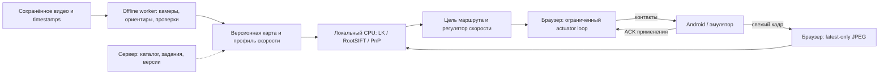

# Скорость повторения маршрута и размещение вычислений

3 ноября 2026, Asia/Yekaterinburg. Проверка исходников и сохранённых игровых
отчётов; новые игровые команды в этой проверке не отправлялись. Полный
автономный проезд, объезд препятствий и управление на 100 км/ч не подтверждены.
Предыдущая установка: [единая схема и 3D](../2026-11-02/UNIFIED-ROUTE-WORKSPACE.md).

## Где работает нынешний контур

| Задача | Фактическая реализация | Предлагаемое размещение |
| --- | --- | --- |
| Сохранение исходника | Браузер получает H.264 Android, сохраняет запись; фактические FPS измеряются отдельно от запрошенного профиля | Рядом с источником; исходник и timestamps сохранять без повторного кодирования |
| Построение камер, точек и reference map | Локальный обработчик `127.0.0.1:3342` запускает отдельные CPU/native workers | Локальная ограниченная очередь либо выделенный reconstruction worker; это отдельная задача от движения |
| Свежая локализация | Браузер отправляет свежий JPEG; loopback Python выполняет RootSIFT/LK/PnP | На хосте эмулятора или рядом в LAN; перенос на удалённый сервер требует измерить полную задержку |
| Выбор цели и скорости | `WalkRouteFollower` / `VehicleRouteFollower` в том же локальном обработчике | Вместе с локализатором, с изолированным состоянием каждого агента |
| Подача стика, педалей, камеры | Браузер владеет `TeachingContacts`, контактами и сроком разрешения; Android подтверждает применение | Android выполняет ввод и аварийное освобождение; перенос всего perception в APK пока не реализован |
| Сайт и основной API | Выбор записей, устройств, результатов и управление заданиями | Сервер координирует; каждый realtime-поворот не обязан проходить через интернет |

По уточнению пользователя, default — локальная обработка на рабочей станции
с эмуляторами; удалённая подготовка остаётся опцией. Доступ браузера к локальному
обработчику требует установленного и запущенного сервиса, разрешённых Origin
и capability, а не только разрешения браузера. Сам Android остаётся лёгким
исполнителем capture/input/ACK. Это описание текущих границ и предлагаемого распределения, а не готовый
распределённый сервис. Сейчас `Jobs` допускает одну активную подготовку,
`RouteWorkspaces.live` — один общий live-сеанс. Фиксированные четыре OpenCV
threads и восемь HTTP slots не дают доказанной ёмкости сотен окон. Для этого
нужны отдельные per-agent session/mailbox, общий immutable map cache, лимиты
CPU и измерения одновременной нагрузки. Нельзя умножать результат одного
кадра на число окон и выдавать это за проверенную производительность.

## Почему 5 Гц не означает плавное управление

На 100 км/ч объект проходит 27,78 м/с, то есть 5,56 м за 200 мс. Это арифметика
скорости из HUD, не доказательство метрического масштаба SfM. Пять тяжёлых
сверок в секунду — возможная целевая частота, но её достаточно только при
приемлемых задержках, ошибках позы, запасе видимости и откалиброванном управлении.
Текущий transport default — 15 км/ч, hard cap — 30 км/ч; ограничение сохранено.

Нужны разные частоты: свежий source stream; дешёвое сопровождение видимых
ориентиров; периодическая абсолютная сверка с картой; выдача удерживаемого
стика/педали с плавным изменением цели. Старый ответ не становится свежим,
если чаще вызывать таймер. Неизвестная поза не получает разрешение на газ.
В текущем localizer абсолютная descriptor-проверка требуется не реже 0,8 с;
LK переносит подтверждённые 3D-якоря между кадрами с новым PnP. Это не воспроизведение
записанных клавиш. Работа с исходным видео в обе стороны полезна для offline
геометрии; будущее наблюдение в живой игре недоступно.

## Исправления этой проверки

1. `PilotCommandLoop` отделяет изменение стика/руля от прихода localization reply.
   При активной принятой цели он вызывает actuator с интервалом 20 мс; существующий
   slew limiter формирует промежуточные векторы. Каждый вызов сохраняет исходный
   deadline ответа. Потеря источника, neutral, abort, закрытие и expiry уничтожают
   цель; новый permit без новой цели не запускает движение. Педали остаются
   бинарными удерживаемыми контактами, без PWM и повторяющихся DOWN.
2. Возврат транспортного руля к прямому направлению теперь проходит тот же slew
   limiter. Аварийный neutral по-прежнему центрирует и освобождает сразу.
3. В CPU-supervisor подготовки и экспорта повторная проверка `poll()` после
   трёхсекундного ожидания предотвращает замену уже завершённого результата
   последующим `resource_guard`. Длительная route-only задача получает собственный
   `TaskResourceMonitor`: RAM/commit/disk читаются свежими, volume proof действует
   до 30 с и обновляется принадлежащим задаче фоновым процессом. Dense-ветка
   сохраняет прежний collector. Порогов RAM, commit, качества и отмены не снижали.
4. LK и RootSIFT используют один подготовленный grayscale текущего кадра.
   Повторный RGB→gray/resize при descriptor-проверке убран; extractor, маски,
   соответствия, PnP и пороги остаются теми же. Ограниченные stage timings
   позволяют отличать SIFT, coarse search и candidate matching/PnP.
5. Read-only `route_reactivity` дополняет анализ сохранённых отчётов: отдельно
   считает кадр→ответ, backend compute и submission→applied ACK. Повторные или
   неоднозначные native keys не спариваются. Номер source frame и native-input
   sequence принадлежат разным пространствам; их нельзя соединить ради ложной
   метрики «кадр→Android». Прореженные/обрезанные отчёты не подтверждают cadence.

Отдельный review нашёл ошибку обновления неизменившейся цели: unsent MOVE,
ожидавший ACK, сохранял старый deadline даже после принятия новой команды с
теми же округлёнными координатами. Новый permit обновляет только ожидающее
событие; уже отправленная команда и её ACK identity остаются неизменными.
Таймер с прежним permit и устаревший source этого сделать не могут.
Вторая регрессия проверяет interleaved очередь: MOVE руля → DOWN газа → новый
MOVE руля. Устаревшие unsent MOVE заменяются только внутри одного удерживаемого
жеста, через чужие контакты, сохраняя чужие deadlines и собственные DOWN/UP.
Свежий руль не продлевает старое разрешение на газ.

## Что измерено

Парная A/B-проба использовала 159 кадров `skuter1`, исключённых из списка
173 reconstruction views. Одинаковый RGB, mask, reference map, OpenCV 4.13 и
seed; порядок baseline/candidate чередовался для каждого кадра. Это та же
запись, а не независимый проезд. Clock для pose freshness синтетический;
измерение wall time включает gray/SIFT/LK/PnP, исключает HTTP/stream/browser/Android.

| Показатель | Baseline | Gray reuse |
| --- | ---: | ---: |
| Compute p50 | 87,68 мс | 86,29 мс |
| Compute p95 | 111,46 мс | 109,66 мс |
| Descriptor frame p95 | 115,46 мс | 110,67 мс |
| localized / confirming / unknown | 66 / 29 / 64 | 66 / 29 / 64 |

Публичный компактный [summary](reactivity-evidence/paired-compute-summary.json)
содержит producer/source hashes и ограничения опыта. PNG построен из измеренных
значений; ось времени начинается с нуля, чтобы не преувеличивать небольшой выигрыш.

Все 159 результатов позы, inliers, состояния, причины и прогресса совпали
точно. Сохранены 44 `route_pose_not_verified` и 20 `route_pose_discontinuity`;
ускорение не устранило потери локализации. Медианы отдельных стадий candidate:
gray 0,65 мс, SIFT 61,91 мс, coarse 7,78 мс, candidate matching/PnP 11,19 мс,
LK/PnP 5,17 мс. Это отдельные условные распределения, их нельзя складывать
как медиану одного общего пути. Sampled private максимум процесса с двумя
tracker objects — 120,48 МиБ; это не общий ресурс всех служб и не оценка capacity.

На этом Windows-хосте read-only full resource collect занял 3191,57 мс;
task-monitor admission — 1175,51 мс, пять последующих samples — 1,33–1,51 мс.
Это выигрыш надзора offline-процесса, не ускорение SfM на тысячи раз.

Повторный анализ пяти сохранённых игровых отчётов от 31 октября отделяет
новые вычислительные пробы от исторического gameplay. Например, в полном по
счётчику отчёте `d34d4383` p95 кадр→ответ — 190,87 мс, compute — 152,33 мс,
submit→applied ACK — 20,88 мс, интервалы между сохранёнными fresh/following
corrections p95 — 269,26 мс, max — 604,30 мс. Завершение:
`walk_camera_response_not_observed`. Это не скутерный тест новой версии.
В `c5ac7959` счётчик сообщает больше наблюдений, чем сохранено: большие
интервалы его прореженной выборки не доказывают длительность реальной паузы.
ACK не доказывает пройденные метры или отсутствие столкновения.

Приватные receipts: `.local-pilot/route-gray-reuse-20261103-v1/{result,summary}.json`,
`.local-pilot/route-preparation-monitor-20261103-v1/verification.json`,
`.local-pilot/route-reactivity-20261103-v1/reports.json`. Исходные видео и
historical reports не изменялись. Проверки реализации и delivery фиксируются
отдельно после завершения, без выдачи offline-пробы за live acceptance.

Публичные копии: [монитор подготовки](reactivity-evidence/preparation-monitor-verification.json),
[исторические игровые отчёты](reactivity-evidence/historical-reactivity-summary.json),
[хеши](reactivity-evidence/manifest.json). Текстовые evidence hashes используют
UTF-8 LF; вложенные producer hashes относятся к исходным приватным bytes.

## Проверка реализации и граница установки

Backend commit `71d5ac33`: 216 tests и 59 subtests PASS, OpenCV 4.13, 9,56 с.
Отключён autoload посторонних pytest plugins; `asyncio_mode` даёт одно
предупреждение конфигурации. Проверялись localization/background tracking,
supervisors, service/workspace, monitor и reactivity reports; это не полный
backend CI. CLI анализатора проверен как direct script и как `python -m`.

Frontend commit `08caf8d8`: профильные 108 tests / 7 suites PASS, TypeScript
PASS, ESLint — 0 errors / 2 прежних hook warnings. Есть настоящий
`TeachingContacts` с mock transport и медленными ACK, Workbench lease,
deadline/abort/source-loss/queue-boundary tests; Android/gameplay не запускались.
Commits отправлены в `codex/enterprise-audit-20260905`.

Read-only preflight перезагрузки API не прошёл: Windows вернул PID владельца
порта 3342 равным 0 при успешном HTTP 200. CIM показывает возможную цепочку
21156 → 21376 → 17532 (`pythonw` watchdog), отличающуюся от исторической;
сама по себе цепочка не доказывает владение портом. Helper не приобрёл handles
для завершения, не остановил процессы и не перезапустил обработчик. Это не
отказ качества карты и не `resource_guard`. Изменения backend нельзя объявить
установленными на основании только исходников или старых health contracts.
Отказ: `.local-pilot/route-runtime-delivery-20261103-v1/preflight-refusal.json`.

Полная frontend CI и установка этой версии записываются отдельным результатом;
профильные тесты сами по себе не означают, что веб уже обновлён.

## Камера, HUD и задачи следующего этапа

Пешая камера уже имеет двухосные ACK-serialized MOVE с 16-мс scheduling;
цель выбирается по свежим localization replies. Фактический cadence зависит
от ACK и кадров. Начальная калибровка gain/sign/touch-slop, большой yaw/pitch
или неопределённая поза могут требовать остановки. Новый actuator loop стика
не доказывает устранение всех этих остановок. Vehicle-режим предполагает
связанную с корпусом камеру и поворачивает транспорт рулём; независимый drag
камеры разрушил бы эту связь. В режиме свободной камеры нужна другая модель.

Миникарта и GPS-линия пока не добавлены как новый навигатор. HUD speed adapter
явно привязан к Black Russia; без подходящего speed adapter текущая транспортная
ветка не является универсальной. Внешние газ/тормоз в эмуляторе не становятся
записанными input labels: пиктограмма педали и скорость дают наблюдение с
неизвестной точностью. Скорость не определяет однозначно нажатие газа/тормоза.

Распознавание ориентиров уже использует компьютерное зрение. Для предметов
или квестов нужен дополнительный цикл detect→track→approach→interact→verify
с отдельной моделью/профилем задачи. Для объезда нужны свежие dynamic objects,
свободная поверхность, оценка дистанции и footprint/торможение транспорта.
Разреженные points и красивый Gaussian не доказывают свободный коридор.
Первый отдельный проверяемый этап — обнаружить опасное препятствие и остановить;
затем локальный обход и возвращение на подтверждённый путь. Это ещё не реализованный
в данной поставке collision layer.

## Сопоставление с готовыми методами и порядок проверки

У [Nav2 Regulated Pure Pursuit](https://docs.nav2.org/jazzy/configuration_and_development/configuration_guide/controller_plugins/configuring_regulated_pp/)
есть velocity-scaled lookahead и снижение скорости по кривизне. Их принцип
применим, но готовые настройки в метрах нельзя подставить в неизвестный SfM scale.
[Nav2 MPPI](https://docs.nav2.org/rolling/configuration_and_development/configuration_guide/controller_plugins/mppi_controller/configuring_mppic/)
оптимизирует кандидаты движения и учитывает costmap, footprint и динамику.
Он не восстанавливает необходимые данные автоматически из произвольного видео.

[FFI-VTR](https://arxiv.org/abs/2507.12800) и [код авторов](https://github.com/wangjks/FFI-VTR)
показывают другой вариант teach-and-repeat: граф ключевых кадров и минимизация
feature flow без требования плотной реконструкции. Это направление для
сравнительного offline-эксперимента, не уже подключённый controller Sphere.
[MixVPR teach-and-repeat](https://arxiv.org/abs/2610.09631) исследует более дешёвое
place recognition. Retrieval может предлагать участок карты; authority движения
должна оставаться за геометрической проверкой, чтобы похожий фасад не стал позой.

Дальше: установить проверенные исправления; replay с задержками ACK/кадра,
потерями позы, остановкой/подхватом и обеими осями камеры; независимый медленный
проезд с реальными timestamps и world-progress; затем ступенчато повышать
скорость с измерением braking/steering response. Считать успехом полный маршрут
без ручных повторных запусков, а не красивую линию или большое число ACK.
