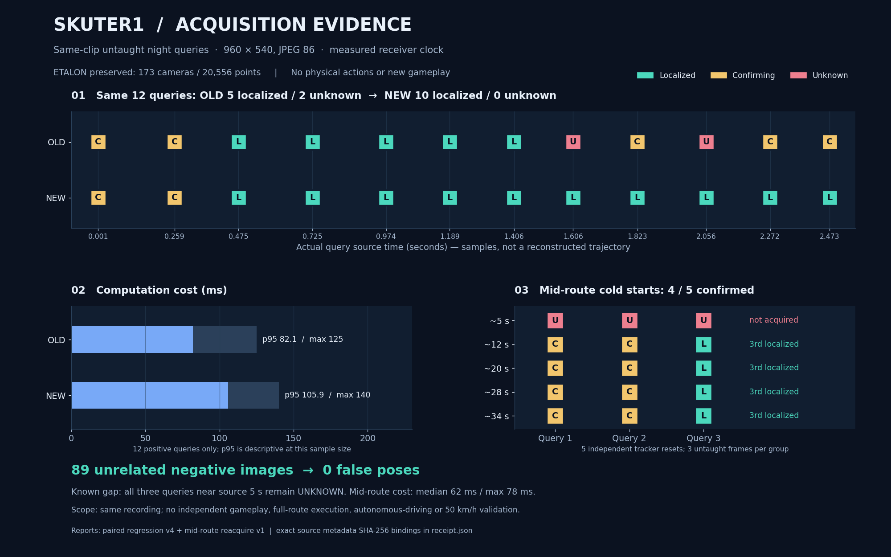

# skuter1: подтверждение текущей позы, старт и владелец ввода

**Измерения и исправление 4 ноября 2026 года.** Приоритет — сопровождение по
неизменённому пользовательскому эталону skuter1. Реальные кадры исходной
записи и синтетические проверки контроллера обозначены отдельно. Это не
отчёт об успешном автономном заезде.

Эталон: `fixed-k-fused-173-supported-diagnostic`, 173 камеры / 20 556 точек /
130 081 native-наблюдение; geometry SHA-256
`75e491be5dff83a4566414c903cc1c666dfb96b88ca0c713e7565de102bff1aa`.
Capture `36ae7f3f42f84dd99cd60d18de852409`, manifest SHA-256
`22b319e094981dbc8e737984b956c71ed6faa8a7db3d3782d4f91942d6e71fbc`.
Геометрия, исходные кадры и сохранённый профиль не изменялись.

Предыдущая отдельная дневная проблема описана в
[DAY-NIGHT-LOCALIZATION](DAY-NIGHT-LOCALIZATION.md). Её отказ с нулевыми
соответствиями нельзя автоматически переносить на новый ночной случай.

## Что устанавливает пользовательский ночной снимок

В присланном ночном случае отображались примерно 174 соответствия и время
около 91 мс; это свидетельство интерфейса, а не сохранённая полная серверная
трасса. **Поле `poseReason` этого конкретного запроса до новой metadata-записи
не установлено.** Одного счётчика недостаточно для выбора между проверкой
движения, возрастом, подтверждением последовательности и состоянием ввода.
История сообщений на экране также не доказывает текущее состояние сессии.

Раздельно исследуются четыре границы: реальные геометрические соответствия,
допуск текущей позы, накопление подтверждений и право текущего владельца ввода.
Ни один из результатов ниже не объявляется единственной причиной скриншота.

## Ранний опыт: только короткое окно подтверждений

Локальная первичная квитанция:
`.local-pilot/skuter1-confirmation-regression-20261104-v1/report.json`,
SHA-256 `5f5bff65f9b06fb45aa465e048f7856c00deb5bb6e4a495960b00f4d32dd76c9`.
Исполненная копия нового wrapper сохранена рядом как
`executed-route-confirmation.py`; описание относится к этой исполненной версии.

Использованы 12 настоящих **необученных** кадров исходной ночной записи,
resize 960×540 → JPEG86 → decode, фактические wall/receiver clocks, без
подсказки исходного времени локализатору. Это replay той же записи, не свежий
live-проезд и не независимая игровая приёмка. Эталон, route/cache и пять native
файлов сохранили хеши. Owned runner закрыт с exit 0 за 7.468 с; сам опыт —
4.485 с, физических команд 0.

| Вариант | localized / confirming / unknown | Compute min / median / max |
| --- | --- | --- |
| Прежний Reference-LK | 6 / 4 / 2 | 31 / 39.5 / 63 мс |
| Wrapper 3 valid из 5 за ≤1 с | 5 / 5 / 2 | 31 / 47 / 62 мс |

Эта небольшая парная выборка **не демонстрирует общего улучшения** количества
локализованных ответов. Она показывает, что жёсткие текущие gate не обойдены.
Проверка нескольких валидных кадров допускает мягкий пропуск в коротком окне;
неизвестный текущий кадр не получает право движения от старого результата.

Два оставшихся ответа `unknown` имеют установленную причину
`route_pose_discontinuity`, несмотря на хорошие PnP-кандидаты:

| Source index / время | До temporal gate | Измеренная граница |
| --- | --- | --- |
| 40 / 1.606 с | 512 inliers, median error 0.09495 px | center delta 0.000240609 при limit 0.000238632; progress delta 0 |
| 51 / 2.056 с | 503 inliers, median error 0.12034 px | center delta 0.000771310, progress delta 0.001565631 при limit 0.000238632 |

Это отдельный вопрос к envelope на почти неподвижном начале и переходе к
движению. В данной работе floor/порог не расширялся, позы не сглаживались и
камера не перемещалась программно. Значения даны в собственном масштабе SfM,
не в метрах. Нужна отдельная проверка неопределённости, а не ослабление gate
по одному красивому PnP-результату.

## Проверка оценки неопределённости

На девяти настоящих reference-наборах отдельно проверен Jacobian проекции
относительно локальной позы, с масштабированием translation по медианной
положительной глубине. Этот статический опыт не выполняет новый PnP и не
даёт движение. Первичная квитанция:
`.local-pilot/skuter1-pnp-uncertainty-static-20261104-v1/outcome.json`.
Все 13 защищённых исходных хешей сохранились; owned runner закрылся за 2.375 с
при ограничении CPU2 / 1 ГиБ, пиковый owned commit около 60.5 МиБ.

У reference 0 (512 наблюдений, медианный остаток 0.07857 px) условная оценка
3σ центра равна 0.00108027 собственных единиц. Но first-order bound с
полностью коррелированными ошибками координат ±0.5 px равен 0.01785221 —
больше cap 0.00456847 (1% медианного ненулевого шага маршрута). Все девять
наборов превышают cap. Поэтому этот helper **не включён в runtime** и не
использован для расширения допуска. Маленькая covariance при предположении
независимого шума не объявляется гарантией точности.

Основание различать обусловленность, модель шума и реальную точность:
[Ceres: covariance estimation](https://ceres-solver.readthedocs.io/latest/nnls_covariance.html).
[OpenCV: projectPoints](https://docs.opencv.org/4.x/d9/d0c/group__calib3d.html)
описывает производные проекции по rotation/translation и параметрам камеры.
Эти источники объясняют метод; они не подтверждают точность этой игровой карты.

## Проверка возможного deadlock при HUD 0

Вызван настоящий `VehicleRouteFollower` с реально загруженными Reference-LK
route/cache, source-bound вращениями эталона и полным genuine
`vehicle-speed-reference` исходного job `6a77040681d142ec97d51831a22785fb`.
Route SHA-256 — `b18ec0e33e9297728e6760c702e97567bed074fb5f0094e76c33f58f4cc801a0`.

**Поза `localized` и текущие HUD0 readings в этом вызове — явно синтетическая
логическая fixture**, привязанная к настоящему reference 0 и разным тестовым
RGB-хешам. Это не свежая локализация игры, не проверка PnP и не физический тест.

При progress 0 и HUD0 spatial lookahead выбрал:

- `step=0.4568474896542627`, departure arc `0.685271234481394`;
- соответствующее исходное время `2.8152141172344547` с;
- настоящую исходную скорость `19.62996632996633` км/ч, ограниченную target до 10 км/ч;
- первые два ответа `waiting / coast`, после третьего подтверждения
  `following / throttle`, reason `vehicle_continuous_pursuit`, progress остаётся 0.

Первый принятый source HUD >1 км/ч — 2 км/ч в 2.139 с. Следовательно,
продолжительное исходное HUD0 **не создаёт здесь нулевую цель навсегда**:
когда текущие подтверждения получены, существующий spatial preview уже даёт
положительный departure target. Этот результат не доказывает, что реальные
подтверждения в пользовательской ночной сессии доходят до контроллера.

## Отдельный HARD gate владельца ввода в frontend

Текущий исходник `TeachingWorkbench.tsx` передаёт `vehicleInput.issue`
«Сначала выключите ручное управление или запись.» для любого состояния
`phase != 'preview'`, после проверок прямого потока и калибровки.
Это не только manual/recording: туда входят `opening`, `stopping`, `finished`
и собственное состояние пилота `piloting`.

`WalkingRoutePilot.tsx` использует `input.issue` одновременно для disabled
кнопки «Запустить транспорт» и раннего возврата `start()` до старта API.
`TeachingWorkbench.openPilotInput()` независимо требует `preview`. Значит,
для **нового запуска** это жёсткий gate. Но он сам по себе не останавливает
уже работающий pilot; та же общая надпись может отображаться при его владении.
По строке из истории и последующему «архив сохранён» нельзя установить,
что ручное управление включено сейчас, либо обвинить этот gate в прежнем
отказе ночной локализации. Текущий frontend не изменялся.

Возможное дальнейшее одно-кнопочное переключение — **предложение, не реализовано**:
только `controlling && !armSent && controller.isNeutral`, без активных/ожидающих
контактов; дождаться существующего `controller.close()` и подтверждённого
release; повторно сверить generation/binding/freshness, затем переходить
`preview → pilot`. При неизвестном release ввод остаётся нейтральным.
Идущую запись нельзя автоматически останавливать или финализировать ради
такого handoff. Для `finished` нужен отдельный явный сценарий восстановления
preview; общая надпись не должна представляться точной диагностикой причины.

## Ограниченная metadata-диагностика

Новый `RuntimeMetadataRing` пишет только
`job/navigation-runtime-diagnostic.json`: максимум 64 маленькие строки,
компактный snapshot <64 КиБ, writer не чаще 1 Гц. Все admitted frame-строки
сохраняются в bounded memory ring, поэтому чередование valid/unknown между
дисковыми snapshots не теряется только из-за частоты записи. При contention
offer может быть пропущен; это диагностический след, не журнал всех кадров.

Producer offer не делает файловых операций. Один owned writer на путь,
coalesced snapshot, остановка/join и изоляция ошибок записи не дают диагностике
права остановить или повторить игровую команду. JPEG, дескрипторы, auth и
произвольные payload не сохраняются. Allowlist включает реальные pose/plan
reason, compute/inliers, motion deltas/limit, pre-temporal verified inliers/error
и 3-of-5 confirmation counters/policy. Строка с `inliers=0` теперь может
отдельно показать 512 проверенных inliers **до** temporal refusal.

Фокусный прогон `tests/test_walk_diagnostics.py`: 8 passed, 0.36 с.
Включены прежние три archive-теста, ограничение размера/числа строк, отсутствие
секретных полей, singleton/thread release, enqueue-only offer и отказ записи.
Этот результат не заменяет общий regression, установленный source fingerprint
или наблюдение новой реальной сессии.

## Итоговая проверенная политика

Исходник исправления — commit `9147f563`, frontend — `1d8a66d3`.
Совместимые прежние Reference-LK признаки, native-модель и exporter не
пересчитывались. Новый wrapper отдельно версионирует три изменения:

1. `distinct_current_pose_3of5_source_bound_1second_v1`: три разных текущих
   подтверждения из пяти наблюдений за ≤1 с. Мягкий пропуск не обнуляет
   всю историю; текущий неизвестный кадр по-прежнему не разрешает движение.
2. `current_inlier_center_subpixel_0p5px_1pct_moving_step_v2`: сравнение
   проекций текущих verified inliers при текущем измеренном вращении и двух
   центрах. Разница каждой координаты ≤0.5 px, сдвиг центра и progress ≤1%
   медианного ненулевого шага; исходные depth/spatial/PnP/turn/corridor и
   250-мс freshness проверки остаются. Старый центр не публикуется как новый.
   Это проверка малой трансляционной неразличимости, не covariance-допуск.
3. `bounded_source_arc_preimage_local_speed_v1`: для предыдущего progress
   строится полный прообраз малого arc-интервала ±1% шага в исходное время,
   включая все времена стоянки. Используется объединение прежних локальных
   окрестностей ±0.5 с, прежние receiver-dt / 0.2-с горизонт и множитель 1.25.
   Самая быстрая часть всего маршрута не подставляется. При необследованном
   интервале >1 с расширение недоступно. Candidate ranking этим допуском
   не пользуется: он возможен только после выбора verified winner.

Таким образом почти одинаковые позиции на стоянке не обязаны соответствовать
единственной ранней секунде записи. Допуск масштабируется с координатами
модели, но зависит от её keyframe density; универсальная метрическая или
resampling-инвариантная калибровка не заявлена.

В финальном парном опыте использованы те же 12 необученных JPEG86 кадров
плюс все 89 отрицательных изображений. Полная квитанция
`.local-pilot/skuter1-confirmation-regression-20261104-v4/report.json`, SHA-256
`d28f5a13f449ae1275196109ad8e9c9aa9a38cc9eed4659fce547ca4ba89cb68`.
Owned runner CPU2 / 1 ГиБ завершился за 27.0 с; source/model/producer hashes
сохранились. Выборка остаётся replay той же записи, не новым игровым заездом.

| Финальный вариант | localized / confirming / unknown | Compute p95 / max |
| --- | --- | --- |
| Прежний Reference-LK в этой паре | 5 / 5 / 2 | 82.1 / 125 мс |
| Исправленный wrapper | 10 / 2 / 0 | 105.9 / 140 мс |

У нового варианта все ответы после третьего — localized, включая стоянку и
разгон. Все 89 отрицательных запросов фактически выполняли сопоставление,
не дали подтверждённой позы и имели 0 verified candidates; один ответ также
достиг предела возраста. Этот набор не устанавливает нулевой риск ложного
совпадения на любых будущих сценах и не доказывает сквозную частоту управления.
[Компактный протокол](evidence/skuter1-live-acquisition/paired-start.json).

## Подхват с середины и оставшийся участок

Отдельный cold-start опыт использовал пять мест той же записи: около 5, 12,
20, 28 и 34 с. Для каждого создавался новый tracker и подавались три настоящих
необученных кадра без номера исходного ракурса или времени как подсказки.
Фактические receiver-интервалы 0.188–0.204 с; 15 запросов заняли 11.75 с
вместе с декодированием, инициализацией и проверкой исходников.

Четыре места из пяти подтвердились на третьем изображении (333–510 inliers).
На положительных местах ошибка возвращённого исходного времени ≤29.55 мс;
это сравнение одной записи, не ошибка положения в метрах. Compute min / median /
max — 31 / 62 / 78 мс. Около 5-й секунды все три запроса остались unknown:
LK сохранил 216+ точек, но ни один PnP-кандидат не прошёл проверку. Это
отдельный отказ соответствий/геометрии до temporal gate, не исправленный
окном подтверждений. Все источники и producer-файлы сохранились.
[Фактические группы](evidence/skuter1-live-acquisition/midroute.json).

Следовательно, подхват не привязан к старту записи, но универсальный подхват
со смещением на 1–3 м или произвольным yaw этим опытом не принят. Требуется
проверка другого сопоставления именно на слабом участке и независимых кадрах.
При 0 inliers карта сохраняет последний опорный кадр; ручной seek отключает
follow, а включённый follow обновляется по свежей позиции не чаще 1 Гц.
Номер вручную выбранного кадра не задаёт текущую позицию алгоритму.

## Удержание педали и скорость

Backend и parser принимают предел до 50 км/ч. В вебе добавлены 25, 40, 50 и
«По записи · до 50 км/ч», прежние варианты и default 15 сохранены. Все варианты
используют измеренный профиль записи с выбранным верхним пределом. Это не
новый неограниченный режим скорости. Точность ±5 км/ч в игре ещё не измерена.
Существующее preview берёт более низкую будущую скорость перед поворотом;
объезд препятствий в эту поставку не включён.

Frontend fixture настоящей lease-цепочки проверяет десять свежих одинаковых
throttle updates: один pedal DOWN, ни одного UP до explicit neutral, затем
один UP. То есть одинаковые решения продлевают удержание, а не нажимают газ
заново. При неизвестной текущей позиции neutral остаётся отдельным намеренным
действием; его частота уменьшается качеством локализации, не слепым удержанием.
71 frontend-тест и TypeScript прошли; root независимо выполнил 426 backend-
тестов и 187 subtests за 13.16 с. Это проверки программы, не нового проезда.

## Поставка и границы

Managed API reload из commit `1d8a66d3576efe1639368cc2dcc553c482b70051`
проверен на loopback 3342 по отдельным policy-полям и SHA wrapper.
1035 защищённых assets, 66 контейнеров и оба настроенных watchdog сохранились;
без capability сервер вернул 403. Ни одной команды устройству не послано.
Квитанция `.local-pilot/skuter2-api-reload-20261104-v4/receipt.json`.

Полный архив последних пользовательских десяти минут в браузере прочитать
не удалось: browser runtime вернул OS error 3, а server ZIP оставался от
16:42 UTC. После reload появился настоящий новый metadata-фрагмент от
23:36:07 UTC: session `8bca14664ed74db89ea4002054fff5be`, 55 сохранённых строк
на 14.437–19.402 с запуска, geometry SHA совпадает с эталоном. Все 55 причин —
`route_pose_not_verified`, максимум retained LK — 5, verified candidates — 0,
compute median / max — 55.5 / 179.1 мс, все планы — coast. Это реальный отказ
сопоставления до PnP, а не измеренная нехватка памяти или temporal rejection
с 200 inliers. Фрагмент не содержит RGB/Android ACK и не показывает начало
поездки. Поэтому offline причина слабого 5-секундного участка не приписывается
этому живому отказу. [Сводка живого фрагмента](evidence/skuter1-live-acquisition/live-tail-summary.json).

Веб установлен из `1d8a66d3` с image ID
`sha256:5b2c44330dac70afb88cf64c8ea3ba8a3e369293d4b2df63defd8495e9bfeec6`.
Полный frontend CI завершился за 186.438 с, package — за 111.329 с; минимум
свободной физической ОЗУ в измерениях соответственно 10.440 и 9.749 ГиБ.
HTTP-проверены 31 asset/worker, UI healthy; 65 соседних контейнеров, 1036
защищённых assets и конфигурация приложения сохранены. Browser hydration
и успешный игровой проезд этим HTTP-приёмом не подтверждаются. Первый CI
вызов не начался из-за ошибочно переданного root полного commit hash;
исправленный вызов получил hash из Git. Это не ресурсный отказ.
[Свидетельства поставки](evidence/skuter1-live-acquisition/delivery.json).

Successful route following, устойчивое day/night acquisition, 50 км/ч в игре,
метрическая точность и гарантированная частота 5 Гц пока не заявлены.
