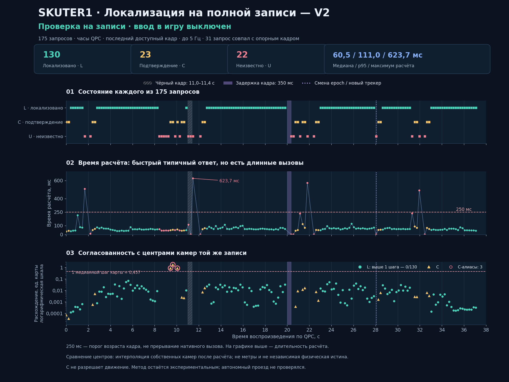

# skuter1: потеря соответствий и сопровождение маршрута

Срез: 4 ноября 2026 года. Это продолжение
[разбора живого запуска](../2026-11-03/SKUTER1-LIVE-ACQUISITION.md).
Эталон `fixed-k-fused-173-supported-diagnostic`, его 173 камеры,
20 556 точек и geometry SHA `75e491be5dff83a4566414c903cc1c666dfb96b88ca0c713e7565de102bff1aa`
сохранены. Новые опыты не заменяют геометрию, исходник или разрешение управления.

## Два разных отказа

В сохранённом хвосте настоящего живого запуска было 55 наблюдений за
14.438–19.402 с. Все закончились `route_pose_not_verified`: максимум пять
LK-соответствий, ноль проверенных PnP-кандидатов. Медиана вычисления —
55.505 мс, максимум — 179.090 мс. Это отказ сопоставления до PnP,
а не доказательство нехватки RAM. Этот фрагмент не содержит RGB, Android ACK
или начала попытки, поэтому не объясняет весь заезд.

Журнал теперь сохраняет первые три наблюдения, первый план следования по
подтверждённой позе, последний такой план перед первой потерей, саму потерю
и первый повторный подхват, если он произошёл. Эти записи переживают
вытеснение хвоста. Общий предел — 64 строки и менее 64 КиБ в одном локальном
файле; запись выполняется фоновым потоком не чаще раза в секунду. Снимок
может отставать при мгновенной остановке. Это журнал решений сервиса, не
свидетельство касания Android и не архив кадров.

Отдельно на исходных кадрах около пятой секунды нашлись 198–237 настоящих
соответствий, но полный набор не прошёл пространственную проверку. Она
использует робастную медиану по малой оси: плотная полоса наблюдений
может преобладать над достаточно широко расположенными остальными точками.
Полные наблюдения самих опорных ракурсов 21–25 тоже не проходят этот критерий.
Это другой отказ; исправление проверки полосы не создаёт отсутствующие
соответствия в живом кадре.

## Проверенные варианты

| Вариант | Измерение | Решение |
| --- | --- | --- |
| Расширенное LK-окно 31 / 4 уровня | 8 настоящих кадров другой записи: 8 unknown, максимум одно соответствие; медиана 231.63 мс вместо 96.23 мс | Отклонён: медленнее и хуже исходного варианта |
| Разрешённая область precise-v3 вместо legacy-маски | Статический аудит всех 130 081 native-наблюдений: в слабых ракурсах уже разрешены все имеющиеся физические опоры; те же 5 пространственных отказов | Одно расширение маски не исправляет этот участок |
| Равномерный отбор перед PnP | 12 начальных + 15 средних кадров той же записи: 12 confirming, 15 localized, 0 unknown; 89 посторонних кадров: 0 ложных позиций | Приватный кандидат новой политики; проверка полного видео рассматривается отдельно |
| GPU LightGlue, три пары одним пакетом, истинный FP32 | Четыре исторических кадра: 4 confirming; медиана 229.24 мс, максимум 252.60 мс | Ускорение измерено, запас по задержке не доказан |
| Тот же B3, независимая запись skuter2 | 2 confirming / 6 unknown; 89 посторонних кадров дали 0 позиций | Только частичный перенос; не готовая замена локализатора |

Синтетические тесты равномерного отбора проверяют отбрасывание коллинеарных
облаков, повторных физических пикселей, неоднозначных native ID,
обманчивого поднабора с несогласованным большинством и конкурирующих
далёких положений. Положительные кадры того же ролика не являются
независимым прохождением в игре или измерением точности в метрах.

## Что меняет равномерный отбор

Приватный кандидат сначала вызывает установленный проверяющий алгоритм.
Только при его отказе выбирает не более двух измеренных точек из ячейки
32 px, обходя ячейки по слоям, максимум 128 строк. Отбор не использует
остатки, предполагаемую позу или результат проверки. Неизменённый PnP
со всеми пространственными порогами проверяет выбранные строки.

Полученная поза затем проецируется на **все исходные соответствия**:
минимум 20 инлайеров, доля не меньше 50%, ошибка до 3 px, медиана до
2 px и положительная глубина. Ранжирование использует полный консенсус.
Строки разрешаются в настоящие native ID; конфликтующие идентичности и
дубли пикселей отклоняются. Возвращённая поза связана с её собственными
текущими наблюдениями. Полный исходный пространственный критерий может
по-прежнему быть ложным: это новая политика, а не утверждение, что старый
критерий внезапно прошёл. Отбор также не инвариантен к сдвигу сетки.

## Почему одного LightGlue пока недостаточно

У шести нераспознанных кадров skuter2 было 18 гипотез. Четырнадцать
закончились на первом пороге: меньше 24 настоящих 2D–3D соответствий.
Для оставшихся четырёх сохранены точные XYZ/UV/native ID и исходные
строки; SHA совпали с первоначальным запуском:

| Кадр / опора | Конкретный отказ |
| --- | --- |
| 17.501 с / 62 | RANSAC дал 16 инлайеров при минимуме 20 |
| 39.916 с / 167 | После уточнения согласованы 25/64, то есть 39%, при минимуме 50% |
| 39.916 с / 171 | Согласованы 23/71, то есть 32%; также недостаточна площадь пространственной опоры |
| 39.916 с / 158 | RANSAC дал 19 инлайеров при минимуме 20 |

Равномерный отбор не исправил ни одну из этих четырёх гипотез.
Они не дошли до выбора между конкурирующими позами. Приписывать этот
отказ только освещению, памяти или пространственной медиане нельзя.

Отдельный аудит нашёл потерю точных SIFT-вариантов ориентации. Несколько
original-строк с одинаковыми XY/scale, одним fused-наблюдением и одним
native point ID отвергались как неоднозначные. Их можно отличить от
конфликтующих физических точек проверкой полной обратной связи.
На сохранённых шести наборах такое объединение увеличило 23→34 настоящих
соответствия в опоре 69. С исходными порогами PnP получил 29 инлайеров,
медиану 0.784 px и полный пространственный допуск. Вторая опора того же
кадра дала 26 инлайеров. Все три гипотезы ранжировались; конфликт поз
не обнаружен. Кадр 39.916 с по-прежнему не прошёл долю согласованных
наблюдений. Это статическая проверка новой политики привязки данных,
не новый end-to-end запуск и не установленный runtime.

## Полное видео с production clock

Повторный приватный replay использовал QPC и для публикации кадров, и для
clock локализатора. Все 857 кадров декодировались из целой записи;
producer публиковал последний кадр по настоящему времени, consumer
обрабатывал не чаще 5 Гц. Из 175 наблюдений получились 130 localized,
23 confirming и 22 unknown; последняя камера 36.903 с распознана.
31 обработанное изображение совпало с обучающим ракурсом — это явно
отмечено и не объявляется независимой проверкой. Подсказки исходного
времени не поступали алгоритму.

При проверке по native-центрам той же записи все 130 localized-поз
отклонились не более чем на 0.0673 собственных единицы; медиана 0.00775.
Это внутренняя согласованность с реконструкцией, не физическая истина
и не метры. Три confirming-позы на повторяющемся фасаде были ошибочными
относительно этого же сравнения. Они получены **установленным полным
проверяющим алгоритмом**, а не новым равномерным отбором; до localized
не дошли, но затруднили последующее подтверждение.

Медиана вычисления 60.50 мс, p95 111.01 мс, максимум 623.65 мс.
Длинные native-вызовы были отклонены по возрасту после возврата;
из этого нельзя делать вывод об устойчивых 5 Гц. На естественном
участке около 8.4–10.9 с подтверждение пропало на 2.426 с.
Отдельные внедрённые отказы — чёрное изображение, удержанный 350 мс
кадр и смена epoch — дали нейтральный результат и потребовали нового
подтверждения. После удержанного кадра и последовавших просрочек полное
подтверждение отсутствовало до 2.663 с. Вердикт опыта: **не принимать
как непрерывное управление**. Ослаблять проверку движения ради этих
пропусков нельзя: часть отказов защищает от реально конкурирующих поз.

Краткие проверяемые числа и SHA первичных квитанций:
[verification-summary.json](evidence/skuter1-tracking/verification-summary.json),
[manifest.json](evidence/skuter1-tracking/manifest.json).

В этой проверке намеренно использовался consumer до 5 Гц. В самом вебе
`requestVideoFrameCallback` не жёстко ограничен 5 Гц: один in-flight
запрос и пауза `began + 50 ms` дают верхнюю границу 20 Гц; вычисление,
кодирование и HTTP могут её снижать. Публикация последнего кадра уже
реализована. Отдельный цикл команд работает с интервалом 20 мс, не
продлевая разрешение устаревшего ответа. Сопоставление частоты offline
consumer с этим пределом требует отдельной проверки; это не доказательство
фактической browser→Android задержки. Backend ставит QPC timestamp после
JPEG decode, frontend отдельно контролирует возраст кадра до ответа.

## Поправка к протоколам времени и FP32

Старые приватные B3-квитанции сохранены без переписывания. Их receipt
и clock локализатора использовали `time.monotonic`: на этом Windows это
`GetTickCount64` с разрешением 15.625 мс. Production `RouteWorkspace`
использует `time.perf_counter`, то есть `QueryPerformanceCounter`.
Поэтому частный ответ с расчётом 262 мс и записанным возрастом 250 мс
не доказывает прохождения production-порога. Нулевая ложная локализация
отрицательных изображений остаётся фактом именно этих опытов.
Два последующих диагностических захвата использовали QPC для обоих
концов измерения; оба остались unknown.

Также прежняя надпись FP32 означала FP32 весов и дескрипторов без autocast.
В закреплённом LightGlue `flash=True` внутри Attention переводит Q/K/V
в half. Новый B3 использовал `flash=False`, TF32 выключен. Для 12 пар
совпали наборы матчей и уровни ранней остановки с последовательным
вариантом; максимальное расхождение assignment — 0.004807. Это численная
проверка конкретных данных, не общая гарантия побитного равенства GPU.

## Сопровождение между живыми кадрами

Установленный typed Reference-LK сопоставляет каждый кадр с записанными
опорными изображениями. Уже найденные в живом кадре native-ориентиры
не передаются в отдельный typed live-to-live путь. Поэтому успешный
кадр сам по себе не гарантирует соответствий на следующем при изменении
ракурса. В проекте есть отдельный `AnchoredRouteLocalizer` для другой
семьи; его наличие не означает, что typed Reference-LK уже получил
аналогичное сопровождение.

Дальнейший кандидат должен передавать только проверенные native ID,
измеренные UV и неизменные XYZ между соседними живыми изображениями,
заново решать абсолютный PnP на текущем кадре и периодически сверяться
с записью. Неподтверждённая текущая поза не заменяется старой. Ограничение
памяти, срока опор, смены capture epoch и источника остаётся обязательным.

Такой приватный кандидат затем проверен на полном ролике и **отклонён**.
При 177 наблюдениях получились 139 localized / 18 confirming / 20 unknown.
Медиана 25.885 мс меньше, чем в отдельном reference-only прогоне, но p95
хуже: 146.756 мс вместо 111.009 мс. Прогоны получили лишь 22 одинаковых
source index, поэтому это описательное сравнение, не парный тест ускорения.
Девять localized-положений разошлись с native-центрами той же записи более
чем на 0.2 собственных единицы; максимум — 5.338. Все lifecycle-проверки
сохранились, включая три разные GLOBAL-картинки перед сохранением опор,
неизменные native ID, текущий абсолютный PnP и обязательную сверку за 0.8 с.

На 6.277 с GLOBAL-положение было верным относительно native-сравнения;
через 0.4 с flow дал сдвиг на повторяющийся фасад с 131 инлайером и
медианой ошибки всего 0.645 px. Это прошло установленный полный verifier,
без новой балансировки. Обновление GLOBAL позднее тоже могло выбрать
похожий фасад. Следовательно, малая ошибка проекции и правильная работа
сроков опор не доказывают семантической идентичности окна или здания.
Ускоренный вариант не установлен. Дополнительно одна поза после работы
внешней обёртки имела возраст 272.6 мс: проверка свежести нужна и у
потребителя непосредственно перед использованием.

## Миникарта как независимая подсказка

Существующий `MinimapRouteShadow` анализирует цветную GPS-линию и не
реализует узнавание места по записанной карте. Новая проверка внешнего
вида миникарты выполнена отдельно, без PnP, поз или разрешения ввода.
Первый опыт оказался неинформативным: предположенный радиус и однопиксельная
проверка окружности отвергли 172 из 173 настоящих опор. Это отказ
предварительной калибровки, не доказательство бесполезности миникарты.

Затем только по первым пяти исходным кадрам, без query и ответов о месте,
измерена окружность: центр (158.916, 160.008), радиус 106.223 source px
при 1920×1080. Разброс центров 0.864 px, радиусов 0.293 px; шесть
синтетических проверок формы прошли. Соответствие направления карты
повороту тела/камеры этим не калибровалось.

С этим отдельным фиксированным профилем все 173 опоры и 15 настоящих
query прошли проверку видимости. Чёрное изображение вернуло `no_hint`;
89 изображений без соответствующего HUD не сравнивались как миникарты.
Сигнатуры занимают 885 760 байт; медиана сравнения 6.8895 мс,
максимум 7.0296 мс. Во всех семи ночных случаях неоднозначных фасадов
первая подсказка попала в фактическую временную окрестность той же записи.
Но у дневного старта другая, повёрнутая улица получила top1, а правильный
старт оказался третьим. Встречаются многочисленные близкие оценки.
Поэтому миникарта пригодна для исследования shortlist/проверки конфликтов,
но не может самостоятельно создавать положение, голос подтверждения
или команду управления.

Такое разделение согласуется с реальными teach-and-repeat системами:
[VT&R3](https://github.com/utiasASRL/vtr3) поддерживает обучение пути и
повторное следование с локализацией; его vision-ветка требует GPU и
стереокамеру, поэтому это не готовая подстановка в наш монокулярный поток.
[Работа Gridseth и Barfoot](https://github.com/utiasASRL/deep_learned_visual_features)
демонстрирует повтор пути при смене освещения через обученные признаки
и геометрическую оценку позы. Это подтверждает направление исследования,
но не переносит результаты робота на текущий игровой маршрут.

## Проверка темпа и повторного подхвата

У браузера одна HTTP-проверка в работе и интервал между стартами не менее
50 мс. Пока ответ не вернулся, промежуточные кадры пропускаются. В приватном
прогоне с ранним обновлением 3D-опор кадр на 10.687 с сопоставился правильно
относительно той же записи, но запрос занял 202.5 мс. Следующим был кадр
через 198 мс по исходнику: повторяющийся фасад дал положение со сдвигом
0.895 условной единицы при 159 инлайерах и 1.021 px медианной ошибки.
Это воспроизводимая последовательность, а не доказанная причина последнего
запуска в игре. Низкая ошибка и большое число совпадений здесь недостаточны.

В двух полных прогонах с лимитом 20 Гц получили соответственно 592
подтверждённых положения из 623 наблюдений и 576 из 609. У обоих вариантов
сохранились неверные положения на похожих фасадах. Раннее обновление по
падению числа опор ниже половины сработало 20 раз, но все 20 отброшенных
кандидатов согласовались с положением камеры исходной записи в пределах
0.035 условной единицы. Самый заметный ошибочный подхват сохранил 62% опор.
Оба варианта отклонены. Прогоны использовали разные кадры той же записи и
фоновый ресурсный контроль; максимальные задержки этих прогонов нельзя
выдавать за измерение отдельной операции в живом браузере.

На восьми кадрах другой записи сочетание SIFT-LightGlue, исправленной
привязки вариантов ориентации SIFT и подсказок миникарты дало три свежих
геометрически проверенных положения, каждое только в состоянии
`confirming`. Ни одна подсказка миникарты не дала проверенную позу за
пределами прежних трёх кандидатов. Вариант DISK подтвердил 1536 связей
точных 2D-измерений с ориентирами исходной карты, но на прогреве свёртка
запросила 3.89 ГиБ при лимите GPU 2 ГиБ. Ни одна из четырёх заданных пар не
была сопоставлена. Это результат проверки ресурсов, не точности DISK.

Следующая проверяемая гипотеза — короткая очередь кадров отдельно от
повторного поиска по всей карте. Между проверками позы можно переносить
измеренные 2D-точки через соседние кадры. При ответе фонового поиска
нужна новая геометрическая проверка на свежем кадре с тем же источником;
старый ответ, разрыв цепочки или противоречие между двумя оценками сами
по себе не дают команды. [Исследование задержек в SLAM](https://doi.org/10.1145/3677317)
описывает этот компромисс: разделение задач помогает принимать кадры,
но конкуренция за ресурсы и доступ к карте может съесть выигрыш.

## Парная проверка на одних и тех же кадрах

На участке 10.687–10.885 с восстановили тот же набор из 256 измеренных
опор. Хеши изображения для LK, измеренных 2D-координат, 3D-координат и
идентификаторов опор совпали со снимком предыдущего прогона. Оба варианта
обработали один конечный кадр, с одной маской и неизменённой проверкой
PnP. В прямом переходе воспроизвелась прежняя ошибочная поза. Перенос
через все пять промежуточных кадров дал другую оценку того же кадра:

| Кадры между опорой и концом | Согласованные опоры | Медианная ошибка проекции | Отклонение от камеры исходной записи |
| --- | ---: | ---: | ---: |
| Пропущены | 159 | 1.021 px | 0.895 усл. ед. |
| Обработаны последовательно | 214 | 0.825 px | 0.023 усл. ед. |

[Схема сравнения](evidence/skuter1-tracking/frame-gap-pair.png) ·
[Численные данные](evidence/skuter1-tracking/frame-gap-pair.json).
Это парная проверка влияния пропуска кадров на этот конкретный эпизод.
Положение камеры той же записи служит сравнением, его координаты не
подаются в решатель. Из результата не следуют метрическая точность,
поведение на другой записи или готовность замкнутого управления.

Отдельно подготовлен прототип границы между приёмом кадров и поиском
ориентиров. 29 синтетических проверок покрыли кольцо до 12 изображений /
0.5 с, явные разрывы, одноразовые ответы поиска и проверку возраста до
и после вычислений. Прототип не выполняет LK, PnP или управление, не
установлен. Для нескольких гипотез нужен один пакет результатов на тот
же исходный кадр, чтобы оценить их на одном свежем кадре до выдачи решения.

Такой пакет проверили в отдельном коротком прогоне с семью настоящими
кадрами и отдельным потоком поиска. Все три кандидата были переданы с
измеренными координатами и исходными идентификаторами. Поиск занял
45.1 мс; семь изображений в буфере — 3 628 800 байт. Возраст конечного
кадра при возврате был 28.7 мс для прямого перехода и 127.1 мс после
последовательного сравнения обеих веток. Это измерение одного окна,
не оценка задержки браузера или норма для всех кадров.

На ветке 50 получились те же 214 инлайеров и 0.023 усл. ед. при
последовательной обработке. Но конкурент с похожим фасадом сохранил 184
инлайера и отклонение 2.674 усл. ед. Без предшествующей подтверждённой
позиции штатная проверка неоднозначности оставила **оба прогона без
подтверждённой позы**. В отдельной статической проверке прежняя реально
подтверждённая поза на 10.687 с ограничила допустимый переход до 0.998
усл. ед. Штатное ранжирование выбрало ветку 50 в обоих случаях, но при
скачке её позиция всё ещё отклонялась на 0.895 усл. ед. Это аргумент за
сочетание непрерывного сопровождения и недавней подтверждённой позиции.
Статический опыт не воспроизводит подхват после длинного обрыва или
старта с произвольной точки и не разрешает использовать старую позу
как текущую команду. Семь дополнительных проверок изоляции пакета и
устаревания прошли; локализатор в продукте не менялся.

Эксперимент с разбиением последней свёртки DISK прошёл CPU-сравнение с
полным вычислением в допуске FP32. На GPU прогрев одной опоры вернул 512
дескрипторов; пик зарезервированной памяти 1.61 ГиБ, измерение с
инструментированием — 1.24 с. Пробник не зарегистрировал операцию
дополнения границ RGB, поэтому проверка остановилась до запросов.
Это подтверждает, что данный прогрев поместился в 2 ГиБ; сравнения
точности и задержки на новых кадрах пока нет.

## Дневное изображение и ноль опор при старте

В старом хвосте из 55 наблюдений максимум на кадр составлял 2–5 LK-соответствий.
В отдельном хвосте из 52 наблюдений от 4 ноября, 12:09:50 UTC, максимум на
каждом кадре был ровно 0. Оба сеанса использовали ту же геометрию. Во втором
поиск выбирал преимущественно ракурсы ближе к концу записи. Оба сеанса
закончились без принятой позы и ни один кандидат не дошёл до PnP.
Эти журналы содержат метаданные. Отдельная дневная вырезка из скриншота
также дала 0 сохранённых LK-соответствий. Цвет облака служит для отображения,
а поиск использует яркость чёрно-белого изображения. Смена освещения и
ракурса в этих материалах не позволяет разделить вклад каждого фактора.

В парном прогоне оставили штатный LK первым. RootSIFT включался только
после нуля геометрически проверенных гипотез и при остатке бюджета
от 150 мс. Неоднозначные гипотезы LK по-прежнему приводят к отказу.
Оба метода проверяют геометрию и время по одному источнику и используют
одну последовательность подтверждений. На кадре из скриншота получено
27 инлайеров, медианная ошибка 0.328 px и одно подтверждение за 220.5 мс.
[Описание RootSIFT](https://robots.ox.ac.uk/~vgg/publications/2012/Arandjelovic12/)

| Набор | Результат |
| --- | --- |
| Ночная запись, 12 кадров | 11 подтверждений у штатного и комбинированного поиска, позы совпали |
| 12 отдельных дневных кадров | 8 подтверждений, p95 222.6 мс |
| Те же 12 дневных кадров в исходном порядке при подаче 5 Гц | 4 локализованных, 2 промежуточных подтверждения, 6 без позы, p95 275.5 мс |
| 89 посторонних кадров | 0 подтверждений, RootSIFT фактически вызван на 29 кадрах, 7 запросов вышли за срок |

Исходные паузы дневного архива в ускоренной подаче сжаты. Это проверка
локализатора, без задержек браузера и Android. Ни один ответ старше
250 мс не принят. Выборка недостаточна для допуска движения. Дополнение
подключается только в режиме наблюдения через локальную квитанцию
оператора. Она связывает байты дескрипторов, версию кода и исходную попытку,
а хеши отчётов фиксируют происхождение решения оператора. Воспроизведение
записи, пеший и транспортный режимы используют штатный поиск.

На изолированной копии проверили обработчик JPEG, привязку к выбранной
альтернативе и разделение режимов. После кодирования вырезки в JPEG
получили 22 опоры и одно подтверждение за 187 мс, у штатного поиска
было 0 опор. На этой вырезке и 12 архивных JPEG при подаче до 4 Гц
наблюдатель вернул 5 локализованных поз, 4 промежуточных подтверждения
и 4 отказа. Транспортный обработчик использовал штатный локализатор
и вернул отпущенные педали. Действия Android в проверке отсутствовали.

В отдельном прототипе предыдущий принятый ответ RootSIFT мог лишь
менять порядок решателей для следующего свежего кадра. На восьми
кадрах с этой подсказкой медианная экономия составила 24.7 мс, но
всего в последовательности p95 остался 254.2 мс. Под нагрузкой
первый кадр из скриншота дошёл до 27 инлайеров и успел устареть
до принятия. Прототип остался отдельным экспериментом.

## Воспроизведение с изменённым светом

Команда `python -m scripts.pilot.check_route_lighting_replay JOB OUTPUT`
берёт кадры из исходного H.264 и исключает точные кадры, участвовавшие
в подготовке карты. Оригинал и варианты получают одинаковый JPEG
с качеством 86. В каждом из четырёх окон кадры поступают по исходным
интервалам с частотой до 5 Гц. Опоздавший кадр пропускается, когда
уже доступен следующий. Время видео используется для подачи и оценки
отклонения от реконструкции. Локализатор получает пиксели, идентификатор
сеанса, номер кадра и время его поступления. Команды в игру отсутствуют.

Измерены семь профилей, четыре политики и два режима подачи 12
реальных дневных JPEG. В таблице число локализованных поз в пределах
250 мс. Каждое синтетическое условие содержит 24 кадра. В каждом из
четырёх окон первые две удачные позы идут на подтверждение, поэтому
максимум локализованных поз при удачном прогоне равен 16.

| Вход | LK | LK + RootSIFT 960 | LK + RootSIFT 720 | LK + RootSIFT 640 |
| --- | ---: | ---: | ---: | ---: |
| Оригинал | 16 | 16 | 16 | 16 |
| Пасмурно | 0 | 1 | 5 | 6 |
| Дневной свет | 0 | 4 | 6 | 8 |
| Тёплый свет и тени | 0 | 4 | 4 | 5 |
| Холодные сумерки | 0 | 6 | 8 | 4 |
| Блики | 0 | 6 | 5 | 7 |
| Пересвет, контроль | 0 | 0 | 0 | 0 |
| Реальный дневной архив с исходными паузами | 0 | 0 | 0 | 0 |
| Реальный дневной архив при искусственной подаче 5 Гц | 0 | 6 | 3 | 1 |

На синтетическом дне уменьшение области вычисления дескрипторов до
640 px улучшило p95 с 227 до 152 мс, но потеряло пять подтверждённых
поз на реальном архиве. Предварительное построение индекса полного
RootSIFT в отдельном прогоне дало 6 вместо 5 поз на том же архиве
при искусственных 5 Гц и 4 вместо 6 на синтетическом дне. Этого
недостаточно для выбора новой политики. Сохранённая карта, допуск
движения и штатные пороги остались прежними.

Использована маска эталона, совпадающая с маской живого поиска.
Допустимая область составляет 132 813 из 518 400 пикселей. Профили
меняют пиксели изображения, не геометрию, а поиск позы не использует
спидометр и мини-карту. Искусственный свет удобен для регрессии.
Перенос на реальные тени, освещение другого движка и реакция машины
на команды требуют отдельных измерений на настоящих кадрах или
в симуляторе с повторяемой постановкой камеры и управлением светом.
[Протокол Day–Night](https://www.visuallocalization.net/) ·
[Фиксированный шаг CARLA](https://carla.readthedocs.io/en/latest/adv_synchrony_timestep/)

У транспорта есть отдельный переключатель «Сохранить видео запуска
транспорта». В хранилище аккаунта в этом браузере остаются два последних
сохранённых запуска, до 30 минут или 512 МиБ каждый. Поток H.264
записывается начиная с первого доступного ключевого кадра. Видео, индекс
RTP и данные запуска скачиваются из одного архива. Передача на сервер
и перекодирование при записи отсутствуют.

Для проверки такого запуска передайте скрипту те же `JOB` и `OUTPUT`
и добавьте `--diagnostic VIDEO INDEX METADATA`. Импорт сверяет привязку
к заданию и карте, хеш индекса, байты каждого кадра и временную шкалу.
Прогон использует окна из первой минуты записи. Совместимость
проверена на исходном H.264 `skuter1` с тестовыми данными экспорта.
Это отдельная проверка импорта, без живого запуска транспорта.

## Независимые заезды при другом освещении

Для допуска важна цепочка подтверждений на свежих кадрах из отдельного
заезда. Синтетические варианты служат повторяемой проверкой регрессий.
Офлайн-команда принимает `--holdout INPUT_DIRECTORY` и до шести
`--holdout-window START:END` по 2.4 с. Она проверяет хеши записи и
отклоняет исходное H.264 даже с другим манифестом. В каждом окне до
пяти кадров в секунду подаются по исходным меткам RTP. Отчёт считает
время до первой локализованной позы и максимальный интервал между
такими результатами с учётом границ окна.

На независимом дневном `skuter2` визуально сверены стартовая улица,
развилка у ворот, обратная прямая и возвращение. У записи нет внешней
эталонной позы, а синхронизация по времени с `skuter1` отсутствует.
В первом прогоне команды штатный LK вернул 0 локализованных поз
из 48. С RootSIFT получено 7 из 48, p95 возраста кадра 228.4 мс.
Повтор дал 6 из 48 при p95 187.7 мс. Из них 4 на старте и 2 у
развилки. До первой позы у развилки прошло 2.13 с от начала окна.
Два других окна по 2.4 с целиком прошли без локализованной позы.
Из независимого ночного `zaezd888` отдельно проверено окно на той же
улице с другим положением камеры. В частном прогоне ни один метод
не подтвердил цепочку на этих 11 кадрах. Смена условий съёмки включает
и перспективу, поэтому разницу нельзя объяснить одним освещением.

Проверены два частных индекса XFeat с исходными координатами и маской
`skuter1`. При 640×360 на дневном кадре выделение дескрипторов
занимало 42–51 мс после прогрева. Первый индекс усреднял дескрипторы
по ориентиру, второй использовал отдельные измеренные ракурсы для
12 221 ориентиров и проверял два способа отбора соответствий.
Штатные проверки PnP и свежести оставлены без изменений.
Ни один вариант не локализовался на 45 дневных кадрах из четырёх
реальных окон. На 12 отложенных ночных кадрах исходника индекс
отдельных ракурсов дал до 3 промежуточных подтверждений. Все 30 кадров
другой сцены остались без позы. Скорость извлечения признаков сама по себе
не решает задачу. В опубликованной оценке XFeat опоры строились из его
собственных совпадений с повторной триангуляцией, а здесь дескрипторы
брались в координатах прежних измерений. [XFeat](https://arxiv.org/abs/2404.19174)

Дополнительный вариант RootSIFT хранил измеренные дескрипторы разных
ракурсов для тех же 3 756 точек. На старте дневного `skuter2` он дал
5 локализованных поз из 11 при p95 182.6 мс. В том же частном сравнении
штатный запасной поиск дал 2 из 11. У развилки оба дали по одной позе.
На обратной прямой и при возвращении подтверждений не было. Вариант
с несколькими ракурсами используется только как измеренный кандидат.
Маршрут и режимы управления не менялись, команд в игру не отправляли.

## План разбора нуля опор в живом потоке

### Где возникает отказ

У эталона `skuter1` 173 ракурса и 20 556 точек. В его рабочем кэше LK
83 957 двумерных измерений для 16 976 уникальных 3D-ориентиров. На каждый
опорный ракурс приходится до 512 измерений после маски и отбора. На новый
кадр локализатор берёт ровно три ракурса по средней квадратичной ошибке
нормализованных миниатюр 64×36. Затем оптический поток LK переносит
измерения этих ракурсов на новый кадр. Фильтры проверяют статус прохода
в обе стороны, границы, маску, обратную ошибку до 1 px и фотометрическую
ошибку до 12. Геометрический проверяющий этап вызывается с 24 парами
2D–3D и требует минимум 20 инлайеров наряду с остальными проверками.
У транспортного контура есть отдельный минимум 24 инлайера. Свежесть и
серия подтверждений проверяются после геометрии, поэтому одиночный ответ
с 27 инлайерами ещё не разрешает движение.
[Отбор опор](../../../scripts/pilot/route_reference_lk_export.py#L178) ·
[Поиск ракурсов и LK](../../../motor_worker/route_reference_lk.py#L534) ·
[Геометрическая проверка](../../../motor_worker/route_localization.py#L527) ·
[Проверка транспорта](../../../motor_worker/vehicle_route.py#L169)

«Опоры» в вебе показывает инлайеры в результате локализации. Значение
0 встречается и до первого ответа, и при неизвестной позе. Поле «PnP»
считает прошедшие геометрическую проверку гипотезы. На двух хвостах
выше PnP пропущен из-за малого числа соответствий. На другом кадре
поле может показывать 0 после фактического вызова PnP, а положительное
число гипотез ещё допускает отказ из-за неоднозначности, срока или
геометрии маршрута. Сейчас резервный решатель может заменить в ответе
поля штатного LK, а отсутствие покадровых причин оставляет открытым
вопрос, какой из фильтров отбросил больше всего точек.
[Веб-индикаторы](../../../frontend/src/features/stream/WalkingRoutePilot.tsx#L454) ·
[Допуск позы](../../../motor_worker/route_localization.py#L638) ·
[Телеметрия резервного решателя](../../../motor_worker/route_descriptor_recovery.py#L75)

На пользовательской дневной вырезке альтернативный поиск дал 27
геометрических инлайеров и одно промежуточное подтверждение. После
кодирования вырезки в JPEG получилось 22 инлайера. Это показывает, что
на этой картинке есть подходящие признаки. Для устойчивого положения
на независимом дневном `skuter2` этого пока мало. Резервный поиск доступен
в наблюдении при наличии проверенной локальной конфигурации. Пеший и
транспортный режимы используют штатный поиск.
[Выбор режима](../../../scripts/pilot/route_workspace.py#L508)

### Изолирующий тест и решение по порогам

1. Взять 4–8 кадров для разбора причин из 12 сохранённых JPEG, которые
   поступали в сервис на этой карте. Добавить контроль из исходной ночной
   записи и примеры из независимого дневного `skuter2`. Связать кадр с
   хешами, исходным временем, калибровкой, маской и версией карты. Архив
   JPEG и оба хвоста метаданных принадлежат разным сеансам.
2. На каждом JPEG сначала воспроизвести штатный список из трёх ракурсов.
   Затем оставить все проверки прежними и подставить ракурсы с видимой
   общей геометрией, выбранные при просмотре оригинала. Если с ними
   появляется поза, приоритет у улучшения поиска ракурса. Если остаётся
   меньше 24 пар, измерить потери на каждом фильтре LK. Если пар хватает,
   проверить отдельно вызов PnP, распределение инлайеров, конкурирующие
   гипотезы и причину допуска или отклонения позы.
3. Повторить сравнение при изменении экспозиции, гаммы, локального
   контраста и теней на том же кадре. Это изолирует реакцию на свет при
   фиксированной перспективе. Проверить совпадение эффективной маски
   при подготовке и живом поиске. Штатная маска разрешает 132 813 из
   518 400 пикселей. Варианты менять по одному и сравнивать с тем же
   набором, включая похожие фасады и посторонние сцены.
4. Общие пороги пока сохранить. При 0 соответствий снижение 24 или 20
   само по себе не помогает. Если конкретный фильтр режет проверенные
   пары, проверить его границу отдельно на тех же кадрах и отрицательных
   примерах. Ранее повторяющийся фасад уже давал ошибочную гипотезу
   с более чем сотней инлайеров, поэтому число точек само по себе плохо
   отделяет правильное место от похожего.

### Какие варианты сравнить после разбора

Если теряется нужный ракурс, сравнить штатные миниатюры с ограниченным
поиском по устойчивым к освещению признакам и группировкой ракурсов
по общим 3D-точкам. Для глобального подхвата искать по всему маршруту,
проверять несколько пространственно разных кандидатов. После подтверждения
сопровождать свежие кадры локально и при потере снова включать глобальный
поиск. Это применение архитектуры HLoc к нашему бюджету, его выигрыш
предстоит измерить. [Sarlin и соавторы, CVPR 2019](https://openaccess.thecvf.com/content_CVPR_2019/papers/Sarlin_From_Coarse_to_Fine_Robust_Hierarchical_Localization_at_Large_Scale_CVPR_2019_paper.pdf)

Если нужный ракурс уже находится, сравнить штатный LK с RootSIFT по
нескольким измеренным видам. Для нормализации оценивать долю пригодных
соответствий и поз. Визуально правдоподобная имитация дня сама по себе
этого не гарантирует. XFeat стоит повторять только в содержательно другом
варианте с его собственными измеренными треками и триангуляцией в отдельном
индексе, если более дешёвый вариант не даст покрытия. Эталон геометрии
остаётся общей базой сравнения. [Clement и соавторы](https://arxiv.org/abs/1904.01080) ·
[Potje и соавторы, CVPR 2024](https://arxiv.org/abs/2404.19174)

### Уровни интерфейса и проверка перед включением управления

| Уровень | Что показывать |
| --- | --- |
| Кадр | Источник, возраст, пропуски и просроченные ответы |
| Поиск | Ракурсы, их время в записи, оценки и число проверенных кандидатов |
| Геометрия | Пары до и после фильтров, факт вызова PnP, инлайеры и причина отказа |
| Поза | Ожидание, промежуточное подтверждение, подтверждённая поза или потеря |
| Движение | Решение о вводе и отдельное подтверждение Android |

Показать в вебе короткий статус в блоке фиксированной высоты. Детали
оставить в раскрываемой диагностике и экспорте. Для этапа, который ещё
не запускался, показывать прочерк. Число точек всей карты выводить отдельно.

Запускать регрессию без игры из сохранённого видео с исходными метками
времени. Синтетические варианты нужны для воспроизводимости, независимые
дневные и ночные окна — для проверки переноса. Не нужна запись на каждый
час суток. Сравнивать время до первого захвата, длину потерь и время
повторного захвата, покрытие по участкам, ошибочные подтверждения и p95/p99
возраста кадра. Отдельно проверять задержку всего пути от захвата до решения.
Границы маршрута и точность в метрах оценивать только с независимой
разметкой. Первый допуск нового кандидата — наблюдение без ввода.
Управление транспортом требует повторяемого захвата и удержания позы
на старте, в середине и после потери, затем отдельного живого прогона.
[Протокол проверки при смене условий, Sattler и соавторы, CVPR 2018](https://openaccess.thecvf.com/content_cvpr_2018/papers/Sattler_Benchmarking_6DOF_Outdoor_CVPR_2018_paper.pdf)

## Результат проверки сохранённых кадров

Четыре входных JPEG из архива проверены по всем 173 ракурсам эталона.
Все 692 пары кадр–ракурс оставили ровно 0 совпадений после штатных
фильтров LK. Для JPEG 2343 один из первых трёх ракурсов действительно
показывает ту же часть улицы. В этой паре из 512 исходных точек осталось
146 после прямого прохода, 50 после обратного и 29 после границ и маски.
Ни одна не пережила порог обратной ошибки 1 px. Три контрольных кадра
из той же ночной записи сохранили 510–512 пар на ракурс и прошли
одиночную геометрическую проверку.

На четырёх других кадрах из независимого дневного `skuter2` штатный
поиск также не дал позы. При переборе всех ракурсов у двух кадров
появились геометрические гипотезы. Для первого выигравшие ракурсы
стояли на позициях 31–53 штатного рейтинга, для второго — на 12-й.
У оставшихся двух кадров главным ограничением стало пространственное
распределение инлайеров. Таким образом, подтверждены разные режимы
отказа. Поднять число кандидатов полезно лишь на части входов, и сам
перебор не проходил проверку задержки.

Проверен быстрый вариант поиска с голосованием RootSIFT по общим
3D-точкам. Он использует те же LK, PnP, проверку свежести и серию
подтверждений. По исходным временным меткам RTP при частоте до 5 Гц
получены следующие результаты. Окна ранее использовались в экспериментах.

| Вход | Штатный LK | Голосование RootSIFT → LK |
| --- | ---: | ---: |
| Дневной `skuter2`, старт | 0/12 | 5/12 |
| Дневной `skuter2`, три остальных окна | 0/36 | 0/36 |
| Независимая ночь `zaezd888`, начало | 0/11 | 0/11, 5 ответов просрочено |
| Посторонняя сцена, искусственная подача 5 Гц | 0/30 | 0/30 |

Три дневных прогона подтвердили одни и те же пять кадров. p95 возраста
ответа на дневных окнах в последнем повторе составил 115–193 мс. Ночью p95 достиг
269 мс. Все дроби в таблице считают принятые локализатором позы до
истечения 250 мс. Внешней разметки положения камеры нет. Точность на
местности, ложный захват похожей улицы и управление ещё не подтверждены.

Гистограммы ориентаций дали 0/48 одиночных PnP на дневной записи против
1/48 штатных. Симметричные CLAHE и DoG для LK, инверсия контраста для
RootSIFT, равномерный отбор и объединение соседних опор не исправили
проверенные пространственные отказы. На JPEG из архива с отдельной
инициализацией LK→RootSIFT дал 6/12 промежуточных подтверждений, RootSIFT
по нескольким измеренным видам — 7/12. С исходными паузами 0,51–0,80 с
оба подхода подтвердили первый кадр и затем остановились на проверке
непрерывности. Этот JPEG-архив подходит для разбора кадров, а для проверки
движения нужен сохранённый поток с исходной частотой.

Отдельный пилот XFeat строил новые треки по собственным признакам и
триангулировал их при фиксированных позах эталона. Из девяти стартовых
ракурсов собраны шесть перекрывающихся под-карт без слияния координат.
Для каждой точки проверены глубина, ошибка до 2 px в трёх или четырёх
наблюдениях и параллакс от 0,5°. На четырёх JPEG архива максимум
совпадений в лучшей под-карте составил 17–21, на четырёх дневных —
19–24. Единственный вызов PnP завершился отказом. На 30 посторонних
кадрах PnP не запускался. Время запроса 49–55 мс измерено на восьми
целевых кадрах без полного живого контура. Результат ограничен стартовым
участком и этим размером банка. [XFeat, CVPR 2024](https://openaccess.thecvf.com/content/CVPR2024/papers/Potje_XFeat_Accelerated_Features_for_Lightweight_Image_Matching_CVPR_2024_paper.pdf)

Следующая проверка по тем же JPEG — устойчивое плотное сопоставление
пары с подходящим ракурсом. Сопоставленные пиксели нужно связывать
с измеренными 3D-точками эталона и проверять тем же PnP. Такой тест
покажет, возвращаются ли пространственно распределённые опоры на
сложных кадрах, где простой LK оставляет ноль. Время плотного метода
измерять отдельно от точности. [RoMa, CVPR 2024](https://openaccess.thecvf.com/content/CVPR2024/html/Edstedt_RoMa_Robust_Dense_Feature_Matching_CVPR_2024_paper.html)

Экспериментальный скрипт запускается локально через
`python -m scripts.pilot.check_route_coarse_retrieval JOB HOLDOUT OUTPUT --replay --window 0:2.4`.
Для дневного прогона также добавляются окна `19:21.4`, `27:29.4` и
`37.516:39.916`. `HOLDOUT` указывает на `input` отдельной записи, `OUTPUT`
должен быть новым файлом внутри `.local-pilot` вне каталогов входных данных.
Нужен Python обработчика с PyAV и версией OpenCV, привязанной к карте.
Для этого артефакта используется `.local-pilot/motor-worker-venv` с OpenCV 4.13.0.
Кандидат остаётся в офлайн-проверке. В коде веба наблюдение отдельно
показывает поиск, геометрические гипотезы и состояние подтверждения.
Скалярные счётчики проходят в экспорт локального отчёта. Пороги,
эталонная карта и допуск ввода остались прежними.
[Скрипт сравнения](../../../scripts/pilot/check_route_coarse_retrieval.py) ·
[Экспорт счётчиков](../../../frontend/src/features/stream/routeNavigationDiagnostics.ts)

## Три проблемных участка и полуплотное сопоставление

Активная карта проверки по-прежнему связана с `skuter1`, вариантом
`fixed-k-fused-173-supported-diagnostic` и geometry SHA `75e491be…f1aa`.
Дневная запись показывает те же участки с другой скоростью, положением
камеры и освещением. Восемнадцать выбранных кадров при повторном
декодировании совпали по SHA-256 с RGB в предыдущем отчёте.

| Время `skuter2` | Что удалось разделить |
| --- | --- |
| 19–21,4 с | Ракурс 84 дал 38 инлайеров на 19,434 с, но не попал в тройку голосования. В других кадрах инлайеры собрались узкой полосой около въезда и лестницы. |
| 27–29,4 с | Первые кадры голосовали за соседние по виду участки. Перебор 30 визуально подходящих ракурсов на шести кадрах не дал штатной геометрической гипотезы. На 28,949 с все 52 оставшиеся пары согласовались по проекции, но не прошли пространственную проверку. |
| 37,516–39,916 с | На 38,416 с пропущенный ракурс 157 дал 40 инлайеров. В следующих кадрах опоры остались на левой стороне, хотя второй фасад виден. На 38,616 с гипотеза на декодированном RGB исчезла в штатной проверке на JPEG. |

На восьми выбранных парах с ≥24 соответствиями и малой медианной
ошибкой штатный PnP отказал на `inlier_spatial_support`. Это не
свидетельство достаточного покрытия кадра. Измеренные инлайеры занимали,
например, 144×19 px у въезда и 39×95 px у левого фасада. Прогноз LK
из гомографии и объединение измеренных точек трёх опор дали 0/12
принятых геометрических гипотез. Дополнительные пары местами ухудшали
согласие с остальными измерениями.

XFeat* использовал полуплотные соответствия. Для переноса использовались
пары в пределах 4 px от измеренных опорных пикселей и их исходные XYZ.
Маска, проверка PnP и пространственный допуск остались прежними.
При диагностическом выборе трёх ракурсов получено 3/6 одиночных
геометрических гипотез на проблемных окнах. Окно у въезда дало 1/2,
участок вдоль стены — 2/2, возвращение в переулок — 0/2. На четырёх
архивных JPEG с нулём LK получено 4/4, на трёх посторонних кадрах 0/3.
Это геометрические гипотезы без независимой разметки и подтверждения
последовательности. [XFeat, CVPR 2024](https://openaccess.thecvf.com/content/CVPR2024/papers/Potje_XFeat_Accelerated_Features_for_Lightweight_Image_Matching_CVPR_2024_paper.pdf)

Матрица сходства через NumPy BLAS и отсев пар без близкой измеренной
опоры до точного уточнения сохранили результаты всех 60 проверенных пар.
На дневных окнах полный запрос с тремя подготовленными ракурсами занял
223–319 мс вместо секунд. С одним ракурсом, выбранным после просмотра
результатов, время составило 132–198 мс. Сам выбор ракурса, очередь и
проверка последовательности в эти замеры не входят.

Проверен и автоматический выбор одной опоры до PnP. Он ранжировал
кандидатов по пространственно распределённым измеренным совпадениям.
Получено 1/6 на диагностической тройке и 1/6 на штатном списке RootSIFT,
причём на разных кадрах. Время по диагностической тройке составило
197–367 мс. Две геометрические гипотезы были потеряны из-за ранжирования.
Оснований подключать метод к живому контуру пока нет. Следующий
эксперимент поиска должен сохранять несколько геометрически разных
кандидатов до проверки и отдельно покрывать переулок на возвращении.

В пилоте Efficient LoFTR первый вызов модели на CPU занял 28,28 с.
На единственной ночной контрольной паре штатный PnP принял 192
инлайера с медианной ошибкой 0,407 px. Прямое смешение окружений
вызвало нативный сбой. Успешный прогон разделил подготовку и PnP
в штатном worker и inference в отдельном процессе. После замера
дневные и отрицательная пары не запускались. Это проверка простого
контрольного кадра и времени первого вызова, без вывода о сложном
участке и производительности после прогрева. [Efficient LoFTR, CVPR 2024](https://openaccess.thecvf.com/content/CVPR2024/html/Wang_Efficient_LoFTR_Semi-Dense_Local_Feature_Matching_with_Sparse-Like_Speed_CVPR_2024_paper.html)

В штатном стенде `--replay` теперь сверяет хеши JPEG, запланированных
обоим методам, включая кадры, пропущенные при перегрузке. По каждому
окну отчёт отделяет геометрическую гипотезу, просроченный ответ,
подтверждённую позу и максимальное время без неё. Повторная поездка
для этих экспериментов не нужна. На возвращении `--jpeg-quality 92`
вместо 86 дал одну своевременную геометрическую гипотезу из 12 у
RootSIFT→LK. Подтверждённых поз осталось 0/12. Это кодирование OpenCV,
его JPEG не следует приравнивать побайтно к кодировщику браузера.
[Стенд сравнения](../../../scripts/pilot/check_route_coarse_retrieval.py)

## Последовательный поиск и запас по задержке

В стенд добавлен офлайн-режим `--replay --sequence-vote`. Он сохраняет
лучший глобальный ракурс и выделяет один из трёх слотов под ракурс,
который поддерживают и текущие, и предыдущие голоса RootSIFT. Предыдущие
голоса действуют до 0,5 с, поиск окрестности ограничен одной секундой
опорной записи. У кандидата по-прежнему должно быть не менее 12 текущих
голосов. Такой порядок меняет только список для LK и PnP. Подтверждение
позы по-прежнему требует измерений текущего кадра и штатной серии.
[Работа о распознавании мест по последовательностям](https://journals.sagepub.com/doi/10.1177/0278364913490323)

На 48 дневных кадрах OpenCV JPEG 92 обычное голосование и вариант с
историей подтвердили одни и те же пять кадров старта. По трём другим
окнам у обоих 0/36 локализованных. На 19–21,4 с история дала одну
геометрическую гипотезу вместо нуля у обычного голосования, на
возвращении у обоих по одной. Ни одна не набрала серию. Все 48 кадров
в каждом варианте обработаны до 250 мс. На 11 кадрах независимого
ночного окна и 30 посторонних кадрах локализации нет. Один ответ с
историей на посторонней сцене просрочен. Совпадение JPEG между
решателями проверено до сравнения.

В отдельном эксперименте XFeat* с тремя заранее подобранными опорами
получил подтверждённые позы на кадрах 757, 763 и 768 только при
искусственно нулевой задержке. В близком варианте список из трёх
опор собран по результатам поиска на двух предыдущих кадрах. На тех
же кадрах он также даёт серию при нулевой задержке, но измеренные
324,5–353,7 мс выходят за 250 мс. Две опоры на кадр в отдельной
проверке также просрочили все пять ответов.

Кандидат с одной опорой на кадр выбирает её только из уже доступного
списка и удерживает после свежей позы. После неизвестного ответа он
отбрасывает подсказку и снова перебирает доступные опоры. На участке
27–29,4 с после отказа на кадре 752 он подтвердил кадры 757 и 763,
а кадр 768 локализовался при возрасте 232,8 мс. Это один результат
из пяти с исходными интервалами между кадрами и действующими проверками
PnP, маршрута, свежести и серии. Измерение использовало заранее
декодированные кадры, подготовленные опоры и сохранённый результат
поиска. Правило и окно выбраны после анализа записи. Запас 17,2 мс
в этом прогоне нельзя переносить на полный живой контур.

В шести повторах той же серии в одном прогретом процессе получены
7 своевременно локализованных из 30 обработанных кадров и 3 просрочки.
В пяти повторах из шести появилась хотя бы одна локализация. Порядок
двух исходных опор чередовался. Минимальный запас своевременного
результата составил 8,5 мс. На соседнем отрезке 29,4–31,8 с первые
два кадра дали промежуточные подтверждения, затем проверка движения
сбросила серию. Итого 0/12 локализаций. Это другая часть той же
дневной записи и другой список опор из прошлого кадра.

При возвращении исходный эксперимент с XFeat* дал 0/12 геометрических
гипотез, а причинный вариант с одной опорой — 0/11. На кадре 39,916 с
дополнительные нативные VIDEO-точки с проверенной связью с моделью дали
по 6–7 новых пар для трёх ракурсов. В каждом из трёх случаев только одна
новая пара вошла в согласованное множество. Доля инлайеров осталась
ниже требуемых 50%, хотя пространственная проверка прошла. Это измерение
на одном кадре и для одного способа описания дополнительных точек.

Сохранённый контроль на похожем фасаде показывает, почему нельзя
принимать положение по числу совпадений или близости соседних ответов.
В двух кадрах было 351 и 339 инлайеров, но оценки центра разошлись с
интерполяцией исходной реконструкции на 0,87 и 1,78 условной единицы.
Третий кадр сбросила проверка движения. Интерполяция здесь служит
проверкой внутренней согласованности, внешней разметки нет.

Частный GPU-пилот на RX 9070 сравнил извлечение обычных XFeat-признаков
на двух кадрах 640×360. Координаты совпали для всех 2048 точек после
округления до 0,0001 px, минимальное косинусное сходство дескрипторов
0,9999997. CPU занял 31,8–35,7 мс, GPU — 2855 мс на первом вызове
и 6,19 мс на втором. Это время извлечения, без передачи результата
на CPU и без полуплотного сопоставления или PnP.

На двух парах 960×540 с полуплотным XFeat* GPU-извлечение после
прогрева заняло 12–16 мс на изображение против 73–87 мс на CPU.
Первый вызов GPU занял 3,04 с, копирование признаков на CPU — 0,48–0,68
мс на изображение. Точное уточнение на CPU оставило те же 78 и 42 пары,
что при CPU-извлечении. На этих парах максимальная разница уточнённых
координат составила 0,0000611 px. Это сравнение двух пар без PnP,
очереди и выбора опоры, с заранее заданным лимитом GPU-памяти.

В отдельном стенде постоянный GPU-процесс извлекал признаки и возвращал
2D-соответствия. Штатный процесс проверял их на исходных 3D-измерениях
и считал позу. Запросы связаны с SHA кадра, ответы ограничены по размеру.
На тех же пяти кадрах участка 27–29,4 с возраст ответа составил
106–138 мс с GPU и 161–209 мс с CPU, включая сопоставление, передачу
и штатную геометрию. Оба прогона локализовали кадр 768. На кадре 763
GPU дал 96 инлайеров, CPU 97. GPU-прогон выполнен вторым после прогрева.
На возвращении GPU обработал 11 кадров за 59–106 мс на кадр без
геометрической гипотезы, контроль с неверной опорой дал 0/5.
Опоры для этого сравнения были подготовлены из сохранённых голосов.
Измерение не включает повторный поиск, захват или доставку видео.

В следующем проходе RootSIFT вычислялся по предыдущему JPEG, уже
доступному к началу поиска. На кадре 739 он автоматически выбрал
опоры 135 и 139. На исходном RGB предыдущий отчёт показывал 136 и
140. Первый проход остановился, потому что ограниченный GPU-кэш не
содержал новых опор. В повторе кэш расширен до восьми ракурсов. Поиск
снова выполнился из JPEG и передал ту же тройку без ручной подмены.

На одном отрезке и тех же пяти последующих кадрах оба метода дали
неизвестную позу на 745, промежуточное подтверждение на 752 и 757,
локализацию на 763 и 768. Первый поиск занял 96–118 мс. От поступления
кадра 739 до первой локализации прошло около 1,06 с у обоих вариантов
с учётом исходных промежутков между кадрами. Возраст двух локализованных
ответов составил 196 и 178 мс на CPU, 198 и 211 мс с GPU. Поэтому
ускорение отдельных стадий не подтвердилось как ускорение захвата
в этом прогоне. Возвращение после автоматического выбора опор 147 и
154 снова дало 0/11 геометрических гипотез. Ни одного кадра не пропущено.
Индекс и опоры подготовлены заранее, JPEG декодирован заранее, CPU
проверялся первым. Захват, кодирование, доставка потока и ввод Android
за пределами опыта. Это одна дневная запись без внешней разметки поз.

В продлённом окне до 31,8 с оба варианта локализовали три кадра из 16,
763, 768 и 773. На 779 геометрия потерялась, перебор старых опор не дал
повторного захвата до конца окна. На этом наборе возраст ответа составил
54–119 мс с GPU и 121–199 мс на CPU. До первого локализованного кадра
от начала поиска прошло 0,985 с с GPU и 1,050 с на CPU. Поле `scope` в
JSON этого опыта унаследовало описание старого стенда. Реальный поиск
по JPEG выполнен в `parent.py` перед соответствующей серией.

Для повторного поиска подготовлены GPU-признаки всех 173 ракурсов.
После извлечения они хранятся в обычной памяти. Прогрев и построение
банка в контрольном запуске заняли 5,94 с. Пиковый объём памяти,
зарезервированной PyTorch на GPU, составил 33,6 МБ. Это не общий
расход GPU-процесса или устройства.

Повтор поиска на кадре после неизвестного ответа проверен отдельно.
Свежий список из текущего JPEG применялся только к следующим кадрам.
Лимит свежести оставлен 250 мс, между повторными поисками не менее 0,5 с.
Один прогон собрал подтверждения на 768 и 773 и локализовал 779 при
возрасте 122,5 мс. До первого локализованного кадра от начального
поиска прошло 1,61 с с исходными интервалами подачи. После следующей
потери поиск обновлял список, но новой серии до конца окна не было.
Всего 1/16 против 3/16 у прогона с исходным списком. Этот вариант
слишком рано отбрасывает оставшиеся опоры при первой неудаче и пока
не показывает надёжного восстановления. Для строк с повторным поиском
возраст в JSON относится к завершению поиска, состояние позы — к
предыдущей проверке того же кадра.

Последний вариант сохраняет вторую исходную опору после первой
неудачной проверки. После потери уже локализованной позы он сразу
перезапускает поиск на текущем кадре. В повторе тех же 16 кадров
локализовались 763, 768 и 773. После потери на 779 повторный поиск
занял 228,5 мс от прихода этого кадра и предложил опору 144. Кадры
791 и 796 подтвердили её, кадр 802 локализовался за 129,1 мс с 26
инлайерами. Без повторного поиска локализаций после потери было 0,
в этом прогоне — 1. После ещё одной потери повторный поиск завершился
за 246,1 мс. Запас 3,9 мс слишком мал для вывода о живой работе под
нагрузкой. На кадр проверяется одна опора, поэтому конкурирующая поза
на второй опоре не оценивается в тот же момент. Это повтор на одном
отрезке записи без независимой позы, а не испытание точности управления.

Рабочая карта, исходное видео и допуски управления сохранены. Дальнейшая
квалификация должна проверить поиск при свободном входе на маршрут и
повторный подхват после потери. Для переулка приоритет — устойчивые
измеренные соответствия на двух видимых поверхностях.

## Локальные первичные материалы

Папки ниже приватные, не содержатся в поставке Git; все опыты ограничивали
owned-процессы и проверяли неизменность исходников/предыдущих результатов.

- `.local-pilot/skuter1-live-metadata-20261104-v1/` — настоящий фрагмент запуска;
- `.local-pilot/reconstruction-jobs/6a77040681d142ec97d51831a22785fb/navigation-runtime-diagnostic.json` — отдельный живой хвост из 52 наблюдений, снимок на 12:09:50 UTC;
- `.local-pilot/reconstruction-jobs/6a77040681d142ec97d51831a22785fb/walk-diagnostics/f0f98bebce2a4323af8466fe191fb8aa.zip` — 12 входных JPEG отдельного сеанса, проверены хеши всех кадров;
- `.local-pilot/skuter1-paired-lk-allrefs-20261104-v1/` — полный перебор 173 ракурсов на восьми кадрах, проверка причин отказа и исходные контрольные кадры;
- `.local-pilot/skuter1-coarse-vote-paced-day-20261104-v3.json` и `.local-pilot/skuter1-coarse-vote-paced-night-neg-20261104-v1.json` — воспроизведение по исходному времени и отрицательная проверка;
- `.local-pilot/skuter1-jpeg-rootsift-paired-20261104-v1/` и `.local-pilot/skuter1-multiview-actual-jpeg-sequence-20261104-v1/` — одиночные JPEG и последовательность с исходными паузами;
- `.local-pilot/skuter1-xfeat-local-submaps-20261104-v1/` — XFeat на собственных точках с фиксированными позами, независимыми под-картами и отрицательными кадрами;
- `.local-pilot/private-window-diagnostic-20261104/` — контактные листы трёх окон, проверка опор и пространственного распределения;
- `.local-pilot/skuter1-xfeat-star-fast-matcher-20261104-v1/` и `.local-pilot/skuter1-xfeat-star-auto-reference-20261104-v1/` — полуплотный перенос и профилирование автоматического выбора опоры;
- `.local-pilot/skuter1-coarse-vote-window-audit-20261104-v1.json` и `.local-pilot/skuter1-coarse-vote-return-jpeg92-20261104-v1.json` — сравнение одинаковых JPEG между решателями и отдельный прогон возвращения с качеством 92;
- `.local-pilot/skuter1-efficientloftr-split-20261104-v1/` — раздельный CPU-пилот модели и штатного геометрического проверяющего контура;
- `.local-pilot/skuter1-sequence-vote-day-20261104-v1.json` и `.local-pilot/skuter1-sequence-vote-night-negative-20261104-v1.json` — сравнение временного ранжирования на одинаковых JPEG;
- `.local-pilot/skuter1-xfeat-temporal-20261104-v1/`, `.local-pilot/skuter1-xfeat-temporal-retrieval-seed-20261104-v1/`, `.local-pilot/skuter1-xfeat-causal-single-20261104-v1/` и `.local-pilot/skuter1-xfeat-causal-repeat-20261104-v1/` — серии XFeat*, возраст кадра и повторы;
- `.local-pilot/skuter1-return-video-supplied-sift-20261104-v1/` — дополнительные измеренные VIDEO-точки на возвращении;
- `.local-pilot/xfeat-gpu-feasibility-20261104/` и `.local-pilot/xfeat-gpu-dense-20261104/` — короткие сравнения CPU/GPU с разреженными и полуплотными признаками;
- `.local-pilot/skuter1-xfeat-gpu-paced-20261104-v1/` — частный сквозной CPU/GPU replay с передачей кадров между процессами и штатным геометрическим допуском;
- `.local-pilot/skuter1-xfeat-gpu-integrated-seed-20261104-v2/` и `.local-pilot/skuter1-xfeat-gpu-integrated-seed-20261104-v3/` — тот же стенд с вычислением опор по предыдущему JPEG и продлением окна до потери позы;
- `.local-pilot/skuter1-xfeat-gpu-allrefs-20261104-v1/`, `.local-pilot/skuter1-xfeat-gpu-integrated-seed-20261104-v4/` и `.local-pilot/skuter1-xfeat-gpu-integrated-seed-20261104-v5/` — полный банк ракурсов и два варианта повторного поиска после потери;
- `.local-pilot/skuter1-spatial-pnp-audit-20261104-v1/` — точные пространственные причины;
- `.local-pilot/skuter1-etalon-mask-potential-20261104-v1/` — все native-наблюдения и маски;
- `.local-pilot/skuter1-wide-lk-crossclip-20261104-v1/` — отклонённое большое LK-окно;
- `.local-pilot/skuter1-balanced-lk-localizer-20261104-v1/` — 116 запросов и новая политика;
- `.local-pilot/skuter1-balanced-lk-whole-route-20261104-v1/` — исследовательский полный replay с прежним Windows clock;
- `.local-pilot/skuter1-balanced-lk-whole-route-20261104-v2/` — полный replay с production QPC;
- `.local-pilot/skuter1-balanced-lk-admission-review-20261104-v1/` — независимая проверка ошибок, пропусков и миникарты;
- `.local-pilot/skuter1-lightglue-b3-fp32-20261104-v1/` — четыре кадра и сравнение пакета;
- `.local-pilot/skuter1-lightglue-b3-qualification-20261104-v1/` — 97 запросов;
- `.local-pilot/skuter1-b3-clock-correction-20261104-v1/` — отдельная поправка clock;
- `.local-pilot/skuter1-b3-two-input-static-20261104-v1/` — точные причины четырёх PnP-отказов.
- `.local-pilot/skuter1-sift-orientation-alias-pnp-20261104-v1/` — отдельная проверка точных вариантов ориентации.
- `.local-pilot/skuter1-typed-live-anchor-prototype-20261104-v3/` — 29 синтетических проверок typed-сопровождения;
- `.local-pilot/skuter1-typed-live-anchor-whole-route-20261104-v1/` — отклонённый полный прогон ускоренного сопровождения;
- `.local-pilot/skuter1-minimap-circle-calibration-20261104-v1/` — независимая source-only калибровка круга;
- `.local-pilot/skuter1-minimap-appearance-20261104-v1/` — неинформативный первый опыт;
- `.local-pilot/skuter1-minimap-appearance-20261104-v2/` — измеренная вспомогательная подсказка;
- `.local-pilot/skuter1-whole-route-v2-figure-20261104-v1/` — русская проверенная диагностическая фигура.
- `.local-pilot/skuter1-typed-live-anchor20-whole-route-20261104-v1/` и
  `.local-pilot/skuter1-seed-refresh20-whole-route-20261104-v1/` — полные проверки с лимитом 20 Гц;
- `.local-pilot/skuter1-b3-minimap-fusion-20261104-v1/` — проверка комбинации на другой записи;
- `.local-pilot/skuter1-native-disk-four-pair-20261104-v1/` — проверка исходных связей и отказ GPU на прогреве;
- `.local-pilot/skuter1-async-tracking-design-20261104-v1/` — требования к очереди и сверке положения на свежем кадре.
- `.local-pilot/skuter1-frame-gap-paired-20261104-v1/` — парный тест семи последовательных исходных кадров.
- `.local-pilot/skuter1-async-frame-contract-20261104-v1/` — прототип буфера и 29 проверок.
- `.local-pilot/skuter1-async-paired-actor-20261104-v1/` — фоновый поиск, неоднозначность и статическая проверка ранжирования.
- `.local-pilot/skuter1-native-disk-strips-admission-20261104-v1/` — прогрев GPU под исходным лимитом и отказ по неполной телеметрии.
- `.local-pilot/skuter1-screenshot-recovery-20261104-v1/` — обрезка скриншота и парная проверка.
- `.local-pilot/skuter1-native-sidecar-attestation-20261104-v1/` — сверка происхождения всех 3 756 дескрипторов и их координат.
- `.local-pilot/skuter1-combined-descriptor-qpc-20261104-v1/` — отклонённый вариант с RootSIFT первым при старте.
- `.local-pilot/skuter1-combined-descriptor-qpc-20261104-v2/` — парный прогон LK и запасного поиска.
- `.local-pilot/skuter1-observer-admission-20261104-v2/` — проверка обработчика на копии.
- `.local-pilot/skuter1-combined-descriptor-qpc-20261104-v3/` — опыт с порядком поиска по предыдущему ответу.
- `.local-pilot/skuter1-lighting-matrix-20261104-v2/` — 768 запланированных наблюдений с оригинальной и изменённой экспозицией.
- `.local-pilot/skuter1-lighting-prewarm-20261104-v1/` — отдельная пара с построением индекса до первого кадра.
- `.local-pilot/skuter1-lighting-diagnostic-import-20261104-v1/` — проверка импорта исходного H.264 с тестовыми метаданными запуска.
- `.local-pilot/skuter1-independent-day-replay-20261104-v1/` и
  `.local-pilot/skuter1-independent-day-replay-20261104-v2/` — отдельный дневной заезд с исходными метками RTP.
- `.local-pilot/skuter1-xfeat-route-20261104-v2/` и
  `.local-pilot/skuter1-xfeat-route-20261104-v3/` — два индекса XFeat на измеренных точках эталона.
- `.local-pilot/skuter1-multiview-rootsift-20261104-v1/` — вариант RootSIFT с измерениями разных ракурсов.
