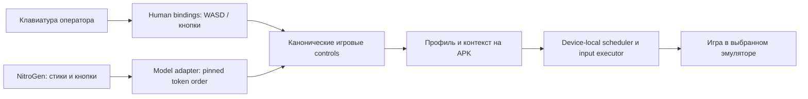

# Профили игрового управления и прямой моторный клиент

Основная архитектура и порядок приёмки — [единый проект игрового AI-контура](MOTOR-AI-PLATFORM.md).
Здесь сохранены подробности игрового профиля; реализация и передача владения DAG/эпизоду ещё требуются.

17 октября: добавлены [shadow policy и независимая проверка model action chunks](../audits/2026-10-17/MOTOR-REALTIME-SHADOW04.md). Это не исполнение данного профиля и не multi-touch. Конечный single-finger probe также не является WASD/game executor; зоны по-прежнему требуют отдельной калибровки и native capability.

16 октября 2026 · **проектное решение, не реализованный API или установленная функция**.
Основа — [аудит NitroGen](../audits/2026-10-16/NITROGEN-READINESS.md),
уточнение владельца: Black Russia/GTA-подобная игра, движение к метке, отдельная GPU-станция,
4–5 наблюдений/с на устройство, в перспективе около 50 эмуляторов.

## Цель и границы

Один версионируемый профиль связывает игровые controls с вводом Android. Им пользуются и оператор
с клавиатурой, и внешний motor worker. Профиль не зависит от фокуса окна Windows или открытого браузера.
NitroGen выдаёт исходные gamepad values; их преобразование и физическое исполнение — отдельные компоненты.

На скриншоте владельца показан редактор LDPlayer 9.5.6.0 на launcher, не раскладка внутри игры.
По этому скриншоту нельзя калибровать зоны Black Russia. Документация
[LDPlayer keymapping](https://www.ldplayer.net/support/introduction-to-keyboard-mapping.html?n=66) и
[BlueStacks Controls Editor](https://support.bluestacks.com/hc/en-us/articles/360058928871-How-to-create-and-edit-controls-in-BlueStacks-5)
подтверждает подход: зоны касания, движение, камера, схемы и назначение клавиш.
Это продуктовый ориентир, не существующий открытый SDK для встраивания в Sphere.

## Почему нельзя просто включить WASD в LDPlayer

Наш [RootTouchBridge](../../android/app/src/main/java/com/sphereplatform/agent/commands/RootTouchBridge.java)
инъецирует KeyEvent **в Android**. Клавиша, отправленная APK, не проходит через Windows keymapping LDPlayer.
Само наличие профиля WASD в окне эмулятора не преобразует такой Android KeyEvent в движение пальца.

Для нашего прямого пути профиль должен исполняться в APK либо в проверенном device-local input adapter.
Резервный вариант с Windows mapper требует отдельной адресации экземпляра и испытания без фокуса окна;
его нельзя объявлять рабочим для 50 экземпляров по наличию горячих клавиш.

## Общий исполнитель для человека и модели

WASD переводится в двумерный вектор; диагональ нормализуется, чтобы не давать скорость √2 от обычной.
Аналоговый выход модели сохраняет амплитуду: преобразовывать его сначала в четыре клавиши не требуется.
Схемы ходьбы/езды/меню отличаются; profile context переключается явно и подтверждается вместе с revision.
Автоматическое распознавание контекста допускается позже, с confidence и остановкой при неопределённости.

### Типы привязок первого этапа

| Тип | Назначение | Важные параметры |
| --- | --- | --- |
| `virtual_stick` | Движение, аналоговый руль | Центр, радиус, dead zone, curve, знаки осей, fixed/dynamic anchor, neutral=release/center |
| `hold_zone` | Газ, тормоз, удерживаемая кнопка | Точка/область, press/release, максимальная непрерывная длительность |
| `tap_zone` | Разовое действие | Точка, уникальный edge ID, длительность и deadline; без повторного tap при retry |
| `camera_drag` | Поворот камеры | Разрешённая область, чувствительность, инверсия, предел drag и переустановка пальца |
| `android_key` | Поддерживаемая физическая клавиша | Allowlist, down/up, chord/cleanup; только если игра её действительно понимает |

Для игры с виртуальным рулём можно добавить `steering_wheel` после отдельной калибровки.
[BlueStacks описывает разные способы руления](https://support.bluestacks.com/hc/en-us/articles/360062477251-How-to-steer-in-racing-games-on-BlueStacks-5):
wheel rotation, tap, tilt, swipe и D-pad. Профиль нельзя универсально угадать по названию игры.

Нулевой stick отпускается или центрируется согласно проверенному профилю. Ненулевой stick:
DOWN в anchor → MOVE к смещению → последующие MOVE на том же pointer ID → UP при neutral.
Радиус задаётся относительно меньшего размера логического Android display; X/Y центра — нормализованно.
Rotation, capture crop и letterbox преобразуются через подтверждённую геометрию; координаты окна Windows не используются.
Dead zone не является магическим константным значением для всех игр: её калибруют и записывают в profile revision.

### Контракт профиля

| Группа | Содержание |
| --- | --- |
| Identity | schema version, profile ID/revision/hash, game package/build, input adapter version |
| Geometry | Android display geometry/aspect/orientation, transform rules, calibration capture ID |
| Bindings | Уникальные ID, тип, зона/anchor, источник semantic control, dead zone/curve, лимиты |
| Contexts | Пешком, автомобиль, меню; явные разрешённые переходы и neutral перед сменой |
| Capabilities | Нужное число контактов, gamepad/keyboard/root возможности, поддержанные протоколы |
| Calibration | Draft/calibrated, проверенный game build, дата и результаты ручного теста |

Непроверенный draft не получает разрешение исполнять ввод. Изменение game layout, orientation либо
capture epoch требует проверки совместимости; несоответствие останавливает управление, а не масштабирует
слепо координаты. Импорт чужих LDPlayer/BlueStacks схем возможен только после изучения формата и проверки;
совместимость их закрытых файлов сейчас не обещается.

## Multi-touch и версионирование

Нынешние [RootTouchSession](../../android/app/src/main/java/com/sphereplatform/agent/commands/RootTouchSession.java)
и [RootTouchWire](../../android/app/src/main/java/com/sphereplatform/agent/commands/RootTouchWire.java)
имеют один x/y и один held pointer. [SharedPointerArbiter](../../android/app/src/main/kotlin/com/sphereplatform/agent/commands/SharedPointerArbiter.kt)
допускает 10 участников, но не 10 одновременно удерживаемых пальцев. Это разные ограничения.

Для одновременного stick + camera + action нужен новый capability-negotiated contact-state protocol,
ограниченный native executor и версия root pipe. Не добавлять массив contacts в прежний fixed-size пакет.
APK76 продолжает обслуживать нынешний браузер; новый worker явно отклоняет неподдерживаемый профиль.

Требования к новому исполнителю:

- Стабильные pointer IDs и downTime, ограничение числа контактов по реальной capability устройства.
  Native POINTER_DOWN/POINTER_UP с корректными index и массивом всех текущих контактов.
- Детерминированный порядок переходов, отдельный подтверждённый release; частичный/неизвестный результат
  не объявляется успешным и требует cleanup согласно существующим правилам fencing.
- Явные contexts/profile hash/capture epoch и одного владельца motor episode; нельзя объединять
  пальцы двух некоординированных моделей в один жест.
- Human takeover освобождает весь AI state перед передачей контроля. Нынешний shared human режим
  остаётся отдельным режимом, его нельзя молча заменить эксклюзивным AI ownership.
- Предсказанный tap не повторяется после reconnect; удержание сохраняет состояние между соседними
  sample, а не создаёт DOWN/UP на каждом кадре.

Вариант с настоящим виртуальным Android gamepad через UHID также остаётся допустимым при поддержке игры
и kernel выбранного эмулятора; он описан в предыдущем аудите. При его выборе touch-профиль не нужен
для поддержанных gamepad controls, но меню/текст и смена схемы всё равно требуют контракта.

## Direct worker и локальное время исполнения

Worker подключается прямо к APK по WebRTC; H.264 и DataChannel принадлежат одному peer.
Backend выдаёт machine/device-bound права, согласует соединение и хранит эпизод/метрики.
Моторный data path не пересылается через сайт, central API, task queue или туннель.

Существующий прямой протокол всё ещё зависит от signaling renewal; непрерывность при потере backend
не принята. Для worker нужен отдельный bounded grant с привязкой к peer, device, episode и profile,
согласованным offline lifetime и правилами отзыва. Новый транспорт не должен обходить аутентификацию
или использовать скопированную browser session как постоянную machine identity.

Модель может наблюдать 4–5 раз/с, а APK плавно исполнять план с частотой 30–60 ticks/с.
По сети достаточно передавать короткий ограниченный по времени план, не делать 60 HTTP-запросов/с.
Tick frequency не увеличивает количество новых решений модели и не компенсирует старое наблюдение.

Observation ID и время его capture связываются с prediction и action plan. План содержит period,
срок начала/конца, sequence и epoch. Scheduler работает на локальном монотонном времени APK после
clock mapping; неподтверждённые wall clocks разных ПК напрямую не сравниваются.

Состояния осей можно заменять последним ещё не отправленным состоянием. Переходы кнопок/tap нельзя
терять при coalescing: нужны edge IDs и bounded ordered delivery. Новый план заменяет только будущую
часть старого; уже выполненные шаги не проигрываются ещё раз. Обработчик потери worker/кадров отпускает
оси, клавиши и все contacts независимо от доступности backend. TTL выбирается испытанием игры и GPU,
а не автоматически из нынешней 1500-мс touch lease.

## Роль DAG и задача «доехать до метки»

Нынешние [DAG schema](../../backend/schemas/dag.py) и [DagRunner](../../android/app/src/main/kotlin/com/sphereplatform/agent/commands/DagRunner.kt)
описывают конечные действия; motor episode action пока отсутствует. Его будущий lifecycle:
подготовить игру/профиль → запустить разрешённый эпизод → ждать результата → stop/cleanup → следующая задача.
Не следует превращать каждый inference frame в DAG node с task/result записью.

Goal coordinator живёт в worker и хранит цель, контекст пешком/машина, историю метки/прогресса и stop reason.
NitroGen — кандидат на motor policy. Нужен отдельный supervision loop: нет прогресса, потеря метки,
неподходящий контекст, коллизия/застревание, ручной перехват, достижение цели. Один видимый маркер не
доказывает, что модель умеет выбрать дорогу вокруг здания или перестроиться после столкновения.

Мини-карта может требовать отдельного ROI из исходного кадра для tracker/route coordinator: после resize
всего изображения до 256×256 мелкая метка может исчезнуть. Это не повод без проверки заменить вход
NitroGen только мини-картой или нарисованными стрелками. Фиксируются одинаковый source frame ID,
transform revision и отдельная стоимость tracker. Более редкое observation допустимо при измеренной
скорости движения/реакции; скорость игрового мира не замедляется от редких вызовов модели.

## Этапы и критерии

1. Разработать и проверить versioned native contact-state либо UHID adapter на безопасном тестовом экране:
   несколько удержаний, release, rotate, suspend, process death, частичный ACK и старый epoch.
2. Draft редактор поверх stream: разместить stick/hold/tap/camera, проверить отображение capture→display,
   сохранить revision, отдельно выполнить калибровку в игре. Редактирование не должно посылать gameplay input.
3. Дать человеку WASD через этот же профиль; проверить диагональ, смену car/on-foot, два контакта и кнопку,
   потерю фокуса браузера и остановку. Затем тот же профиль использовать с fake model.
4. Headless direct worker с fake policy и actual APK receipts: 4–5 observations/с при отдельной частоте
   исполнения, свежесть, color fidelity, reconnect и отсутствие старого replay.
5. Подключить NitroGen на отдельной GPU; сначала короткий контролируемый маршрут с видимой меткой,
   повторяемым стартом и ручной остановкой. Качество игры и throughput измеряются раздельно.
6. Приёмка 1 → 2 → 8 → 16 → 50 устройств по измеренному admission budget. Число 50 — целевой нагрузочный
   сценарий, не текущая заявленная ёмкость платформы или модели.

Новые endpoints, DAG actions, APK protocol, профильный редактор и gameplay этим документом не внедрены.
Реализован отдельно только [офлайн-калькулятор бюджета](../../scripts/pilot/motor_budget.py).
