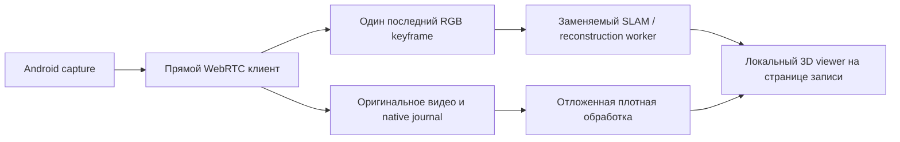

# Построение сцены во время записи маршрута

Срез исследования: 24 октября 2026. Подготовлен локальный DA3/Rerun preview;
первый offline service trial выполнен, единая карта/SLAM не квалифицированы. APK89 и ручной рекордер
проверяются отдельно в [доставке teaching](../audits/2026-10-24/WEB-TEACHING-CONTACTS.md).

## Результат для оператора

На странице записи нужны связанные представления: исходный Android-кадр,
трёхмерная сцена, траектория камеры и временная шкала действий. По мере прохода
появляются подтверждённые пространственные точки и положения камеры. Потеря
tracking останавливает дополнение карты; старые участки остаются видимыми с
явными границами. Пространственные точки нельзя дорисовывать по длительности
нажатия W или выдавать нейронную глубину одного изображения за измеренную карту.

Первый полезный результат — разреженная сцена и путь камеры. Плотная поверхность
с текстурами может строиться отдельным процессом позже. Готовая mesh не требуется
для визуальной локализации по известным видам маршрута. Ни одна из этих
визуализаций сама по себе не подтверждает проходимость дороги или автономное A→B.

## Проверенные первичные источники и кандидаты

| Компонент | Что действительно предоставляет | Ограничение для Sphere |
|---|---|---|
| [Rerun web viewer](https://rerun.io/docs/howto/integrations/embed-web) | Встраиваемый React/JS просмотр кадров, Points3D, Transform3D и временных рядов; данные могут поступать потоком | Это viewer, а не реконструктор. SDK и viewer должны иметь согласованные версии; self-host, без передачи частного видеопотока app.rerun.io |
| [AlvaAR](https://github.com/alanross/AlvaAR) | Реальный visual SLAM в WebAssembly, pose камеры, plane и frame features, пример с видео и Three.js | GPLv3, старые зависимости и открытые задачи устойчивой инициализации. Это кандидат CPU/Wasm-прототипа, а не доказательство плотной карты игры; публичный JS API не обещает готовый экспорт всей dense mesh |
| [Depth Anything3 Small/Base](https://github.com/ByteDance-Seed/Depth-Anything-3) | Any-view depth и camera pose; Small80M/Base120M, Apache2.0; официальный API принимает список кадров и экспортирует геометрию | Предпочтительный небольшой neural кандидат для первого bounded benchmark. Single-frame depth ещё не согласованная карта; время/память RX9070 и3070M нужно измерить |
| [DA3-Streaming](https://github.com/ByteDance-Seed/Depth-Anything-3/tree/main/da3_streaming) | Готовая chunk/overlap обработка видео, pose/intrinsics и combined point cloud | Это не готовый SLAM или low-latency browser service: авторы явно отделяют их pipeline от SLAM. Авторские8.51FPS измерены наA100 без загрузки/прогрева/сохраненияPLY |
| [StreamVGGT](https://github.com/wzzheng/StreamVGGT) | Причинная нейронная реконструкция последовательности; опубликованы код и checkpoint | Отдельный GPU-процесс; рост cache/ресурсов нужно измерять. Скорость авторского demo нельзя переносить на RX9070/3070M или десятки устройств |
| [STream3R](https://huggingface.co/yslan/STream3R/blob/main/README.md) | Потоковая геометрия, вариант ограниченного sliding window | Авторы приводят около6.53GB для window5 и518×384 на H200. Это не обещание такого времени на3070M; вместе с моторной моделью8GB могут оказаться недостаточны |
| [SceneVGGT](https://hbvc-ai.github.io/SceneVGGT/) | Online semantic SLAM и пример навигационного модуля | Авторская оценка памяти <17GB не укладывает автоматически весь стек в16GB и исключает выбор его по умолчанию для8GB |
| [AETHER-SLAM](https://github.com/sahaj2310-tech/AETHER-SLAM) | Пример сочетания monocular SLAM, neural depth, TSDF и React/Three.js | Небольшой интеграционный проект; заявленные4GB/8–14FPS не являются нашей проверкой. Использовать как пример связей, не как основание production-допуска |

Согласно [описанию устройства Rerun](https://rerun.io/docs/concepts/how-does-rerun-work),
его web viewer имеет практическое ограничение памяти порядка2GiB. Это верхняя
граница технологии, а не разрешённый бюджет нашей страницы. Встроенный viewer
нужно загружать по требованию и ограничивать объём отображаемой сцены.

## Выбранная последовательность

1. Сначала закончить оригинальное H264+native journal на PH011. Счётчик frames,
   COMPLETE, независимое декодирование и CLOSED должны подтверждаться настоящим
   материалом. Пустой или неполный клип не направлять в реконструктор как успешный.
2. На одном качественном проходе сравнить готовый CPU/Wasm SLAM и один streaming
   neural backend. Модели, веса, исполняемые бинарники и лицензии фиксировать
   отдельно; автоматически не скачивать несколько тяжёлых моделей сразу.
3. Показать реальную pose/разреженную геометрию во встроенном локальном viewer.
   Затем подключать плотный backend, только если он улучшает тот же маршрут и
   укладывается в измеренный бюджет. Реконструктор и viewer заменяемы независимо.
4. После повторного входа в игру проверить локализацию на540p/render50% против
   master1080p/render100%. Прежде чем включать мотор, измерить ложные совпадения,
   tracking loss, возврат на уже известный участок и ошибку после полного круга.

Для первого trial разумно отдавать реконструктору уменьшенные keyframes, сохраняя
исходник высокого качества. Целевые5Hz/640×360 — конфигурация эксперимента, не
подтверждённая производительность. Частоту motor corrections и частоту mesh/viewer
обновлений разделять. Реконструкция не должна удерживать захват, ввод или запись.

## Поток данных и ограничения

Sidecar принимает только данные явно начатой сессии: session/epoch, номер и часы
кадра, геометрию, intrinsics или статус их неизвестности, маски, version/hash
backend. Никаких токенов Sphere или доступа к управлению ему не требуется.
Выход: camera pose convention, map epoch, points/colours/confidence, шкала
`relative` либо `anchored`, tracking status и причина потери. Неизвестный scale
не подписывать метрами. Смена источника или размеров закрывает текущую карту.

Проектные пределы первого canary: один активный реконструктор, один ожидающий
кадр без очереди старых кадров, до100000 отображаемых точек, до2048 pose samples,
размер сообщения≤4MiB, UI обновления≤2Hz, отдельный cap журнала/экспорта. Обновление
облака идёт по map epoch и revision; пропущенный delta требует нового snapshot.
Overflow, NaN, неверный transform, несовпадение capture или stale frame отвергаются.
Отказ reconstruction оставляет работающими ручную запись и аварийную остановку.

В третьем лице требуется маска персонажа, HUD/чата/миникарты и динамических
игроков/машин. Нельзя просто занулить HUD и считать задачу решённой: крупный
персонаж закрывает дорогу, деревья движутся, тени и повторяющиеся фасады дают
ложные соответствия. Чистый поворот камеры без перемещения не даёт достаточного
параллакса для устойчивой глубины. Intrinsics/FOV камеры игры и DPI Android —
разные параметры; изменение FOV/зумов требует новой калибровки.

## Допуск перед использованием карты для маршрута

- Настоящие keyframes связаны с native input и просмотром по одной временной оси;
  Android capture-clock mapping всё ещё отдельная задача.
- Карта выдержала петлю, потерю tracking, relocalization и повтор из другой точки.
- Масштаб явно неизвестен либо подтверждён независимыми anchors; координаты чата
  и калиброванная миникарта могут быть adapters, но не обязательным ядром системы.
- Проверены ресурсные пики, остановка страницы, закрытие worker и отсутствие
  роста памяти после нескольких материалов. На десятках устройств тяжёлая
  реконструкция не запускается одновременно по умолчанию.
- На странице видны реальные точки/камера и tracking uncertainty. Красивая
  синтетическая сетка, depth одной картинки или записанные WASD не выдаются за
  карту мира. Пока эти проверки не выполнены, reconstruction остаётся preview
  и не разрешает мотору самостоятельно объезжать объекты.

## Первый воспроизводимый preview

Установлены локально DA3-SMALL и Rerun0.40.0, отдельно от окружения транспорта.
Официальный checkpoint revision `e08cab65ca0ec38e7826075418411ab90cab4da3`,137248940bytes,
SHA-256 `364492e38a3a06d221ac75da7f6621ada3f2361cd24fde11ba79091e9f40efcf`.
Закреплённый upstream `3d835ec1a5802d64a8b8b15f817a1ab54809bfe4`.
Реально создано34299463параметра; опубликованная оценка размера семейства не
используется как доказательство фактического количества в этом checkpoint.
Alias-aware strict safetensors load обязателен: shared LayerNorm tensors не
маскируются `strict=False`. CPU и RX9070 inference успешно выполнены.

`scripts/pilot/teaching_scene.py` принимает явно разрешённые свежие JPEG из
существующего browser video и публикует реальные Points3D/Pinhole/Transform3D.
Дополнительного Android peer нет. На двух **исторических** Black Russia кадрах
service trial дал4266точек, три GPU inference1098/474/32мс, общий HTTP round trip
1203–2344мс, включая проверку ресурсов. Это offline smoke, не live навигация,
не5Hz карта и не полная Android→модель задержка. Rerun визуально показал точки,
два исходных ракурса и две камеры. Встроенная панель отделяет геометрию от ввода.

Каждая пара реконструируется заново; окна не сшиваются в глобальную карту,
scale неизвестен. Фиксированная preview маска HUD/avatar не является semantic
segmentation. Следующий допуск — качественный игровой human master, выравнивание
перекрывающихся окон с confidence, loop/relocalization и независимый low-render
повтор. [Запуск и ограничения](../operations/TEACHING-WEB.md#локальная-живая-3d-панель).

Browser renderer isolation опирается на разные sites, не только порты. См.
[Chromium Site Isolation](https://www.chromium.org/developers/design-documents/site-isolation/).
Проверка отдельного renderer в конкретном браузере остаётся runtime-фактом;
URL сам по себе не доказывает отсутствие stalls. Холодный viewer запускается
до ввода; watchdog/native lease не продлеваются ради3D.

## Случайные объекты, трафик и HUD: что именно портится

Оригинальная видеозапись остаётся пригодной: NPC, игроки, интерфейс и их тайминги
в ней сохраняются как наблюдались. Меняются условия реконструкции и повторения:
тот же журнал клавиш не обязан привести к той же точке при другой машине на дороге,
толкнувшем игроке или сменившемся положении персонажа. Запись не делает мир детерминированным.
Маски/семантика — отдельные версионированные производные, raw H264 не закрашивается.

| Источник | Риск для карты/локализации | Требуемая обработка |
|---|---|---|
| HUD, чат, миникарта, экранные кнопки | Пиксели стабильны относительно экрана и могут перетянуть оценку камеры на ложное нулевое движение | Профиль экранных масок до извлечения pose features; HUD остаётся доступен отдельному GPS/UI observer |
| Собственный персонаж/оружие | Закрывает дорогу и анимируется независимо от камеры | Self mask по camera mode; смена вида/FOV инвалидирует калибровку |
| NPC и другие игроки | Несовместимые между ракурсами точки, ложная геометрия/ложные совпадения | Семантическая маска плюс residual motion после компенсации ego-motion; временные track IDs |
| Машины, включая припаркованные | Сегодня выглядят неподвижными, при повторе исчезают; при этом реально мешают проезду | Не использовать как постоянные anchors; отдельный краткоживущий слой препятствий для online controller |
| Тени, дождь, вода, листва, отражения | Видимое движение не равно движению твёрдого объекта; глубина может быть нестабильной | Геометрическая согласованность нескольких видов, confidence и отказ от fusion при низком качестве |
| Магазин, AFK/disconnect, карта/меню | Свежий видеопоток способен изображать не игровой мир | Отдельный gameplay-state gate; при меню не дополнять карту и не объявлять маршрут продолжающимся |

Ключевое различие: **исключить машину из постоянной карты не значит игнорировать
её при движении**. Долгоживущий статический слой и текущие препятствия обслуживают
разные задачи. Неизвестный/закрытый участок не становится свободным по inpainting
или нейронному предположению о фоне. При плохой видимости нужна остановка/другой
ракурс, а не выдуманное продолжение дороги.

[DynaSLAM](https://arxiv.org/abs/1806.05620) подтверждает методологию сочетания
геометрии нескольких видов и определения движущихся объектов для статической
карты. Это источник подхода, не установленный современный backend Sphere.
[SAM2/2.1](https://github.com/facebookresearch/sam2) предоставляет promptable video
segmentation/tracking, но требует инициализации объектов и не доказывает сам
по себе автоматическое обнаружение всех игровых NPC или работу на нашей AMD.
Новый segmentation backend не скачивается до отдельного benchmark/лицензионного
выбора; маски должны быть заменяемым provider, а не привязкой ядра к Black Russia.

**Текущий реальный предел:** в `teaching_scene.unproject` грубая фиксированная маска
отбрасывает точки краёв HUD/центра персонажа уже **после** DA3 inference. Она не
исключает эти пиксели из оценки camera pose. Закреплённый DA3 `forward` не принимает
готовый arbitrary pixel mask; добавить маску только в PointCloud недостаточно.
Нужен подходящий mask-aware pose estimator/feature frontend либо проверенная
калиброванная ROI-обработка и отдельная fusion mask. До этого даже визуально
красивое облако не является устойчивой картой в толпе.

Допуск: повтор одного маршрута при разных NPC/трафике/свете; измерение pose drift,
ложных relocalization, static-map contamination, потерь tracking и правильного
отказа на меню/полном перекрытии. Отдельно проверить объезд новой машины во время
повтора. Первичный проход лучше делать в спокойной локации, с постоянным FOV,
1080p/100%render, фактическим стабильным FPS; затем независимо испытывать
960×540/render50%. Более качественный scan уменьшает шум, но не отменяет динамику.
