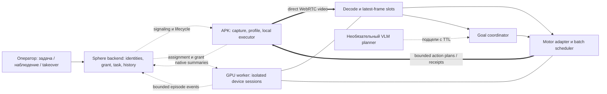
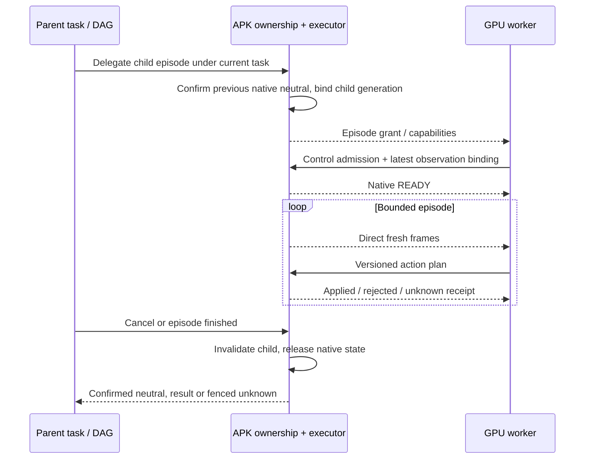
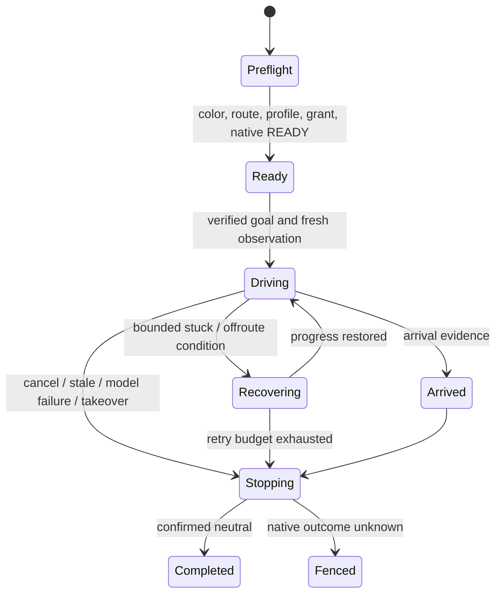

# Игровой AI-контур Sphere: архитектура, модели и план реализации

**Текущий срез · 17 октября 2026:** UI/API `15ce2b62`, APK82 сохранены. NitroGen/P2P реально запущены на локальной RX9070 через direct PH011. Добавлены held-center stick contact, исполнение latest18-state gamepad trajectory и explicit WASD adapter. Последний45-с NitroGen8 опыт:235 решений/5.182Гц,571/571 native APPLIED, один непрерывный контакт и подтверждённое закрытие. Метка241→241м: навигация не принята. P2P150M проверялся без text conditioning; сравнение пригодности ещё открыто. [Факты, ограничения и goal-контур](../audits/2026-10-17/MOTOR-STICK-CONTACT-LIVE.md). Поставляемый model loader/preprocessing, камера/multi-touch, source capture/action clocks и отдельная GPU/LAN ещё нужны.

**Recovery этап:**122 motor tests подтвердили ограниченный supervisory layer прогресса/падения, at-most-once double tap/camera sequences и optional optical-flow sensor. Это не семантическое распознавание зданий и не integrated obstacle avoidance; native multi-touch открыт. Положительный live jump/camera test пока заблокирован подключением игры. [Срез и evidence](../audits/2026-10-17/MOTOR-NAVIGATION-RECOVERY.md).

**Последующий goal-опыт:** отдельный5Гц CV visual servo довёл персонажа к пользовательской метке; прибытие подтверждено пользователем,36/36 native APPLIED и CLOSED. Нейросети не использовались, поэтому learned goal navigation остаётся открытой. [Результаты и пределы](../audits/2026-10-17/MOTOR-WAYPOINT-SERVO.md).

**Единый рабочий документ · 17 октября 2026 · версия 2.5.**

Назначение: подготовить реализацию отдельной GPU-станции, которая получает экран Android APK
напрямую и управляет игрой без открытого браузера. Первый целевой сценарий — движение к метке
в Black Russia / GTA-подобной игре. Перспектива — около 50 эмуляторов, 4–5 свежих наблюдений
в секунду на устройство. Локальный GPU inference pilot выполнен; игровой executor и gameplay не приняты.

Документ объединяет требования владельца, анализ Sphere, исследование моделей, протоколы,
эксплуатацию и критерии приёмки. Он задаёт основное направление; прежние датированные отчёты
сохраняются как свидетельства. Машиночитаемый состав исследования и хеши исходников —
[MOTOR-AI-SOURCE-REVIEW.json](../audits/2026-10-16/MOTOR-AI-SOURCE-REVIEW.json).

**Транспортный этап0.3, сохранённый в0.4:** worker принимает direct H.264, выбирает RGB-наблюдения около5Гц и с явным opt-in отправляет короткий DOWN/MOVE/UP без браузера. Это проверка single-finger dispatch, а не модельный или игровой executor. Default остаётся без физических действий. Исправлены совместимость с `input_availability` APK80+ и порядок штатного завершения peer; реальные отрицательные прогоны сохранены в новом отчёте.

На нынешнем локальном Windows ПК установлены официальный AMD ROCm/PyTorch и проверенные веса двух моделей. Установка на отдельную GPU-станцию ещё не выполнена. LAN-маршрут, source/action clock correlation, полная parity модельного preprocessing, профиль нескольких controls и автономная игра не приняты. [Предыдущая поставка транспорта77](../audits/2026-10-16/MOTOR-TRANSPORT-DELIVERY.md) остаётся исторической квитанцией.

**Дополнение0.4:** по повторному чтению NitroGen, NitroGen-Full, Nexto, MineStudio и VPT разделены доказательства реального игрового цикла, pause-based evaluation и специализированного structured-state бота. Реализованы bounded shadow loop, epoch/request lineage, сроки ответа и независимая проверка decoded action chunks. Это часть будущего model boundary, без сетевого GPU API или физических действий модели. [Источники, проверки и границы](../audits/2026-10-17/MOTOR-REALTIME-SHADOW04.md).

## Содержание

1. [Решение и фактическая готовность](#1-решение-и-фактическая-готовность)
2. [Требования и границы](#2-требования-и-границы)
3. [Что означает 5 Гц](#3-что-означает-5-гц)
4. [Как оценивались доказательства](#4-как-оценивались-доказательства)
5. [Моторные модели и альтернативы](#5-моторные-модели-и-альтернативы)
6. [VLM и планирование](#6-vlm-и-планирование)
7. [Работающие примеры и обсуждения](#7-работающие-примеры-и-обсуждения)
8. [Что уже есть в Sphere](#8-что-уже-есть-в-sphere)
9. [Целевая архитектура](#9-целевая-архитектура)
10. [Контракты и время](#10-контракты-и-время)
11. [Игровые профили и исполнитель](#11-игровые-профили-и-исполнитель)
12. [Владение вводом и DAG](#12-владение-вводом-и-dag)
13. [Навигация к метке](#13-навигация-к-метке)
14. [Нагрузка и выбор оборудования](#14-нагрузка-и-выбор-оборудования)
15. [Сбои и восстановление](#15-сбои-и-восстановление)
16. [Телеметрия, история и данные](#16-телеметрия-история-и-данные)
17. [Испытания и критерии приёмки](#17-испытания-и-критерии-приёмки)
18. [Развёртывание на GPU-станции](#18-развёртывание-на-gpu-станции)
19. [План реализации](#19-план-реализации)
20. [Принятые решения и открытые вопросы](#20-принятые-решения-и-открытые-вопросы)
21. [Источники и воспроизводимость](#21-источники-и-воспроизводимость)

## 1. Решение и фактическая готовность

**Направление технически обосновано. Готового контура «поставить NitroGen и запустить 50 машин» нет.**
В Sphere есть capture, прямой WebRTC, touch/keyboard primitives, task lifecycle и подтверждения
Android и начальный headless transport. Не хватает игрового worker executor, профилей, нескольких одновременных касаний,
сквозного observation/action contract, передачи владения от DAG и измеренной ёмкости GPU.

Предлагается сохранить APK как исполнитель и источник кадров, вынести inference в отдельный
worker, а backend использовать для допуска, задач и истории. На первом этапе сравнить
NitroGen с узким вариантом «компьютерное зрение + контроллер» на одной и той же короткой трассе.
VLM добавлять для подцелей и восстановления только после измерения пользы. Модель должна
заменяться без изменения транспорта и native executor.

| Область | На момент аудита | Что нужно доказать |
| --- | --- | --- |
| Прямой браузерный экран/ввод | Есть конечные положительные проверки и открытые дефекты | Длительный стабильный маршрут, корректность цвета и восстановления |
| Worker ↔ APK без браузера | Worker0.5: direct кадры, конечный single-finger probe, original-RGB shadow и локальный process provider | Физический LAN, поставляемый model loader/preprocessing, игровой executor и source/action freshness |
| NitroGen/P2P inference на RX9070 | Оба локальных checkpoint реально запускались; сохранены конечные замеры | Игровое качество, точный preprocessing P2P, отдельная GPU/LAN, throughput парка |
| WASD/model → игровые зоны | Есть проект, исполнения нет | Удержания, несколько пальцев, контексты, отмена |
| Навигация Black Russia | Не проверена | Доезд к метке, отсутствие застреваний, подтверждение финиша |
| 50 устройств × 5 Гц | Есть калькулятор, нет benchmark | 250 свежих решений/с с допустимым хвостом задержек |
| Коммерческое использование NitroGen | Не согласовано | Лицензия конкретного компонента; non-commercial research ограничивает выбор |

Первоначальный source-аудит выполнен на `38ec739fa6239806c0f5bd5ab624fc129aa46012`; он не подменяет новые проверки. Текущая установленная платформа — веб/API `15ce2b62`, APK `1.2.82-dev /10282` на четырёх online; package SHA/OTA подтверждены,17offline исключены. [Установка82](../audits/2026-10-16/POINTER-TIMELINE82-DELIVERY.json). Worker0.5 запускается из локального checkout. Веса скачаны, локальный RX9070 inference проверен, но на отдельной GPU/LAN модуль ещё не поставлен, модельное управление игрой не принято.

## 2. Требования и границы

### 2.1. Прослеживаемые требования

| ID | Требование | Проверка / раздел |
| --- | --- | --- |
| AI-01 | GPU отдельно от эмуляторов, как минимум в одной LAN | Реальный маршрут и трафик, G02 |
| AI-02 | Видео и действия APK ↔ worker без браузера в data path | Закрыть все браузеры, G02 |
| AI-03 | Backend согласует доступ, не пересылает каждый кадр по умолчанию | Счётчики relay, G02 |
| AI-04 | Direct выбирается по фактической достижимости | ICE pair, адреса/интерфейсы, G02 |
| AI-05 | Видео READY и control READY проверяются отдельно | Native admission/ACK, G02–G03 |
| AI-06 | Цель — 4–5 свежих наблюдений/с/device | Capture IDs и возраст, G04 |
| AI-07 | Удержание газа/стика между наблюдениями | Локальный scheduler, G03 |
| AI-08 | Около 50 устройств — цель, не принятая ёмкость | Ступени нагрузки, G09 |
| AI-09 | Профиль работает без фокуса окна эмулятора Windows | Два экземпляра, G03 |
| AI-10 | Оператор и модель используют одинаковую семантику controls | Профиль и capability, G03 |
| AI-11 | Руль/газ/камера могут работать одновременно | Multi-touch или проверенный gamepad, G03 |
| AI-12 | Явное владение human / task / AI | Atomic handoff, G05 |
| AI-13 | Человек может прервать эпизод | Native neutral, G05 |
| AI-14 | После reconnect старые действия не повторяются | Epoch/sequence/fault tests, G06 |
| AI-15 | Неизвестный исход ввода виден и блокирует опасное продолжение | Receipt/fence, G06 |
| AI-16 | Адаптер не путает изображение, устройство и эпизод | Межклиентная изоляция, G04 |
| AI-17 | Модель получает правильные цвета, ориентацию и crop | Golden frames, G01 |
| AI-18 | Цель A→B отделена от реакции по одному кадру | Goal coordinator, G08 |
| AI-19 | Проверяется игровое качество, а не только FPS | Повторные маршруты, G08 |
| AI-20 | Нет неограниченных PNG/MP4/JSONL на каждом шаге | Квоты и retention, G10 |
| AI-21 | Модель, профиль, preprocessing и seed версионируются | Episode manifest, G07 |
| AI-22 | VLM не блокирует быстрый моторный цикл | Deadline/TTL ответа, G07 |
| AI-23 | Работа после потери backend имеет явную политику | Ограниченный grant, G06 |
| AI-24 | Деградация нагрузки не скрывает нарушение 5 Гц | Admission и rejected reasons, G09 |
| AI-25 | Все режимы просмотра сохраняют единый транспорт/исполнитель | Control/view/record/XPath, G11 |
| AI-26 | Есть воспроизводимые установка, остановка и откат | Артефакты и runbook, G12 |

### 2.2. Что не следует смешивать

50 эмуляторов на GPU-станцию, 20 зрителей одной машины и 10 участников нынешнего shared input —
разные задачи. В этом проекте AI получает один управляемый эпизод на устройство, а люди могут
наблюдать и явно перехватывать управление. Пользовательский режим «последнее нажатие побеждает»
для людей сохраняется как отдельная политика. Постоянная борьба AI с живыми кликами не должна
считаться корректным обучением или нормальным автономным режимом.

Удалённая GPU по LAN не означает localhost для APK: Android находится внутри NAT эмулятора.
Близость устройств не отменяет firewall, изоляцию клиентов Wi-Fi/хотспота, VPN и маршрутизацию.
Проверяется доступность конкретных сетевых интерфейсов. При внешнем signaling интернет может
потребоваться для первоначального допуска; независимость уже установленного эпизода требует
отдельного ограниченного по времени grant. В нынешнем коде она не принята.

## 3. Что означает 5 Гц

Идея владельца верна в одном важном отношении: **не нужно отпускать W после каждого решения**.
Пять решений в секунду могут означать «сохранять газ и чуть поправить руль», а не пять отдельных
тапов. Нужны четыре независимых параметра:

| Параметр | Начальный сценарий | Смысл |
| --- | --- | --- |
| Частота источника изображения | Фактические 30/60 FPS либо меньше | Что выдаёт игра/capture |
| Частота наблюдения модели | 5 Гц | Новое пригодное изображение каждые 200 мс |
| Горизонт предсказания | Зависит от модели и конфигурации | Сколько будущих состояний controls вычислено |
| Локальное исполнение | Предлагается до 30–60 тиков/с, по измерениям | Своевременное удержание/перемещение/отпускание на APK |

Постоянный газ удерживается без повторных DOWN. Координата стика меняется по локальному
плану; UP/CANCEL происходит по завершению, истечению срока или остановке. «Исполнять 60 Гц»
не означает генерировать 60 одинаковых native событий/с: неизменное состояние не надо дублировать.

### 3.1. Почему частота не равна полной задержке

Пример: 5 Гц, кадр ждёт выборки, затем decode/очередь/GPU/возврат/Android. Даже при маленьком
RTT свежее решение может оказаться старше 200 мс. Событие сразу после выборки ждёт почти
полный период до следующего наблюдения, а затем вычисление. Поэтому учитывать нужно
возраст кадра при исполнении и хвост распределения задержек, а не только среднее FPS.

Для иллюстрации, при условных 15 игровых метрах/с за 200 мс машина проходит 3 м,
за 500 мс — 7,5 м. Это арифметика, не измерение Black Russia. Низкая скорость и простая трасса
могут позволять 5 Гц; тесный поворот, высокая скорость и внезапная помеха могут потребовать
большей частоты либо меньшей скорости. Аналогия с человеком не заменяет эксперимент.

### 3.2. Action chunks и непрерывная игра

У закреплённого NitroGen checkpoint горизонт18 состояний; последовательное исполнение
при60Гц занимает300мс ещё до добавления следующего inference.16 denoising steps — другой параметр.
Референсный environment может приостанавливать игру между шагами через XSpeedHack.
Android multiplayer продолжает жить во время расчёта; пауза здесь не предполагается.
[Исходник runner](https://github.com/MineDojo/NitroGen/blob/32608444660950ffda95e1e57c79632ad65bea10/nitrogen/game_env.py).

Нужен цикл с коротким исполняемым префиксом: получить самый свежий кадр, предсказать план,
исполнить ограниченную часть, снова наблюдать. Перекрытие вычисления и исполнения проектируется
явно; нельзя просто обрезать chunk до 5 действий и объявить, что модель стала пятигерцовой.
Изменения горизонта, шага времени, noise и preprocessing проходят отдельную проверку качества.

У закреплённого Open Pixel2Play150M ответ — одно keyboard/mouse state, обученная временная шкала20Гц.
Получать новый кадр5раз/с не эквивалентно запускать исходную20Гц policy: меняются интервалы history и
необходимая длительность удержания. Worker0.5 сохраняет исходную семантику50мс и не растягивает её
автоматически. Для5Гц нужен проверенный controller/profile с ограниченным удержанием, измерением
качества и корректным expiry; положительный shadow benchmark этого не доказывает.

Сравнить 2/5/10/20 Гц на одном наборе маршрутов и одной скорости. Принять 5 Гц, если качество
в установленном игровом диапазоне проходит G08; иначе показать стоимость повышения частоты
или ограничить область применения. Нельзя маскировать плохую управляемость увеличением lease.

## 4. Как оценивались доказательства

| Уровень | Что действительно известно |
| --- | --- |
| E0 | Обещание, название, скриншот, чужая пересказанная новость |
| E1 | Прочитан код/интерфейс; доступность артефактов проверена по метаданным |
| E2 | Автор публикует демонстрацию или собственный запуск с ограничениями |
| E3 | Есть описанный замкнутый benchmark, метрики и материалы для воспроизведения |
| E4 | Мы воспроизвели на выбранной игре/устройстве с сохранённой квитанцией |
| E5 | Мы прошли нагрузку, длительность и отказы в целевой конфигурации |

E3 в Minecraft не превращается в E4 в Black Russia. Доступность `.pth` не означает, что файл
проверен загрузкой. Ссылка на MP4 означает наличие авторского демо; здесь такие видео
не скачивались и не просматривались. Issue — свидетельство конкретного пользователя,
если нет воспроизведения и ответа автора; популярность репозитория не является уровнем доказательства.

В просмотренных источниках **не найден воспроизводимый готовый комплект именно для Black Russia,
APK Sphere и 50×5 Гц**. Это граница проведённого поиска, не утверждение, что такого нигде не существует.

## 5. Моторные модели и альтернативы

### 5.1. Короткий список

| Решение | Вход / выход | Доступность и доказательства | Роль для Sphere |
| --- | --- | --- | --- |
| NitroGen | RGB → gamepad actions | Код/веса; research policy; E1 здесь, авторская игровая оценка | Первый общий моторный baseline, с адаптером |
| Open Pixel2Play150M | RGB192×192 + optional text → keyboard/mouse | Авторский unpaused real-time; здесь реальный AMD eager inference через Sphere, без model input execution | Более быстрый локальный baseline; необходим Android key/mouse→touch profile, no-text режим пока отдельно |
| Узкая модель зрения + PID/правила | Полосы/мини-карта → руль/газ | Есть близкий GTA V проект с демо, E2 автора | Равноправный baseline для задачи A→B |
| Обученный на наших демонстрациях небольшой policy | Экран/цель/история → controls | Пока проект; данных и модели нет | Следующий вариант, если generalist не справляется |
| GameWAM | Кадры, task, game state → клавиатура/мышь | Код, checkpoints, benchmark Minecraft/ViZDoom, E3 автора | Исследовательская альтернатива после проверки входов и GPU |
| OpenHA / Minecraft policies | Игровые наблюдения → действия Minecraft | Код, модель, benchmark в своей среде | Иерархия/методика, не готовый Android driver |
| SIMA 2 | Экран и язык → игровые действия | Ограниченный research preview | Архитектурный ориентир; локальные веса не подтверждены |
| Game-TARS | Мультимодальная игровая policy | Paper и project page; открытый checkpoint не подтверждён | Следить за выпуском; не блокировать реализацию |
| Cosmos3 | Мультимодальная физическая/world/action модель | Открытые компоненты и специализированные embodiments | Не считать готовой gamepad policy |

### 5.2. NitroGen: пригодность и ограничения

Закреплены код `32608444660950ffda95e1e57c79632ad65bea10` и веса
`584c8dded734d032f07a4bcc0ccb330e703298c4`. Это компактный по сравнению с VLM моторный кандидат
около 493M параметров: RGB 256×256, gamepad output. Текстовая цель и route planner не входят
в нынешний inference interface. Фактическая схема кода — 21 button/trigger columns + 4 stick
coordinates; расхождение с кратким описанием model card проверено отдельно.
[Модель](https://huggingface.co/nvidia/NitroGen),
[интерфейс inference](https://github.com/MineDojo/NitroGen/blob/32608444660950ffda95e1e57c79632ad65bea10/nitrogen/inference_client.py).

Sampling стохастический: `torch.randn` в model code. Для сравнения нужны изолированные seed/noise
на эпизод и фиксированные версии. Одного `eval()` недостаточно. Стандартный сервер с ZMQ/pickle,
общим session state и одним REP loop не является сервисом на 50 независимых устройств.
Веса загружаются через доверенный PyTorch checkpoint; provenance и checksum фиксируются до запуска.
[Model code](https://github.com/MineDojo/NitroGen/blob/32608444660950ffda95e1e57c79632ad65bea10/nitrogen/flow_matching_transformer/nitrogen.py),
[serve.py](https://github.com/MineDojo/NitroGen/blob/32608444660950ffda95e1e57c79632ad65bea10/scripts/serve.py).

Стратегия: изолированный адаптер, один supervised эпизод, измерение качества и tail latency.
Не обещать zero-shot доезд по мини-карте. Лицензия закреплённого кода/весов ограничивает применение
non-commercial research; это отдельный gate выбора для коммерческой установки.
[LICENSE](https://github.com/MineDojo/NitroGen/blob/32608444660950ffda95e1e57c79632ad65bea10/LICENSE).
Точная проверка действий, лицензии, зависимостей и community reports сохранена в
[первом аудите](../audits/2026-10-16/NITROGEN-READINESS.md).

### 5.3. GameWAM: современная, но не прямая замена

Авторы предлагают совместное обучение будущего видео и действий; онлайн исполняется короткий
префикс и выполняется новое наблюдение. Опубликованы код и отдельные checkpoints Minecraft/ViZDoom.
На своей MCU оценке заявлены 50,7% Mini / 46,6% All и средняя execution frequency 12,51 Гц
на одном H200. Это авторские показатели в указанных средах, не наши 250 inference/с.
[Project и результаты](https://yunncheng.github.io/GameWAM/),
[paper](https://arxiv.org/abs/2608.26200).

В paper время этой оценки исключает simulation/execution среды: это model-side measurement,
а не полная частота обратной связи живой игры. В опубликованной Minecraft конфигурации стоит
20 FPS; префикс из 8 действий соответствует 400 мс игрового времени. Поэтому число 12,51 Гц
нельзя автоматически читать как 12,51 новых наблюдений/решений в секунду на каждом APK.
[Методика измерения, C.6](https://arxiv.org/html/2608.26200v1#A3.SS6),
[конфигурация simulator](https://github.com/yunncheng/GameWAM/blob/e3a3d29a1eef4bc1f51ec161652bcc158f908321/configs/sim_minecraft.yaml).

Checkpoint построен на Wan2.2-TI2V-5B + ActionDiT 1B. У модели Minecraft 22-мерные keyboard/mouse
actions и 15-мерное canonical state с маской достоверности; ViZDoom использует POSITION_X/Y,
ANGLE и HEALTH. Предсказание 16 шагов, исполнение 8; каждому checkpoint нужны соответствующие
`dataset_stats.json`. Подставлять нули вместо отсутствующих игровых данных без испытания нельзя.
Apache-2.0 указана для опубликованных артефактов; зависимости проверяются отдельно.
[Закреплённая карточка](https://huggingface.co/Yunncheng/gamewam-models/blob/6486a716c9b7dc969f1999a26c78aea7967c1de3/README.md).

Наше решение: сохранить в сравнении, но не ставить первым dependency проекта. Нужны адаптер
Black Russia, исследование отсутствующего state и benchmark на будущей GPU. Требования обучения
8×H200 из README не являются автоматически требованиями inference, а дробная Ray GPU allocation
не означает изоляцию памяти или гарантированное число параллельных эпизодов.
[Код и окружение](https://github.com/yunncheng/GameWAM/tree/e3a3d29a1eef4bc1f51ec161652bcc158f908321).

### 5.4. Почему не выбирать по самым свежим демонстрациям

[SIMA 2](https://deepmind.google/blog/sima-2-an-agent-that-plays-reasons-and-learns-with-you-in-virtual-3d-worlds/)
показывает цельный language/vision/game-control подход, но анонсирована как limited research preview
с доступом выбранной группе. Публичный комплект локальных весов для нашей SSH-установки не подтверждён.

[Game-TARS](https://seed-tars.com/game-tars/) публикует результаты общего игрового агента;
[paper](https://arxiv.org/abs/2510.23691) не заменяет installable release.
В [официальном репозитории UI-TARS, issue #232](https://github.com/bytedance/UI-TARS/issues/232)
вопрос об открытом выпуске Game-TARS остаётся без ответа на момент среза. Это не доказательство
вечной закрытости, но оснований закладывать доступные веса сейчас нет. Одноимённый небольшой
Game-TARS для tic-tac-toe из другого аккаунта — другой проект.

[OpenHA](https://github.com/CraftJarvis/OpenHA/tree/606efc69e945bd02c700e584136bcc105d22f122)
и его [ICML paper](https://proceedings.mlr.press/v306/wang26do.html) полезны как пример иерархии
действий и проверки множества задач. Minecraft action space, наблюдения и benchmark не переносятся
в GTA через переименование кнопок.

[Cosmos3-Nano](https://huggingface.co/nvidia/Cosmos3-Nano) — актуальный 16B представитель Cosmos3,
а не прежний Reason2 как «последняя модель». Поддерживаемые action embodiments в карточке —
камеры, автомобили и роботизированные платформы; это не контракт gamepad NitroGen или Android touch.
Рекомендованная частота видео для reasoning не доказывает частоту замкнутого управления игрой.
Семейство можно исследовать для восприятия, но не включать в обязательный первый моторный путь.

## 6. VLM и планирование

VLM может определять контекст: в машине ли персонаж, открыто ли меню, видна ли метка, застряла ли
машина, нужна ли новая подцель. Быстрое руление по каждому кадру оставляется моторной policy
или контроллеру. Добавление LLM само по себе не превращает неуправляемую policy в навигатор.

### 6.1. Проверенные названия и масштаб

Размеры ниже — **сумма опубликованных safetensors по метаданным конкретной ревизии**, десятичные GB.
Это не измерение VRAM. В памяти дополнительно нужны vision encoder, activations, KV cache,
runtime, batch и decoder. Active parameters MoE не равны resident parameters. Для квантования
нужно отдельно проверять vision path, совместимость runtime и качество на кадрах игры.

| Модель | Опубликованный объём весов | Предлагаемая роль |
| --- | --- | --- |
| [Qwen3.5-9B](https://huggingface.co/Qwen/Qwen3.5-9B) | 19,31 GB | Первый небольшой локальный VLM для сравнения |
| [Gemma 4 E4B](https://huggingface.co/google/gemma-4-E4B-it) | 15,99 GB | Альтернативный небольшой VLM; E4B не означает 4B полного хранения |
| [Gemma 4 12B](https://huggingface.co/google/gemma-4-12B-it) | 23,92 GB | Следующий сравнительный кандидат |
| [Qwen3.6-27B](https://huggingface.co/Qwen/Qwen3.6-27B) | 55,56 GB | Крупный dense VLM, если память/latency оправданы |
| [Qwen3.6-35B-A3B](https://huggingface.co/Qwen/Qwen3.6-35B-A3B) | 71,90 GB | MoE, около 3B active; память всё равно определяется полным составом |
| [Gemma 4 26B-A4B](https://huggingface.co/google/gemma-4-26B-A4B-it) | 51,61 GB | Крупный MoE VLM, не «4B по памяти» |
| [DeepSeek-V4.1-Flash](https://huggingface.co/deepseek-ai/DeepSeek-V4.1-Flash) | 510,30 GB в опубликованном смешанном формате | Возможный внешний planner API, не исходная локальная конфигурация одной обычной GPU |

Все перечисленные Qwen/Gemma карточки указывают vision и Apache-2.0 для этих ревизий.
Для Gemma 4 не следует автоматически переносить лицензионные предположения от прежних поколений.
[Официальная общая карточка Gemma 4](https://ai.google.dev/gemma/docs/core/model_card_4).
Ни одна строка таблицы не означает доказанное вождение Black Russia или измеренную скорость у нас.

Название, которое предложил владелец, существует:
[DeepSeek-V4.1-Flash анонсирован с native vision](https://www.deepseek.com/en/news/deepseek-v4-1-flash/).
Указаны 552B backbone, 8B active на encoding и 16B active на decoding; карточка также описывает
отдельную Engram memory. Поэтому слово Flash не делает весь checkpoint маленьким.
Для внешнего API проверять точный alias/version и согласие на передачу игровых кадров;
сбой WAN не должен блокировать локальный STOP или продолжать устаревший план.

### 6.2. Контракт медленного planner

Planner получает выбранные кадры/ROI и краткое состояние эпизода по событию или редкому расписанию.
Начальная гипотеза для нагрузки — один запрос раз в 2–5 секунд, не обязательный SLA.
У 50 машин даже 0,5 запроса/с дают 25 мультимодальных запросов/с; «редко» также требует бюджета.

Ответ — ограниченная схема: `goalRevision`, контекст, подцель, confidence, срок годности,
разрешённый skill. Он не содержит произвольный shell/Python и не отправляется напрямую в root input.
Опоздавший ответ от прошлой сцены/эпизода отбрасывается. Неизвестный контекст ведёт к остановке
или запросу оператора, а не к случайному клику. При необходимости motor и planner разводятся
по GPU/процессам, чтобы большой prefill не задерживал остальные 50 моторных циклов.

Первое сравнение VLM: Qwen3.5-9B и Gemma 4 E4B на одинаковых локальных кадрах, фиксированной
схеме и коротком output limit. Измерять полный ответ, vision preprocessing и ошибку классификации,
а не только tokens/s. Крупные варианты добавлять, если они решают наблюдаемую проблему лучше.

## 7. Работающие примеры и обсуждения

### 7.1. Ближайшие практические проекты

| Источник | Проверенный материал | Граница доказательства / полезный вывод |
| --- | --- | --- |
| [jeromed780 GTA V driving](https://github.com/jeromed780/gta-v-autonomous-driving/tree/98165d4be046065688c07f1e12da51e25c6e141f) | Код capture/lanes/minimap/controller; авторское MP4 присутствует в release v1.0.0, 23 288 394 B | Демо здесь не просмотрено; claimed 120 FPS не наш benchmark. Взять идею vision + minimap + PID и сравнить на своей игре |
| [Артефакты его моделей](https://huggingface.co/jeromed780/gta-v-autonomous-driving) | Public model metadata доступны | Наличие карточки/файла не проверяет правильность checkpoint или переносимость TuSimple/GTA V → Black Russia |
| [T-Py-T GTA5 agent](https://github.com/T-Py-T/gta5-vision-driving-agent/tree/1e63afc39c20e165cf9da78919feee5348cc485c) | В закреплённом README прямо отсутствуют веса, gameplay footage и retained driving score | Работоспособное вождение по названию репозитория не подтверждено; legacy code не готовая поставка |
| [Cradle](https://github.com/BAAI-Agents/Cradle/tree/d7752fccf890d8d3818cd1d435f3705f604a1339) | Code/framework, игры включая RDR2, статьи и авторские demos | Полезны память, skills и reflection; новая игра требует адаптации, это не 5 Гц driver |
| [GamingAgent / LMGameBench](https://github.com/lmgame-org/GamingAgent/tree/996d848ae5e3bf68433d663f38ef4da5bdfe5332) | Игровые wrappers, evaluation harness, опубликованные benchmark материалы | Полезен формат испытаний; результаты puzzle/Atari не доказывают непрерывное 3D вождение |
| [NitroGen-Full](https://github.com/subbon/NitroGen-Full/tree/a42921a39e44331a800f7d5d53fc3ce5a5680191) | Community recording/fine-tuning/inference pipeline и linked Pizza Tower checkpoint | Авторская адаптация в другой игре; не доказательство навигации и не официальный multi-device server |
| [TransFuser](https://github.com/autonomousvision/transfuser/tree/21bdb7eaf3aa9fa95219329883d520b3d48e4892) | Код, модели/данные и CARLA route evaluation | Использует дополнительные сенсоры/route information; не video-only policy для Android |

У GTA V проекта lane model использует ResNet-18, мини-карта обрабатывается отдельно, управление
выдаётся виртуальному Xbox pad. Нельзя переносить его зависимость от Windows окна и глобального
gamepad в наш per-device APK путь. Код MIT не определяет автоматически права на все внешние
weights, datasets, YOLO и драйверы — состав каждого выбранного компонента фиксируется отдельно.

У [Pizza Tower fine-tune](https://huggingface.co/subbonan/nitrogen-pizza-tower-finetune)
автор описывает 34 runs, 681 203 samples и собственные validation metrics.
Это полезное подтверждение существования adaptation pipeline, но F1 действий не равен
проценту завершённых игровых маршрутов. Для своих данных split делать по целым эпизодам/маршрутам,
иначе соседние почти одинаковые кадры могут попасть одновременно в train и validation.

### 7.2. Что пишут пользователи и что из этого следует

| Обсуждение | Характер свидетельства | Решение для Sphere |
| --- | --- | --- |
| [NitroGen #24](https://github.com/MineDojo/NitroGen/issues/24), [#28](https://github.com/MineDojo/NitroGen/issues/28) | Разные неунифицированные заявления о FPS/VRAM и скорости | Не выводить GPU capacity из комментариев; сохранять точные batch/config/end-to-end measurements |
| [NitroGen #39](https://github.com/MineDojo/NitroGen/issues/39) | Пользователи описывают отсутствие нужного поведения и попытки fine-tuning | Цель и игровые результаты проверять отдельно от успешного inference |
| [NitroGen #43](https://github.com/MineDojo/NitroGen/issues/43) | COLLABORATOR уточняет лишние output columns | Адаптер закрепляет порядок и не исполняет неизвестные кнопки |
| [NitroGen #44](https://github.com/MineDojo/NitroGen/issues/44) | COLLABORATOR поясняет глобальность virtual gamepad | Не считать `--process` адресацией ввода выбранному эмулятору |
| [Cradle #101](https://github.com/BAAI-Agents/Cradle/issues/101) | Пользователь: минуты ожидания; COLLABORATOR указывает на latency внешнего API | Внешняя LLM не должна обслуживать каждый локальный motor tick |
| [Cradle #106](https://github.com/BAAI-Agents/Cradle/issues/106) | Пользователь сообщает повторную подачу старого screenshot, предлагает локальное изменение | Нужны capture IDs, freshness и проверка актуального observation; исправление из issue не принято нами на веру |
| [UI-TARS #232](https://github.com/bytedance/UI-TARS/issues/232) | Открытый вопрос о Game-TARS release без комментариев | Доступность поставки остаётся неизвестной |

Отчёты пользователей не дают основания отвергать подход целиком. Они помогают заранее поставить
эксперименты, которые обнаружат старый кадр, скрытую паузу, глобальный ввод и задержку модели.

## 8. Что уже есть в Sphere

### 8.1. Карта компонентов по исходникам

| Компонент | Уже существует | Разрыв для AI |
| --- | --- | --- |
| [StreamingManagerImpl](../../android/app/src/main/kotlin/com/sphereplatform/agent/streaming/StreamingManagerImpl.kt) | Один capture/encoder и encoded subscribers | Независимый AI substream, бюджеты decoder и изоляция качества зрителей |
| [EncodedCaptureFrame](../../android/app/src/main/kotlin/com/sphereplatform/agent/streaming/EncodedCaptureFrame.kt) | Внутренняя sequence/timestamp/capture epoch | Согласованный внешний observation ID и source clock |
| [FramePackager](../../android/app/src/main/kotlin/com/sphereplatform/agent/streaming/FramePackager.kt) | V1/V2 frame headers; V2 capture UUID | Sequence отсутствует в заголовке; relative timestamp не даёт межхостовую E2E latency |
| [Direct signaling router](../../backend/api/ws/direct/router.py) | Auth, session/capture binding, peer negotiation | Ограниченная worker identity и headless client lifecycle |
| [DirectInputChannel](../../android/app/src/main/kotlin/com/sphereplatform/agent/direct/DirectInputChannel.kt) | Прямой authenticated channel, binding к сеансу | Peer connection сам по себе не даёт native authority |
| [SharedDirectInputController](../../android/app/src/main/kotlin/com/sphereplatform/agent/commands/SharedDirectInputController.kt) | Native grants, admission, receipts/fencing | Версионируемые motor plans, делегирование эпизоду |
| [SharedInputMailbox](../../android/app/src/main/kotlin/com/sphereplatform/agent/commands/SharedInputMailbox.kt) | Ограниченная очередь, coalescing заменяемых событий | Отдельные очереди состояния и необратимых edges для профиля |
| [RootTouchBridge](../../android/app/src/main/java/com/sphereplatform/agent/commands/RootTouchBridge.java) | Root injection touch/keyboard в Android | Multi-pointer либо Android gamepad axes/buttons |
| [RootTouchSession](../../android/app/src/main/java/com/sphereplatform/agent/commands/RootTouchSession.java) | Hold/release, watchdog, keyboard held state | Не игровая модель controls/контекстов |
| [DeviceInputOwnership](../../android/app/src/main/kotlin/com/sphereplatform/agent/commands/DeviceInputOwnership.kt) | Взаимоисключение discrete/continuous, uncertainty fence | Atomic task→episode→task delegation |
| [DagRunner](../../android/app/src/main/kotlin/com/sphereplatform/agent/commands/DagRunner.kt) | Выполнение задания и отмена | Долгоживущий motor episode не должен обходить task ownership |
| [Task queue](../../backend/services/task_queue.py) / [dispatcher](../../backend/services/task_dispatcher.py) | Per-device dispatch, tenant scope, running task lock | Не использовать как высокочастотную очередь кадров/руля |
| [CommandJournal](../../android/app/src/main/kotlin/com/sphereplatform/agent/commands/CommandJournal.kt) | Ограниченное сохранение результатов и unknown recovery | Не записывать каждый motor tick в общий command journal |
| [Stream history](../../backend/websocket/stream_session_history.py) | Ограниченные samples состояния сеансов | Не история игровых эпизодов и не training dataset |
| [Task screenshots](../../backend/services/task_screenshots.py) / [storage](../../backend/services/screenshot_storage.py) | Tenant/task-owned artifacts | Нужен episode scope, квоты и отдельный lifecycle |

### 8.2. Ограничения, которые легко неправильно истолковать

В коде encoded viewer максимум 10 на устройство; в shared input максимум 10 участников.
Это разные ограничения, ни одно не означает 10 одновременных физических пальцев. Текущий native
touch bridge использует один pointer. Газ и поворот в разных зонах нельзя считать проверенными.
Обновление [RootTouchWire](../../android/app/src/main/java/com/sphereplatform/agent/commands/RootTouchWire.java)
требует новой версии и capability; нынешний fixed packet нельзя молча расширить массивом.

Общий encoder учитывает слабейшую свежую bitrate allocation зрителей. Поэтому медленный AI peer
может затронуть качество человеческого просмотра, если подключить его без выделенной политики.
Отбор 5 RGB кадров после decode 60 FPS не уменьшает decode до 5 FPS. Пропускать произвольные H.264
delta packets до decoder тоже нельзя: последующие кадры могут ссылаться на них.

Android `KeyEvent W` инъецируется внутри гостевой ОС и не проходит через Windows keymapper LDPlayer.
Наличие WASD схемы в эмуляторе не создаёт готовый API для нашего APK. Для нескольких экземпляров
нужен ввод по device identity, не по активному Windows окну.

[Stream history](../../backend/websocket/stream_session_history.py): 10 сеансов/device, 15 samples,
32 KiB/session, retention 7 дней; media и input payload там не хранятся.
[Viewer presence](../../backend/services/device_viewers.py): TTL 45 с и максимум 128 записей счётчика —
это не доказанная ёмкость 128 потоков. Command journal ограничен 512 entries/1 MiB и отдельным
лимитом результата; это не база телеметрии 60 Гц. Presigned URL screenshot на час не задаёт
retention самого объекта в хранилище.

### 8.3. Известные дефекты перед AI

1. PH030: сохранены ICE requests без responses, затем в другом сеансе idle receipt timeout.
   Стабильный LAN путь нельзя принять по короткому появлению direct badge.
2. PH025: native PNG серый, декодированное video/canvas с фиолетово-зелёным искажением.
   Не локализовано, на каком capture/conversion/encoding/decoding этапе появляется ошибка.
3. Нет общей корреляции source frame ID → prediction → native applied receipt.
4. Direct session сохраняет зависимость от backend renewal/generation; offline autonomous grant
   не доказан. Наличие класса AutonomousSessionGrant само по себе не подтверждает работу режима.
5. Есть конечные положительные video/native-input проверки; они не заменяют длительный AI soak.

Подробности — [режимы и transport authorization](../audits/2026-10-16/MODE-TRANSPORT-AUTHORIZATION.md).
Не нужно заново объявлять весь транспорт неработающим; нужны адресные P0 проверки и исправления.
Но модель не должна обучаться на неправильных цветах или ехать по старому кадру.

## 9. Целевая архитектура



Inference находится **на GPU-станции**, а не в JavaScript клиента и не в APK. Браузер остаётся
полноценным операторским клиентом. Web Worker может помогать UI, но не является локальным сервером
с доступом к GPU другого компьютера или обходом ограничений сети Android.

### 9.1. Состав первого worker

- Device session: signaling, ICE/RTP/data channel, identity и generation.
- Decoder и один заменяемый latest-frame slot на устройство; bounded history только для нужд policy.
- Preprocessor: цвет, resize/crop, normalization; отдельно версия под каждую модель.
- Motor adapter: явные формы входа/выхода, per-device state/RNG, reset и health.
- Scheduler: deadlines, fair admission, micro-batch, ограничение памяти, cancellation.
- Goal coordinator: контекст, маршрут, прогресс и переходы skills.
- Plan sender и receipt tracker; отдельный local STOP, не зависящий от VLM.
- Episode recorder с квотами; metrics/health/version endpoint, без кадров по умолчанию.

Для первого Python prototype кандидат — [aiortc](https://aiortc.readthedocs.io/en/latest/api.html):
есть peer connection, media tracks, data channels и signaling primitives. Совместимость с нашим
точным protocol/capabilities и стоимость decode надо проверить. Нельзя считать hardware decode
автоматически включённым. Если профиль CPU/decode не проходит нагрузку, выбирать другой
WebRTC/FFmpeg/native receiver по измерению. Браузер в контейнере не обязателен как промежуточный bridge.

Модель первоначально вызывается в процессе или через типизированный loopback IPC. ZMQ/pickle
upstream не выставляется в LAN. Не нужен новый центральный media proxy, Redis на каждый кадр
или отдельный Kubernetes только ради первого устройства.

### 9.2. Прямой путь и резервирование

На пилоте `direct_required`: если нужного локального пути нет, вернуть диагностируемую ошибку,
не скрывать её за server relay. После принятия — `direct_preferred` с явным разрешением fallback
для конкретного профиля latency. Указать отдельно video route и control route; готовность одного
не подменяет готовность другого. Предпочтителен один peer session с media и control, но у них
отдельные admission и health, связанные общей generation.

Direct означает отсутствие media relay, но может идти через VPN. Для подтверждения LAN сохранять
выбранную ICE pair, candidate types, фактические адреса/интерфейсы и трафик. `srflx` или `host`
badge без маршрута не доказывает обход VPN. Публичный Tuna URL относится к доставке веба/signaling,
а не обязан становиться маршрутом каждого игрового кадра.

При смене peer/generation старый executor нейтрализуется, а новый не исполняет его хвост плана.
Переключение relay→direct не должно повторять tap/key edges. Общая система владения принимает
только один generation действия. Альтернатива после неудачного WebRTC LAN — явно спроектированный
аутентифицированный device-local transport, а не открытый raw input socket без допуска.

## 10. Контракты и время

**Все имена сообщений ниже — проект, не существующие endpoint или wire schema Sphere.**
До реализации схема версионируется и проходит совместимость с действующим transport protocol.

### 10.1. Общие идентификаторы

Каждое observation/prediction/plan/receipt связано с `tenantId`, `deviceId`, `episodeId`,
`captureEpoch`, `controlGeneration`, `profileRevision`, `modelRevision`. Нельзя использовать
название устройства как identity. Смена resolution/orientation, capture или игры меняет контекст
и делает неподходящие планы недействительными.

| Сообщение | Обязательные данные | Правило |
| --- | --- | --- |
| Capability | Protocol/input version, touch slots/gamepad/keys, capture mode, orientation | Нельзя отправить неподдерживаемое действие |
| Observation | Frame ID, source monotonic timestamp/clock identity, receive/decode time, размеры, color metadata | Свежесть оценивается от источника, не от времени копирования RGB |
| Prediction | Observation ID, model/preprocessing revision, dt/horizon, seed/noise identity, output shape | Невалидные/NaN/out-of-range значения отклоняются |
| Plan | Generation/lease, seq, target controls, срок, based-on frame, context revision | Старый план не исполняется и не переотправляется после reconnect |
| Native receipt | Seq, accepted/applied/rejected/expired/unknown, stage timestamps и reason | Accepted очередью не означает applied в Android |
| Episode result | Исход, причина остановки, достижения goal, revisions, evidence links | Transport success не равен gameplay success |

### 10.2. Draft motor plan

```json
{
  "type": "motor_plan_v1_draft",
  "deviceId": "device-identity",
  "episodeId": "episode-identity",
  "captureEpoch": "capture-epoch",
  "controlGeneration": 7,
  "profileRevision": "profile-sha256",
  "basedOnFrameId": 9401,
  "sequence": 92,
  "context": "vehicle",
  "contextRevision": 3,
  "validForMs": 220,
  "stepMs": 20,
  "controls": [
    {"offsetMs": 0, "steer": -0.15, "throttle": 0.3, "brake": 0.0},
    {"offsetMs": 100, "steer": -0.10, "throttle": 0.3, "brake": 0.0}
  ],
  "afterExpiry": "neutral"
}
```

220 мс в примере — параметр проекта, не разрешение бесконечно продлевать старую команду.
Receipt сообщает фактически применённое состояние и остаток допустимого времени; heartbeat
сообщает живость канала и **не продлевает содержание motor plan**. Исчезновение модели при живом
сетевом процессе всё равно должно закончить удержание.

### 10.3. Время и достоверность задержки

Не вычитать напрямую Android monotonic clock из GPU monotonic clock. Требуется clock mapping
с оценкой offset/drift/uncertainty либо device-local проверка observation age по echo source ID.
UTC пригоден для журнала, но NTP/ручной скачок часов не должен продлевать удержание.

`validForMs` проверяется на APK совместно с ограничением возраста исходного кадра и времени
транзита. Одного TTL от момента получения недостаточно: очень старый пакет иначе станет «свежим».
При неизвестной clock mapping источник либо доказывает возраст в своём clock domain, либо
эпизод не получает autonomous READY. Сетевой RTT и время inference показываются отдельно.

### 10.4. Очереди и семантика действий

Latest-frame slot хранит последний пригодный decoded frame. Для каждой device session не более
одного ожидающего motor inference; late result не создаёт очередь поездки в прошлое. Batch
формируется из совместимых model/profile/shape параметров с ограниченным ожиданием.

Состояния осей заменяемы новым sequence; необратимые edges — tap, interact, key DOWN/UP —
имеют уникальный ID и собственный outcome. Их нельзя терять при coalescing или автоматически
повторять после unknown. Termination/STOP имеет зарезервированный путь, но packet priority
не гарантирует native release без подтверждения. Надёжность SCTP не отменяет deadlines и
возможную задержку из-за ordered delivery; это измеряется в G06.

## 11. Игровые профили и исполнитель

Подробная исходная спецификация — [GAME-CONTROL-PROFILES.md](GAME-CONTROL-PROFILES.md).
Основной контракт: human bindings и model output переводятся в одни канонические игровые controls,
а профиль уже исполняет их на конкретном Android. GPU не должен знать абсолютные pixel coordinates
каждой кнопки после каждого обновления интерфейса игры.

| Уровень | Пример | Владелец |
| --- | --- | --- |
| Human binding | WASD, Space, мышь | Браузерный клиент |
| Model adapter | `j_left`, `j_right`, кнопки по pinned order | GPU worker |
| Canonical controls | move/steer/throttle/brake/look/interact | Общая версия контракта |
| Game profile | Координаты стика/газа/камеры, пороги, режим | Репозиторий профилей + APK cache |
| Native execution | Pointer IDs, events, downTime, key/axis injection | APK root executor |

### 11.1. Геометрия и калибровка

Профиль закрепляет game build/package, ориентацию, reference viewport, safe insets, HUD layout,
зоны controls, deadzone, hysteresis, полярность осей, saturation, hold/pulse и пределы скорости.
Normalized coordinates переводятся в текущий Android viewport без смешения с letterbox браузера.
WASD diagonal нормализуется; analog stick сохраняет величину вектора. Порог включения и отпускания
разный, чтобы шум модели не вызывал дрожание пальца. Неизвестный context не использует прошлую
раскладку автомобиля в меню или пешем режиме.

Проверки калибровки: вперёд/назад/лево/право, диагональ, плавное руление, газ+руль, камера+движение,
interact, смена вида, отпускание всех controls и rotation. Профиль имеет human preview и revision.
Скриншот launcher с редактором LDPlayer не задаёт координаты зон внутри Black Russia.

### 11.2. Несколько касаний и gamepad

Первый путь выбирается по эксперименту с игрой. Если Android gamepad действительно поддерживается
игрой и эмулятором, implement axis/button events с per-device identity. Иначе нужен touch profile
и настоящий multi-pointer MotionEvent: постоянные pointer IDs, корректные pointer index/action,
общий downTime, целостные DOWN/POINTER_DOWN/MOVE/POINTER_UP/UP/CANCEL transitions.

Нельзя эмулировать газ+руль двумя конкурирующими однопальцевыми жестами: они будут отменять
друг друга. Нельзя обещать gamepad по наличию keyboard hold. Старый клиент сохраняет старую
capability; новый профиль не отправляется неподдерживаемому APK. Минимальный прототип можно
начать с одного стика на пешем персонаже, но это не приёмка автомобиля.

### 11.3. Удержания и игровая безопасность исполнения

Исполнитель держит текущее состояние до следующего допустимого плана или deadline. Таймеры
и STOP работают на APK независимо от GPU backlog. После disconnect, отмены, смены профиля
или истечения плана выполняется neutral/release. Нажатие не повторяется ради получения ACK.
Если native release неизвестен, состояние остаётся fenced, а UI показывает причину и процедуру
восстановления. Новый owner не получает ложный READY.

## 12. Владение вводом и DAG

### 12.1. Обнаруженная связь в текущем коде

`DagRunner.execute()` вызывает `adbActions.claimInputForTask()` и удерживает reservation до
`finally`. `claimInputForTask()` использует `DeviceInputOwnership.claimDiscrete()`.
`claimContinuous()` отказывает, пока `discrete != 0`. Поэтому простое добавление DAG node
«запустить motor worker и ждать» заблокирует continuous input собственным task reservation.
Это вывод по исходникам будущей интеграции, не доказанный дефект уже существующего AI node:
такого node сейчас нет.

Снимать protection или завершать parent task раньше времени нельзя: появится окно, в котором
другое задание/человек и AI одновременно получат ввод. Нужна явная операция делегирования
в существующей системе ownership, привязанная к parent task и episode identity.

### 12.2. Требуемая последовательность



Backend task остаётся logically running; per-device lock не освобождается на время child episode.
APK не принимает ещё один independent DAG. Parent cancellation доходит до executor даже при
потере связи с worker. Возврат управления parent возможен только после подтверждённого release;
unknown не «чинится» простым обнулением owner. Работа без backend допускается лишь до предела
предварительного grant; немедленная центральная revocation без сети невозможна и не обещается.

Human takeover отменяет episode generation, нейтрализует AI controls и затем передаёт authority
человеку. Возобновление AI — отдельное действие с новым контекстом и свежим кадром, без replay.
Все переходы должны работать при двух одновременных запросах и падении процесса между шагами.

## 13. Навигация к метке

### 13.1. Разделение ответственности

Motor policy отвечает за локальные действия. Goal coordinator отвечает за «куда, зачем и закончили ли».
Видимая метка не гарантирует знание дороги: прямая может пересекать здание, мини-карта вращаться,
маршрут уходить за поворот, а машина ехать назад. Нужны контекст, направление, прогресс и восстановление.



### 13.2. Первый ограниченный сценарий

Выбрать одну машину/камеру/HUD, короткий маршрут с 1–2 поворотами и заранее установленную метку.
Сохранить начальное состояние, область мини-карты и критерий финиша. Не начинать с произвольного
города, меню, смены транспорта и полного mission planner одновременно.

Базовые наблюдения: полный кадр policy, отдельный ROI мини-карты/метки для coordinator,
оценка движения по нескольким кадрам. Дополнительный crop нельзя подменить входом NitroGen
без проверки distribution shift. Состояние машины/меню распознаётся отдельным детектором
или редким VLM; не предполагается доступ к внутренним координатам игры.

Stuck detector должен отличать стоянку на повороте/светофоре от застревания. Нужны временное
окно, history движения/нажатий, confidence и ограниченный recovery budget. Задний ход, торможение
или перезапуск skill выполняются только известным профилем. По исчерпании бюджета — остановка
с кадром причины. Автоматический бесконечный reverse loop не считается восстановлением.

Arrival: устойчивое подтверждение достижения маркера или проверяемого игрового состояния,
а не просто timeout или большой счётчик действий. Для первого эксперимента результат
размечает оператор; detector финиша проверяется отдельно. Нужна проверка ошибки ложного успеха.

### 13.3. Когда нужны обучение и LLM

Если generalist узнаёт дорогу, но не знает нужную цель — проверить goal-conditioned adapter
или узкий controller. Если не связывает экран с controls — собирать демонстрации и обучать
игровую policy. Если ошибается в меню/контексте — добавить конкретный detector/VLM skill.
Если теряет длительную цель — добавить coordinator memory. Каждая доработка отвечает
наблюдаемому failure mode; LLM не должна скрывать неисправный транспорт или неверную раскладку.

## 14. Нагрузка и выбор оборудования

### 14.1. Проверяемая арифметика

В репозитории есть [motor_budget.py](../../scripts/pilot/motor_budget.py)
с [9 unit tests](../../tests/test_motor_budget.py). Это offline calculator,
`CALCULATION_NOT_A_BENCHMARK`, не GPU load test. Пример:

```powershell
.venv-audit/Scripts/python.exe -m scripts.pilot.motor_budget --devices 50 --observation-hz 5 --batch-size 8 --batch-ms 20 --source-fps 60 --video-mbps 1
```

| Сценарий | Расчёт | Что из этого следует |
| --- | --- | --- |
| 50 × 5 Гц | 250 observations/inferences в секунду | Главный throughput target |
| 50 × 4 Гц | 200 в секунду | Отдельный режим качества, не скрытый fallback с надписью 5 Гц |
| 50 устройств, batch 1, 70% compute budget | До 2,8 мс/sample при 5 Гц | Иначе один последовательный model worker не укладывается |
| То же, batch 8 | 7 полных по стоимости batches на 200-мс раунд; до 20 мс/batch | Последний неполный batch также имеет стоимость |
| Batch 16 | 4 batches; до 35 мс/batch при том же бюджете | Больше batch может увеличить память и задержку ожидания |
| 50 × 60 FPS video | 3000 decoded frames/с | Модель на 5 Гц не отменяет receiver/decode work |
| 50 × 5 RGB 256×256 | 393,216 Мбит/с только raw RGB payload | Малое разрешение не делает несжатую сеть бесплатной |
| 50 × 1 Мбит/с compressed video | 50 Мбит/с до протокольного overhead | Это заданный пример bitrate, не измерение нашей игры |

70% — выбранный расчётный запас, не стандарт отрасли. Реальная схема может быть асинхронной,
но обязана измерять ожидание и fairness. Нельзя делить идеальную batch throughput на 50,
игнорируя decode, последнюю группу, GC, копирование CPU/GPU и VLM prefill.

### 14.2. Разделение video FPS и observation FPS

На AI-only устройстве можно снижать capture/encoder FPS после проверки игры и bandwidth.
При одновременном человеческом 60 FPS просмотре возможны два решения: полный decode с выборкой
5 Гц либо отдельный measured low-FPS/substream. Второй encoder/resize потребляет ресурсы эмулятора;
он не объявляется заранее бесплатным. JPEG snapshots через backend 250 раз/с не выбираются
как основной путь. Адаптивный bitrate должен учитывать качество модели, а не только удобство глаз.

Не требуется lossless H.264/несжатый поток для первого AI. Сравнить JPEG/H.264 settings и native
reference на метке/полосах; определить минимальное качество, которое сохраняет navigation score.
Для оператора можно иметь более высокий профиль. Цветовая ошибка и encode artifacts — разные дефекты.

### 14.3. Что измерять на GPU-станции

До рекомендации GPU нужны её модель/VRAM/driver/OS, доступный RAM/SSD, decode возможности,
сетевая схема и число фактически одновременно играющих окон. Существующая локальная AMD карта
не характеризует будущую NVIDIA станцию. Не обещать 50 устройств на неизвестном GPU.

Benchmark phases: model-only синтетический → реальные recorded observations → decode+model →
direct live без ввода → closed-loop с вводом. Только последний этап учитывает отсутствие свежего
кадра, recovery и изменяющуюся игровую нагрузку. Измерять p50/p95/p99, max, miss rate,
GPU memory peak, decode CPU/GPU, temperature/throttling, network и backlog.

У model adapter есть per-device history/reset/RNG; batching не смешивает контексты разных игр.
Один mutable upstream InferenceSession на весь парк запрещён. При перегрузке scheduler
не копит задачи: явно отклоняет новый admission, уменьшает согласованный target либо останавливает
наименее приоритетный эпизод. Приоритет STOP выше обновления policy; план не продлевается из-за OOM.

## 15. Сбои и восстановление

| Событие | Требуемое поведение | Что нельзя делать |
| --- | --- | --- |
| Нет свежего кадра | Прекратить продление motor plan; neutral по deadline | Считать дубликат reference frame новым наблюдением |
| Видео есть, input не READY | Явная причина и bounded восстановление; действий нет | Объявлять сессию рабочей по первому кадру |
| Только control есть, video зависло | Ограничить/остановить автономное движение | Продолжать ехать по последнему изображению |
| Модель зависла, сеть жива | Истечь action plan независимо от heartbeat | Держать газ, пока жив WebSocket |
| Late prediction | Отбросить по observation age/generation | Поставить в очередь после свежего результата |
| NaN/shape/token mismatch | Отклонить и записать config fingerprint | Интерпретировать мусор как координаты/кнопки |
| GPU OOM / worker crash | APK-local deadline + recovery generation | Бесконечный retry под прежним lease |
| ICE disconnect / restart | Отменить невалидные планы, проверить оба READY | Проиграть хвост старого chunk |
| Relay→direct handover | Одна authority; sequence/outcome сохраняются | Повторно доставить interact, потому что сменился socket |
| Capture epoch/orientation изменились | Перепроверить profile/geometry и freshness | Применить прежние pixel coordinates |
| Native ACK неизвестен | Fenced outcome, bounded cleanup/диагностика | Обнулить fence и молча открыть нового owner |
| Human takeover | Отозвать AI generation, neutral, затем допуск человека | Дать AI немедленно исправлять человеческий ввод |
| Parent task отменён | Прекратить child episode на APK | Ждать очередного внешнего inference |
| Backend недоступен | Выполнять только утверждённую offline grant policy | Обещать бессрочную работу и мгновенную revocation одновременно |
| VLM ответил поздно | Проверить scene/goal revision и TTL | Повернуть по ответу из прошлой сцены |
| Профиль отсутствует/не совпал | Не давать gameplay READY | Использовать случайную default раскладку |
| Закончилась квота диска | Отключить recording с явным событием, сохранить STOP | Положить executor бесконечной записью PNG |
| Второй worker на то же устройство | Отказать или atomic takeover по политике | Два независимых владельца газа/руля |

У текущего native lease есть собственные ограничения, включая watchdog порядка 1500 мс;
это не принятый motor freshness SLA. Будущий короткий plan deadline проектируется отдельно.
Watchdog — необходимая проверка живости, он не должен вызывать регулярный teardown исправной связи.
Stable session сохраняется, пока её фактические условия и полномочия действуют.

## 16. Телеметрия, история и данные

### 16.1. Сквозная диагностическая цепочка

Для одного действия восстанавливаются source capture → receive → decode → selection → batch wait →
preprocess → inference → plan send → APK receive → native apply → receipt. Общий trace связывает
устройство/эпизод/frame ID/sequence. Отдельно фиксируются route и generation changes.
Это позволит ответить, где выросли 20 мс до 300 мс: в Android actor, GPU очереди, SCTP,
decoder buffer или неверной оценке возраста.

Не смешивать ACK RTT, ICE RTT, inference time, video presentation buffer и возраст observation.
На dashboard показывать target/actual observation Hz, возраст, deadline miss, control READY,
владельца, выбранный путь и текущую причину деградации. `unknown` и отсутствие данных не рисуются нулями.

В Prometheus — агрегаты с ограниченными labels. Episode IDs/frame IDs/usernames не добавляются
как бесконечная cardinality; они живут в ограниченных event logs/episode storage. Высокочастотные
samples агрегируются, критические переходы сохраняются. Пределы логов задаются заранее.

### 16.2. Episode storage

Предлагается отдельный manifest в PostgreSQL и ограниченные артефакты в существующем object storage.
Manifest: task/episode/device/worker, модель/config/profile/preprocessor, время, grant/generation,
исход, метрики, seeds, ссылки и hashes. Детальные кадры — opt-in, sampling и quotas.
Обычный control не должен блокироваться до завершения загрузки артефакта на backend.

Начальная политика для обсуждения и испытания: summaries 30 дней, диагностические clips 7 дней,
dataset demonstrations отдельного подтверждённого набора — до явного удаления/retention policy.
Это **предложение, сейчас не настроенная retention**. Есть per-episode/per-device/global byte budgets,
автоматическая остановка записи и проверяемая очистка только принадлежащих ей объектов.
Бэкапы/удаление/tenant scope проверяются отдельно от истечения presigned URL.

Для dataset не собирать чат/учётные данные и лишние пользовательские экраны. Сохранять только
разрешённые demonstration episodes с происхождением и версией game/control mapping. Права на
внешние datasets/checkpoints отслеживаются по компонентам. Это требуется для воспроизводимости
и выбора модели; не повод менять текущую задачу на несвязанный аудит всей платформы.

### 16.3. Воспроизводимость эксперимента

Replay записывает исходный observation ID, применённый plan и outcome, random seed/noise,
model/config/checkpoint hashes, точный preprocessing и clock mapping uncertainty.
Случайный seed глобального процесса недостаточен при конкурирующих batch clients.
PyTorch не обещает идентичность между всеми версиями/GPU;
[ограничения воспроизводимости](https://docs.pytorch.org/docs/2.14/notes/randomness.html)
учитываются в протоколе. Помимо численной близости нужны игровые результаты.

## 17. Испытания и критерии приёмки

### 17.1. Последовательность испытаний

1. Offline schemas/profile geometry/fake native executor: удержания, expiry, cancellation, invalid outputs.
2. Настоящий APK executor, управляемый вручную: одиночные и одновременные controls, два эмулятора,
   отсутствие Windows focus dependency, физический release.
3. Headless worker без модели: real video decode и заданный ограниченный action plan; браузеры закрыты.
4. Supervised inference одного устройства: сначала только observation/shadow actions, затем краткий
   approved control episode с мгновенным operator STOP.
5. Замкнутые короткие маршруты, одинаковые для всех baseline; анализ промахов и повторная калибровка.
6. Ступени 1→2→5→10→25→50, при неизменных метриках freshness и результате действий.
7. Длительность, отказы и rollout только после прохождения предыдущих gates.

Игра не приостанавливается ради inference. Фиксируются game build, camera/HUD, скорость,
source FPS, profile, маршрут, seed, загрузка эмулятора и model config. Человеческое прохождение
нужно как baseline выполнимости трассы, не как доказательство качества модели.

### 17.2. Gates

Все gates ниже сейчас открыты для AI-контура. Положительный результат существующего video/touch
теста можно переиспользовать только в совпадающем scope; он не закрывает автоматически весь gate.

| Gate | Проверка | Условие принятия |
| --- | --- | --- |
| G00 | Provenance/лицензии/артефакты | Pinned commits/checkpoint hashes, разрешённый режим применения, список зависимостей |
| G01 | Цвет и capture | Native reference и decoded frame согласованы по цветам/геометрии; fault stage локализован |
| G02 | Direct headless | Без браузера реальные кадры и control admission; LAN доказан маршрутом; fallback виден отдельно |
| G03 | Игровой ввод | Удержания/газ+руль/камера и release проходят в двух экземплярах без зависимости от фокуса |
| G04 | Observation/action contract | Сквозные IDs/clocks, stale reject, изоляция устройств, корректный reset |
| G05 | Ownership | DAG delegation, cancellation, human takeover и двойной запрос без двух owners |
| G06 | Отказы | Потери video/control/backend/worker, late ACK и reconnect без replay; unknown остаётся unknown |
| G07 | Model adapter | Формы, noise, preprocessing, bounded inference, per-device state, cancellation |
| G08 | Gameplay | Повторные доезды, подтверждённые arrival, измеренные ошибки/вмешательства на согласованных трассах |
| G09 | Fleet capacity | Target 50×5 с freshness и tail budget; если не прошёл — честно меньший admission limit |
| G10 | История/данные | Квоты, retention, tenant scope, restart и восстановление manifests/артефактов |
| G11 | Совместимость UI | View/control/record/XPath не меняют принятый transport/ownership произвольно |
| G12 | Поставка/эксплуатация | Воспроизводимая установка, canary, rollback, version receipts, operator runbook |

### 17.3. Первичные численные цели

Ниже **предлагаемые цели пилота**, не достигнутые показатели и не обещание для любой сети.
Их нужно закрепить до сравнения моделей и уточнить по скорости выбранного автомобиля.

| Метрика | Начальная цель для LAN пилота | Как измерять |
| --- | --- | --- |
| Свежие наблюдения | 5 Гц/device; минимум 4,5 Гц в 10-с окне | Уникальные source IDs, не повторные выдачи RGB |
| Возраст кадра при native apply | p95 ≤250 мс, p99 ≤400 мс | Clock mapping + uncertainty; неизвестное время не проходит |
| Hold после потери обновлений | Neutral в заданном plan deadline; hard bound ≤500 мс для начального профиля | Падение worker и наблюдение native release |
| Владение | Ноль одновременно активных AI owners | Race/cancel/restart fault tests |
| Playback после reconnect | Ноль повторённых необратимых edges | Sequence/receipt journal и native traces |
| Короткая трасса | Предварительно ≥18/20 доездов на каждом выбранном маршруте | Человечески подтверждённый финиш; рядом confidence interval, не общая гарантия |
| Устойчивость | Сначала 30 мин/device, затем 2 ч на целевой ступени; дальше 24 ч перед широким rollout | Контроль memory/disk/backlog и незапланированных reconnect |

250-мс age может оказаться несовместимым с конкретной GPU/игрой при 5 Гц. Если gate не выполнен,
меняются профиль/частота/нагрузка и повторяется проверка. Нельзя тихо увеличить пределы и оставить
прежнюю маркировку accepted. 20 испытаний — скрининг пилота, статистически это не доказательство
«90% успеха в любых условиях».

### 17.4. Матрица игровых экспериментов

Baseline: human, vision+PID, NitroGen zero-shot, затем при необходимости fine-tuned/specialist policy.
VLM включён/выключен сравнивается отдельно. Одинаковые маршруты, стартовые позиции, допустимое
время, максимальная скорость, camera/HUD и наблюдения. Стратегии 2/5/10/20 Гц сравниваются
в закрытом цикле, не просто на сохранённом видео.

Считать arrival rate, false arrivals, время/длину маршрута, число столкновений по заранее заданной
разметке, stuck duration, вмешательства оператора, off-route и neutral stops. Game units/километры
не придумывать, если игра не даёт достоверной шкалы. Сохранять не только удачные ролики.

Train/validation/test разделять по целым episodes/маршрутам и условиям. Повторные кадры одного
заезда не должны утечь в другой split. Quantization/compile/TensorRT принимать после сравнения
игровых метрик, а не только схожего tensor shape или быстрого synthetic inference.

## 18. Развёртывание на GPU-станции

SSH ещё не предоставлен. Команды из upstream README здесь не выполнялись. Начальная процедура
после получения доступа — инвентаризация и один pilot, затем масштабирование по gates.

### 18.1. Preflight

1. Установить OS, GPU/VRAM, driver, RAM/SSD/free space, CUDA runtime compatibility и имеющиеся
   сервисы. Не менять системный Python/драйвер вслепую.
2. Проверить GPU-станция → эмулятор → APK, NAT/firewall/VPN, стабильность LAN и выбранную ICE pair.
   Не открывать весь входящий UDP и не отключать firewall как универсальную настройку.
3. Зафиксировать game package/build, emulator build, FPS/HUD/orientation и реальные input capabilities.
4. Выбрать один модельный adapter и pin кода/weights/license; сверить checksum до загрузки.
5. Создать изолированный env/container, lock зависимостей и health endpoint. Кеш encoder/tokenizer
   включить в manifest; запрет неожиданных докачек в рабочем эпизоде проверяется отдельно.
6. Прогреть model-only, затем реальные кадры без ввода; измерить память/latency/decoder.
7. Разрешить один ограниченный supervised episode, проверить local STOP и recovery.

### 18.2. Сервис и допуск

Worker identity имеет tenant/device scope, expiry и ограниченный role, а не личный admin JWT.
Signaling admission не даёт права произвольного shell. Peer fingerprint/session/capture binding
сохраняются, metrics не раскрывают credentials. Central revoke, local expiry и human takeover
имеют различимые outcomes. Политика offline grant должна определить максимальную автономность,
даже если LAN продолжает работать после исчезновения интернета.

Restart не поднимает прежний held input. Parent episode получает interrupted/unknown outcome;
сначала neutral и новый grant, потом новый observation. Несовместимый model/profile/config
не получает READY. Supervisor restart backoff ограничен; OOM не вызывает шторм переподключений.

### 18.3. Поставка и откат

Артефакт содержит worker version, lock, model/preprocessor/profile hashes, protocol capabilities,
миграции и gates. Сначала один canary device, затем небольшая группа. Перед rollback — отмена
эпизодов и подтверждённый release. Возвращаются совместимые worker/profile/APK версии;
старый APK не получает новый multi-pointer wire. Model weights не кладутся в Git/APK.

Результаты локальных проверок публикуются к точному commit как GitHub status/check с ссылкой
на квитанцию. Это сохраняет прослеживаемость без обязательного GPU в GitHub-hosted runner.
Полный перенос всех нынешних CI jobs локально остаётся отдельной незакрытой работой;
данный документ не объявляет его завершённым. GPU/gameplay acceptance требует реального worker,
его нельзя заменить зелёным documentation check.

## 19. План реализации

| Этап | Конкретный результат | Основные места изменения | Зависимость / приёмка |
| --- | --- | --- | --- |
| P0-A | Локализовать color corruption и доказать стабильный LAN путь | Capture/encoder/direct decoder, диагностика | G01; без него не собирать dataset |
| P0-B | Зафиксировать schemas/capabilities/clock/frame IDs | EncodedCaptureFrame, FramePackager, direct protocol | G04, совместимость старых клиентов |
| P0-C | Headless receiver с identity/admission/real receipts | Новый worker package + direct signaling adapter | G02, без модели/браузера |
| P0-D | Profile executor, hold и несколько controls | RootTouchWire/Bridge/Session, input controller | G03, ручная проверка двух эмуляторов |
| P0-E | Atomic delegation DAG→episode→task | DeviceInputOwnership, DagRunner, task control | G05, cancel/race/unknown tests |
| P1-A | NitroGen adapter с изоляцией session/RNG и pinned artifacts | Worker model interface | G00/G07, one-device shadow |
| P1-B | CV+PID baseline и goal coordinator | Worker perception/skills/profile | G08 на коротких маршрутах |
| P1-C | Сравнение 2/5/10/20 Гц, качества и delay | Evaluation harness/episode artifacts | G08; выбрать policy по результатам |
| P1-D | Reconnect/failure/offline grant policy | APK executor + worker lifecycle/backend grant | G06; без старых действий |
| P2-A | Micro-batch/admission/decode оптимизация | Worker scheduler/decoder; возможно capture substream | G09 по ступеням нагрузки |
| P2-B | Dataset/fine-tune при доказанной потребности | Versioned demonstrations/training pipeline | Отдельные train/validation/test, повтор G08 |
| P2-C | VLM для контекста/подцелей при измеренной пользе | Planner adapter + coordinator | G07/G08; отдельный memory/latency budget |
| P2-D | Episode history/dashboard/retention | Backend episode service, object store, frontend | G10/G11 |
| P3 | Canary → длительность → эксплуатационный rollout | Deploy/runbook/rollback/receipts | G12, E5 только в проверенном scope |

P0 блоки можно проектировать совместно, но запуск модели не подменяет исправление input ownership.
Первый полезный результат — **без браузера получить правильный свежий кадр и надёжно исполнить
ограниченный ручной plan с release**. Это значительно сужает поиск, если модель потом не едет.

Документация не требует сейчас переписывать backend или APK целиком. Конкретные изменения идут
через существующую ветку `codex/enterprise-audit-20260905` и PR19 с локальными релевантными checks,
без новых параллельных release branches по умолчанию.

## 20. Принятые решения и открытые вопросы

### 20.1. Решения этого проекта

| Решение | Причина | Когда пересмотреть |
| --- | --- | --- |
| Backend вне постоянного frame/action data path | LAN latency и нагрузка | Только если direct технически невозможен и fallback принят по SLO |
| APK исполняет профиль и сроки | Нет зависимости от Windows focus, GPU jitter или открытой вкладки | После доказательства лучшего per-device executor |
| Модель за сменным adapter | У NitroGen нет гарантии задачи/лицензии/ёмкости | При появлении более подходящего доказанного кандидата |
| 5 Гц — тестируемая целевая частота | Удержания позволяют редкие решения, но нужны качество и freshness | По route evaluation |
| VLM опционален и не в каждом motor tick | Другой latency/compute budget | Если end-to-end benchmark докажет преимущество |
| AI episode имеет одного владельца | Иначе два контроллера постоянно отменяют друг друга | Отдельный supervised shared-control режим с явным арбитражем |
| Не строить большой distributed stack заранее | Один worker должен сначала доказать действие на одном устройстве | По измеренному bottleneck, отказоустойчивости и объёму |
| Сначала измерение, потом покупка GPU/оптимизация | Неизвестны hardware, модель и качество | После G07–G09 |

### 20.2. Данные, которые понадобятся перед установкой

- GPU station: OS, модель/VRAM, RAM, доступный SSD и ограничения установки через SSH.
- Точная игра/build, управление gamepad или touch, способ установки метки, целевой HUD/ориентация.
- Сколько машин действительно одновременно играют и нужен ли параллельно человеческий 60 FPS stream.
- Допустимая скорость движения, сложность маршрутов, вмешательства и приоритет «доехать» относительно времени.
- Нужны ли коммерческое применение и offline работа без backend; предел автономного grant.
- Разрешённые demonstration episodes и их retention; доступны ли тестовые игровые сценарии для повторов.

Эти вопросы не мешают нынешнему аудиту и проектированию. Они блокируют конкретные аппаратные
обещания и окончательную приёмку, поэтому не заполняются выдуманными значениями.

**Готовность означает доказанную цепочку observation → decision → native action → новое observation,
правильный игровой исход и ограниченное поведение при сбое.** Успешный импорт модели, зелёный
WebRTC badge, хороший synthetic FPS и отдельный удачный ролик закрывают лишь часть этой цепочки.

## 21. Источники и воспроизводимость

### 21.1. Закреплённые материалы

| Компонент | Код / model revision |
| --- | --- |
| Sphere base | `38ec739fa6239806c0f5bd5ab624fc129aa46012` |
| NitroGen code / model | `32608444660950ffda95e1e57c79632ad65bea10` / `584c8dded734d032f07a4bcc0ccb330e703298c4` |
| GameWAM code / models | `e3a3d29a1eef4bc1f51ec161652bcc158f908321` / `6486a716c9b7dc969f1999a26c78aea7967c1de3` |
| GTA V controller code / model repository | `98165d4be046065688c07f1e12da51e25c6e141f` / `64ad5fe9508ade15a1f00942dea9b298a34cba56` |
| Cradle / GamingAgent | `d7752fccf890d8d3818cd1d435f3705f604a1339` / `996d848ae5e3bf68433d663f38ef4da5bdfe5332` |
| OpenHA / TransFuser | `606efc69e945bd02c700e584136bcc105d22f122` / `21bdb7eaf3aa9fa95219329883d520b3d48e4892` |
| NitroGen-Full / Pizza Tower derivative | `a42921a39e44331a800f7d5d53fc3ce5a5680191` / `0fe7b7c87ae15ec566e610cd9d16a6e277594f89` |
| T-Py-T GTA5 | `1e63afc39c20e165cf9da78919feee5348cc485c` |
| Qwen3.5-9B / Qwen3.6-27B | `c202236235762e1c871ad0ccb60c8ee5ba337b9a` / `6a9e13bd6fc8f0983b9b99948120bc37f49c13e9` |
| Qwen3.6-35B-A3B | `995ad96eacd98c81ed38be0c5b274b04031597b0` |
| Gemma 4 E4B / 12B | `ee0ef6023621cff504d758262d4e04895a5af4a2` / `707f0a3b8a3c7ad586ed01e27eafbad8a27dd0f7` |
| Gemma 4 26B-A4B | `4d7ae4984b7db7de8f8457170b3f1a419ee76d52` |
| DeepSeek-V4.1-Flash | `5254448103b6254fc646dacbca1cbbf20e9216c1` |
| Cosmos3-Nano | `e59a53c25979a090fa8706c9acc0c254a6e89b92` |

Репозитории и HF API читались как ограниченные текст/метаданные. Хеши 63 выбранных текстовых
файлов, 19 записей репозиториев/моделей, отдельных primary pages и community reports сохранены
в [квитанции исследования](../audits/2026-10-16/MOTOR-AI-SOURCE-REVIEW.json).
Объём/наличие checkpoint проверялись по API metadata, содержимое weights не проверялось.
Модельный upstream может измениться; реализация начинается с повторной сверки pinned artifacts,
а не с неконтролируемого `main` или `pip install -U`.

### 21.2. Связанные документы Sphere

- [Первый аудит NitroGen](../audits/2026-10-16/NITROGEN-READINESS.md): точный action vector, лицензия, dependencies и первые gates.
- [Навигация и бюджет](../audits/2026-10-16/NITROGEN-NAVIGATION-AND-BUDGET.md): stochastic sampling, 50×5 Гц и расчётные сценарии.
- [Игровые профили](GAME-CONTROL-PROFILES.md): подробности зон, WASD/model adapter и geometry.
- [Video capture V2](../protocols/VIDEO-CAPTURE-V2.md): действующий frame protocol и его временные границы.
- [Task control](../security/task-control-protocol.md): ownership/cancellation и текущие гарантии.
- [Режимы и авторизация транспорта](../audits/2026-10-16/MODE-TRANSPORT-AUTHORIZATION.md): сохранённые runtime наблюдения.
- [Текущая готовность](../operations/READINESS.md) и [реестр статуса](../operations/STATUS-REGISTRY.json): установка и границы приёмки.

При изменении модели, game build, FPS, профиля, decoder или transport generation применимые gates
перепроверяются. Состояние gameplay/50-device capacity меняется только по новой квитанции испытаний.


Поставка APK81 добавила одну timed pointer_path ноду и нативный DOWN/MOVE/UP replay; конечная PH011-проверка с двумя viewers принята через3015/Tuna. Это фундамент моторного адаптера, не работа модели. [Приёмка и ограничения](../audits/2026-10-16/POINTER-PATH81-DELIVERY.md).

APK82: общий task-scoped helper и абсолютное расписание последовательных pointer_path/sleep проверены на PH011/PH030. [Конечная приёмка](../audits/2026-10-16/POINTER-TIMELINE82-DELIVERY.md). Это replay готовой траектории; модель, игровые профили, мультикасания и closed-loop gameplay этим не реализованы.
