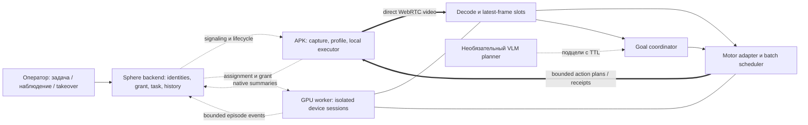
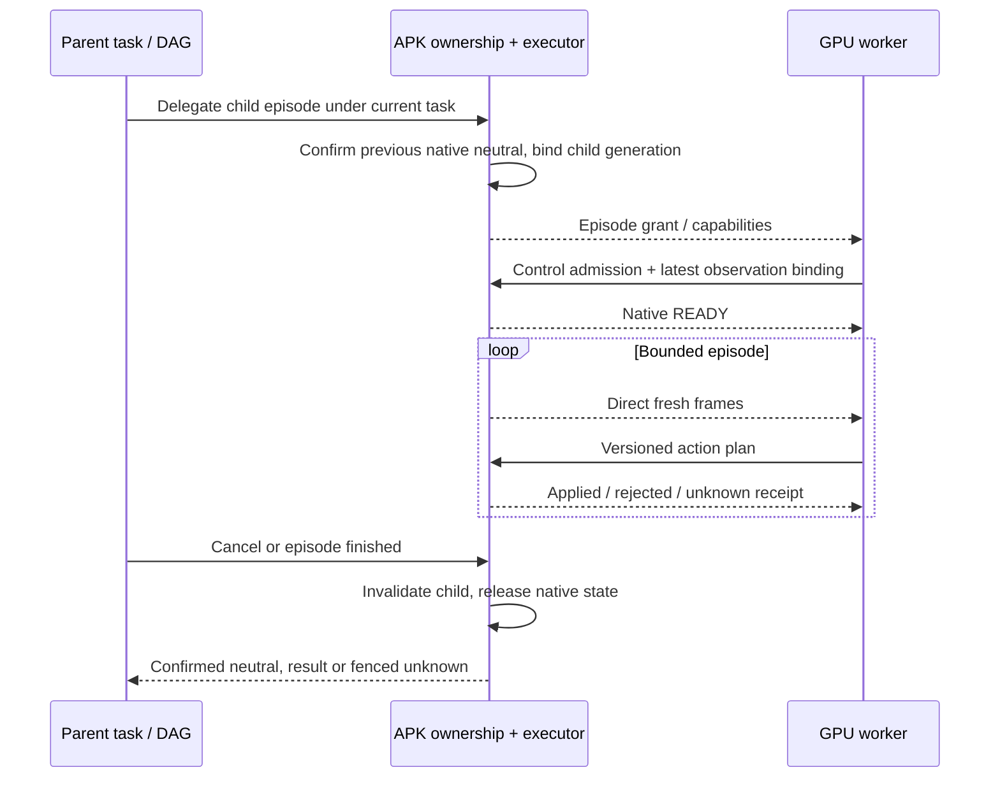
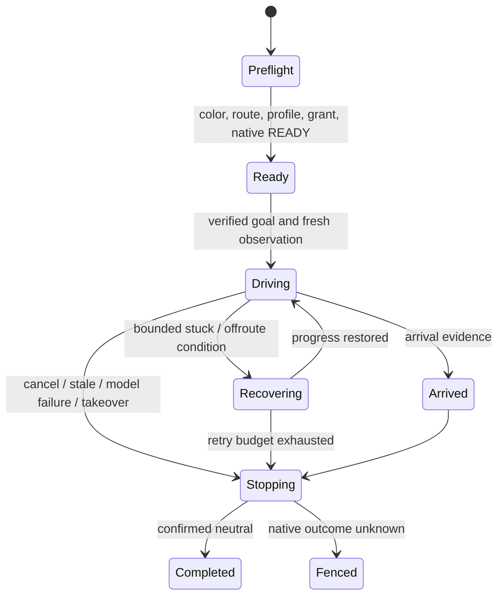
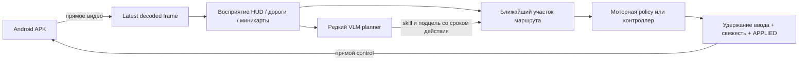
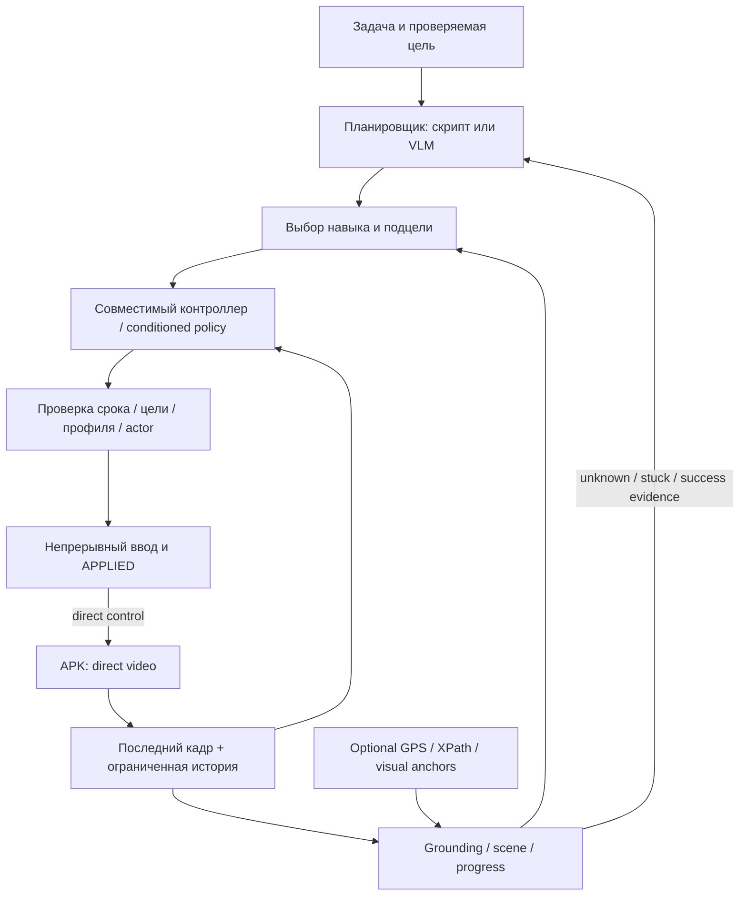
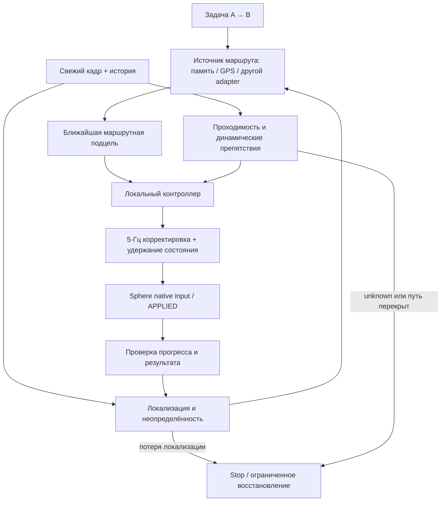

# Игровой AI-контур Sphere: архитектура, модели и план реализации

**24 октября · версия3.5, worker0.8.0:** реализованы original H.264 recorder,
own pointer journal, временная localhost teaching console, ordered view bundles,
sequential observation и offline quality experiment.295 tests/Ruff прошли;
финальный real PH011 read-only137/137 frames decoded. Позднее на real PH011
подтверждены два native gestures/14 APPLIED,один3с; game disconnected. Gameplay teaching,
реальный1080p60, минимальный rendering repeat, controller/объезд/arrival/fleet
ещё не приняты. [Полная квитанция и следующий допуск](../audits/2026-10-24/MOTOR-TEACHING080.md).
Раздел26.7 имеет приоритет над историческим состоянием recorder в26.6.

**Предыдущий этап23 октября · версия3.4, исследование методов и capture:** сопоставлены teach-and-repeat,
mini→map localization, path following и динамический объезд. Добавлен раздел26.6
и [разбор с первичными источниками](../audits/2026-10-23/NAVIGATION-METHODS-CAPTURE-RESEARCH.md).
Это проектные рекомендации; новый recorder/controller не включён, runtime остаётся0.7.5.

**Предыдущий срез23 октября · версия3.3, worker0.7.5:** реализованы общий immutable RGB и ограниченная
память видов ORB/RANSAC. В новом capture epoch сохранённый ориентир узнан50/50 раз;
совместный P2P shadow дал74 ответа за~15с. Физического ввода0, маршрута/объезда ещё
нет. Раздел26.5 разделяет этот компонент, следующий teach-and-repeat опыт и preflight
после AFK/перезапуска. [Измерения и отрицательные результаты](../audits/2026-10-23/MOTOR-ROUTE-VIEWS075.md).

**Предыдущий срез23 октября · версия3.2, worker0.7.4:** отдельно проверены численная точность и
скорость object perception. FP32 observer выдержал5 результатов в каждой полной
секунде, но free-space, obstacle avoidance и маршрут не приняты. FP16 этого pipeline
отклонён. Раздел26 рассматривает предложенную пользователем память маршрутов;
она опциональна; её частичная реализация0.7.5 описана ниже. [Доказательства0.7.4](../audits/2026-10-23/MOTOR-PERCEPTION074.md).

**21 октября · общее целеуказание, версия2.9:** задача платформы — выполнять проверяемые
игровые навыки в разных играх, в том числе без метки и без миникарты. GPS — необязательный
сенсор одного профиля. Раздел24 уточняет источники цели, память маршрута, границы моделей,
проверку приложенного разбора и хранение кадров. Он имеет приоритет над узким GPS-сценарием
в исторических разделах22–23. Общий goal-conditioned агент ещё не реализован и не принят.

**21 октября · worker0.7.0:** геометрическая часть N4 реализована в read-only режиме:
GPS line→связная полилиния/lookahead, JSON-профиль, refusal при неоднозначности/потере пути.
Нативный ввод для этого provider запрещён.184 motor tests/Ruff прошли. Свежий PH025 CLI
дал5.001Гц в среднем, минимум4 в полной секунде; на экране поиск Android, не игра.
[Результаты и ограничения](../audits/2026-10-21/MOTOR-MINIMAP-ROUTE070.md). Раздел23 описывает
API и оставшиеся условия. Допуск физического A→B, N1–N3 и препятствия этим не закрыты.

**20 октября · актуальное решение для A→B:** остаются открытыми удержание управления под
нагрузкой, маршрут по дороге, препятствия и vehicle calibration. Новая receiver-clock
телеметрия worker0.6.1 проверяет частоту принятых результатов по полным секундам и паузы,
а не только средний FPS. Свежие video-only PH025/RX9070 прогоны: NitroGen16 —4.036Гц,
P2P150M без текста —4.921Гц; минимумы3/4 результата в полных секундных окнах. Обе модели
видели экран game disconnect, поэтому это измерение inference/transport, не вождения.
[Квитанция](../audits/2026-10-20/MOTOR-NAVIGATION-REVIEW07.md).
Раздел22 уточняет архитектуру, модели, ограничения и ближайший порядок работ.
Последняя проверенная установка платформы: UI5cbb4bba/API15ce2b62/APK83;
Python worker запускается отдельно из checkout. Нижележащие датированные записи — история.

**20 октября · worker0.6:** реализован общий finite `StickPolicySession`, а не только private
movement runner; доступны scene/freshness guard, held-center WASD/gamepad и exact request binding.
145 motor tests прошли. PH025: положительные direct transport/control опыты,89
NitroGen video-only responses и finite learned movement61 responses/62 APPLIED за12с.
Повторные запуски выявили ACK/lease failures и SCTP retransmissions с RTO1000мс.
Black Russia установлена, гостевой персонаж находится в tutorial world. Полный gameplay, цвет/clock parity,
камера/multi-touch и fleet SLA остаются открытыми. [Точный срез](../audits/2026-10-20/MOTOR-PH025-EXECUTION06.md).

**Исторический срез · 17 октября 2026:** UI/API `15ce2b62`, APK82 сохранены. NitroGen/P2P реально запущены на локальной RX9070 через direct PH011. Добавлены held-center stick contact, исполнение latest18-state gamepad trajectory и explicit WASD adapter. Последний45-с NitroGen8 опыт:235 решений/5.182Гц,571/571 native APPLIED, один непрерывный контакт и подтверждённое закрытие. Метка241→241м: навигация не принята. P2P150M проверялся без text conditioning; сравнение пригодности ещё открыто. [Факты, ограничения и goal-контур](../audits/2026-10-17/MOTOR-STICK-CONTACT-LIVE.md). Поставляемый model loader/preprocessing, камера/multi-touch, source capture/action clocks и отдельная GPU/LAN ещё нужны.

**Recovery этап:**122 motor tests подтвердили ограниченный supervisory layer прогресса/падения, at-most-once double tap/camera sequences и optional optical-flow sensor. Это не семантическое распознавание зданий и не integrated obstacle avoidance; native multi-touch открыт. Положительный live jump/camera test пока заблокирован подключением игры. [Срез и evidence](../audits/2026-10-17/MOTOR-NAVIGATION-RECOVERY.md).

**Последующий goal-опыт:** отдельный5Гц CV visual servo довёл персонажа к пользовательской метке; прибытие подтверждено пользователем,36/36 native APPLIED и CLOSED. Нейросети не использовались, поэтому learned goal navigation остаётся открытой. [Результаты и пределы](../audits/2026-10-17/MOTOR-WAYPOINT-SERVO.md).

**Единый рабочий документ · 23 октября 2026 · версия 3.1.**

Назначение: подготовить реализацию отдельной GPU-станции, которая получает экран Android APK
напрямую и управляет игрой без открытого браузера. Первый ограниченный опыт — движение к метке
в GTA-подобной игре; это тест, а не обязательный интерфейс платформы. Нужны также цели по
изображению/объекту, записанному маршруту и профилю задачи. Ближайшая перспектива — около50
эмуляторов,4–5 свежих наблюдений в секунду на устройство;100–200 — дальнейшая гипотеза
масштабирования. Локальный GPU inference pilot выполнен; общий gameplay не принят.

Документ объединяет требования владельца, анализ Sphere, исследование моделей, протоколы,
эксплуатацию и критерии приёмки. Он задаёт основное направление; прежние датированные отчёты
сохраняются как свидетельства. Машиночитаемый состав исследования и хеши исходников —
[MOTOR-AI-SOURCE-REVIEW.json](../audits/2026-10-16/MOTOR-AI-SOURCE-REVIEW.json).

**Транспортный этап0.3, сохранённый в0.4:** worker принимает direct H.264, выбирает RGB-наблюдения около5Гц и с явным opt-in отправляет короткий DOWN/MOVE/UP без браузера. Это проверка single-finger dispatch, а не модельный или игровой executor. Default остаётся без физических действий. Исправлены совместимость с `input_availability` APK80+ и порядок штатного завершения peer; реальные отрицательные прогоны сохранены в новом отчёте.

На нынешнем локальном Windows ПК установлены официальный AMD ROCm/PyTorch и проверенные веса двух моделей. Установка на отдельную GPU-станцию ещё не выполнена. LAN-маршрут, source/action clock correlation, полная parity модельного preprocessing, профиль нескольких controls и автономная игра не приняты. [Предыдущая поставка транспорта77](../audits/2026-10-16/MOTOR-TRANSPORT-DELIVERY.md) остаётся исторической квитанцией.

**Дополнение0.4:** по повторному чтению NitroGen, NitroGen-Full, Nexto, MineStudio и VPT разделены доказательства реального игрового цикла, pause-based evaluation и специализированного structured-state бота. Реализованы bounded shadow loop, epoch/request lineage, сроки ответа и независимая проверка decoded action chunks. Это часть будущего model boundary, без сетевого GPU API или физических действий модели. [Источники, проверки и границы](../audits/2026-10-17/MOTOR-REALTIME-SHADOW04.md).

## Содержание

1. [Решение и фактическая готовность](#1-решение-и-фактическая-готовность)
2. [Требования и границы](#2-требования-и-границы)
3. [Что означает 5 Гц](#3-что-означает-5-гц)
4. [Как оценивались доказательства](#4-как-оценивались-доказательства)
5. [Моторные модели и альтернативы](#5-моторные-модели-и-альтернативы)
6. [VLM и планирование](#6-vlm-и-планирование)
7. [Работающие примеры и обсуждения](#7-работающие-примеры-и-обсуждения)
8. [Что уже есть в Sphere](#8-что-уже-есть-в-sphere)
9. [Целевая архитектура](#9-целевая-архитектура)
10. [Контракты и время](#10-контракты-и-время)
11. [Игровые профили и исполнитель](#11-игровые-профили-и-исполнитель)
12. [Владение вводом и DAG](#12-владение-вводом-и-dag)
13. [Навигация к метке](#13-навигация-к-метке)
14. [Нагрузка и выбор оборудования](#14-нагрузка-и-выбор-оборудования)
15. [Сбои и восстановление](#15-сбои-и-восстановление)
16. [Телеметрия, история и данные](#16-телеметрия-история-и-данные)
17. [Испытания и критерии приёмки](#17-испытания-и-критерии-приёмки)
18. [Развёртывание на GPU-станции](#18-развёртывание-на-gpu-станции)
19. [План реализации](#19-план-реализации)
20. [Принятые решения и открытые вопросы](#20-принятые-решения-и-открытые-вопросы)
21. [Источники и воспроизводимость](#21-источники-и-воспроизводимость)
22. [Измерения и A→B](#22-решение-для-маршрута-ab-и-5-наблюденийс-20-октября)
23. [Необязательный GPS-наблюдатель](#23-реализация070-локальная-геометрия-gps-линии)
24. [Работа без меток и проверка внешнего разбора](#24-общие-цели-без-меток-и-проверка-внешнего-разбора)

## 1. Решение и фактическая готовность

**Направление технически обосновано. Готового контура «поставить NitroGen и запустить 50 машин» нет.**
В Sphere есть capture, прямой WebRTC, touch/keyboard primitives, task lifecycle и подтверждения
Android и начальный headless transport. Не хватает игрового worker executor, профилей, нескольких одновременных касаний,
сквозного observation/action contract, передачи владения от DAG и измеренной ёмкости GPU.

Предлагается сохранить APK как исполнитель и источник кадров, вынести inference в отдельный
worker, а backend использовать для допуска, задач и истории. На первом этапе сравнить
NitroGen с узким вариантом «компьютерное зрение + контроллер» на одной и той же короткой трассе.
VLM добавлять для подцелей и восстановления только после измерения пользы. Модель должна
заменяться без изменения транспорта и native executor.

| Область | На момент аудита | Что нужно доказать |
| --- | --- | --- |
| Прямой браузерный экран/ввод | Есть конечные положительные проверки и открытые дефекты | Длительный стабильный маршрут, корректность цвета и восстановления |
| Worker ↔ APK без браузера | Worker0.5: direct кадры, конечный single-finger probe, original-RGB shadow и локальный process provider | Физический LAN, поставляемый model loader/preprocessing, игровой executor и source/action freshness |
| NitroGen/P2P inference на RX9070 | Оба локальных checkpoint реально запускались; сохранены конечные замеры | Игровое качество, точный preprocessing P2P, отдельная GPU/LAN, throughput парка |
| WASD/model → игровые зоны | Есть проект, исполнения нет | Удержания, несколько пальцев, контексты, отмена |
| Навигация Black Russia | Не проверена | Доезд к метке, отсутствие застреваний, подтверждение финиша |
| 50 устройств × 5 Гц | Есть калькулятор, нет benchmark | 250 свежих решений/с с допустимым хвостом задержек |
| Коммерческое использование NitroGen | Не согласовано | Лицензия конкретного компонента; non-commercial research ограничивает выбор |

Первоначальный source-аудит выполнен на `38ec739fa6239806c0f5bd5ab624fc129aa46012`; он не подменяет новые проверки. Историческая установка17октября — веб/API `15ce2b62`, APK `1.2.82-dev /10282` на четырёх online; package SHA/OTA подтверждены,17offline исключены. [Установка82](../audits/2026-10-16/POINTER-TIMELINE82-DELIVERY.json). Тогда worker0.5 запускался из локального checkout; текущий срез находится в начале документа. Веса скачаны, локальный RX9070 inference проверен, но на отдельной GPU/LAN модуль ещё не поставлен, модельное управление игрой не принято.

## 2. Требования и границы

### 2.1. Прослеживаемые требования

| ID | Требование | Проверка / раздел |
| --- | --- | --- |
| AI-01 | GPU отдельно от эмуляторов, как минимум в одной LAN | Реальный маршрут и трафик, G02 |
| AI-02 | Видео и действия APK ↔ worker без браузера в data path | Закрыть все браузеры, G02 |
| AI-03 | Backend согласует доступ, не пересылает каждый кадр по умолчанию | Счётчики relay, G02 |
| AI-04 | Direct выбирается по фактической достижимости | ICE pair, адреса/интерфейсы, G02 |
| AI-05 | Видео READY и control READY проверяются отдельно | Native admission/ACK, G02–G03 |
| AI-06 | Цель — 4–5 свежих наблюдений/с/device | Capture IDs и возраст, G04 |
| AI-07 | Удержание газа/стика между наблюдениями | Локальный scheduler, G03 |
| AI-08 | Около 50 устройств — цель, не принятая ёмкость | Ступени нагрузки, G09 |
| AI-09 | Профиль работает без фокуса окна эмулятора Windows | Два экземпляра, G03 |
| AI-10 | Оператор и модель используют одинаковую семантику controls | Профиль и capability, G03 |
| AI-11 | Руль/газ/камера могут работать одновременно | Multi-touch или проверенный gamepad, G03 |
| AI-12 | Явное владение human / task / AI | Atomic handoff, G05 |
| AI-13 | Человек может прервать эпизод | Native neutral, G05 |
| AI-14 | После reconnect старые действия не повторяются | Epoch/sequence/fault tests, G06 |
| AI-15 | Неизвестный исход ввода виден и блокирует опасное продолжение | Receipt/fence, G06 |
| AI-16 | Адаптер не путает изображение, устройство и эпизод | Межклиентная изоляция, G04 |
| AI-17 | Модель получает правильные цвета, ориентацию и crop | Golden frames, G01 |
| AI-18 | Цель A→B отделена от реакции по одному кадру | Goal coordinator, G08 |
| AI-19 | Проверяется игровое качество, а не только FPS | Повторные маршруты, G08 |
| AI-20 | Нет неограниченных PNG/MP4/JSONL на каждом шаге | Квоты и retention, G10 |
| AI-21 | Модель, профиль, preprocessing и seed версионируются | Episode manifest, G07 |
| AI-22 | VLM не блокирует быстрый моторный цикл | Deadline/TTL ответа, G07 |
| AI-23 | Работа после потери backend имеет явную политику | Ограниченный grant, G06 |
| AI-24 | Деградация нагрузки не скрывает нарушение 5 Гц | Admission и rejected reasons, G09 |
| AI-25 | Все режимы просмотра сохраняют единый транспорт/исполнитель | Control/view/record/XPath, G11 |
| AI-26 | Есть воспроизводимые установка, остановка и откат | Артефакты и runbook, G12 |

### 2.2. Что не следует смешивать

50 эмуляторов на GPU-станцию, 20 зрителей одной машины и 10 участников нынешнего shared input —
разные задачи. В этом проекте AI получает один управляемый эпизод на устройство, а люди могут
наблюдать и явно перехватывать управление. Пользовательский режим «последнее нажатие побеждает»
для людей сохраняется как отдельная политика. Постоянная борьба AI с живыми кликами не должна
считаться корректным обучением или нормальным автономным режимом.

Удалённая GPU по LAN не означает localhost для APK: Android находится внутри NAT эмулятора.
Близость устройств не отменяет firewall, изоляцию клиентов Wi-Fi/хотспота, VPN и маршрутизацию.
Проверяется доступность конкретных сетевых интерфейсов. При внешнем signaling интернет может
потребоваться для первоначального допуска; независимость уже установленного эпизода требует
отдельного ограниченного по времени grant. В нынешнем коде она не принята.

## 3. Что означает 5 Гц

Идея владельца верна в одном важном отношении: **не нужно отпускать W после каждого решения**.
Пять решений в секунду могут означать «сохранять газ и чуть поправить руль», а не пять отдельных
тапов. Нужны четыре независимых параметра:

| Параметр | Начальный сценарий | Смысл |
| --- | --- | --- |
| Частота источника изображения | Фактические 30/60 FPS либо меньше | Что выдаёт игра/capture |
| Частота наблюдения модели | 5 Гц | Новое пригодное изображение каждые 200 мс |
| Горизонт предсказания | Зависит от модели и конфигурации | Сколько будущих состояний controls вычислено |
| Локальное исполнение | Предлагается до 30–60 тиков/с, по измерениям | Своевременное удержание/перемещение/отпускание на APK |

Постоянный газ удерживается без повторных DOWN. Координата стика меняется по локальному
плану; UP/CANCEL происходит по завершению, истечению срока или остановке. «Исполнять 60 Гц»
не означает генерировать 60 одинаковых native событий/с: неизменное состояние не надо дублировать.

### 3.1. Почему частота не равна полной задержке

Пример: 5 Гц, кадр ждёт выборки, затем decode/очередь/GPU/возврат/Android. Даже при маленьком
RTT свежее решение может оказаться старше 200 мс. Событие сразу после выборки ждёт почти
полный период до следующего наблюдения, а затем вычисление. Поэтому учитывать нужно
возраст кадра при исполнении и хвост распределения задержек, а не только среднее FPS.

Для иллюстрации, при условных 15 игровых метрах/с за 200 мс машина проходит 3 м,
за 500 мс — 7,5 м. Это арифметика, не измерение Black Russia. Низкая скорость и простая трасса
могут позволять 5 Гц; тесный поворот, высокая скорость и внезапная помеха могут потребовать
большей частоты либо меньшей скорости. Аналогия с человеком не заменяет эксперимент.

### 3.2. Action chunks и непрерывная игра

У закреплённого NitroGen checkpoint горизонт18 состояний; последовательное исполнение
при60Гц занимает300мс ещё до добавления следующего inference.16 denoising steps — другой параметр.
Референсный environment может приостанавливать игру между шагами через XSpeedHack.
Android multiplayer продолжает жить во время расчёта; пауза здесь не предполагается.
[Исходник runner](https://github.com/MineDojo/NitroGen/blob/32608444660950ffda95e1e57c79632ad65bea10/nitrogen/game_env.py).

Нужен цикл с коротким исполняемым префиксом: получить самый свежий кадр, предсказать план,
исполнить ограниченную часть, снова наблюдать. Перекрытие вычисления и исполнения проектируется
явно; нельзя просто обрезать chunk до 5 действий и объявить, что модель стала пятигерцовой.
Изменения горизонта, шага времени, noise и preprocessing проходят отдельную проверку качества.

У закреплённого Open Pixel2Play150M ответ — одно keyboard/mouse state, обученная временная шкала20Гц.
Получать новый кадр5раз/с не эквивалентно запускать исходную20Гц policy: меняются интервалы history и
необходимая длительность удержания. Worker0.5 сохраняет исходную семантику50мс и не растягивает её
автоматически. Для5Гц нужен проверенный controller/profile с ограниченным удержанием, измерением
качества и корректным expiry; положительный shadow benchmark этого не доказывает.

Сравнить 2/5/10/20 Гц на одном наборе маршрутов и одной скорости. Принять 5 Гц, если качество
в установленном игровом диапазоне проходит G08; иначе показать стоимость повышения частоты
или ограничить область применения. Нельзя маскировать плохую управляемость увеличением lease.

## 4. Как оценивались доказательства

| Уровень | Что действительно известно |
| --- | --- |
| E0 | Обещание, название, скриншот, чужая пересказанная новость |
| E1 | Прочитан код/интерфейс; доступность артефактов проверена по метаданным |
| E2 | Автор публикует демонстрацию или собственный запуск с ограничениями |
| E3 | Есть описанный замкнутый benchmark, метрики и материалы для воспроизведения |
| E4 | Мы воспроизвели на выбранной игре/устройстве с сохранённой квитанцией |
| E5 | Мы прошли нагрузку, длительность и отказы в целевой конфигурации |

E3 в Minecraft не превращается в E4 в Black Russia. Доступность `.pth` не означает, что файл
проверен загрузкой. Ссылка на MP4 означает наличие авторского демо; здесь такие видео
не скачивались и не просматривались. Issue — свидетельство конкретного пользователя,
если нет воспроизведения и ответа автора; популярность репозитория не является уровнем доказательства.

В просмотренных источниках **не найден воспроизводимый готовый комплект именно для Black Russia,
APK Sphere и 50×5 Гц**. Это граница проведённого поиска, не утверждение, что такого нигде не существует.

## 5. Моторные модели и альтернативы

### 5.1. Короткий список

| Решение | Вход / выход | Доступность и доказательства | Роль для Sphere |
| --- | --- | --- | --- |
| NitroGen | RGB → gamepad actions | Код/веса; research policy; E1 здесь, авторская игровая оценка | Первый общий моторный baseline, с адаптером |
| Open Pixel2Play150M | RGB192×192 + optional text → keyboard/mouse | Авторский unpaused real-time; здесь реальный AMD eager inference через Sphere, без model input execution | Более быстрый локальный baseline; необходим Android key/mouse→touch profile, no-text режим пока отдельно |
| Узкая модель зрения + PID/правила | Полосы/мини-карта → руль/газ | Есть близкий GTA V проект с демо, E2 автора | Равноправный baseline для задачи A→B |
| Обученный на наших демонстрациях небольшой policy | Экран/цель/история → controls | Пока проект; данных и модели нет | Следующий вариант, если generalist не справляется |
| GameWAM | Кадры, task, game state → клавиатура/мышь | Код, checkpoints, benchmark Minecraft/ViZDoom, E3 автора | Исследовательская альтернатива после проверки входов и GPU |
| OpenHA / Minecraft policies | Игровые наблюдения → действия Minecraft | Код, модель, benchmark в своей среде | Иерархия/методика, не готовый Android driver |
| SIMA 2 | Экран и язык → игровые действия | Ограниченный research preview | Архитектурный ориентир; локальные веса не подтверждены |
| Game-TARS | Мультимодальная игровая policy | Paper и project page; открытый checkpoint не подтверждён | Следить за выпуском; не блокировать реализацию |
| Cosmos3 | Мультимодальная физическая/world/action модель | Открытые компоненты и специализированные embodiments | Не считать готовой gamepad policy |

### 5.2. NitroGen: пригодность и ограничения

Закреплены код `32608444660950ffda95e1e57c79632ad65bea10` и веса
`584c8dded734d032f07a4bcc0ccb330e703298c4`. Это компактный по сравнению с VLM моторный кандидат
около 493M параметров: RGB 256×256, gamepad output. Текстовая цель и route planner не входят
в нынешний inference interface. Фактическая схема кода — 21 button/trigger columns + 4 stick
coordinates; расхождение с кратким описанием model card проверено отдельно.
[Модель](https://huggingface.co/nvidia/NitroGen),
[интерфейс inference](https://github.com/MineDojo/NitroGen/blob/32608444660950ffda95e1e57c79632ad65bea10/nitrogen/inference_client.py).

Sampling стохастический: `torch.randn` в model code. Для сравнения нужны изолированные seed/noise
на эпизод и фиксированные версии. Одного `eval()` недостаточно. Стандартный сервер с ZMQ/pickle,
общим session state и одним REP loop не является сервисом на 50 независимых устройств.
Веса загружаются через доверенный PyTorch checkpoint; provenance и checksum фиксируются до запуска.
[Model code](https://github.com/MineDojo/NitroGen/blob/32608444660950ffda95e1e57c79632ad65bea10/nitrogen/flow_matching_transformer/nitrogen.py),
[serve.py](https://github.com/MineDojo/NitroGen/blob/32608444660950ffda95e1e57c79632ad65bea10/scripts/serve.py).

Стратегия: изолированный адаптер, один supervised эпизод, измерение качества и tail latency.
Не обещать zero-shot доезд по мини-карте. Лицензия закреплённого кода/весов ограничивает применение
non-commercial research; это отдельный gate выбора для коммерческой установки.
[LICENSE](https://github.com/MineDojo/NitroGen/blob/32608444660950ffda95e1e57c79632ad65bea10/LICENSE).
Точная проверка действий, лицензии, зависимостей и community reports сохранена в
[первом аудите](../audits/2026-10-16/NITROGEN-READINESS.md).

### 5.3. GameWAM: современная, но не прямая замена

Авторы предлагают совместное обучение будущего видео и действий; онлайн исполняется короткий
префикс и выполняется новое наблюдение. Опубликованы код и отдельные checkpoints Minecraft/ViZDoom.
На своей MCU оценке заявлены 50,7% Mini / 46,6% All и средняя execution frequency 12,51 Гц
на одном H200. Это авторские показатели в указанных средах, не наши 250 inference/с.
[Project и результаты](https://yunncheng.github.io/GameWAM/),
[paper](https://arxiv.org/abs/2608.26200).

В paper время этой оценки исключает simulation/execution среды: это model-side measurement,
а не полная частота обратной связи живой игры. В опубликованной Minecraft конфигурации стоит
20 FPS; префикс из 8 действий соответствует 400 мс игрового времени. Поэтому число 12,51 Гц
нельзя автоматически читать как 12,51 новых наблюдений/решений в секунду на каждом APK.
[Методика измерения, C.6](https://arxiv.org/html/2608.26200v1#A3.SS6),
[конфигурация simulator](https://github.com/yunncheng/GameWAM/blob/e3a3d29a1eef4bc1f51ec161652bcc158f908321/configs/sim_minecraft.yaml).

Checkpoint построен на Wan2.2-TI2V-5B + ActionDiT 1B. У модели Minecraft 22-мерные keyboard/mouse
actions и 15-мерное canonical state с маской достоверности; ViZDoom использует POSITION_X/Y,
ANGLE и HEALTH. Предсказание 16 шагов, исполнение 8; каждому checkpoint нужны соответствующие
`dataset_stats.json`. Подставлять нули вместо отсутствующих игровых данных без испытания нельзя.
Apache-2.0 указана для опубликованных артефактов; зависимости проверяются отдельно.
[Закреплённая карточка](https://huggingface.co/Yunncheng/gamewam-models/blob/6486a716c9b7dc969f1999a26c78aea7967c1de3/README.md).

Наше решение: сохранить в сравнении, но не ставить первым dependency проекта. Нужны адаптер
Black Russia, исследование отсутствующего state и benchmark на будущей GPU. Требования обучения
8×H200 из README не являются автоматически требованиями inference, а дробная Ray GPU allocation
не означает изоляцию памяти или гарантированное число параллельных эпизодов.
[Код и окружение](https://github.com/yunncheng/GameWAM/tree/e3a3d29a1eef4bc1f51ec161652bcc158f908321).

### 5.4. Почему не выбирать по самым свежим демонстрациям

[SIMA 2](https://deepmind.google/blog/sima-2-an-agent-that-plays-reasons-and-learns-with-you-in-virtual-3d-worlds/)
показывает цельный language/vision/game-control подход, но анонсирована как limited research preview
с доступом выбранной группе. Публичный комплект локальных весов для нашей SSH-установки не подтверждён.

[Game-TARS](https://seed-tars.com/game-tars/) публикует результаты общего игрового агента;
[paper](https://arxiv.org/abs/2510.23691) не заменяет installable release.
В [официальном репозитории UI-TARS, issue #232](https://github.com/bytedance/UI-TARS/issues/232)
вопрос об открытом выпуске Game-TARS остаётся без ответа на момент среза. Это не доказательство
вечной закрытости, но оснований закладывать доступные веса сейчас нет. Одноимённый небольшой
Game-TARS для tic-tac-toe из другого аккаунта — другой проект.

[OpenHA](https://github.com/CraftJarvis/OpenHA/tree/606efc69e945bd02c700e584136bcc105d22f122)
и его [ICML paper](https://proceedings.mlr.press/v306/wang26do.html) полезны как пример иерархии
действий и проверки множества задач. Minecraft action space, наблюдения и benchmark не переносятся
в GTA через переименование кнопок.

[Cosmos3-Nano](https://huggingface.co/nvidia/Cosmos3-Nano) — актуальный 16B представитель Cosmos3,
а не прежний Reason2 как «последняя модель». Поддерживаемые action embodiments в карточке —
камеры, автомобили и роботизированные платформы; это не контракт gamepad NitroGen или Android touch.
Рекомендованная частота видео для reasoning не доказывает частоту замкнутого управления игрой.
Семейство можно исследовать для восприятия, но не включать в обязательный первый моторный путь.

## 6. VLM и планирование

VLM может определять контекст: в машине ли персонаж, открыто ли меню, видна ли метка, застряла ли
машина, нужна ли новая подцель. Быстрое руление по каждому кадру оставляется моторной policy
или контроллеру. Добавление LLM само по себе не превращает неуправляемую policy в навигатор.

### 6.1. Проверенные названия и масштаб

Размеры ниже — **сумма опубликованных safetensors по метаданным конкретной ревизии**, десятичные GB.
Это не измерение VRAM. В памяти дополнительно нужны vision encoder, activations, KV cache,
runtime, batch и decoder. Active parameters MoE не равны resident parameters. Для квантования
нужно отдельно проверять vision path, совместимость runtime и качество на кадрах игры.

| Модель | Опубликованный объём весов | Предлагаемая роль |
| --- | --- | --- |
| [Qwen3.5-9B](https://huggingface.co/Qwen/Qwen3.5-9B) | 19,31 GB | Первый небольшой локальный VLM для сравнения |
| [Gemma 4 E4B](https://huggingface.co/google/gemma-4-E4B-it) | 15,99 GB | Альтернативный небольшой VLM; E4B не означает 4B полного хранения |
| [Gemma 4 12B](https://huggingface.co/google/gemma-4-12B-it) | 23,92 GB | Следующий сравнительный кандидат |
| [Qwen3.6-27B](https://huggingface.co/Qwen/Qwen3.6-27B) | 55,56 GB | Крупный dense VLM, если память/latency оправданы |
| [Qwen3.6-35B-A3B](https://huggingface.co/Qwen/Qwen3.6-35B-A3B) | 71,90 GB | MoE, около 3B active; память всё равно определяется полным составом |
| [Gemma 4 26B-A4B](https://huggingface.co/google/gemma-4-26B-A4B-it) | 51,61 GB | Крупный MoE VLM, не «4B по памяти» |
| [DeepSeek-V4.1-Flash](https://huggingface.co/deepseek-ai/DeepSeek-V4.1-Flash) | 510,30 GB в опубликованном смешанном формате | Возможный внешний planner API, не исходная локальная конфигурация одной обычной GPU |

Все перечисленные Qwen/Gemma карточки указывают vision и Apache-2.0 для этих ревизий.
Для Gemma 4 не следует автоматически переносить лицензионные предположения от прежних поколений.
[Официальная общая карточка Gemma 4](https://ai.google.dev/gemma/docs/core/model_card_4).
Ни одна строка таблицы не означает доказанное вождение Black Russia или измеренную скорость у нас.

Название, которое предложил владелец, существует:
[DeepSeek-V4.1-Flash анонсирован с native vision](https://www.deepseek.com/en/news/deepseek-v4-1-flash/).
Указаны 552B backbone, 8B active на encoding и 16B active на decoding; карточка также описывает
отдельную Engram memory. Поэтому слово Flash не делает весь checkpoint маленьким.
Для внешнего API проверять точный alias/version и согласие на передачу игровых кадров;
сбой WAN не должен блокировать локальный STOP или продолжать устаревший план.

### 6.2. Контракт медленного planner

Planner получает выбранные кадры/ROI и краткое состояние эпизода по событию или редкому расписанию.
Начальная гипотеза для нагрузки — один запрос раз в 2–5 секунд, не обязательный SLA.
У 50 машин даже 0,5 запроса/с дают 25 мультимодальных запросов/с; «редко» также требует бюджета.

Ответ — ограниченная схема: `goalRevision`, контекст, подцель, confidence, срок годности,
разрешённый skill. Он не содержит произвольный shell/Python и не отправляется напрямую в root input.
Опоздавший ответ от прошлой сцены/эпизода отбрасывается. Неизвестный контекст ведёт к остановке
или запросу оператора, а не к случайному клику. При необходимости motor и planner разводятся
по GPU/процессам, чтобы большой prefill не задерживал остальные 50 моторных циклов.

Первое сравнение VLM: Qwen3.5-9B и Gemma 4 E4B на одинаковых локальных кадрах, фиксированной
схеме и коротком output limit. Измерять полный ответ, vision preprocessing и ошибку классификации,
а не только tokens/s. Крупные варианты добавлять, если они решают наблюдаемую проблему лучше.

## 7. Работающие примеры и обсуждения

### 7.1. Ближайшие практические проекты

| Источник | Проверенный материал | Граница доказательства / полезный вывод |
| --- | --- | --- |
| [jeromed780 GTA V driving](https://github.com/jeromed780/gta-v-autonomous-driving/tree/98165d4be046065688c07f1e12da51e25c6e141f) | Код capture/lanes/minimap/controller; авторское MP4 присутствует в release v1.0.0, 23 288 394 B | Демо здесь не просмотрено; claimed 120 FPS не наш benchmark. Взять идею vision + minimap + PID и сравнить на своей игре |
| [Артефакты его моделей](https://huggingface.co/jeromed780/gta-v-autonomous-driving) | Public model metadata доступны | Наличие карточки/файла не проверяет правильность checkpoint или переносимость TuSimple/GTA V → Black Russia |
| [T-Py-T GTA5 agent](https://github.com/T-Py-T/gta5-vision-driving-agent/tree/1e63afc39c20e165cf9da78919feee5348cc485c) | В закреплённом README прямо отсутствуют веса, gameplay footage и retained driving score | Работоспособное вождение по названию репозитория не подтверждено; legacy code не готовая поставка |
| [Cradle](https://github.com/BAAI-Agents/Cradle/tree/d7752fccf890d8d3818cd1d435f3705f604a1339) | Code/framework, игры включая RDR2, статьи и авторские demos | Полезны память, skills и reflection; новая игра требует адаптации, это не 5 Гц driver |
| [GamingAgent / LMGameBench](https://github.com/lmgame-org/GamingAgent/tree/996d848ae5e3bf68433d663f38ef4da5bdfe5332) | Игровые wrappers, evaluation harness, опубликованные benchmark материалы | Полезен формат испытаний; результаты puzzle/Atari не доказывают непрерывное 3D вождение |
| [NitroGen-Full](https://github.com/subbon/NitroGen-Full/tree/a42921a39e44331a800f7d5d53fc3ce5a5680191) | Community recording/fine-tuning/inference pipeline и linked Pizza Tower checkpoint | Авторская адаптация в другой игре; не доказательство навигации и не официальный multi-device server |
| [TransFuser](https://github.com/autonomousvision/transfuser/tree/21bdb7eaf3aa9fa95219329883d520b3d48e4892) | Код, модели/данные и CARLA route evaluation | Использует дополнительные сенсоры/route information; не video-only policy для Android |

У GTA V проекта lane model использует ResNet-18, мини-карта обрабатывается отдельно, управление
выдаётся виртуальному Xbox pad. Нельзя переносить его зависимость от Windows окна и глобального
gamepad в наш per-device APK путь. Код MIT не определяет автоматически права на все внешние
weights, datasets, YOLO и драйверы — состав каждого выбранного компонента фиксируется отдельно.

У [Pizza Tower fine-tune](https://huggingface.co/subbonan/nitrogen-pizza-tower-finetune)
автор описывает 34 runs, 681 203 samples и собственные validation metrics.
Это полезное подтверждение существования adaptation pipeline, но F1 действий не равен
проценту завершённых игровых маршрутов. Для своих данных split делать по целым эпизодам/маршрутам,
иначе соседние почти одинаковые кадры могут попасть одновременно в train и validation.

### 7.2. Что пишут пользователи и что из этого следует

| Обсуждение | Характер свидетельства | Решение для Sphere |
| --- | --- | --- |
| [NitroGen #24](https://github.com/MineDojo/NitroGen/issues/24), [#28](https://github.com/MineDojo/NitroGen/issues/28) | Разные неунифицированные заявления о FPS/VRAM и скорости | Не выводить GPU capacity из комментариев; сохранять точные batch/config/end-to-end measurements |
| [NitroGen #39](https://github.com/MineDojo/NitroGen/issues/39) | Пользователи описывают отсутствие нужного поведения и попытки fine-tuning | Цель и игровые результаты проверять отдельно от успешного inference |
| [NitroGen #43](https://github.com/MineDojo/NitroGen/issues/43) | COLLABORATOR уточняет лишние output columns | Адаптер закрепляет порядок и не исполняет неизвестные кнопки |
| [NitroGen #44](https://github.com/MineDojo/NitroGen/issues/44) | COLLABORATOR поясняет глобальность virtual gamepad | Не считать `--process` адресацией ввода выбранному эмулятору |
| [Cradle #101](https://github.com/BAAI-Agents/Cradle/issues/101) | Пользователь: минуты ожидания; COLLABORATOR указывает на latency внешнего API | Внешняя LLM не должна обслуживать каждый локальный motor tick |
| [Cradle #106](https://github.com/BAAI-Agents/Cradle/issues/106) | Пользователь сообщает повторную подачу старого screenshot, предлагает локальное изменение | Нужны capture IDs, freshness и проверка актуального observation; исправление из issue не принято нами на веру |
| [UI-TARS #232](https://github.com/bytedance/UI-TARS/issues/232) | Открытый вопрос о Game-TARS release без комментариев | Доступность поставки остаётся неизвестной |

Отчёты пользователей не дают основания отвергать подход целиком. Они помогают заранее поставить
эксперименты, которые обнаружат старый кадр, скрытую паузу, глобальный ввод и задержку модели.

## 8. Что уже есть в Sphere

### 8.1. Карта компонентов по исходникам

| Компонент | Уже существует | Разрыв для AI |
| --- | --- | --- |
| [StreamingManagerImpl](../../android/app/src/main/kotlin/com/sphereplatform/agent/streaming/StreamingManagerImpl.kt) | Один capture/encoder и encoded subscribers | Независимый AI substream, бюджеты decoder и изоляция качества зрителей |
| [EncodedCaptureFrame](../../android/app/src/main/kotlin/com/sphereplatform/agent/streaming/EncodedCaptureFrame.kt) | Внутренняя sequence/timestamp/capture epoch | Согласованный внешний observation ID и source clock |
| [FramePackager](../../android/app/src/main/kotlin/com/sphereplatform/agent/streaming/FramePackager.kt) | V1/V2 frame headers; V2 capture UUID | Sequence отсутствует в заголовке; relative timestamp не даёт межхостовую E2E latency |
| [Direct signaling router](../../backend/api/ws/direct/router.py) | Auth, session/capture binding, peer negotiation | Ограниченная worker identity и headless client lifecycle |
| [DirectInputChannel](../../android/app/src/main/kotlin/com/sphereplatform/agent/direct/DirectInputChannel.kt) | Прямой authenticated channel, binding к сеансу | Peer connection сам по себе не даёт native authority |
| [SharedDirectInputController](../../android/app/src/main/kotlin/com/sphereplatform/agent/commands/SharedDirectInputController.kt) | Native grants, admission, receipts/fencing | Версионируемые motor plans, делегирование эпизоду |
| [SharedInputMailbox](../../android/app/src/main/kotlin/com/sphereplatform/agent/commands/SharedInputMailbox.kt) | Ограниченная очередь, coalescing заменяемых событий | Отдельные очереди состояния и необратимых edges для профиля |
| [RootTouchBridge](../../android/app/src/main/java/com/sphereplatform/agent/commands/RootTouchBridge.java) | Root injection touch/keyboard в Android | Multi-pointer либо Android gamepad axes/buttons |
| [RootTouchSession](../../android/app/src/main/java/com/sphereplatform/agent/commands/RootTouchSession.java) | Hold/release, watchdog, keyboard held state | Не игровая модель controls/контекстов |
| [DeviceInputOwnership](../../android/app/src/main/kotlin/com/sphereplatform/agent/commands/DeviceInputOwnership.kt) | Взаимоисключение discrete/continuous, uncertainty fence | Atomic task→episode→task delegation |
| [DagRunner](../../android/app/src/main/kotlin/com/sphereplatform/agent/commands/DagRunner.kt) | Выполнение задания и отмена | Долгоживущий motor episode не должен обходить task ownership |
| [Task queue](../../backend/services/task_queue.py) / [dispatcher](../../backend/services/task_dispatcher.py) | Per-device dispatch, tenant scope, running task lock | Не использовать как высокочастотную очередь кадров/руля |
| [CommandJournal](../../android/app/src/main/kotlin/com/sphereplatform/agent/commands/CommandJournal.kt) | Ограниченное сохранение результатов и unknown recovery | Не записывать каждый motor tick в общий command journal |
| [Stream history](../../backend/websocket/stream_session_history.py) | Ограниченные samples состояния сеансов | Не история игровых эпизодов и не training dataset |
| [Task screenshots](../../backend/services/task_screenshots.py) / [storage](../../backend/services/screenshot_storage.py) | Tenant/task-owned artifacts | Нужен episode scope, квоты и отдельный lifecycle |

### 8.2. Ограничения, которые легко неправильно истолковать

В коде encoded viewer максимум 10 на устройство; в shared input максимум 10 участников.
Это разные ограничения, ни одно не означает 10 одновременных физических пальцев. Текущий native
touch bridge использует один pointer. Газ и поворот в разных зонах нельзя считать проверенными.
Обновление [RootTouchWire](../../android/app/src/main/java/com/sphereplatform/agent/commands/RootTouchWire.java)
требует новой версии и capability; нынешний fixed packet нельзя молча расширить массивом.

Общий encoder учитывает слабейшую свежую bitrate allocation зрителей. Поэтому медленный AI peer
может затронуть качество человеческого просмотра, если подключить его без выделенной политики.
Отбор 5 RGB кадров после decode 60 FPS не уменьшает decode до 5 FPS. Пропускать произвольные H.264
delta packets до decoder тоже нельзя: последующие кадры могут ссылаться на них.

Android `KeyEvent W` инъецируется внутри гостевой ОС и не проходит через Windows keymapper LDPlayer.
Наличие WASD схемы в эмуляторе не создаёт готовый API для нашего APK. Для нескольких экземпляров
нужен ввод по device identity, не по активному Windows окну.

[Stream history](../../backend/websocket/stream_session_history.py): 10 сеансов/device, 15 samples,
32 KiB/session, retention 7 дней; media и input payload там не хранятся.
[Viewer presence](../../backend/services/device_viewers.py): TTL 45 с и максимум 128 записей счётчика —
это не доказанная ёмкость 128 потоков. Command journal ограничен 512 entries/1 MiB и отдельным
лимитом результата; это не база телеметрии 60 Гц. Presigned URL screenshot на час не задаёт
retention самого объекта в хранилище.

### 8.3. Известные дефекты перед AI

1. PH030: сохранены ICE requests без responses, затем в другом сеансе idle receipt timeout.
   Стабильный LAN путь нельзя принять по короткому появлению direct badge.
2. PH025: native PNG серый, декодированное video/canvas с фиолетово-зелёным искажением.
   Не локализовано, на каком capture/conversion/encoding/decoding этапе появляется ошибка.
3. Нет общей корреляции source frame ID → prediction → native applied receipt.
4. Direct session сохраняет зависимость от backend renewal/generation; offline autonomous grant
   не доказан. Наличие класса AutonomousSessionGrant само по себе не подтверждает работу режима.
5. Есть конечные положительные video/native-input проверки; они не заменяют длительный AI soak.

Подробности — [режимы и transport authorization](../audits/2026-10-16/MODE-TRANSPORT-AUTHORIZATION.md).
Не нужно заново объявлять весь транспорт неработающим; нужны адресные P0 проверки и исправления.
Но модель не должна обучаться на неправильных цветах или ехать по старому кадру.

## 9. Целевая архитектура



Inference находится **на GPU-станции**, а не в JavaScript клиента и не в APK. Браузер остаётся
полноценным операторским клиентом. Web Worker может помогать UI, но не является локальным сервером
с доступом к GPU другого компьютера или обходом ограничений сети Android.

### 9.1. Состав первого worker

- Device session: signaling, ICE/RTP/data channel, identity и generation.
- Decoder и один заменяемый latest-frame slot на устройство; bounded history только для нужд policy.
- Preprocessor: цвет, resize/crop, normalization; отдельно версия под каждую модель.
- Motor adapter: явные формы входа/выхода, per-device state/RNG, reset и health.
- Scheduler: deadlines, fair admission, micro-batch, ограничение памяти, cancellation.
- Goal coordinator: контекст, маршрут, прогресс и переходы skills.
- Plan sender и receipt tracker; отдельный local STOP, не зависящий от VLM.
- Episode recorder с квотами; metrics/health/version endpoint, без кадров по умолчанию.

Для первого Python prototype кандидат — [aiortc](https://aiortc.readthedocs.io/en/latest/api.html):
есть peer connection, media tracks, data channels и signaling primitives. Совместимость с нашим
точным protocol/capabilities и стоимость decode надо проверить. Нельзя считать hardware decode
автоматически включённым. Если профиль CPU/decode не проходит нагрузку, выбирать другой
WebRTC/FFmpeg/native receiver по измерению. Браузер в контейнере не обязателен как промежуточный bridge.

Модель первоначально вызывается в процессе или через типизированный loopback IPC. ZMQ/pickle
upstream не выставляется в LAN. Не нужен новый центральный media proxy, Redis на каждый кадр
или отдельный Kubernetes только ради первого устройства.

### 9.2. Прямой путь и резервирование

На пилоте `direct_required`: если нужного локального пути нет, вернуть диагностируемую ошибку,
не скрывать её за server relay. После принятия — `direct_preferred` с явным разрешением fallback
для конкретного профиля latency. Указать отдельно video route и control route; готовность одного
не подменяет готовность другого. Предпочтителен один peer session с media и control, но у них
отдельные admission и health, связанные общей generation.

Direct означает отсутствие media relay, но может идти через VPN. Для подтверждения LAN сохранять
выбранную ICE pair, candidate types, фактические адреса/интерфейсы и трафик. `srflx` или `host`
badge без маршрута не доказывает обход VPN. Публичный Tuna URL относится к доставке веба/signaling,
а не обязан становиться маршрутом каждого игрового кадра.

При смене peer/generation старый executor нейтрализуется, а новый не исполняет его хвост плана.
Переключение relay→direct не должно повторять tap/key edges. Общая система владения принимает
только один generation действия. Альтернатива после неудачного WebRTC LAN — явно спроектированный
аутентифицированный device-local transport, а не открытый raw input socket без допуска.

## 10. Контракты и время

**Все имена сообщений ниже — проект, не существующие endpoint или wire schema Sphere.**
До реализации схема версионируется и проходит совместимость с действующим transport protocol.

### 10.1. Общие идентификаторы

Каждое observation/prediction/plan/receipt связано с `tenantId`, `deviceId`, `episodeId`,
`captureEpoch`, `controlGeneration`, `profileRevision`, `modelRevision`. Нельзя использовать
название устройства как identity. Смена resolution/orientation, capture или игры меняет контекст
и делает неподходящие планы недействительными.

| Сообщение | Обязательные данные | Правило |
| --- | --- | --- |
| Capability | Protocol/input version, touch slots/gamepad/keys, capture mode, orientation | Нельзя отправить неподдерживаемое действие |
| Observation | Frame ID, source monotonic timestamp/clock identity, receive/decode time, размеры, color metadata | Свежесть оценивается от источника, не от времени копирования RGB |
| Prediction | Observation ID, model/preprocessing revision, dt/horizon, seed/noise identity, output shape | Невалидные/NaN/out-of-range значения отклоняются |
| Plan | Generation/lease, seq, target controls, срок, based-on frame, context revision | Старый план не исполняется и не переотправляется после reconnect |
| Native receipt | Seq, accepted/applied/rejected/expired/unknown, stage timestamps и reason | Accepted очередью не означает applied в Android |
| Episode result | Исход, причина остановки, достижения goal, revisions, evidence links | Transport success не равен gameplay success |

### 10.2. Draft motor plan

```json
{
  "type": "motor_plan_v1_draft",
  "deviceId": "device-identity",
  "episodeId": "episode-identity",
  "captureEpoch": "capture-epoch",
  "controlGeneration": 7,
  "profileRevision": "profile-sha256",
  "basedOnFrameId": 9401,
  "sequence": 92,
  "context": "vehicle",
  "contextRevision": 3,
  "validForMs": 220,
  "stepMs": 20,
  "controls": [
    {"offsetMs": 0, "steer": -0.15, "throttle": 0.3, "brake": 0.0},
    {"offsetMs": 100, "steer": -0.10, "throttle": 0.3, "brake": 0.0}
  ],
  "afterExpiry": "neutral"
}
```

220 мс в примере — параметр проекта, не разрешение бесконечно продлевать старую команду.
Receipt сообщает фактически применённое состояние и остаток допустимого времени; heartbeat
сообщает живость канала и **не продлевает содержание motor plan**. Исчезновение модели при живом
сетевом процессе всё равно должно закончить удержание.

### 10.3. Время и достоверность задержки

Не вычитать напрямую Android monotonic clock из GPU monotonic clock. Требуется clock mapping
с оценкой offset/drift/uncertainty либо device-local проверка observation age по echo source ID.
UTC пригоден для журнала, но NTP/ручной скачок часов не должен продлевать удержание.

`validForMs` проверяется на APK совместно с ограничением возраста исходного кадра и времени
транзита. Одного TTL от момента получения недостаточно: очень старый пакет иначе станет «свежим».
При неизвестной clock mapping источник либо доказывает возраст в своём clock domain, либо
эпизод не получает autonomous READY. Сетевой RTT и время inference показываются отдельно.

### 10.4. Очереди и семантика действий

Latest-frame slot хранит последний пригодный decoded frame. Для каждой device session не более
одного ожидающего motor inference; late result не создаёт очередь поездки в прошлое. Batch
формируется из совместимых model/profile/shape параметров с ограниченным ожиданием.

Состояния осей заменяемы новым sequence; необратимые edges — tap, interact, key DOWN/UP —
имеют уникальный ID и собственный outcome. Их нельзя терять при coalescing или автоматически
повторять после unknown. Termination/STOP имеет зарезервированный путь, но packet priority
не гарантирует native release без подтверждения. Надёжность SCTP не отменяет deadlines и
возможную задержку из-за ordered delivery; это измеряется в G06.

## 11. Игровые профили и исполнитель

Подробная исходная спецификация — [GAME-CONTROL-PROFILES.md](GAME-CONTROL-PROFILES.md).
Основной контракт: human bindings и model output переводятся в одни канонические игровые controls,
а профиль уже исполняет их на конкретном Android. GPU не должен знать абсолютные pixel coordinates
каждой кнопки после каждого обновления интерфейса игры.

| Уровень | Пример | Владелец |
| --- | --- | --- |
| Human binding | WASD, Space, мышь | Браузерный клиент |
| Model adapter | `j_left`, `j_right`, кнопки по pinned order | GPU worker |
| Canonical controls | move/steer/throttle/brake/look/interact | Общая версия контракта |
| Game profile | Координаты стика/газа/камеры, пороги, режим | Репозиторий профилей + APK cache |
| Native execution | Pointer IDs, events, downTime, key/axis injection | APK root executor |

### 11.1. Геометрия и калибровка

Профиль закрепляет game build/package, ориентацию, reference viewport, safe insets, HUD layout,
зоны controls, deadzone, hysteresis, полярность осей, saturation, hold/pulse и пределы скорости.
Normalized coordinates переводятся в текущий Android viewport без смешения с letterbox браузера.
WASD diagonal нормализуется; analog stick сохраняет величину вектора. Порог включения и отпускания
разный, чтобы шум модели не вызывал дрожание пальца. Неизвестный context не использует прошлую
раскладку автомобиля в меню или пешем режиме.

Проверки калибровки: вперёд/назад/лево/право, диагональ, плавное руление, газ+руль, камера+движение,
interact, смена вида, отпускание всех controls и rotation. Профиль имеет human preview и revision.
Скриншот launcher с редактором LDPlayer не задаёт координаты зон внутри Black Russia.

### 11.2. Несколько касаний и gamepad

Первый путь выбирается по эксперименту с игрой. Если Android gamepad действительно поддерживается
игрой и эмулятором, implement axis/button events с per-device identity. Иначе нужен touch profile
и настоящий multi-pointer MotionEvent: постоянные pointer IDs, корректные pointer index/action,
общий downTime, целостные DOWN/POINTER_DOWN/MOVE/POINTER_UP/UP/CANCEL transitions.

Нельзя эмулировать газ+руль двумя конкурирующими однопальцевыми жестами: они будут отменять
друг друга. Нельзя обещать gamepad по наличию keyboard hold. Старый клиент сохраняет старую
capability; новый профиль не отправляется неподдерживаемому APK. Минимальный прототип можно
начать с одного стика на пешем персонаже, но это не приёмка автомобиля.

### 11.3. Удержания и игровая безопасность исполнения

Исполнитель держит текущее состояние до следующего допустимого плана или deadline. Таймеры
и STOP работают на APK независимо от GPU backlog. После disconnect, отмены, смены профиля
или истечения плана выполняется neutral/release. Нажатие не повторяется ради получения ACK.
Если native release неизвестен, состояние остаётся fenced, а UI показывает причину и процедуру
восстановления. Новый owner не получает ложный READY.

## 12. Владение вводом и DAG

### 12.1. Обнаруженная связь в текущем коде

`DagRunner.execute()` вызывает `adbActions.claimInputForTask()` и удерживает reservation до
`finally`. `claimInputForTask()` использует `DeviceInputOwnership.claimDiscrete()`.
`claimContinuous()` отказывает, пока `discrete != 0`. Поэтому простое добавление DAG node
«запустить motor worker и ждать» заблокирует continuous input собственным task reservation.
Это вывод по исходникам будущей интеграции, не доказанный дефект уже существующего AI node:
такого node сейчас нет.

Снимать protection или завершать parent task раньше времени нельзя: появится окно, в котором
другое задание/человек и AI одновременно получат ввод. Нужна явная операция делегирования
в существующей системе ownership, привязанная к parent task и episode identity.

### 12.2. Требуемая последовательность



Backend task остаётся logically running; per-device lock не освобождается на время child episode.
APK не принимает ещё один independent DAG. Parent cancellation доходит до executor даже при
потере связи с worker. Возврат управления parent возможен только после подтверждённого release;
unknown не «чинится» простым обнулением owner. Работа без backend допускается лишь до предела
предварительного grant; немедленная центральная revocation без сети невозможна и не обещается.

Human takeover отменяет episode generation, нейтрализует AI controls и затем передаёт authority
человеку. Возобновление AI — отдельное действие с новым контекстом и свежим кадром, без replay.
Все переходы должны работать при двух одновременных запросах и падении процесса между шагами.

## 13. Навигация к метке

### 13.1. Разделение ответственности

Motor policy отвечает за локальные действия. Goal coordinator отвечает за «куда, зачем и закончили ли».
Видимая метка не гарантирует знание дороги: прямая может пересекать здание, мини-карта вращаться,
маршрут уходить за поворот, а машина ехать назад. Нужны контекст, направление, прогресс и восстановление.



### 13.2. Первый ограниченный сценарий

Выбрать одну машину/камеру/HUD, короткий маршрут с 1–2 поворотами и заранее установленную метку.
Сохранить начальное состояние, область мини-карты и критерий финиша. Не начинать с произвольного
города, меню, смены транспорта и полного mission planner одновременно.

Базовые наблюдения: полный кадр policy, отдельный ROI мини-карты/метки для coordinator,
оценка движения по нескольким кадрам. Дополнительный crop нельзя подменить входом NitroGen
без проверки distribution shift. Состояние машины/меню распознаётся отдельным детектором
или редким VLM; не предполагается доступ к внутренним координатам игры.

Stuck detector должен отличать стоянку на повороте/светофоре от застревания. Нужны временное
окно, history движения/нажатий, confidence и ограниченный recovery budget. Задний ход, торможение
или перезапуск skill выполняются только известным профилем. По исчерпании бюджета — остановка
с кадром причины. Автоматический бесконечный reverse loop не считается восстановлением.

Arrival: устойчивое подтверждение достижения маркера или проверяемого игрового состояния,
а не просто timeout или большой счётчик действий. Для первого эксперимента результат
размечает оператор; detector финиша проверяется отдельно. Нужна проверка ошибки ложного успеха.

### 13.3. Когда нужны обучение и LLM

Если generalist узнаёт дорогу, но не знает нужную цель — проверить goal-conditioned adapter
или узкий controller. Если не связывает экран с controls — собирать демонстрации и обучать
игровую policy. Если ошибается в меню/контексте — добавить конкретный detector/VLM skill.
Если теряет длительную цель — добавить coordinator memory. Каждая доработка отвечает
наблюдаемому failure mode; LLM не должна скрывать неисправный транспорт или неверную раскладку.

## 14. Нагрузка и выбор оборудования

### 14.1. Проверяемая арифметика

В репозитории есть [motor_budget.py](../../scripts/pilot/motor_budget.py)
с [9 unit tests](../../tests/test_motor_budget.py). Это offline calculator,
`CALCULATION_NOT_A_BENCHMARK`, не GPU load test. Пример:

```powershell
.venv-audit/Scripts/python.exe -m scripts.pilot.motor_budget --devices 50 --observation-hz 5 --batch-size 8 --batch-ms 20 --source-fps 60 --video-mbps 1
```

| Сценарий | Расчёт | Что из этого следует |
| --- | --- | --- |
| 50 × 5 Гц | 250 observations/inferences в секунду | Главный throughput target |
| 50 × 4 Гц | 200 в секунду | Отдельный режим качества, не скрытый fallback с надписью 5 Гц |
| 50 устройств, batch 1, 70% compute budget | До 2,8 мс/sample при 5 Гц | Иначе один последовательный model worker не укладывается |
| То же, batch 8 | 7 полных по стоимости batches на 200-мс раунд; до 20 мс/batch | Последний неполный batch также имеет стоимость |
| Batch 16 | 4 batches; до 35 мс/batch при том же бюджете | Больше batch может увеличить память и задержку ожидания |
| 50 × 60 FPS video | 3000 decoded frames/с | Модель на 5 Гц не отменяет receiver/decode work |
| 50 × 5 RGB 256×256 | 393,216 Мбит/с только raw RGB payload | Малое разрешение не делает несжатую сеть бесплатной |
| 50 × 1 Мбит/с compressed video | 50 Мбит/с до протокольного overhead | Это заданный пример bitrate, не измерение нашей игры |

70% — выбранный расчётный запас, не стандарт отрасли. Реальная схема может быть асинхронной,
но обязана измерять ожидание и fairness. Нельзя делить идеальную batch throughput на 50,
игнорируя decode, последнюю группу, GC, копирование CPU/GPU и VLM prefill.

### 14.2. Разделение video FPS и observation FPS

На AI-only устройстве можно снижать capture/encoder FPS после проверки игры и bandwidth.
При одновременном человеческом 60 FPS просмотре возможны два решения: полный decode с выборкой
5 Гц либо отдельный measured low-FPS/substream. Второй encoder/resize потребляет ресурсы эмулятора;
он не объявляется заранее бесплатным. JPEG snapshots через backend 250 раз/с не выбираются
как основной путь. Адаптивный bitrate должен учитывать качество модели, а не только удобство глаз.

Не требуется lossless H.264/несжатый поток для первого AI. Сравнить JPEG/H.264 settings и native
reference на метке/полосах; определить минимальное качество, которое сохраняет navigation score.
Для оператора можно иметь более высокий профиль. Цветовая ошибка и encode artifacts — разные дефекты.

### 14.3. Что измерять на GPU-станции

До рекомендации GPU нужны её модель/VRAM/driver/OS, доступный RAM/SSD, decode возможности,
сетевая схема и число фактически одновременно играющих окон. Существующая локальная AMD карта
не характеризует будущую NVIDIA станцию. Не обещать 50 устройств на неизвестном GPU.

Benchmark phases: model-only синтетический → реальные recorded observations → decode+model →
direct live без ввода → closed-loop с вводом. Только последний этап учитывает отсутствие свежего
кадра, recovery и изменяющуюся игровую нагрузку. Измерять p50/p95/p99, max, miss rate,
GPU memory peak, decode CPU/GPU, temperature/throttling, network и backlog.

У model adapter есть per-device history/reset/RNG; batching не смешивает контексты разных игр.
Один mutable upstream InferenceSession на весь парк запрещён. При перегрузке scheduler
не копит задачи: явно отклоняет новый admission, уменьшает согласованный target либо останавливает
наименее приоритетный эпизод. Приоритет STOP выше обновления policy; план не продлевается из-за OOM.

## 15. Сбои и восстановление

| Событие | Требуемое поведение | Что нельзя делать |
| --- | --- | --- |
| Нет свежего кадра | Прекратить продление motor plan; neutral по deadline | Считать дубликат reference frame новым наблюдением |
| Видео есть, input не READY | Явная причина и bounded восстановление; действий нет | Объявлять сессию рабочей по первому кадру |
| Только control есть, video зависло | Ограничить/остановить автономное движение | Продолжать ехать по последнему изображению |
| Модель зависла, сеть жива | Истечь action plan независимо от heartbeat | Держать газ, пока жив WebSocket |
| Late prediction | Отбросить по observation age/generation | Поставить в очередь после свежего результата |
| NaN/shape/token mismatch | Отклонить и записать config fingerprint | Интерпретировать мусор как координаты/кнопки |
| GPU OOM / worker crash | APK-local deadline + recovery generation | Бесконечный retry под прежним lease |
| ICE disconnect / restart | Отменить невалидные планы, проверить оба READY | Проиграть хвост старого chunk |
| Relay→direct handover | Одна authority; sequence/outcome сохраняются | Повторно доставить interact, потому что сменился socket |
| Capture epoch/orientation изменились | Перепроверить profile/geometry и freshness | Применить прежние pixel coordinates |
| Native ACK неизвестен | Fenced outcome, bounded cleanup/диагностика | Обнулить fence и молча открыть нового owner |
| Human takeover | Отозвать AI generation, neutral, затем допуск человека | Дать AI немедленно исправлять человеческий ввод |
| Parent task отменён | Прекратить child episode на APK | Ждать очередного внешнего inference |
| Backend недоступен | Выполнять только утверждённую offline grant policy | Обещать бессрочную работу и мгновенную revocation одновременно |
| VLM ответил поздно | Проверить scene/goal revision и TTL | Повернуть по ответу из прошлой сцены |
| Профиль отсутствует/не совпал | Не давать gameplay READY | Использовать случайную default раскладку |
| Закончилась квота диска | Отключить recording с явным событием, сохранить STOP | Положить executor бесконечной записью PNG |
| Второй worker на то же устройство | Отказать или atomic takeover по политике | Два независимых владельца газа/руля |

У текущего native lease есть собственные ограничения, включая watchdog порядка 1500 мс;
это не принятый motor freshness SLA. Будущий короткий plan deadline проектируется отдельно.
Watchdog — необходимая проверка живости, он не должен вызывать регулярный teardown исправной связи.
Stable session сохраняется, пока её фактические условия и полномочия действуют.

## 16. Телеметрия, история и данные

### 16.1. Сквозная диагностическая цепочка

Для одного действия восстанавливаются source capture → receive → decode → selection → batch wait →
preprocess → inference → plan send → APK receive → native apply → receipt. Общий trace связывает
устройство/эпизод/frame ID/sequence. Отдельно фиксируются route и generation changes.
Это позволит ответить, где выросли 20 мс до 300 мс: в Android actor, GPU очереди, SCTP,
decoder buffer или неверной оценке возраста.

Не смешивать ACK RTT, ICE RTT, inference time, video presentation buffer и возраст observation.
На dashboard показывать target/actual observation Hz, возраст, deadline miss, control READY,
владельца, выбранный путь и текущую причину деградации. `unknown` и отсутствие данных не рисуются нулями.

В Prometheus — агрегаты с ограниченными labels. Episode IDs/frame IDs/usernames не добавляются
как бесконечная cardinality; они живут в ограниченных event logs/episode storage. Высокочастотные
samples агрегируются, критические переходы сохраняются. Пределы логов задаются заранее.

### 16.2. Episode storage

Предлагается отдельный manifest в PostgreSQL и ограниченные артефакты в существующем object storage.
Manifest: task/episode/device/worker, модель/config/profile/preprocessor, время, grant/generation,
исход, метрики, seeds, ссылки и hashes. Детальные кадры — opt-in, sampling и quotas.
Обычный control не должен блокироваться до завершения загрузки артефакта на backend.

Начальная политика для обсуждения и испытания: summaries 30 дней, диагностические clips 7 дней,
dataset demonstrations отдельного подтверждённого набора — до явного удаления/retention policy.
Это **предложение, сейчас не настроенная retention**. Есть per-episode/per-device/global byte budgets,
автоматическая остановка записи и проверяемая очистка только принадлежащих ей объектов.
Бэкапы/удаление/tenant scope проверяются отдельно от истечения presigned URL.

Для dataset не собирать чат/учётные данные и лишние пользовательские экраны. Сохранять только
разрешённые demonstration episodes с происхождением и версией game/control mapping. Права на
внешние datasets/checkpoints отслеживаются по компонентам. Это требуется для воспроизводимости
и выбора модели; не повод менять текущую задачу на несвязанный аудит всей платформы.

### 16.3. Воспроизводимость эксперимента

Replay записывает исходный observation ID, применённый plan и outcome, random seed/noise,
model/config/checkpoint hashes, точный preprocessing и clock mapping uncertainty.
Случайный seed глобального процесса недостаточен при конкурирующих batch clients.
PyTorch не обещает идентичность между всеми версиями/GPU;
[ограничения воспроизводимости](https://docs.pytorch.org/docs/2.14/notes/randomness.html)
учитываются в протоколе. Помимо численной близости нужны игровые результаты.

## 17. Испытания и критерии приёмки

### 17.1. Последовательность испытаний

1. Offline schemas/profile geometry/fake native executor: удержания, expiry, cancellation, invalid outputs.
2. Настоящий APK executor, управляемый вручную: одиночные и одновременные controls, два эмулятора,
   отсутствие Windows focus dependency, физический release.
3. Headless worker без модели: real video decode и заданный ограниченный action plan; браузеры закрыты.
4. Supervised inference одного устройства: сначала только observation/shadow actions, затем краткий
   approved control episode с мгновенным operator STOP.
5. Замкнутые короткие маршруты, одинаковые для всех baseline; анализ промахов и повторная калибровка.
6. Ступени 1→2→5→10→25→50, при неизменных метриках freshness и результате действий.
7. Длительность, отказы и rollout только после прохождения предыдущих gates.

Игра не приостанавливается ради inference. Фиксируются game build, camera/HUD, скорость,
source FPS, profile, маршрут, seed, загрузка эмулятора и model config. Человеческое прохождение
нужно как baseline выполнимости трассы, не как доказательство качества модели.

### 17.2. Gates

Все gates ниже сейчас открыты для AI-контура. Положительный результат существующего video/touch
теста можно переиспользовать только в совпадающем scope; он не закрывает автоматически весь gate.

| Gate | Проверка | Условие принятия |
| --- | --- | --- |
| G00 | Provenance/лицензии/артефакты | Pinned commits/checkpoint hashes, разрешённый режим применения, список зависимостей |
| G01 | Цвет и capture | Native reference и decoded frame согласованы по цветам/геометрии; fault stage локализован |
| G02 | Direct headless | Без браузера реальные кадры и control admission; LAN доказан маршрутом; fallback виден отдельно |
| G03 | Игровой ввод | Удержания/газ+руль/камера и release проходят в двух экземплярах без зависимости от фокуса |
| G04 | Observation/action contract | Сквозные IDs/clocks, stale reject, изоляция устройств, корректный reset |
| G05 | Ownership | DAG delegation, cancellation, human takeover и двойной запрос без двух owners |
| G06 | Отказы | Потери video/control/backend/worker, late ACK и reconnect без replay; unknown остаётся unknown |
| G07 | Model adapter | Формы, noise, preprocessing, bounded inference, per-device state, cancellation |
| G08 | Gameplay | Повторные доезды, подтверждённые arrival, измеренные ошибки/вмешательства на согласованных трассах |
| G09 | Fleet capacity | Target 50×5 с freshness и tail budget; если не прошёл — честно меньший admission limit |
| G10 | История/данные | Квоты, retention, tenant scope, restart и восстановление manifests/артефактов |
| G11 | Совместимость UI | View/control/record/XPath не меняют принятый transport/ownership произвольно |
| G12 | Поставка/эксплуатация | Воспроизводимая установка, canary, rollback, version receipts, operator runbook |

### 17.3. Первичные численные цели

Ниже **предлагаемые цели пилота**, не достигнутые показатели и не обещание для любой сети.
Их нужно закрепить до сравнения моделей и уточнить по скорости выбранного автомобиля.

| Метрика | Начальная цель для LAN пилота | Как измерять |
| --- | --- | --- |
| Свежие наблюдения | 5 Гц/device; минимум 4,5 Гц в 10-с окне | Уникальные source IDs, не повторные выдачи RGB |
| Возраст кадра при native apply | p95 ≤250 мс, p99 ≤400 мс | Clock mapping + uncertainty; неизвестное время не проходит |
| Hold после потери обновлений | Neutral в заданном plan deadline; hard bound ≤500 мс для начального профиля | Падение worker и наблюдение native release |
| Владение | Ноль одновременно активных AI owners | Race/cancel/restart fault tests |
| Playback после reconnect | Ноль повторённых необратимых edges | Sequence/receipt journal и native traces |
| Короткая трасса | Предварительно ≥18/20 доездов на каждом выбранном маршруте | Человечески подтверждённый финиш; рядом confidence interval, не общая гарантия |
| Устойчивость | Сначала 30 мин/device, затем 2 ч на целевой ступени; дальше 24 ч перед широким rollout | Контроль memory/disk/backlog и незапланированных reconnect |

250-мс age может оказаться несовместимым с конкретной GPU/игрой при 5 Гц. Если gate не выполнен,
меняются профиль/частота/нагрузка и повторяется проверка. Нельзя тихо увеличить пределы и оставить
прежнюю маркировку accepted. 20 испытаний — скрининг пилота, статистически это не доказательство
«90% успеха в любых условиях».

### 17.4. Матрица игровых экспериментов

Baseline: human, vision+PID, NitroGen zero-shot, затем при необходимости fine-tuned/specialist policy.
VLM включён/выключен сравнивается отдельно. Одинаковые маршруты, стартовые позиции, допустимое
время, максимальная скорость, camera/HUD и наблюдения. Стратегии 2/5/10/20 Гц сравниваются
в закрытом цикле, не просто на сохранённом видео.

Считать arrival rate, false arrivals, время/длину маршрута, число столкновений по заранее заданной
разметке, stuck duration, вмешательства оператора, off-route и neutral stops. Game units/километры
не придумывать, если игра не даёт достоверной шкалы. Сохранять не только удачные ролики.

Train/validation/test разделять по целым episodes/маршрутам и условиям. Повторные кадры одного
заезда не должны утечь в другой split. Quantization/compile/TensorRT принимать после сравнения
игровых метрик, а не только схожего tensor shape или быстрого synthetic inference.

## 18. Развёртывание на GPU-станции

SSH ещё не предоставлен. Команды из upstream README здесь не выполнялись. Начальная процедура
после получения доступа — инвентаризация и один pilot, затем масштабирование по gates.

### 18.1. Preflight

1. Установить OS, GPU/VRAM, driver, RAM/SSD/free space, CUDA runtime compatibility и имеющиеся
   сервисы. Не менять системный Python/драйвер вслепую.
2. Проверить GPU-станция → эмулятор → APK, NAT/firewall/VPN, стабильность LAN и выбранную ICE pair.
   Не открывать весь входящий UDP и не отключать firewall как универсальную настройку.
3. Зафиксировать game package/build, emulator build, FPS/HUD/orientation и реальные input capabilities.
4. Выбрать один модельный adapter и pin кода/weights/license; сверить checksum до загрузки.
5. Создать изолированный env/container, lock зависимостей и health endpoint. Кеш encoder/tokenizer
   включить в manifest; запрет неожиданных докачек в рабочем эпизоде проверяется отдельно.
6. Прогреть model-only, затем реальные кадры без ввода; измерить память/latency/decoder.
7. Разрешить один ограниченный supervised episode, проверить local STOP и recovery.

### 18.2. Сервис и допуск

Worker identity имеет tenant/device scope, expiry и ограниченный role, а не личный admin JWT.
Signaling admission не даёт права произвольного shell. Peer fingerprint/session/capture binding
сохраняются, metrics не раскрывают credentials. Central revoke, local expiry и human takeover
имеют различимые outcomes. Политика offline grant должна определить максимальную автономность,
даже если LAN продолжает работать после исчезновения интернета.

Restart не поднимает прежний held input. Parent episode получает interrupted/unknown outcome;
сначала neutral и новый grant, потом новый observation. Несовместимый model/profile/config
не получает READY. Supervisor restart backoff ограничен; OOM не вызывает шторм переподключений.

### 18.3. Поставка и откат

Артефакт содержит worker version, lock, model/preprocessor/profile hashes, protocol capabilities,
миграции и gates. Сначала один canary device, затем небольшая группа. Перед rollback — отмена
эпизодов и подтверждённый release. Возвращаются совместимые worker/profile/APK версии;
старый APK не получает новый multi-pointer wire. Model weights не кладутся в Git/APK.

Результаты локальных проверок публикуются к точному commit как GitHub status/check с ссылкой
на квитанцию. Это сохраняет прослеживаемость без обязательного GPU в GitHub-hosted runner.
Полный перенос всех нынешних CI jobs локально остаётся отдельной незакрытой работой;
данный документ не объявляет его завершённым. GPU/gameplay acceptance требует реального worker,
его нельзя заменить зелёным documentation check.

## 19. План реализации

| Этап | Конкретный результат | Основные места изменения | Зависимость / приёмка |
| --- | --- | --- | --- |
| P0-A | Локализовать color corruption и доказать стабильный LAN путь | Capture/encoder/direct decoder, диагностика | G01; без него не собирать dataset |
| P0-B | Зафиксировать schemas/capabilities/clock/frame IDs | EncodedCaptureFrame, FramePackager, direct protocol | G04, совместимость старых клиентов |
| P0-C | Headless receiver с identity/admission/real receipts | Новый worker package + direct signaling adapter | G02, без модели/браузера |
| P0-D | Profile executor, hold и несколько controls | RootTouchWire/Bridge/Session, input controller | G03, ручная проверка двух эмуляторов |
| P0-E | Atomic delegation DAG→episode→task | DeviceInputOwnership, DagRunner, task control | G05, cancel/race/unknown tests |
| P1-A | NitroGen adapter с изоляцией session/RNG и pinned artifacts | Worker model interface | G00/G07, one-device shadow |
| P1-B | CV+PID baseline и goal coordinator | Worker perception/skills/profile | G08 на коротких маршрутах |
| P1-C | Сравнение 2/5/10/20 Гц, качества и delay | Evaluation harness/episode artifacts | G08; выбрать policy по результатам |
| P1-D | Reconnect/failure/offline grant policy | APK executor + worker lifecycle/backend grant | G06; без старых действий |
| P2-A | Micro-batch/admission/decode оптимизация | Worker scheduler/decoder; возможно capture substream | G09 по ступеням нагрузки |
| P2-B | Dataset/fine-tune при доказанной потребности | Versioned demonstrations/training pipeline | Отдельные train/validation/test, повтор G08 |
| P2-C | VLM для контекста/подцелей при измеренной пользе | Planner adapter + coordinator | G07/G08; отдельный memory/latency budget |
| P2-D | Episode history/dashboard/retention | Backend episode service, object store, frontend | G10/G11 |
| P3 | Canary → длительность → эксплуатационный rollout | Deploy/runbook/rollback/receipts | G12, E5 только в проверенном scope |

P0 блоки можно проектировать совместно, но запуск модели не подменяет исправление input ownership.
Первый полезный результат — **без браузера получить правильный свежий кадр и надёжно исполнить
ограниченный ручной plan с release**. Это значительно сужает поиск, если модель потом не едет.

Документация не требует сейчас переписывать backend или APK целиком. Конкретные изменения идут
через существующую ветку `codex/enterprise-audit-20260905` и PR19 с локальными релевантными checks,
без новых параллельных release branches по умолчанию.

## 20. Принятые решения и открытые вопросы

### 20.1. Решения этого проекта

| Решение | Причина | Когда пересмотреть |
| --- | --- | --- |
| Backend вне постоянного frame/action data path | LAN latency и нагрузка | Только если direct технически невозможен и fallback принят по SLO |
| APK исполняет профиль и сроки | Нет зависимости от Windows focus, GPU jitter или открытой вкладки | После доказательства лучшего per-device executor |
| Модель за сменным adapter | У NitroGen нет гарантии задачи/лицензии/ёмкости | При появлении более подходящего доказанного кандидата |
| 5 Гц — тестируемая целевая частота | Удержания позволяют редкие решения, но нужны качество и freshness | По route evaluation |
| VLM опционален и не в каждом motor tick | Другой latency/compute budget | Если end-to-end benchmark докажет преимущество |
| AI episode имеет одного владельца | Иначе два контроллера постоянно отменяют друг друга | Отдельный supervised shared-control режим с явным арбитражем |
| Не строить большой distributed stack заранее | Один worker должен сначала доказать действие на одном устройстве | По измеренному bottleneck, отказоустойчивости и объёму |
| Сначала измерение, потом покупка GPU/оптимизация | Неизвестны hardware, модель и качество | После G07–G09 |

### 20.2. Данные, которые понадобятся перед установкой

- GPU station: OS, модель/VRAM, RAM, доступный SSD и ограничения установки через SSH.
- Точная игра/build, управление gamepad или touch, способ установки метки, целевой HUD/ориентация.
- Сколько машин действительно одновременно играют и нужен ли параллельно человеческий 60 FPS stream.
- Допустимая скорость движения, сложность маршрутов, вмешательства и приоритет «доехать» относительно времени.
- Нужны ли коммерческое применение и offline работа без backend; предел автономного grant.
- Разрешённые demonstration episodes и их retention; доступны ли тестовые игровые сценарии для повторов.

Эти вопросы не мешают нынешнему аудиту и проектированию. Они блокируют конкретные аппаратные
обещания и окончательную приёмку, поэтому не заполняются выдуманными значениями.

**Готовность означает доказанную цепочку observation → decision → native action → новое observation,
правильный игровой исход и ограниченное поведение при сбое.** Успешный импорт модели, зелёный
WebRTC badge, хороший synthetic FPS и отдельный удачный ролик закрывают лишь часть этой цепочки.

## 21. Источники и воспроизводимость

### 21.1. Закреплённые материалы

| Компонент | Код / model revision |
| --- | --- |
| Sphere base | `38ec739fa6239806c0f5bd5ab624fc129aa46012` |
| NitroGen code / model | `32608444660950ffda95e1e57c79632ad65bea10` / `584c8dded734d032f07a4bcc0ccb330e703298c4` |
| GameWAM code / models | `e3a3d29a1eef4bc1f51ec161652bcc158f908321` / `6486a716c9b7dc969f1999a26c78aea7967c1de3` |
| GTA V controller code / model repository | `98165d4be046065688c07f1e12da51e25c6e141f` / `64ad5fe9508ade15a1f00942dea9b298a34cba56` |
| Cradle / GamingAgent | `d7752fccf890d8d3818cd1d435f3705f604a1339` / `996d848ae5e3bf68433d663f38ef4da5bdfe5332` |
| OpenHA / TransFuser | `606efc69e945bd02c700e584136bcc105d22f122` / `21bdb7eaf3aa9fa95219329883d520b3d48e4892` |
| NitroGen-Full / Pizza Tower derivative | `a42921a39e44331a800f7d5d53fc3ce5a5680191` / `0fe7b7c87ae15ec566e610cd9d16a6e277594f89` |
| T-Py-T GTA5 | `1e63afc39c20e165cf9da78919feee5348cc485c` |
| Qwen3.5-9B / Qwen3.6-27B | `c202236235762e1c871ad0ccb60c8ee5ba337b9a` / `6a9e13bd6fc8f0983b9b99948120bc37f49c13e9` |
| Qwen3.6-35B-A3B | `995ad96eacd98c81ed38be0c5b274b04031597b0` |
| Gemma 4 E4B / 12B | `ee0ef6023621cff504d758262d4e04895a5af4a2` / `707f0a3b8a3c7ad586ed01e27eafbad8a27dd0f7` |
| Gemma 4 26B-A4B | `4d7ae4984b7db7de8f8457170b3f1a419ee76d52` |
| DeepSeek-V4.1-Flash | `5254448103b6254fc646dacbca1cbbf20e9216c1` |
| Cosmos3-Nano | `e59a53c25979a090fa8706c9acc0c254a6e89b92` |

Репозитории и HF API читались как ограниченные текст/метаданные. Хеши 63 выбранных текстовых
файлов, 19 записей репозиториев/моделей, отдельных primary pages и community reports сохранены
в [квитанции исследования](../audits/2026-10-16/MOTOR-AI-SOURCE-REVIEW.json).
Объём/наличие checkpoint проверялись по API metadata, содержимое weights не проверялось.
Модельный upstream может измениться; реализация начинается с повторной сверки pinned artifacts,
а не с неконтролируемого `main` или `pip install -U`.

### 21.2. Связанные документы Sphere

- [Первый аудит NitroGen](../audits/2026-10-16/NITROGEN-READINESS.md): точный action vector, лицензия, dependencies и первые gates.
- [Навигация и бюджет](../audits/2026-10-16/NITROGEN-NAVIGATION-AND-BUDGET.md): stochastic sampling, 50×5 Гц и расчётные сценарии.
- [Игровые профили](GAME-CONTROL-PROFILES.md): подробности зон, WASD/model adapter и geometry.
- [Video capture V2](../protocols/VIDEO-CAPTURE-V2.md): действующий frame protocol и его временные границы.
- [Task control](../security/task-control-protocol.md): ownership/cancellation и текущие гарантии.
- [Режимы и авторизация транспорта](../audits/2026-10-16/MODE-TRANSPORT-AUTHORIZATION.md): сохранённые runtime наблюдения.
- [Текущая готовность](../operations/READINESS.md) и [реестр статуса](../operations/STATUS-REGISTRY.json): установка и границы приёмки.

При изменении модели, game build, FPS, профиля, decoder или transport generation применимые gates
перепроверяются. Состояние gameplay/50-device capacity меняется только по новой квитанции испытаний.


Поставка APK81 добавила одну timed pointer_path ноду и нативный DOWN/MOVE/UP replay; конечная PH011-проверка с двумя viewers принята через3015/Tuna. Это фундамент моторного адаптера, не работа модели. [Приёмка и ограничения](../audits/2026-10-16/POINTER-PATH81-DELIVERY.md).

APK82: общий task-scoped helper и абсолютное расписание последовательных pointer_path/sleep проверены на PH011/PH030. [Конечная приёмка](../audits/2026-10-16/POINTER-TIMELINE82-DELIVERY.md). Это replay готовой траектории; модель, игровые профили, мультикасания и closed-loop gameplay этим не реализованы.

## 22. Решение для маршрута A→B и 5 наблюдений/с: 20 октября

Этот раздел уточняет разделы5–7,10–17 по новой постановке владельца и повторному чтению
исходников. Ближайшая цель — один персонаж или автомобиль доезжает до установленной метки
по проходимому пути. Многозадачный агент «пойди заработай» остаётся последующим уровнем.
Ниже отделены проверенные свойства, расчётные примеры и предлагаемые изменения.

### 22.1. Пять наблюдений не означают пять отдельных нажатий

Рабочая схема: получить свежий кадр, уточнить управляющее состояние, сохранить контакт
и изменить направление/силу без промежуточного UP. Например, `forward → forward-left → forward`
за три наблюдения — одно удержание с MOVE, пока оно допустимо по свежести и сцене.
Интерполяция команд между наблюдениями сглаживает движение, но не добавляет зрительных данных.
Новый кадр заменяет старый; просроченные решения не догоняются очередью.

В коде уже есть `VirtualStickContact`, WASD→stick, latest gamepad trajectory и
`StickPolicySession`. Это single-contact movement, а не калиброванное управление автомобилем.
NitroGen предсказывает последовательность состояний; cadence наблюдений, частота этих
состояний и Android APPLIED — три разных счётчика. Нельзя воспроизводить весь старый chunk
после появления более свежего решения или заново начинать его при задержке callback.

Текущий executor требует минимум4Гц; scene freshness300мс и ограниченные сроки планов
не допускают просто поставить2Гц и продолжать удержание. Для2–3Гц нужен отдельный
низкоскоростной профиль с проверкой торможения, jitter и срока удержания. Общие deadlines
для всех игр ради одного опыта не увеличиваются. Аварийный сброс ввода остаётся независимым
от зависшего GPU и медленного planner.

### 22.2. Цель, мотор и маршрут — разные контракты

| Компонент | Подтверждено сейчас | Что требуется для A→B |
| --- | --- | --- |
| NitroGen | Последний кадр→gamepad; публичный baseline не имеет long-horizon planner | Внешний выбор skill/маршрута или отдельно проверенное conditioning/fine-tuning |
| Open Pixel2Play | Upstream имеет image+text режим; локальный150M adapter передаёт нулевой768-vector | Явный goal contract, настоящий text encoder, испытания с разными инструкциями |
| Sphere stdio-v1 | Request ID/epoch/receiver sequence/размер/RGB, bounded response | Версионированные goalRevision/profileRevision/skill и сброс истории при смене эпизода |
| CV servo к3D-метке | Конечный проход подтверждён пользователем17октября | Выбор проходимого пути, препятствия и доказанное прибытие |

Свойства NitroGen проверены по [официальному репозиторию](https://github.com/MineDojo/NitroGen).
Свойства text-mode P2P — по [официальной инструкции](https://github.com/elefant-ai/open-p2p#readme).
Локальный факт: `p2p-process.py` создаёт `text_zeros`; tokenizer upstream использует
`google/embeddinggemma-300M`. В настоящем text-mode надо учитывать его загрузку, память
и задержку; нулевой embedding не является инструкцией «иди к метке».
P2P имеет историю KV: подача5Гц вместо исходной20Гц меняет временное распределение,
поэтому требуется проверка качества, а не только перенос клавиш.

До допуска goal-v2 должны проверяться смена цели во время inference, поздний ответ от старой
цели, disconnect/respawn, поддерживаемые действия профиля и детерминированный reset модели.
Короткие инструкции «forward/left/stop» проверяются попарно на одинаковых сценах;
одного ненулевого WASD недостаточно для доказательства следования инструкции.

### 22.3. Предлагаемая иерархия без зависимости от одной игры



Предлагаемые частоты: наблюдение/коррекция около5Гц; локальное расписание удержания и
сглаживания30–60Гц; семантический planner по событию или раз в2–5с. Это проектные роли,
не полученный SLA. Обнаружение остановки игры и отпускание ввода не ждут нового VLM ответа.
Игровые координаты/GPS-команды можно добавить как optional sensor/skill профиля,
но базовый контракт не требует Black Russia или чтения памяти игры.

Для автомобиля нужны отдельно steer/throttle/brake и camera. Если игра принимает только touch,
это обычно одновременные контакты; нынешние несколько shared viewers не являются multi-touch.
Альтернатива — настоящий Android gamepad с проверенным приёмом игрой. До этой калибровки
переносить успешный single-stick пеший опыт на машину нельзя.

### 22.4. Дорога важнее направления на3D-значок

1. Проверить HUD, режим пешком/машина, ориентацию миникарты, масштаб, отображение маршрута.
2. Выделить GPS polyline и привязать её начало к стрелке игрока. Выбрать ближайшую впереди
   точку с lookahead, который зависит от скорости и доступного времени реакции.
3. Уточнить локальную проходимость по основному изображению: дорога/бордюр/забор/здание,
   впереди машина или пешеход, поворот, ограниченная видимость. Линия на миникарте не видит
   все динамические препятствия и не гарантирует свободную полосу.
4. Выдать ограниченное steering/throttle состояние. При неоднозначной ветке, потере маршрута
   или недостаточном расстоянии для торможения снизить скорость и остановиться для переоценки.
5. Сравнивать прогресс вдоль маршрута и изменение сцены. Для объезда нужны доступный коридор
   и возможность вернуться на маршрут; «немного влево» без восприятия не является обходом.

Из3D-метки берётся дополнительное направление/дистанция, но она может быть за зданием.
Её исчезновение означает `marker_lost`, пока иные признаки не подтверждают прибытие.
В конце нужны несколько согласованных наблюдений в зоне назначения и остановленный ввод.
Падение, смена камеры, выход из машины и respawn меняют контекст и аннулируют прошлый план.
Для прыжка/заднего хода/recovery нужны отдельные калиброванные skills с ограничением попыток;
универсальный прыжок при любом stall лишь создаёт новый неуправляемый режим.

### 22.5. Задержка не компенсируется моделью автоматически

Полный цикл включает ожидание следующего наблюдения, capture/encode, доставку/декодирование,
preprocess/очередь/inference и доставку/применение действия.20мс RTT — только одна часть.
При5Гц изменение сцены ждёт следующий выбранный кадр до200мс; в среднем около100мс только
при равномерном моменте события. Это не измеренная статистика конкретного маршрута.

Расчётный пример: capture/codec30мс, две сетевые ноги суммарно20мс, inference80мс,
input apply10мс и reserve jitter20мс дают160мс сверх ожидания кадра; получается около260мс
в среднем и360мс при200мс sampling phase. Это сумма **предположенных значений**, не сумма
измеренных p95 и не гарантия верхней границы. На100км/ч360мс соответствуют примерно10м пути.
На20км/ч —2м. Поэтому приемлемость5Гц определяется скоростью, геометрией и запасом обзора.

Компенсация требует измеренной динамики steer/brake, оценки скорости/heading, состояния
удерживаемых команд и ограниченного lookahead на фактический возраст наблюдения.
Непредсказуемое препятствие и секундное зависание заранее «почувствовать» нельзя.
Повышать FPS до60 ради модели не обязательно; жёстко урезать восприятие до5 при высокой
скорости без испытаний также нельзя. Контроллер может снижать скорость или запрашивать
более частое наблюдение на сложном участке в пределах бюджета.

Теперь `acceptedResultTiming` показывает полные1-с окна от первого валидного frame offer,
минимум ответов, ведущую/конечную тишину, p50/p95 интервалов и receiver age. История
процентилей ограничена128 samples; максимумы/минимумы сохраняются за всю сессию.
После закрытия время заморожено до очистки GPU child. Эти числа **не** являются
source-capture→native-APPLIED: сквозной frame ID/clock correlation и APK-side deadline нужны
отдельно. NTP/wall clock без оценки ошибки не заменяет монотонное временное соответствие.

### 22.6. Что показывают настоящие проекты

| Источник | Проверенное полезное свойство | Чего он не доказывает для Sphere |
| --- | --- | --- |
| [Cradle RDR2 navigation code](https://github.com/BAAI-Agents/Cradle/blob/main/cradle/environment/rdr2/composite_skills/navigation.py) | Отдельный skill использует mini-map route/маркер и CV, позволяя не вызывать большой planner на каждом движении | Переносимость лошади/RDR2 на Android автомобиль |
| [GTA V driving](https://github.com/jeromed780/gta-v-autonomous-driving) | Код разделяет lane perception, minimap и controller; архитектурно близок A→B | Авторские120FPS не наш benchmark; нужен другой источник кадров и per-device input |
| [GTA San Astra](https://github.com/PandelisZ/gta-san-astra) | Сохранены попытки visual GTA SA driving и ограничения результата | В README мир замедляется при thinking; полный block return не доказан. Это не пример локальных5Гц без пауз |
| [GTA SA companion](https://github.com/bio-colab/gta-sa-ai-companion) | Команда поездки к метке связана с CLEO/native game AI | Это не переносимая pixel-only моторная модель |

Эти проекты читались как код/описания и published evidence; их видео и модели в Sphere
не запускались. Сравнение сохраняет отрицательные результаты. Практический вывод — для
ближайшего этапа CV/minimap+калиброванный контроллер является обязательным baseline,
с которым надо сравнить learned policy, а не приписывать ей автоматически понимание дороги.

В [NitroGen issue34](https://github.com/MineDojo/NitroGen/issues/34) пользователь описывает
картинку без ввода в эмуляторе. Это отдельный чужой отчёт, не установленная причина наших
ACK failures. У нас транспорт, native admission и APPLIED проверяются раздельно.
P2P upstream описывает двухмашинный Sunshine/Moonlight путь; наша замена — APK→headless
receiver без захвата окна и Windows input injection. Наличие LAN схемы у авторов не даёт
готовый SLA или совместимость с нашими играми.

### 22.7. Выбор моделей и трёх GPU

На RX9070 подтверждены обе уже установленные policy. В прежнем isolated benchmark
peak allocated Torch был около3.00GB у NitroGen и0.93GB у P2P150M без text encoder;
это не полный VRAM footprint процесса и не цена text-conditioned P2P. Свежий тест
подтверждает, что память и частота решений — разные ограничения.

Для редкого semantic planner дополнительно проверены компактные карточки
[Qwen3.5-2B](https://huggingface.co/Qwen/Qwen3.5-2B),
[Gemma4E2B](https://huggingface.co/google/gemma-4-E2B-it) и
[FastVLM](https://github.com/apple-aiml-research/ml-fastvlm). Это кандидаты сравнения;
новые веса в этом этапе не скачивались. Qwen2B расширяет прежний shortlist для8GB карты.
У Gemma4E2B2.3B effective, но5.1B с embeddings: по имени E2B нельзя рассчитывать память
как у обычной dense2B. Начать следует с короткой схемы context/skill/confidence и измерения
полного ответа; ни один из этих VLM не является подтверждённым водителем Black Russia.

По [NVIDIA](https://www.nvidia.com/en-us/geforce/news/rtx-5050-desktop-gpu-and-laptops/)
RTX5050Laptop имеет8GB. Для переделанной PCI3070M нельзя переносить паспортные данные
ноутбука без чтения реального VRAM/driver. Эти две карты сейчас не измерены. Перед выбором:
точное устройство/драйвер, inference runtime, checkpoint/preprocessor, peak allocated/reserved,
полный decoded→result, input ACK tail и непрерывность в течение нескольких минут.
110Вт и принадлежность к новому поколению сами по себе не гарантируют меньшую задержку.

[SIMA2](https://deepmind.google/blog/sima-2-an-agent-that-plays-reasons-and-learns-with-you-in-virtual-3d-worlds/)
остаётся limited research preview; оснований включить её локальные веса в обязательную
поставку нет. Ранее найденные GameWAM/OpenHA/Cosmos и крупные VLM остаются в разделах5–7
с исходными ограничениями. Неуточнённый «GF/Cloudflare классификатор» не отождествляется
с моделью по созвучию. [Cloudflare ResNet50](https://developers.cloudflare.com/workers-ai/models/resnet-50/)
даёт ImageNet classification; это не маршрут, free-space mask или control policy.

### 22.8. VPN, стоимость потока и масштабирование

Чат/Codex не находится в200мс управляющем цикле: локальный сервис должен работать без нового
ответа ассистента. Signaling/backend может быть удалён, но медиапуть и control надо измерять
по выбранной ICE паре плюс native ACK. `host/srflx` означает non-TURN, но не доказывает LAN
или обход OS VPN. Игра→game server и APK→GPU — разные соединения; рабочий ICE ничего
не доказывает об успешном входе персонажа в мир.

[Amnezia split tunneling](https://docs.amnezia.org/documentation/instructions/vpn-split-tunneling/)
поддерживает Windows IP/subnet и app exclusions. Следующая сетевая проверка должна сопоставить
точные LAN CIDR/эмуляторные процессы, выбранный маршрут, firewall/WFP и оба конца соединения.
Нельзя обещать доступ к ноутбуку одним ICE restart, если OS запрещает сам LAN traffic.
Настройки VPN, маршруты и firewall в этом этапе не менялись; VPN как причина game hang
остаётся гипотезой, а не доказанным диагнозом.

Получать5RGB/с сейчас не означает получать5encoded кадров/с: общий APK encoder может работать
на60FPS ради оператора. Для H.264 нельзя просто отбрасывать произвольные delta packets до
декодера. Отдельный низкочастотный AI/preview профиль нужен на стороне источника, с правилами
для simultaneous full-stream viewer и ограничениями числа encoder sessions/bitrate/CPU.
Не снижать общий поток человека глобально ради AI.50×5=250 наблюдений/с; batching,
fair scheduling, декодирование и per-device recurrent state должны измеряться отдельно.
Ни50 эпизодов на RX9070, ни 5Гц на каждой карте этим этапом не приняты.

### 22.9. Ближайший порядок работ и приёмка

| Шаг | Конкретный результат | Проверка до перехода дальше |
| --- | --- | --- |
| N1 | Устойчивая сессия, свежесть кадров, input ownership/ACK и source/action clocks | Нет silent loss; old epoch/goal rejected; bounded release после обрыва/VPN change |
| N2 | Выбор policy/контроллера и профиля частоты на фактическом GPU | Несколько минут; окна/паузы/возраст измерены; прогрев отдельно; никаких1–2с старых действий |
| N3 | Profile для пешком/vehicle, stick/throttle/brake/camera и multi-touch/gamepad | Удержания без UP/DOWN spam; steer+газ одновременно; measured response/braking |
| N4 | Optional GPS polyline плюс общий goal/scene/progress контракт; см. раздел24 | Отдельные тесты с GPS, без GPS и без миникарты; исчезновение сенсора не означает прибытие |
| N5 | Corridor/obstacle perception и bounded recovery | Бордюр,забор,здание,холм,движущийся объект; нет бесконечного jump/reverse loop |
| N6 | Повторяемые A→B маршруты и optional goal-conditioned P2P/VLM | Не менее10 конечных повторов по маршруту; success/collision/intervention/arrival+stop, все отказы сохранены |

Временная тестовая цель для низкой скорости: планировать коррекции около5Гц и остановку при
потере свежести; конкретные допустимые p95/max и скорость выбираются после N2/N3 по тормозному
пути, а не по обещанию «20мс пинг». Строгая гарантия «каждую секунду≥5» сейчас не выполнена.
Сначала короткие безопасные внутри игры маршруты, затем город/другая карта и только потом
50 устройств/многоэтапные задания. Для опытов не сбрасывать данные игры; после её disconnect
действует пользовательское полное закрытие/открытие и минимум20с между server connect attempts.
В текущих shadow замерах никаких login/restart/input действий не выполнялось.

## 23. Реализация0.7.0: локальная геометрия GPS-линии

Добавлен [motor_worker/minimap.py](../../motor_worker/minimap.py). Это CPU CV-наблюдатель,
совместимый с существующей read-only policy boundary. Нейросеть и input sink ему не нужны.
Он не заменяет моторную policy или восприятие3D препятствий.

`MinimapProfile` задаёт исходную frame geometry, ROI/circle/player exclusion, HSV,
path-distance lookahead и направление игрока, если оно действительно измерено.
`extract_route` использует HSV и connected components OpenCV, затем bounded Dijkstra по
цветным пикселям до lookahead. Возвращается полилиния, а не хорда через угол.
Отдельно проверяются anchor и неоднозначный frontier; маленькие разрывы не дорисовываются.
Направление на endpoint само по себе ещё может срезать физический поворот: будущему
контроллеру нужны кривизна, ширина коридора, speed/lookahead и clearance.

`MinimapRouteShadow` возвращает нейтральный placeholder, а диагностическое наблюдение — в
`routeAnalysis`. В исполнителе и native admission этот provider запрещён. Для завершения
CPU calculation есть реальный retirement, а не только отменённая coroutine. Размер ROI,
маски, графа, истории, receiver age и JSON ограничен; старый epoch/goal не продолжается
автоматически. Goal revision является идентификатором опыта, не входом NitroGen/P2P.

Штатный запуск и поля профиля описаны в [операционном руководстве](../operations/MOTOR-WORKER.md).
Профиль из examples — кандидат для анализа; `forward_degrees=null` предотвращает ложное
предположение, что экранный верх всегда совпадает с направлением персонажа. На сохранённых
кадрах стрелка поворачивается; динамический heading sensor ещё нужен.

При повторе20 старых snapshots18 дали контур,2 — route loss; у одного route-loss кадра
3D-метка25м всё ещё видна. Это конкретная проверка, почему нельзя считать исчезновение
GPS-линии прибытием. Значения18/20 не являются accuracy на размеченной выборке.
Первый read-only API probe на PH025 дал101 результат/5.054Гц; окончательный CLI из
`74742fd0` —99/5.001Гц, minimum4 в полном секундном окне. Паузы CLI≤222мс, но
source-capture age неизвестен. На PH025 открыт поиск Android: это отрицательная сцена
и проверка транспорта/анализа, не успешная поездка. [Квитанция](../audits/2026-10-21/MOTOR-MINIMAP-ROUTE070.md).

Следующий допуск: активный игровой мир, динамическая ориентация, согласованная геометрия
stick/camera/vehicle и evidence проходимости. Исполнение затем проходит N1–N3 и конечный
supervised опыт. Обход зданий/бордюров, multi-touch, source/action deadlines и PH030
остаются открытыми; neutral shadow не даёт им положительного статуса.

## 24. Общие цели без меток и проверка внешнего разбора

### 24.1. Что принято, а что было частным опытом

Уточнение владельца21октября: игры, HUD, цели и органы управления меняются. В ядре не должно
быть требования «фиолетовая линия сверху слева» или даже «миникарта существует». Движение к
метке было удобным первым проверяемым опытом, а не определением моторного AI. Нынешний
`minimap.py` остаётся optional read-only сенсором. При его отсутствии общий транспорт,
запись жестов и другие providers должны продолжать работать. Автоматической передачи
GPS/цели в NitroGen сейчас нет.

Детерминированность означает проверяемые состояния, сроки, привязки кадра/цели, владение
вводом и ограниченный исполнитель. Она не означает побитовую повторяемость диффузионной
policy или одинаковую физику онлайн-игры. `temperature=0`, seed и одинаковый prompt сами
по себе не доказывают повторяемый маршрут. Даже идеальная запись движений после другого
spawn/камеры/коллизии требует обратной связи, а не слепого replay.

### 24.2. Цель должна существовать отдельно от её экранного значка

Ниже — **проектный контракт**, ещё не реализованный stdio-v2. Его нельзя объявлять готовым
из-за существующего UUID `goalRevision` в диагностике0.7.

| Вид цели | Чем задаётся | Как проверять движение и завершение |
| --- | --- | --- |
| Видимый объект/место | Текст + reference crop/изображение; target identity и область | Повторная локализация объекта, доступный проход, согласованный arrival predicate |
| Место вне экрана | Известный landmark/topological node или проверенный маршрут | Локализация по наблюдениям, последовательность подцелей; не направление на невидимый объект из одного кадра |
| Демонстрация прохода | Упорядоченные visual anchors + recorded actions/timestamps | Прогресс между anchors, сравнение состояния, остановка/переоценка при расхождении |
| UI-задача | Текст/изображение + XPath/семантика, если приложение их действительно отдаёт | Подтверждённое изменение UI; XPath не даёт автоматически объекты3D OpenGL-сцены |
| Координата/карта/GPS | Optional provider, с определённой системой координат | Локализация и проходимый маршрут; карта не заменяет основной3D-кадр |
| Неизвестная цель | Инструкция без достаточной привязки | `needs_grounding`, поиск в ограниченной области/времени или уточнение; не выдуманный курс |

У задачи нужны `taskId`, `goalRevision`, `profileRevision`, `episodeId`, ограничения действий,
срок задачи, reference assets и явный `successPredicate`. Grounding/route provider выдаёт
подцель с `coordinateFrame` (`image`, `body`, `map`, `topological`), unit/scale, provenance
кадра, измеренной/неизвестной orientation, TTL и состоянием `known/ambiguous/lost`.
Отсутствие измерения не кодируется нулевым углом. Разные systems нельзя складывать как
совместимые векторы. `screenX−centerX` — ошибка наблюдения в изображении, не готовый руль.

При смене цели аннулируются ещё не применённые старые планы и bounded history модели.
При respawn/reconnect с новым epoch требуется повторное grounding и admission. Остановленный
старый input actor не даёт автоматически разрешение новому. Завершение — отдельное
подтверждение задачи и отпускания органов управления; потеря значка/линии им не является.

### 24.3. Навигация без миникарты

Для видимой двери или прохода достаточно начать с короткой visual-goal задачи: выделить цель,
локальную проходимую область и движение относительно камеры/персонажа. Для далёкого места
нужна память ориентиров: где агент находится, какие переходы уже проверены, какая ближайшая
подцель достижима. Это может быть topological graph с отдельными keyframes/embeddings,
полученный из демонстрации. Он не требует хранить непрерывное видео и не является SLAM,
пока не реализованы и не проверены соответствующие геометрия/локализация.

[ViNT/NoMaD, официальный код Berkeley](https://github.com/robodhruv/visualnav-transformer)
показывает практическое разделение goal image/topological memory, предсказанных waypoints
и отдельного PD controller. Это подтверждённая архитектура мобильных роботов, **не** готовые
веса для Android GTA: камера, динамика, action space и training data отличаются. Нам полезен
контракт; перенос качества придётся проверять заново.

В многoигровом профиле обязательны только поддерживаемые controls/режимы и проверки сцены.
GPS, compass, speedometer, XPath, learned depth/segmentation и optical flow регистрируются
по capabilities. Optical flow может включать движение камеры, а monocular depth не даёт
без калибровки метры или гарантированный collision-free corridor. Нельзя по отсутствующему
сенсору объявить «дорога свободна». При неуверенной локализации/падении/меню контроллер
останавливается либо использует отдельный ограниченный recovery skill с проверкой результата.

### 24.4. Иерархия и связь со скриптами



Planner не обязан быть LLM: проверенный DAG/skill подходит для повторяемой задачи. VLM
нужна для смыслового разбора, нового подзадания или recovery; текстовую LLM не добавляем
только ради JSON→JSON. Одна задача владеет actor; запись, ручной viewer и автономный skill
не отправляют конфликтующие команды. Future DAG node вызывает версионированный skill,
ждёт его result/stop evidence и поддерживает cancellation. UI показывает текущую цель,
источник grounding, skill, возраст наблюдения, отказ и владельца, а не только зелёный WebRTC.

Перед вызовом policy нужна capability negotiation: image/text/image-goal/vector inputs,
history/reset, action vocabulary, chunk frequency и profile revision. Базовая NitroGen
отклоняет неподдерживаемую цель; отправить JSON рядом с её изображением недостаточно.
P2P text-mode — отдельный adapter с encoder и проверками семантики. Общая goal schema
в stdio/control сейчас отсутствует; это следующая реализация, а не уже работающая связка.

### 24.5. Что подтвердили первоисточники

Проверка проведена в несколько проходов: научные протоколы → код/checkpoint interfaces →
сообщество/реальные реализации → сопоставление с локальными замерами Sphere. Приложенный
текст — альтернативный разбор без сохранённых ссылок для многих цифр, а не спецификация
или доказательство. Его SHA и список перепроверенных источников — в
[research receipt](../audits/2026-10-21/MOTOR-GENERAL-GOALS-REVIEW08.json).

| Утверждение/совет из разбора | Проверка и решение для Sphere |
| --- | --- |
| NitroGen уже умеет realtime, значит подходит для A→B | [Статья,§2.2/Appendix B](https://arxiv.org/html/2601.02427v1): оценка замораживала игру во время inference; language goals и asynchronous deployment отложены. Это не наш unpaused online SLA |
| Последний кадр→gamepad, без долгой памяти/цели | Подтверждено [официальным README](https://github.com/MineDojo/NitroGen). Использовать как baseline motor, не как готового штурмана |
| Добавить6 чисел/10 строк — и маршрут решён | Новый вход требует training objective/data и проверки зависимости от команды. Overlay без обучения тоже не имеет доказанной семантики |
| Подмешать GPS-руль к NitroGen — и она объедет препятствие | Не гарантируется: несовместимые предложения могут дать опасный третий манёвр. Нужны единый приоритет/контроллер, проходимость и измеренная динамика |
| Миникарта всегда player-up/в одном месте; пиксели равны метрам | Неверно для общего ядра; наши старые кадры имеют вращающуюся стрелку. Профиль/heading/scale должны быть измерены, неизвестное остаётся неизвестным |
| P2P не подходит | Такого вывода нет. [Upstream](https://github.com/elefant-ai/open-p2p) поддерживает text instructions при выбранном на старте режиме. Наш adapter с `text_zeros` его не проверял |
| Octo27M/93M — готовый лёгкий game driver | [Octo](https://github.com/octo-models/octo): robot trajectories, image/language goals, адаптация action/observation space. В таблице авторов17/13 inference/s на4090; нет доказательства «4–5× NitroGen» на3070M или навыка GTA |
| ACT за3–5мс потянет100окон после1,5ч обучения | [LeRobot ACT](https://huggingface.co/docs/lerobot/act): imitation policy для manipulation, reference≈80M/ResNet18. Ни эти сроки, ни GTA/3070M capacity там не доказаны. Возможный обучаемый baseline после dataset, не готовая замена |
| JEPA — тот самый «JEF», готовый датчик физики игры | Название не установлено владельцем. [V-JEPA2](https://github.com/facebookresearch/vjepa2) действительно video encoder/world-model research; AC-ветка адаптирована к robot manipulation. Это не готовый игровой speed/collision sensor |
| Molmo point сразу превращается в руль | [Molmo2 card](https://huggingface.co/allenai/Molmo2-8B) подтверждает pointing/tracking, но не controller. Нужны координаты/камера/движение/clearance; point может лежать за препятствием |
| Gemma4 E2B всегда≈2ГБ | [Card](https://huggingface.co/google/gemma-4-E2B-it):2.3B effective,5.1B с embeddings; учитывать precision, vision, KV и runtime. Размер файла не peak VRAM |
| Все указанные компактные VLM самые новые | MiniCPM-V4.6 существует, но к срезу уже есть [официальный4.7-1B](https://huggingface.co/openbmb/MiniCPM-V-4.7-1B). Версию выбираем по тесту сцен/latency, не названию |
| RX9070 имеет512ГБ/с,640 ошибочно | Исправление в приложении ошибочно: [AMD RX9070](https://www.amd.com/en/products/graphics/desktops/radeon/9000-series/amd-radeon-rx-9070.html) указывает20Gbps/256bit/до640GB/s. Bandwidth всё равно не определяет inference time |

Небольшой VLM-кандидат — MiniCPM-V4.7-1B либо Qwen3.5-2B; затем сравнение с более крупным
Qwen/Gemma по необходимости. Molmo2 — отдельный grounding baseline. Это shortlist для
read-only evaluation, а не новые скачанные/запущенные модели. Предложения60–100мс/100окон
не подменяют наши измерения. 3070M/5050 пока не подключены к этому benchmark; распределение
«AMD planner, NVIDIA motor» проверяем только после одинакового теста, не назначаем по бренду.

### 24.6. Реальные результаты и ограничения обсуждений

[SIMA,§3.4.1](https://arxiv.org/html/2404.10179v1) действительно учитывает latency через
сдвиг обучаемых actions и buffering во время inference. Это подтверждает важность времени,
но не даёт нашей базовой NitroGen автоматически обученную компенсацию.
[LeRobot RTC](https://huggingface.co/docs/lerobot/rtc) согласует перекрывающиеся части chunks
через guidance внутри генерации. Простая замена хвоста плана не является всей RTC-методикой.
Нужны поддержка конкретной policy и тесты непрерывности/старых действий.

[OmniGameArena](https://arxiv.org/html/2606.09826v1) — полезный latency benchmark, но LCRT
тоже паузит wall-clock вызов и затем вводит измеренную model latency в симуляцию; WAN jitter
исключён. Это не реальный сетевой online тест. В новых UE5 задачах NitroGen/P2P плохо
переносятся; результат не ранжирует их для наших игр, но опровергает обещание гарантированного
zero-shot переноса.

[Автор пользовательского Skyrim/Vampire Survivors опыта](https://www.reddit.com/r/StableDiffusion/comments/1ptyn63/someone_had_to_do_it_heres_nvidias_nitrogen/)
сообщает о прохождении intro до tower jump и улучшении после≈10мин demonstrations;
это полезная гипотеза для fine-tuning, не контролируемый A→B benchmark. Его сообщение про
малую RunPod разницу не даёт общего WAN SLA. [Issue34](https://github.com/MineDojo/NitroGen/issues/34)
описывает видео без input в Dolphin: ещё одно подтверждение, что capture и controls
проверяются отдельно; оно не доказывает причину ошибок APK Sphere.

У Cradle есть [отдельный RDR2 minimap skill](https://github.com/BAAI-Agents/Cradle/blob/main/cradle/environment/rdr2/composite_skills/navigation.py).
Это полезный пример planner+skills; его наличие не делает GPS обязательным в общем агенте.
Сертифицированного открытого проекта «наш APK + эти веса +5Гц + произвольная игра без карты»
в этом проходе не найдено. Имеются составляющие и проверяемые примеры, а не готовая сборка.

### 24.7. Частоты, задержка и capacity без выдуманных гарантий

Цель остаётся4–5 свежих коррекций/с. Между ними actuator удерживает состояние, а не делает
UP/DOWN каждые200мс. Hold не бесконечен: ограничен scene/goal/plan freshness и watchdog.
18 NitroGen states при60Hz≈300мс, не полсекунды. Этих states недостаточно для произвольного
удержания на1–2с, если следующий ответ запоздал. Срок действия нельзя молча продлевать.

TTFT250–300мс — не готовый validated action. Vision prefill, generation, transport, queue,
проверка и применение входят в полный путь; cached prefix не кеширует новую игровую сцену.
[OpenRouter performance](https://openrouter.ai/docs/features/latency-and-performance)
разделяет time-to-first/time-to-last и provider routing;
[prompt caching](https://openrouter.ai/blog/tutorials/prompt-caching-sticky-routing/)
экономит повторный prefix, зависит от provider/cache. Результат450–600мс из приложения —
предположение, не наш замер. Тарифы/маршруты не зафиксированы как production расчёт.
[Haiku5.5](https://www.anthropic.com/claude/haiku) и
[DeepSeek Flash1017](https://api-docs.deepseek.com/news/news261017/) существуют; заявления
об их скорости/разработке проектов не доказывают5Hz vision-control на нашем VPN.

До source clock correlation worker измеряет возраст после декодирования, не от Android
capture. Локальная latency также не нулевая. Наш последний read-only PH025 анализ≈5Hz
не является inference NitroGen и не доказывает scene freshness/gameplay. Старые learned
замеры0.6.1 сохранены отдельно: минимумы3/4 результата в полных секундах.

100агентов×5Hz=500 samples/s;200×5=1000. Shared weights уменьшают дублирование весов,
но не число вычислений, decoder work, per-agent KV/history, queues и peak activations.
Microbatch требует максимального времени ожидания и per-agent freshness/fairness; throughput
без p95/max age и качества прохождения не принимается. До этого один агент→два→четыре;
дешёвые GPU и100+окон не включены в обещанную capacity.

### 24.8. Откуда три старых картинки и что хранится

Рассмотренные `waypoint-cv-v1-045s/050s/055s.png` взяты из локального конечного опыта
17октября, не из чата и не из серверного архива. Private runner явно сохранял snapshot
раз в5с и итоговые/latest изображения. В проверенной группе `waypoint-cv-v*.png`24файла,
13.85MiB. Алгоритм повторно обработал20 исторических изображений; выборочно просмотрено5.
Свежий PH025 CLI проверен отдельно: там поиск Android. Старый PNG не является свежим
источником для физического ввода; этот replay не вызывал input sink.

Проверка узкая, по тракту этих опытов, без заявления об аудите всех файлов/volumes:

| Путь | Реальное поведение |
| --- | --- |
| `motor_worker/observation.py` | Один последний decoded frame в RAM; выбранное наблюдение может временно удерживаться обработчиком |
| Shadow loop/provider | Один active request, один заменяемый pending slot; ограниченные metadata tails, не бессрочный frame history |
| CLI | PNG только при явном `--snapshot`; по умолчанию JSON counters без оригинальных RGB |
| `backend/websocket/video_queue.py` | Каждая server queue ограничена50frames/8MiB/200ms; transient delivery, не disk archive |
| `backend/websocket/stream_session_history.py` | До10 diagnostic sessions/device,32KiB/session,TTL7дней; counters/ошибки, без media/input |
| Future demonstrations/topological assets | Только явно включённая запись, session manifest, byte/time quota, retention/delete control; пока не объявлена готовой |

Нельзя «на всякий случай» включать постоянный PNG dump для50устройств. History для perception
делаем ограниченной по числу/возрасту в RAM. Dataset — отдельный включаемый пользователем
режим с ограничениями, source/action timestamps и сбросом при смене episode. Сохранённые
данные опыта не удалялись в ходе этого анализа.

### 24.9. Ближайшая реализация и приёмка без привязки к одной игре

| Порядок | Работа | Доказательство перед включением физического ввода |
| --- | --- | --- |
| G1 вместе с N1–N3 | Устойчивый actor/direct control, source/action timing, поддерживаемые controls | Reconnect/VPN/пара viewers, no silent loss, bounded release; отдельная PH030 проверка |
| G2 | Goal/skill/profile-v2, capabilities/reset/cancellation | Старый goal/epoch reply отклоняется; unsupported conditioning не игнорируется |
| G3 | Read-only scene/grounding и bounded visual memory; optional GPS | Тесты с картой, без линии, без карты, скрытой/движущейся целью; `unknown` не разрешает движение |
| G4 | Сопоставление controller, P2P text и baseline NitroGen | Одинаковые сцены и разные цели; качество выбора направления, latency/age, влияние history |
| G5 | Короткий конечный visual-goal/anchor маршрут + valid arrival/stop | Минимум10повторов, препятствие/смена камеры/цели, interventions/collisions/failures сохранены |
| G6 | Новая игра/другая карта и scaling2/4/... | Обобщение проверено отдельно от первого профиля; GPU capacity с p95/max per-agent age |

Если baselines не выполняют задачу, следующий шаг — размеченные demonstrations и сравнение
goal-conditioned fine-tuning/ACT, а не новые произвольные steering overrides. Dataset должен
содержать остановки/ошибки/recovery, разные цели на похожих кадрах и отложенные маршруты
для проверки. Авторазметка GPS проверяется вручную выборкой; она не заменяет supervision
без карты. Срок/объём обучения заранее не обещается. N4 geometry реализована частично;
G1–G6, общий автономный агент, препятствия и arrival по смыслу остаются открытыми.

## 25. Уточнение 23 октября: целеуказание, небольшие модели и две GPU

Схема владельца «цель → план → восприятие → моторика → Android → проверка»
согласуется с разделом 24. Это разделение обязанностей, а не требование запускать
по отдельной большой нейросети на каждом уровне. Прикреплённый обзор рассмотрен
как набор предложений; заявленные внешние FPS и переносимость не приняты как
измерения Sphere. Ближайший аппаратный стенд — RX 9070; capacity 3070M 8 GB и
второй GPU требует отдельного измерения. Наличие двух карт не объединяет их VRAM.

### 25.1. Какая модель принимает цель

| Компонент | Реальный вход | Решение для Sphere |
| --- | --- | --- |
| Базовая NitroGen | Последний RGB → gamepad | Motor baseline; без встроенного текстового маршрута и долгой памяти |
| P2P 150M/300M/600M/1200M | Изображение, история, optional text embedding → keyboard/mouse | Проверять настоящий text-mode отдельно от прежнего zero-embedding pilot |
| EmbeddingGemma-300M | Текст → embedding, ожидаемый P2P | Это кодировщик обученного входа, не моторная и не VLM-политика |
| Qwen3.5-0.8B/2B | Изображение + инструкция → текст/structured output | Кандидат scene/goal grounding и редкого выбора навыка; не готовый GTA-controller |
| MiniCPM-V-4.7-1B | Мультимодальный ввод → текст | Компактный кандидат для сравнения качества локализации; имя 1B не равно полному runtime footprint |
| Gemma 4 E2B | Мультимодальное понимание | Кандидат верхнего уровня; effective параметры, веса и runtime memory считать отдельно |
| SmolVLM2-500M | Изображение/видео + текст → текст | Более старый компактный контрольный вариант, если latency/качество окажутся лучше новых |

Источники: [NitroGen](https://github.com/MineDojo/NitroGen),
[P2P и его text-mode](https://github.com/elefant-ai/open-p2p),
[Qwen](https://huggingface.co/Qwen/Qwen3.5-0.8B),
[MiniCPM](https://huggingface.co/openbmb/MiniCPM-V-4.7-1B),
[Gemma 4](https://ai.google.dev/gemma/docs/core),
[SmolVLM2](https://huggingface.co/HuggingFaceTB/SmolVLM2-500M-Video-Instruct).

На дату проверки официальный P2P repo публикует четыре размера. 1200M training
checkpoint имеет размер около 15,6 GB, но этот файл содержит больше, чем BF16
inference weights; из размера файла нельзя вывести VRAM или время inference.
Не скачивать все варианты ради названия «новее/больше». Сначала сравнить один
валидный 150M text-mode, затем 300M/600M/1200M на том же маршруте и бюджете.

Прежний локальный P2P150M действительно запускался, но получал нулевой embedding.
Отдельный официальный `google/embeddinggemma-300m` отсутствует в проверенных
кэшах; обращение без авторизованного доступа вернуло `GatedRepoError`. Скачать
доступные веса можно командами, но доступ к gated repo не обходится зеркалом.
Современная Qwen/Gemma не является взаимозаменяемым кодировщиком: одинаковая
размерность вектора не означает совпадение обученного семантического пространства.
Смена encoder потребует отдельного выравнивания/дообучения и проверки качества.

По таблице Google E2B Q4 требует ориентировочно 2,9 GB с их overhead; mobile
1,1 GB относится к LiteRT-LM. Эти числа не являются замером на 3070M/RX 9070.
Название E2B не означает, что любой GPU runtime занимает 1–2 GB. Файлы квантованных
Qwen тоже требуют отдельного vision projector, context/KV и рабочих буферов.

### 25.2. Можно ли нарисовать траекторию на входном кадре

Как отдельный исследовательский вариант — да, как уже поддерживаемый prompt
NitroGen — нет. Нарисованная полилиния меняет распределение изображения; модель
может её игнорировать, принять за объект игры или использовать неверно.
[RT-Trajectory](https://deepmind.google/research/publications/48757/) показывает
траекторное conditioning **при обучении соответствующей policy** на роботных
демонстрациях. Это подтверждает идею представления, а не перенос готовых весов
на GTA и не появление нового умения после одного overlay.

Порядок опыта:

1. Планировщик выдаёт короткую подцель с явной системой координат и provenance.
   Перспективный экранный вектор, координаты миникарты и мировой маршрут не смешивать.
2. Debug overlay рисуется отдельно; чистый RGB сохраняется входом baseline.
3. Сравнить одинаковый кадр с двумя противоположными целями и отсутствие цели.
   Проверить изменение правильного направления, а не только изменение кнопок.
4. Для overlay-policy сравнить чистый/верный/неверный/случайный overlay, скрытую
   цель, поворот камеры и препятствие. Успех на двух кадрах не достаточен.
5. Если поддержки нет, использовать проверенный controller для grounded waypoint
   или обучать goal/trajectory-conditioned adapter на собственных демонстрациях.

Дальний значок сквозь здание задаёт destination, но не проходимый маршрут.
GPS observer остаётся optional; без карты нужны visual anchors/topological memory
и понятное `needs_grounding`, когда цель не определена. VLM не должна угадывать
курс к невидимой точке из одного RGB. Геометрический путь в pixels также не
заменяет оценку глубины, препятствий и соответствия направления реальному стику.

### 25.3. Реализованный узкий контракт цели

`motor_worker/goals.py`, worker0.7.1, source `185553f9`: `GoalBoundPolicy` допускает
chunk только для живой цели и совпадающих task/revision/profile/capture epoch,
request ID и frame sequence. Provider должен явно реализовать conditioning
`text`/`image_point`; обычный stdio-v1 и image-only NitroGen отказывают вместо
молчаливого игнорирования цели. Любая попытка замены цели инвалидирует старую,
в том числе при неподдерживаемом новом запросе. Outstanding ответ не возвращается
после смены цели; второй job не запускается параллельно.

209 motor tests и Ruff прошли. Реализован admission boundary, не сам обученный
goal adapter, не физический stop/watchdog и не универсальный planner. Внешний
исполнитель сохраняет контроль возраста кадра, provider retirement и остановку
контактов. Из-за наличия этого контракта нельзя объявлять ИИ обученной навигации.

### 25.4. Частоты, очередь и реальный бюджет 1–2 GPU

5 Гц — период наблюдения 200 мс; 3 Гц — около 333 мс. Это не автоматически
полная задержка реакции. При произвольном времени появления препятствия добавляются
ожидание следующего кадра, capture/encode/decode, inference и применение. Стик
продолжает контакт между коррекциями; накопление старых inference в FIFO запрещено.
5 Гц может хватить для медленного движения, но это гипотеза конкретной динамики,
не гарантия безопасного быстрого вождения рядом с коллизиями.

Расчёт для batch1, двух одинаковых независимых GPU, 70% времени под inference:

| Движущиеся агенты | Гц на агента | Решений/с суммарно | На наиболее занятой GPU | Максимальное среднее обслуживание одного кадра |
| --- | --- | --- | --- | --- |
| 10 | 5 | 50 | 25/с | 28 мс |
| 20 | 5 | 100 | 50/с | 14 мс |
| 50 | 5 | 250 | 125/с | 5,6 мс |
| 50 | 3 | 150 | 75/с | 9,33 мс |

Это арифметика `scripts.pilot.motor_budget --gpus 2`, не benchmark или promised
capacity. Предыдущие около 112 мс process round trip P2P150M на RX 9070 batch1
не обеспечивают 125 свежих результатов/с на GPU. Современная VLM также не становится
сотней параллельных drivers только потому, что её веса помещаются в память.
Проверять batch1/2/4/8, p95/max per-agent age и успешность маршрута. Частичный batch
не бесплатен; game state/KV/history должны быть отдельными для каждого агента.

Практический scheduler проектируется так:

- Одна resident копия весов на GPU; раздельные episode/goal/KV и отмена на агента.
- Один заменяемый latest-frame slot на агента, ограниченный in-flight batch и
  deadline-aware fair admission; нет длинной очереди кадров или повторов unknown ACK.
- Сначала резерв мощности для уже движущихся агентов, затем запуск новых. Если
  бюджет не выдерживается, новый маршрут остаётся ожидающим; уже едущую машину
  нельзя просто забыть в очереди на секунды. Нужны stop/neutral и его подтверждение.
- VLM вызывается по смене сцены/подцели/ошибке либо редко; быстрый local perception
  и controller корректируют движение на свежем кадре. Это снижает стоимость,
  но не заменяет измерения obstacle avoidance и политику потери восприятия.
- Decode FPS, observation Hz, accepted inference Hz и native APPLIED Hz считать
  отдельно. Понижение sampling не снижает автоматически decode cost 60-FPS stream.

В текущем тесте P2P прошла startup, но после него Windows commit вышел за штатные
85%; модель остановлена до live inference. Изолированный bounded-кандидат удалил
избыточный 20-часовой RoPE cache и создаёт BF16 параметры сразу, с FP32 positional
math. Prefix RoPE проверен точно на CPU, но ресурсный допуск всё равно не прошёл.
Порог не ослаблялся; пользовательские процессы и WSL не останавливались. Экономия
не равна полной model-equivalence приёмке. Vulkan VLM — отдельный эксперимент,
а не объявленная замена motor policy.

### 25.5. Что полезно из приложенного обзора

[GTA V driving prototype](https://github.com/jeromed780/gta-v-autonomous-driving)
реально разделяет lane detection, minimap analysis и PID. Его README указывает
120-Гц perception/60-Гц controller; это другой стенд и не доказательство 5-Гц
Android-навигации. [Cradle](https://github.com/BAAI-Agents/Cradle) полезен устройством
навыков/памяти, но его pause-зависимые сценарии не переносим на unpaused online.
[NitroGen issue44](https://github.com/MineDojo/NitroGen/issues/44) подтверждает,
что стандартный виртуальный геймпад адресует события системе; Sphere продолжает
использовать адресный Android actor вместо переключения desktop focus.

Рассказам с Reddit не присваивается статус воспроизводимых испытаний. Пока не
измерены arrival, recovery, препятствия и перенос на новую сцену, ни внешний
ролик, ни downloaded checkpoint, ни полученные APPLIED не закрывают A→Б.

### 25.6. PH011 pilot до12:57 UTC и границы motor readiness этого среза

[23 октября: APK88, AWG2 и ходьба](../audits/2026-10-23/PH011-APK88-MOTOR-CALIBRATION.md)
обновляет текущую установку PH011 до10288 с независимым package SHA. Уникальный
AWG2 peer использует provider endpoint без дополнительного PC relay; действующие
kernel guards исключают Sphere UID10082. System UIDs, PH011 reboot и полный
VPN soak не приняты. Новых GitHub jobs и новых Android builds не потребовалось.

Первый20-с GPS runner упёрся в ограду и остановился по времени. Затем операторский
обход вывел персонажа на траву. После исправления low-light flow sensor конечная
осторожная ходьба дала590→582м,43 наблюдения/5,125Гц,max gap214,334мс,8/8 APPLIED
и CLOSED. Это CV, не neural goal navigation. Автоматический выбор обхода/прыжка
не выполнен, нового препятствия после обхода в8-с отрезке не встретил.

`WalkingSteering`, worker0.7.2, регулирует аналоговую силу стика и снижает её на
резком изменении курса; stop при unknown/blocked не ждёт замедления ramp.
Контакт удерживается между5-Гц коррекциями. Gap более500мс и повтор capture clock
не продлевают допуск движения/recovery. Flow исключает персонажа/HUD, выбирает
признаки по фоновым ячейкам и проверяет соответствие в обе стороны. Это sensor
фонового движения, не depth/obstacle model: поворот камеры всё ещё может имитировать
перемещение. Нужны независимый progress anchor и calibrated free-space assessment.
221 motor tests и Ruff прошли; common GPS CLI остаётся read-only.

Qwen3.5-0.8B Q4_K_M с matching F16 projector скачаны из pinned `unsloth` repo,
SHA проверены; веса занимают около737,5MB. Runtime — официальный llama.cpp b11836.
CPU и RX9070/Vulkan варианты загрузились, затем штатный85% Windows commit guard
остановил их до первого prediction. P2P150M после warm-up также не допущена.
В этом срезе learned predictions0,5Гц нейросетевых решений не заявляются.
Порог не ослаблялся, чужие процессы и WSL не останавливались. Это системный commit
budget, а не доказательство нехватки16GB VRAM. Сначала нужен подтверждённый резерв
и finite противоположные goal probes, затем live motor и recovery tests.

Современная маленькая VLM не обязана работать в каждом200-мс цикле. Пригодный
вариант — её проверенная оценка сцены/подцели по событию, затем fresh local feedback
на5Гц с finite goal lifetime, скоростью по clearance и подтверждённым stop при
потере восприятия. Никакие “дорисованные стрелки” и поворот камеры сами по себе
не учат motor model соблюдать маршрут или обходить забор.

### 25.7. Возврат памяти и настоящие model predictions после15:07 UTC

[Новый срез worker0.7.3](../audits/2026-10-23/MOTOR-MEMORY-RECOVERY073.md)
снимает прежнюю ресурсную блокировку. Однократный диагностический clean-pagecache
reclaim WSL и последующее возвращение памяти хосту дали80,00→65,82GiB Windows
commit. Это не14GiB физической RAM. Все14 контейнеров и WSL сохранили boot/start
identity, guard85% не менялся. Автоматическая очистка кешей не вводилась; большой
kernel pool и его причина этим не исправлены.

P2P150M выдала125 shadow results на выборе персонажа и124 в игровом мире примерно
за25с. Минимум5 в каждом полном секундном окне; на игровом кадре4,999Гц average,
receiver-age-at-result p95=232,931мс. Native actions0, goal conditioning выключен.
Это подтверждает свежий neural inference одного worker, не learned A→B и не полный
source-capture→action SLA. Model input192×192, source decode остаётся около33FPS.

Qwen0.8B/2B с1024 vision tokens работают медленнее: subsecond ответы получены
на том же изображении с кешем, новые prompt/image запросы занимали секунды. 2B
описала строение, но обе модели не прошли opposite-goal coordinate grounding.
Дополнительная2B классификация ошиблась на ограде и negative case без изображения.
Обе не квалифицированы как obstacle/clearance provider; downloaded weights и
положительная caption не дают такого допуска. Новых моделей после этого сравнения
не загружалось. Matching2B projector668MB входит в общий вес1,949GB; нельзя заменить
его меньшим projector0.8B с другим hidden space.

`visual_waypoint.py` отклоняет противоречивые refusal+coordinates, extra/duplicate
поля, truncation, старый frame/deadline и ответ после смены цели.231 motor tests
прошли. Slow planner proposal требует нового fresh scene/geometry подтверждения;
полученная от VLM координата ещё не является безопасным направлением Android stick.
Следующий этап — квалификация perception и recovery, затем замкнутый A→B. Подмена
их случайным image-only motor output не закрывает задачу.

### 25.8. Perception не сводится к распознаванию забора

[Срез0.7.4](../audits/2026-10-23/MOTOR-PERCEPTION074.md) проверяет отдельный компонент,
а не A→B. YOLOE-26s FP32:125/75 read-only fresh observations за25/15с, минимум5
в полной секунде, receiver-age p95 около104/115мс. Управления0. GPU FP32 сопоставлен
с CPU на тех же6 примерах; FP16 дал неверные высокоуверенные классы и не допущен.
Ограда имеет слабый score, launcher даёт ложных людей. Поэтому object provider
семантически не квалифицирован.241 motor tests/Ruff прошли; native APK не менялся.

Object boxes — только возможный дополнительный сигнал остановки. Для пешехода
важны поверхность, высота бордюра, проход и возможность прыжка; для транспорта —
ширина/кривизна дороги, габарит, торможение и динамические объекты. Перечень классов
не даёт traversability, маска объекта не даёт метрическую глубину, а отсутствие
детекции не доказывает свободное место. Эффективный5-Гц motor требует этих оценок,
маршрутной подцели и подтверждённого прогресса, а не только быстрого forward модели.

`ObjectObservation` привязан к точным RGB/epoch/sequence/clock, профилю, весам и
pipeline fingerprint. Precision/backend/tokenizer/preprocess нельзя менять под
старым допуском. Stale/unknown не дают free side. Возникающие паузы до286мс
и неподтверждённый clean exit одного observer остаются отдельными gap, даже если
каждое полное секундное окно содержит5 ответов. Для движения сначала нужны
qualified scene/geometry, reconnect/shutdown и совместный motor+perception тест.

## 26. Опциональная память маршрутов вместо магической стрелки

### 26.1. Что даёт предварительное изучение местности

Предложение пользователя исследовать A→B заранее полезно как **visual route
memory**: ориентиры, направленные связи между ними и условия прохождения.
При задании «доехать из A в B» верхний уровень выбирает цепочку локальных подцелей.
Это альтернатива поиску всего пути заново, а не обязательное сканирование всего мира.
Новый проект без такой карты по-прежнему требует другого источника маршрута.

Это известное семейство teach-and-repeat/topological navigation. Например,
[ViNT, CoRL2023](https://general-navigation-models.github.io/vint/) разделяет
image-goal-conditioned локальную policy и глобальный граф подцелей.
[NoMaD](https://general-navigation-models.github.io/nomad/) использует наблюдения
и goal image для навигационных действий и исследовательского режима. Это реальные
robotics-проекты, но их готовность к GTA, третьему лицу, стику Android, прыжкам
или езде на скутере не доказана. Они служат архитектурными примерами, а не
объявленной заменой нашего motor backend. Новые веса этих моделей не скачивались.

Пылесос нередко располагает дополнительными датчиками/одометрией. Наш экран
третьего лица — другая сенсорная модель: камера сама вращается, avatar/HUD закрывают
сцену, неизвестны точный масштаб и параметры камеры. Поэтому screenshot sequence
не становится автоматически достоверной3D-картой. Полная metric reconstruction
может оказаться дороже и менее надёжной, чем локальные ориентиры/проезды.

### 26.2. Целевая структура; ограниченный view-компонент реализован в0.7.5

| Слой | Содержание | Что запрещено подразумевать |
| --- | --- | --- |
| Route memory | редкие keyframes, ориентиры, разрешённые направленные связи, версия мира/профиля, pedestrian/vehicle mode | что все кадры и весь игровой мир уже сохранены |
| Localization | текущий участок/направление, несколько гипотез, оценка неоднозначности и свежесть | что похожий фасад означает нужный перекрёсток |
| Global route | доступная цепочка ориентиров/поворотов, условия рёбер и fallback | что прямая к видимой сквозь текстуры метке проходима |
| Local geometry | проходимая область/препятствия/динамика по свежим данным | что старая карта гарантирует отсутствие машины или нового барьера |
| Motor | локальная подцель в реально поддерживаемой моделью модальности, непрерывный stick/state | что текст metadata или дорисованная линия научили image-only policy |
| Verification | наблюдаемый прогресс, re-localization, arrival proof, stop/recovery budget | что APPLIED или исчезнувшая метка означают прибытие |



Изменение глобального пути не требует LLM на каждом200-мс шаге. Быстрый контур
должен корректироваться по свежему локальному наблюдению и ближайшей подцели;
медленный planner вызывается по событию/повороту/потере маршрута. Само число5Гц
не доказывает достаточность для любой скорости: при20м/с за200мс проходит4м.
Скорость, горизонт предсказания и остановки придётся ограничивать по измеренной
задержке и видимой геометрии. Компенсация пинга не восстанавливает невидимые события.

### 26.3. Обучающий проход — не слепой replay нажатий

Предлагаемый первый эксперимент: короткий вручную пройденный маршрут с поворотом,
несколькими различимыми ориентирами и подтверждёнными input receipts. Сохранять
только явно включённые ключевые observations и версию профиля; интервалы/объём
ограничивать квотой bytes/count и сроком хранения. Это будущая opt-in функция,
не уже работающий архив. Текущий worker хранит один latest frame в RAM; PNG
пишется явно при диагностике. Для маршрута не нужен гигабайтный бесконечный stream dump.

Repeat должен заново локализоваться, а затем корректировать курс по свежим кадрам.
Точные записанные задержки полезны для сценариев/skill demonstrations, но не
компенсируют другой spawn, застревание, столкновение и поворот камеры.
После потери локализации запрещено продолжать recorded throttle только потому,
что «мы должны быть здесь». Возврат в маршрут требует отдельного подтверждения;
при неоднозначности — stop, ограниченный осмотр/перепланирование или помощь.

### 26.4. Дорисованная траектория и модель цели

Траектория на изображении полезна для отладки человеку. Передача такой картинки
motor policy допустима как эксперимент только с проверкой её conditioning:
линия может быть проигнорирована, принята за элемент сцены или закрыть препятствие.
Для NitroGen/P2P из самого наличия линии не следует цель «ехать вдоль линии».
Предпочтителен явный поддерживаемый goal interface либо проверенный отдельный
локальный controller. Произвольный visual embedding нельзя подставить вместо
официального текстового encoder P2P, даже при совпадении размерности.

Выбор всей этой структуры не утверждён заранее: сравнить ограниченный graph/keyframe
подход, доступные игровые GPS/координаты как optional adapter и реальные pretrained
image-goal policies. Критерий — воспроизводимое A→B на новых стартовых положениях,
разных объектах, с потерей кадра/маршрута, препятствием и подтверждённой остановкой.
Прежде чем расширять парк, нужны совместный motor+perception load, duration/age
percentiles, recovery/arrival success и bounded clean shutdown. Ни один пункт
не закрывается одиночным забором, красивой схемой или FPS без результата движения.

### 26.5. Первый компонент0.7.5 и короткий практический путь

Реализованы opt-in immutable RGB slot и `RouteViewMatcher`: CPU ORB/Hamming/RANSAC,
строгий профиль ROI/exclusions, максимум16 кандидатов и ограниченный JSON признаков.
Это память вида, **не граф, не локализация в мире и не управление**. Один явно
сохранённый reference107010B без RGB прочитан в новом capture epoch:50/50 matches.
Совместный read-only P2P/вид:74/75 результатов за~15с; у вида минимум4 в полной
секунде, у P2P5 с другой границей окон. Ранний прогон дал gap1,02с/min1 — причина
не устранена.263 tests/Ruff прошли. [Полная квитанция](../audits/2026-10-23/MOTOR-ROUTE-VIEWS075.md).

Ближайший experiment должен уменьшать неизвестность небольшими шагами:

1. Подтвердить активный игровой мир и цель на свежем экране. После AFK/disconnect
   полностью закрыть/открыть игру; подключения не чаще20с. В GPS-профиле Black Russia
   заново открыть карту, выбрать точку/«Отслеживать», закрыть и проверить маршрут.
   Возврат картинки/ICE или matching прежнего вида не заменяют эту проверку.
2. Вручную пройти короткий участок с1–2 поворотами и≥3 различимыми ориентирами.
   Сохранить только явно выбранные признаки, направленные связи, mode/profile revision
   и подтверждённые демонстрационные input/timing receipts. Не соединять старые
   несвязанные картинки из диагностики. Quota/count/retention и запись графа ещё нужны.
3. Повторять с feedback: ближайший проверенный участок задаёт локальную подцель,
   стик удерживается, коррекция порядка5Гц. Первый controller может быть калиброванным
   алгоритмом; P2P подключается для steering только после доказанного goal interface
   и качества. Нулевой embedding и произвольная нарисованная стрелка этого не дают.
4. Незнакомый вид/неоднозначность, закрытый проход, нет прогресса, stale или game
   disconnect прекращают движение. Recovery имеет ограниченный бюджет, затем stop.
   Проверить отдельными опытами обход/прыжок/камеру и прибытие; маршрутная память
   не заменяет свежую геометрию и динамические объекты.

Смена игровой сессии требует новой цели/проверки, даже если camera view похож.
OCR может читать расстояние/сообщения, но не является основным навигатором.
Частота5Гц — период коррекции, а150–250мс — отдельный полный latency budget:
capture→decode→перцепция/решение→доставка→native APPLIED. У текущих измерений есть
только receiver clock. Для десятков машин нужны joint load, очереди без устаревших
кадров, admission по худшему окну и реальная оценка пропускной способности GPU.
Из одного быстрого клиента capacity парка не выводится.

### 26.6. Карта/миникарта, альтернативные controllers и качество демонстрации

[Исследование23 октября](../audits/2026-10-23/NAVIGATION-METHODS-CAPTURE-RESEARCH.md)
отделяет реальные robotics/game demonstrations от неподтверждённых claims.
BearNav/QVPR/GuideNav подтверждают семейство teach-and-repeat, но нуждаются в адаптации
камеры/одометрии/управления. Cradle показывает mini-map composite skills, при этом
пауза для LMM не подходит unpaused online-клиенту. DriveNet checkpoints/action accuracy
не являются доказательством надёжного прибытия Android-агента.

Предлагаемый набор: общая карта дорожных связей + live mini-map localization,
последовательная visual route memory + sparse optional world-coordinate anchors,
локальный path follower и свежая obstacle/unknown оценка, bounded stop/recovery.
Pure Pursuit-подобный baseline снимает обязательность нейросети на каждом шаге,
но требует pose/path/кинематики; сам RGB их не предоставляет. Динамический объезд
нужно проверять отдельно от точного следования пути. Overlay остаётся экспериментом
с paired opposite-direction probes, а не заранее принятым goal interface.

Координаты0…1000 по большой карте — map units, не гарантированные метры. Требуются
масштаб/rotation/zoom transforms, uncertainty и корректные road connections для
мостов/тоннелей. Screen touch coordinates, map coordinates и world pose различаются.
Команда координат игры — adapter для редких anchors; автоматического poller нет.

Для первого teach master предложены нативное разрешение и30 уникальных FPS,
все input state changes/native receipts и единый измеренный timeline.60FPS сравнить
для быстрых движений,120FPS не нужен по умолчанию. Runtime policy может получать5
свежих кадров/с; мастер не нужно непрерывно записывать на всех исполнителях.
Снижение внутреннего rendering scale необратимо теряет детали; апскейл не восстановит
их. Конкретное качество надо сравнить на целевых mini-map/landmarks и rollout.

В Android уже есть encoded frame metadata/PTS и device input times, однако полный
dataset sink и end-to-end clock mapping не реализованы. Целевая запись — исходный
encoded stream + event journal + manifest; она не открывает скрытую3D-геометрию игры.
Внешние LDPlayer-нажатия не появляются в собственном actor Sphere автоматически.
Демонстрацию проще сначала проводить через Sphere. Исследование не меняло APK,
VPN, поток, игру, модели или ресурсные пороги; физических проверок здесь нет.

### 26.7. Реализация0.8.0 и допуск обучающей записи

`TeachCapture` подключается к direct H.264 до декодирования, без re-encode; пишет
encoded access units/RTP index/own input journal с отдельными clock domains.
Это не3D lidar, odometry или измеренный capture→native timeline. Полный
source-clock mapping ещё открыт. Явный manifest/COMPLETE, hashes, geometry/epoch,
очереди и quotas делают импорт проверяемым; аварийная запись не становится успешной.

`ManualTeachSession` и одноразовая loopback-панель дают ручной однопальцевый
teach run через собственный actor. Удержание продолжается между MOVE; native
READY/availability,250мс frame age,350мс UI heartbeat и200мс command age проверяются.
Потеря ввода/видео/владельца останавливает с подтверждённым native close. Это не
захват LDPlayer keymapper, не основная веб-страница и не multitouch vehicle adapter.

CLI компилирует исходное видео в2–64 ordered views с явно выбранным runtime
feature profile; одинаковый неподвижный вид не образует маршрут. `RouteProgress`
подтверждает3 последовательных соседних совпадения только в той же active scene/
episode/goal/capture. Модуль не выдаёт pose, не исполняет input и не считает
последний вид arrival. Дорожные разветвления и свободная геометрия остаются отдельными.

На real PH011 проверен source recording960×540 и offline decode:276/276 и137/137
frames. У первого run max receiver gap367мс, у финального94мс; SLA всего пути
не принят. В исходной квитанции физических pointer actions0; позднее дополнение
подтвердило real PH011 browser drag и3-с finite gesture,14/14 APPLIED с COMPLETE/
CLOSED и decode1396/1396 frames. Игра явно disconnected за AFK, не navigation.
Current console также прошла браузерный fake
Android тест с2 APPLIED/CLOSED;295 motor tests/Ruff passed. Синтетический120-frame
1080p60 format test не заменяет настоящий Android encoder test.

Journal/release transport gate теперь пройден. Дальше: пользователь может поднять
только teaching emulator/game до native1080p для контролируемого опыта; нужен
свежий вход в мир и человеческий finite маршрут. Для опыта использовать1080p
и100% внутреннего rendering. Начать с30 уникальных FPS,60 сравнить на поворотах;
не менять весь парк. Независимый repeat записать на настоящих production540p/50%
settings. Offline downscale/JPEG помогает найти слабые landmarks, но не доказывает
качество renderer или прохождения. При unknown — останов, не blind recorded replay.

После записи — калибровка локального path follower, stop/обход/возврат/arrival и10
повторов; затем20/50-device load. Обязательность neural motor на каждом шаге не
вводится: overlay/goal interface NitroGen/P2P ещё требует opposite-goal доказательства.
Модели/веса/GPU requirements этим recorder не расширялись. [Формат и CLI](../audits/2026-10-24/MOTOR-TEACHING080.md).
