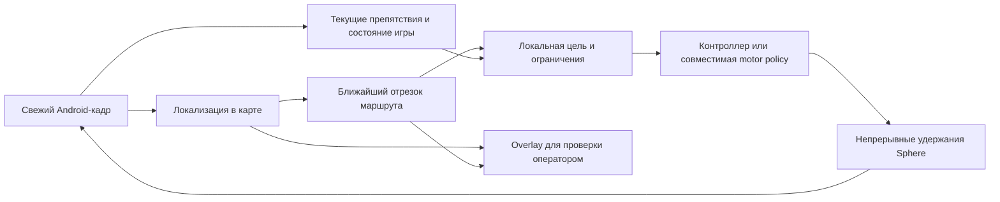

# Пространственная карта записанного маршрута

Решение направления ·25октября2026. Это уточнение цели и протокола проверки,
а не приёмка навигации. Gaussian-сцена «Маршрут012» ревизии2 сохранена. Дополнительно
построена отдельная текстурированная сетка по81ракурсу; режим её просмотра и
границы поставки описаны в [инструкции поверхностей](../operations/TEACHING-SURFACE-MODEL.md).

## Какой результат нужен

Оператор проходит коридор или участок дороги, сохраняет запись и получает:

1. Пространственную модель наблюдавшихся поверхностей, которую можно осмотреть
   с разных сторон. Ненаблюдавшиеся и недостоверные области остаются неизвестными.
2. Карту ориентиров для определения положения и направления камеры на свежем
   Android-кадре, включая работу с меньшим разрешением и другой освещённостью.
3. Маршрут в координатах карты: порядок участков, развилки, локальные цели,
   ограничения скорости и условия остановки/восстановления.
4. Проекцию ближайшего отрезка маршрута на текущий кадр. Она вычисляется заново
   по текущей позе камеры, а не закрепляется за постоянными экранными пикселями.

Это ближе к image-based reconstruction + visual teach-and-repeat, чем к записи
нажатий или к воспроизведению видео. Коллизии конкретной игры и реальные движущиеся
игроки не выводятся автоматически из красивой модели.

## Почему81ракурс недостаточно описывает результат

В исходнике «Маршрут012» сохранены458кадров1920×1080 за44.146s. Текущий обработчик
отобрал81кадр фиксированным media-интервалом≥0.5s и добавил последний кадр.
Каждая из81камер задаёт положение, ориентацию и калибровку, а не единственную
видимую плоскость.432262гауссианы задают объёмное представление для синтеза видов.

Однако оптимизация изображения на этих ракурсах не подтверждает точные поверхности
между ними. Слабая геометрия, мало боковых наблюдений, повторяющиеся текстуры,
движущиеся руки и окклюзии могут дать размытие и ложную геометрию.81/81 означает
связанность выбранных ракурсов, не458/458кадров и не полную копию пространства.

Следующий отбор должен учитывать движение/параллакс, поворот, резкость и новую
видимую область. Дополнительные кадры регистрируются относительно уже проверенной
карты; её не надо каждый раз переинициализировать. Проба178кадров с независимым
переинициализированным SfM ранее дала вырождение и была отклонена. Просто уменьшить
интервал или включить все кадры без отбора не является подтверждённым исправлением.

## Три связанных представления

| Представление | Роль | Чего оно не подтверждает |
|---|---|---|
| Gaussian-сцена | Просмотр записи, сравнение исходного и синтезированного изображения | Точные стены, свободный проход, collision mesh |
| Геометрия: multi-view depth → fusion → triangle mesh | Поверхности, глубина, границы видимости; основа проверки статических препятствий | Невидимые игровые коллизии, метрический масштаб, текущие игроки |
| Навигационный граф/коридор + карта локализации | Где мы на маршруте, ближайшая цель, направление и допустимые переходы | Безошибочную езду без проверки живого кадра и реакции на сбои |

Mesh может иметь более грубое разрешение, чем визуальная текстура. Опасные
бордюры/тонкие столбы нужно проверять отдельно, включая Low/render50%. Область,
где нет треугольников или подтверждённых глубин, нельзя автоматически помечать
свободной. Закрытие дыр и сглаживание для красивого отображения должны сохраняться
отдельно от наблюдавшейся геометрии и её confidence.

## Живой цикл

Карта строится offline и затем переиспользуется. В цикле3–5Hz не надо заново
строить модель города. Для каждого эмулятора хранятся собственные текущая поза,
уверенность, прогресс, история действий и короткий локальный план. Просроченные
наблюдения не должны накапливаться в очереди. Между коррекциями удержание стика
сохраняется; освобождение определяется сменой состояния/TTL/аварийной остановкой,
а не приходом каждого нового кадра.

Сначала нужны relocalization и успешный повтор короткого участка. Планировщик
дальнего A→B по библиотеке участков подключается после этого. Плотная модель всего
города не является условием первого повтора, а отсутствие её не разрешает ехать
в неизвестную область.

## Маршрут камеры, персонажа и цель motor policy

Восстановленная траектория сейчас относится к камере. Прыжки, анимация бега,
вращение/отдаление камеры и третье лицо меняют её связь с персонажем/транспортом.
Для пути ног или колёс нужен проверенный camera/body transform либо отдельная
оценка положения управляемого объекта. Нельзя без проверки считать линию камеры
траекторией колёс или вычислять метры по длительности W.

Наложенная стрелка сама по себе не является поддерживаемым интерфейсом задания
цели. NitroGen документирует pixels→gamepad и post-training для новых игр;
гарантия следования произвольной новой линии отсутствует. Open Pixel2Play
поддерживает image+text→keyboard/mouse при включённом text mode, но это также
не доказательство пространственного waypoint following в Black Russia.

Существующий `motor_worker/goals.py` сохраняет это различие: image-only adapter
не становится goal-conditioned от одной метки в metadata. Overlay остаётся
диагностическим до проверок «чистый кадр/путь налево/направо/нерелевантная линия»
и затем короткого closed-loop опыта. Если совместимость не подтверждается,
локальную цель исполняет явный контроллер либо другой совместимый backend.

## Что уже измерено и что дальше

Продолжение25октября: после отклонённого native texturing проверен отдельный
visibility-aware projective bake. Для каждого треугольника проверяются проекция
вершин/центра, keep-mask, угол к камере и глубина относительно z-buffer. Фотография
выбирается по видимой площади и углу; закрытые и неподдержанные грани не получают
чужую текстуру. Мелкие треугольники рассчитываются пачками с тем же perspective-
correct z-buffer; отдельные тесты проверяют перспективную глубину и окклюзию.

Полная сетка по81камере:327649граней до фильтра видимости,323648текстурированных
треугольников,4001исключённая грань,80встроенных фотографий,40843108байт GLB.
Финальное текстурирование заняло70.83s на этом ПК. Это **не** длительность всего
pipeline: перед ним отдельно выполнялись CPU depth/fusion/meshing; первая скалярная
попытка текстурирования явно отменена, её материалы сохранены, native mesh не
перестраивалась. Самостоятельный GLB не содержит внешних URI.

Свежий локальный API связывает модель с SHA-256 исходного manifest и geometry,
проверяет hash/размер тела при выдаче. Web проверяет hash до GLTFLoader, позволяет
переключать фотографии/поверхности/нормали/каркас и исходные позы камеры.
Чёрные дыры сохраняют неизвестность. Поверхности и их геометрическая точность не
приравниваются к принятой карте коллизий или разрешению автономного движения.

Отдельный CPU-тест OpenMVS2.4.0 на18реальных калиброванных ракурсах этой записи:
2781sparse points →66812согласованных dense points →49863вершины и99564треугольника
после meshing без закрытия дыр/сглаживания. Densify занял≈109s, исходный dense→mesh
опыт≈124s. Зафиксированы binary/archive SHA-256; Android, игра и установленная
Gaussian-сцена не изменялись. Бинарник взят из официального tagged release.

В первом18-кадровом опыте наличие треугольников не стало приёмкой. CPU-проекции сетки показывают поверхность
земли и фасада, но текстурированный экспорт не воспроизводит исходник корректно;
проверка вертикального направления UV это не устранила. Артефакт **не продвинут**
в пользовательскую сцену. В трёх проверяемых ракурсах сетка покрыла≈72–74%пикселей;
неизвестные области и ошибочные поверхности ещё надо отделить. Текстуры и
геометрическая точность остаются открытыми, navigation_qualified=false.

Оставшиеся проверки:

1. Независимо проверить depth/reprojection consistency и ошибочные поверхности;
   визуальную правдоподобность нового projective bake не считать метрической точностью.
2. Добавлять информативные промежуточные кадры к фиксированным опорным позам,
   затем сравнивать качество **между** обучающими кадрами и при небольшом уходе
   от записанной траектории. Зафиксировать coverage/confidence, не только PSNR.
3. Проверить новый сохранённый mesh-режим в пользовательском профиле и за пределами
   записанной траектории; confidence пока означает поддержку наблюдениями, не вероятность проходимости.
4. Проверить локализацию после повторного входа и на540p/render50%, camera/body
   transform и короткий маршрут. При неоднозначности — остановка/восстановление.
5. Затем граф маршрута, live-obstacle слой, local goal/controller и доказательство
   A→B на свежей игровой сессии. Повтор одной и той же записи не считается этим тестом.

OpenMVS рассматривается как заменяемый внешний offline backend; лицензия
AGPL-3.0 и условия распространения проверяются отдельно перед продуктовой поставкой.
Ни download инструмента, ни этот эксперимент не означают принятую интеграцию в APK.

## Первичные источники

- [COLMAP: sparse и dense reconstruction, перекрытие/параллакс](https://colmap.github.io/tutorial.html).
- [OpenMVS: dense, mesh, refinement и texturing](https://github.com/cdcseacave/openMVS).
- [OpenMVS2.4.0: использованный tagged release](https://github.com/cdcseacave/openMVS/releases/tag/v2.4.0).
- [Open3D: fusion глубины с известными позами](https://open3d.org/docs/release/tutorial/t_reconstruction_system/integration.html).
- [2DGS: surface-oriented представление, bounded/unbounded mesh и CUDA](https://github.com/hbb1/2d-gaussian-splatting).
- [gsplat: актуальные CUDA-реализации и ограничения готового backend](https://github.com/nerfstudio-project/gsplat).
- [NitroGen: официальный интерфейс](https://github.com/MineDojo/NitroGen).
- [Open Pixel2Play: image/text и выбор text mode](https://github.com/elefant-ai/open-p2p).
- [Предыдущие30вопросов: границы метода и приёмка](../audits/2026-10-24/NAVIGATION-30-QUESTIONS.md).
