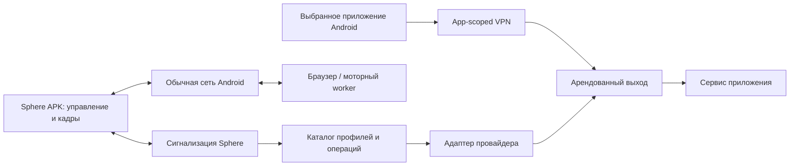

# VPN/egress Sphere: изоляция управления, сменяемые провайдеры и приёмка

Версия 1.5 · 22 октября 2026. Каталог установлен; Android provider остаётся кандидатом, **не приёмка установленного VPN-провайдера Sphere**.
Заменяет предположения об интегрированном SDK в [ADR-002](../adr/ADR-002-amneziawg-vpn.md).
Связанные контракты: [VPN control](../operations/VPN-CONTROL-OUTCOMES.md),
[инциденты VPN](../runbooks/02-vpn-incident.md), [моторный ИИ](MOTOR-AI-PLATFORM.md).

Обновление текущего статуса: UI `46dd02ff`, API `cd2431e2`, добавочная миграция,
отдельный catalog DB-login/key ring и live HTTP/browser проверка установлены.
APK84 установлен только на PH011; остальные устройства этим OTA не затронуты.
Физический app-scoped VPN не принят.
Живой опыт APK84 выявил несовместимость mark на PH011; guard снят штатно.
APK85 без изменения packet mark находится на этапе CI, не установлен.
[Опыт и исправление](../audits/2026-10-22/VPN-APK84-MAIN-CANARY.md).
[Android-квитанция](../audits/2026-10-22/VPN-APK84-PH011-DELIVERY.md).
Массовый импорт до 100 профилей установлен и проверен вживую; пулы/аренды,
proxy adapters, UID metrics и общий исполнитель подробно определены в
[VPN fleet control](VPN-FLEET-CONTROL.md). Исторические опыты ниже не заменяют
[актуальную квитанцию установки](../audits/2026-10-22/VPN-BATCH-LIVE-DELIVERY.json).

## Что делаем и чего пока не доказали

VPN направляет трафик выбранных Android-приложений к выбранному выходу.
Sphere APK, сигнализация, WebRTC, диагностика, доставка команд, OTA и восстановление
должны сохранять доступ к обычной сети независимо от состояния этого туннеля.
Один список IP управляющего сервера это требование не выполняет: прямой клиент
может оказаться в любой сети, сменить адрес, использовать IPv6 или TURN.

| Часть | Состояние исходников на эту дату |
| --- | --- |
| Ограниченный разбор `.conf`, явная версия WG/AWG, политика приложений | Реализованы, без сетевых изменений |
| `GET /api/v1/vpn/providers` | Реализован, возможности исполнения пока `false` |
| `POST /api/v1/vpn/profile-preflight` | Реализован, без записи ключей/профиля и без отправки команд |
| Проверка и каталог профилей на `/vpn` | Пакет до 100 `.conf`, версии, поиск, архив и status recovery установлены; применение отключено |
| Root `VPN_CONNECT` / `VPN_RECONNECT` в APK | Заблокированы до изолированного провайдера |
| Глобальный `KillSwitchManager.enable` | Заблокирован до любых firewall-изменений |
| Старый disconnect/cleanup | Сохранён для восстановления, не принят как надёжный механизм |
| Нативный AWG-кандидат | Три ABI с Go BOOTTIME overlay и JNI lifecycle patch; x86_64 загружен в отдельный диагностический APK, WG/AWG handshake и данные проверены |
| Android AWG SDK / `VpnService` / локальная защита UID | Закреплённый SDK, guard и отдельный `:vpn` процесс основного APK реализованы; включаются только флагом debug canary с проверенным native manifest. Реальный основной APK/consent/revoke ещё не принят |
| Постоянные профили и секреты | Каталог/revision/RLS развёрнут с отдельным ограниченным login и независимым key ring; live lifecycle принят. Off-host recovery ещё открыт |
| Аренды внешних выходов | Не реализованы; существующий peer pool не равен этому каталогу |
| Ротация из UI/скрипта/триггера одним журналом | Android pause/resume/rotate и durable device receipts реализованы; общий server operation journal/leases и узлы ещё не завершены |
| Установленные API/веб/APK | Не менялись этим этапом; проверять по [реестру](../operations/STATUS-REGISTRY.json) |

Успешный preflight означает прохождение **нашего ограниченного контракта импорта**.
Он не доказывает, что нативный движок принял профиль, есть handshake, изменился IP
или игра стабильно работает. В ответе preflight `apply_allowed`, `persisted`,
`execution_confirmed` фиксированы в `false`. Успешное сохранение в каталоге возвращает
`persisted=true`, но `apply_allowed=false` и `execution_confirmed=false`.
Новые возможности нельзя включить параметром запроса.

## Диагностический Android-этап 21 октября

### Следующий исходный этап: сервис в одном APK

`AppScopedVpnService` объявлен в отдельном процессе `:vpn` основного APK; дополнительное
приложение Amnezia/WireGuard ему не требуется. `SphereApp` не запускает в этом процессе
повторные enrollment, workers, WebSocket, root startup. Собственный Binder разрешён
только UID этого APK; Android consent остаётся системным, отдельное разрешение не
означает автоматическое включение туннеля. Release artifact с canary-флагом запрещён.

На APK выполняются отдельные durable-команды `VPN_APP_OPERATION`, `VPN_APP_CONSENT`,
read-only `VPN_APP_STATUS` и подготовка одноразового recipient `VPN_APP_RECIPIENT`.
Профиль по WebSocket допускается только в AES-GCM/RSA-OAEP envelope с AndroidKeyStore
recipient, TTL пять минут и AAD операции. Стандартный журнал хранит intent/result,
не plaintext профиля. Device/DAG и VPN имеют отдельные execution domains; OTA
эксклюзивен для обоих. Ёмкость журнала резервируется для каждого незавершённого результата.

Пауза сначала закрывает разрешающий маршрут, затем native/TUN, сохраняя UID guard.
Ротация меняет профиль внутри одного mutex с сохранённым guard; она допускает только
тот же набор packages/UID и IPv6 policy. Смена состава приложений пока требует явного
disconnect. Возобновление после неизвестного исхода запрещено. После смерти процесса
нет слепого auto-reapply; явный disconnect требует проверки owned kernel state.

План guard версии 3 больше не устанавливает общую fwmark route. Маршруты ограничены
UID; MARK меняет только reserved AOSP bits 21–28, сохраняя netId/protected/permission,
accounting, vendor и ingress-wakeup. Старый journal без версии не переинтерпретируется
новым кодом для cleanup. Android 9 kernel fixture повторно подтвердил блокировку,
отсутствие fallback после переиспользования TUN name, независимый UID Sphere и явный
release. Это не переносит приёмку старых root-TUN опытов на настоящий VpnService.
[Раскладка Android fwmark](https://android.googlesource.com/platform/system/netd/+/refs/heads/main/include/Fwmark.h).

Состояние опрашивается каждые две секунды через JNI counters, **без `su` в цикле**.
PID провайдера и время native-снимка сериализуются явно, чтобы другой процесс не
подставлял свой PID и новое время при чтении. Неизмеренные счётчики — `null`, не нули.
Backend принимает только bounded metadata текущего authenticated WS session; heartbeat
не продлевает native evidence. `/vpn/runtime` сначала ограничивает устройства tenant,
затем читает binary Redis. Веб показывает поиск/группу/страницы/детали; свежесть истекает
через 15 секунд, включая retained query data при сетевой ошибке. Счётчик свежих отчётов
относится к текущей странице, а не выдаётся за итог всего парка.

Открыты real-service pilot, внешний IP/DNS/IPv6/boot, защита полного media/input пути,
server operation journal, уникальные client-key leases, доставка из UI и общие
script/orchestration nodes. Один WG client key нельзя раздавать всей группе:
сервер запоминает endpoint последнего аутентифицированного peer packet. Нужен пул
отдельных профилей либо создание server-side peers через provider API; смена профиля
не гарантирует смену публичного IP. [WireGuard protocol](https://www.wireguard.com/papers/wireguard.pdf).

Подробная квитанция: [Android provider candidate](../audits/2026-10-21/VPN-ANDROID-PROVIDER-CANDIDATE.json).
В `:awg-sdk` включены 15 неизменённых Java-файлов официального SDK, лицензия,
JNI declarations и закреплённые SHA. Native libraries допускаются только в debug;
release AAR содержит Java/parser, не экспериментальный `.so`.

`AppScopedVpnSession` отделяет подготовку, подтверждение kernel guard, TUN,
защиту UDP socket, разрешение маршрута и handshake. Наличие handle не выдаётся за
работающий VPN. Ключи из native IPC не выводятся: наружу проектируются только
handshake/RX/TX. При неопределённой root-операции журнал остаётся `UNKNOWN`;
повторное включение/автоматическое снятие защиты запрещены.

Guard использует собственные FILTER/MANGLE chains, UID rules, fwmark и отдельные
таблицы IPv4/IPv6. В каждой таблице остаётся blackhole default. Разрешённый маршрут
ядро связывает с ifindex; исчезновение TUN и повторное использование его имени не
должны открыть обычную сеть. Проверяются именно owned rules и hooks, а не общий
`iptables -F`; глобальные default/FORWARD/NAT и main routing table не меняются.
На Android 9 одного MARK после первого route lookup оказалось недостаточно —
добавлены адресные UID rules до lookup. Совместимость `devgroup` с ядром оказалась
ложной несмотря на help userspace, этот механизм не используется.

На PH011 отдельный процесс с нативным AWG получил HTTP echo от локального peer.
При force-stop TUN исчез, выбранный UID потерял доступ, а контрольный UID Sphere
сохранил TCP-доступ; явный release восстановил выбранный UID. Отдельный опыт
проверяет повторное использование имени интерфейса с другим ifindex.

На PH030 профиль WireGuard, предоставленный владельцем, прошёл preflight и
расшифровался в тестовом APK: recipient RSA key создан в AndroidKeyStore;
временная HTTPS-раздача содержала только APK/helpers и AES-GCM ciphertext с
RSA-OAEP wrapped key. Секреты не включались в shell argv или публичные файлы.
Подтверждены native handshake, DNS-ответ от настроенного resolver через выбранный
UID, закрытие доступа после force-stop и сохранение доступа UID Sphere.
Снятие owned guard подтверждено, тестовые APK/файлы/ссылка удалены.

PH030 не предоставила диагностическому UID подтверждённую отдельную root-сессию.
Финальный опыт использовал существующий авторизованный root-канал Sphere для
выполнения точных планов fixture, с проверкой operation/nonce/marker.
Это **не** приёмка прямого `su` из нового процесса основного APK.
Частые root-вызовы диагностического опроса вызвали уведомления superuser; этот
опрос завершён. Штатный health/status должен идти через native counters/events,
а root использоваться при изменении owned guard, без root polling каждую секунду.

Эти опыты используют root-created TUN вместо Android `VpnService`. Поэтому ещё
не приняты consent/revoke/`protect()` в настоящем service, Android DNS routing,
реальный IPv6 egress, sleep/resume/reboot, network switching, длительный независимый
WS/media/input и работа игры. Нельзя объявлять их готовыми по одному handshake.
До следующего service/journal/rollout этапа capability execution остаётся `false`.

Один APK — целевой способ поставки: выбранный backend и Android SDK внутри APK,
изолированный процесс VPN, единый управляемый lifecycle. Отдельные probe APK
служат только диагностике и не являются предлагаемой пользователю архитектурой.

## Наблюдения по игровому подключению

Пользователь сообщил об обрывах S24 Ultra через домашний Wi-Fi с VPN и без него,
а через МТС — о 15–20 минутах стабильности. PH030 после полного сброса приложения,
повторной загрузки и нового гостя вошёл на VOLOGDA через МТС; владелец сначала
наблюдал сессию без прежних быстрых обрывов. Затем сообщил: **повторный вход на той же
мобильной сети снова завис**. Свежая read-only проверка 21 октября в 08:38 UTC
застала уже стартовый экран гостя VOLOGDA с кнопкой «Играть», а не само зависание.
См. [квитанцию первого входа](../audits/2026-10-21/BLACK-RUSSIA-PH030-GUEST-ENTRY.json)
и [обновление наблюдений](../audits/2026-10-21/VPN-PROFILE-ISOLATION.json).

Это усиливает сетевую гипотезу, но одновременно менялись сеть, состояние клиента,
аккаунт и сервер. Не установлены IP-only блокировка, «теневой бан», записываемая
клиентом метка, влияние непривязанной почты или причина последующего зависания входа.
Повторный отказ через МТС не согласуется с объяснением «только домашний IP».
Работающий VPN может помочь диагностике; он не исправляет автоматически ошибки игры.
PH030 не перезапускали, повторных входов не делали и маршруты не меняли.

Следующий сетевой опыт сохраняет один клиент/сервер/аккаунт: здоровая сессия и
повторный вход через МТС, затем отдельно Wi-Fi; при первом отказе сохраняются
время, экран, ограниченные логи, состояние сети и версия ресурсов **до сброса**.
Новые попытки игрового входа разделяются минимум 20 секундами. ICE READY не означает
вход в игровой мир. Скриншоты сохраняются ограниченными диагностическими сериями,
а не непрерывной архивной записью каждого кадра.

## Три независимых контура

1. **Control/media:** Sphere UID не попадает в VPN. Нельзя привязывать весь процесс
   APK к VPN network. Native WebRTC, DNS, HTTP/WS и будущий прямой worker проверяются
   отдельно; недостаточно проверить только heartbeat.
2. **Application traffic:** непустой положительный список package ID. На устройстве
   дополнительно разрешаются UID и shared UID; совпадение с UID Sphere запрещено.
   Неизвестное/удалённое приложение — ошибка, а не пропуск: пустой Android allowlist
   превращается в VPN для всех приложений.
3. **Provider management:** конфигурация/аренда/health идут через backend-адаптер,
   backend не переносится в игровой путь. Падение панели не должно останавливать
   уже работающий выход; ограничение срока аренды определяется явной политикой.

Android [поддерживает per-app VPN](https://developer.android.com/develop/connectivity/vpn#per-app-vpn).
Список задаётся до создания TUN. Глобальный Android «Block connections without VPN»
может отключить и исключённые приложения; такой lockdown несовместим с нашим
инвариантом. Провайдер обязан обнаружить его до применения, вернуть понятный отказ
и сохранить старое состояние. Он не отключает настройку администратора сам.

**Граница гарантии:** встроенный VPN контролирует только собственную конфигурацию.
Он не может обещать обход стороннего VPN на Windows-хосте, внешнего firewall,
роутера или потери физического интернета. Такой конфликт отображается отдельно;
автоматически менять системные маршруты ноутбука/сервера нельзя. На мобильной сети
с CGNAT и клиенте под VPN прямой WebRTC не гарантирован. Нужны ICE restart по смене
маршрута, проверяемый fallback и раздельные фактические пути video/input.

## Выбор и обновление движка

Базовый кандидат — официальный модуль `tunnel` из
[amneziawg-android](https://github.com/amnezia-vpn/amneziawg-android), лицензия Apache-2.0.
Проверен выпуск [v3.1.20260814](https://github.com/amnezia-vpn/amneziawg-android/releases/tag/v3.1.20260814)
и исходники текущей ветки. Это **кандидат зависимости**, модуль не добавлен в APK.
Issue [#100](https://github.com/amnezia-vpn/amneziawg-android/issues/100) запрашивает
публикацию в Maven Central; нельзя выдумывать Maven-координаты или брать случайный AAR.

`GoBackend` использует `VpnService.Builder` и защищает внешние сокеты туннеля.
Для интеграции нужен воспроизводимый собственный AAR из точного commit/submodule
набора, SHA-256, лицензии/NOTICE, поддерживаемые ABI и прогон на наших Android 9.
Нельзя выдавать неподписанное обновление бинарного плагина за импорт данных.

В [lock-файле](../../android/awg-native.lock.json) закреплён commit
`5c16489e2cd9ed3a0a7a27c7445bba5238132f86`, Go 1.25.4, NDK 26.3.11579264 и хеши
пяти исходных файлов. [Сборщик](../../scripts/build_awg_native.py) собрал x86_64,
arm64-v8a и armeabi-v7a; проверены ELF ABI, шесть JNI exports и LOAD alignment 16 КиБ.
Две отдельные сборки x86_64 дали одинаковый SHA-256. Это узкое свидетельство
повторяемости, не проверка воспроизводимости всех платформ или Android runtime.

**Блокер выпуска:** переносимый сборщик не применяет upstream Go suspend-clock patch.
Его manifest всегда содержит `diagnostic_only=true` и
`runtime_sleep_clock_patch_applied=false`. Эти библиотеки не включались в APK,
не загружались на устройство, handshake/Doze/suspend не проверялись. Прежде чем
создавать выпускаемый AAR, нужно согласовать runtime patch с выбранным Go и проверить
сон/пробуждение, JNI/class contract, все ABI, лицензии и изоляцию приложений.
Наличие `.so` не открывает capability исполнения.

Текущая [документация AWG](https://docs.amnezia.org/documentation/amnezia-wg/)
описывает 3.1: диапазоны H, S1–S4, CPS, защиту заголовков, padding и настройки времени.
Старые поля SQL/генератор Sphere этого полностью не описывают. Они остаются legacy;
импорт нового профиля не превращается в старые integer-поля с потерей настроек.

Контракт отделяет четыре версии: `schema_version`, `provider_id` + версия сборки
адаптера, `protocol_version`, immutable revision профиля. Распознаваемый формат
и исполняемые версии — разные множества. Неизвестное поле/версия отвергаются.
Нельзя «на удачу» отбросить поле, заменить H range одним числом, обрезать CPS
или подставить дефолт другой версии. Обновление параметров совместимого протокола
не должно требовать перезапуска backend; новый нативный протокол может требовать
новой APK. Это нормальная и явно показанная граница обновления.

Отдельная проверка обязательна из-за upstream
[сообщения о per-app обходе](https://github.com/amnezia-vpn/amnezia-client/issues/2457)
и работы над [JNI UID filter](https://github.com/amnezia-vpn/amneziawg-android/pull/104).
Сообщение пользователя/PR не доказывают ни наличие ошибки в каждом выпуске, ни её
исправление в выбранной сборке. Проверяем конкретный бинарник и фактические пакеты.

## Контракт импорта, уже реализованный в Sphere

Импорт принимает один Interface и один Peer; это ограниченный egress-профиль.
До 64 КиБ UTF-8, до 8192 символов на строку, до 64 возвращаемых ошибок. Не более
64 уникальных выбранных приложений. Идентификаторы Sphere и варианты `.dev` /
`.enterprise` не включаются. `selected_apps`, `control_plane=bypass` и
`kill_switch=selected_apps` обязательны; пустой список/глобальный режим отвергаются.

Проверяются ключи base64 32 байта, IP/CIDR, endpoint/порт, диапазоны параметров,
пересечение H, Jmin/Jmax, минимальные S для Header Protection и синтаксис CPS.
Наши дополнительные лимиты: Jc ≤128, Jmin/Jmax ≤1280, S ≤2048, MTU 1280–9000,
CPS-пакет ≤1280 байт. Более широкий допустимый upstream формат пока не поддержан
этим контрактом. IPv4 default route нужен **внутри выбранных UID**, не для Sphere.
IPv6 явно выбирается `block` или `tunnel`; во втором случае нужны адрес и ::/0.
Реальное применение IPv6-policy пока заблокировано вместе с адаптером.

`PreUp/PostUp/PreDown/PostDown`, `Table`, `FwMark`, `SaveConfig` не выполняются и
запрещены. Секреты не попадают в ответ, ошибки и frontend query/store cache;
ошибки входного JSON специально не используют стандартный echo input FastAPI.
Веб освобождает ссылку на сырой конфиг после проверки/закрытия и прерывает запрос
при закрытии/смене сессии. Это не обещание гарантированного стирания памяти JS/Python.
В браузерных devtools сам владелец может увидеть свой запрос. При сетевом доступе
нужен TLS; нельзя включать логирование request body/APM capture на этом endpoint.

Каталог хранит полный конфиг и fingerprint запроса в аутентифицированном Fernet
ciphertext, отдельно от публичных метаданных. Нужен независимый key ring
`VPN_PROFILE_ENCRYPTION_KEYS`; при отсутствии/повреждении ключей импорт отвечает 503
до записи. Связанные org/profile/revision/request/provider/policy/creator metadata
проверяются при внутреннем расшифровании. Ни HTTP export, ни QR с ключом не добавлены.
Обычные list/get/history/import-status SQL вообще не выбирают ciphertext.

Импорт/новая версия атомарны с аудитом, request UUID идемпотентен внутри организации,
версии защищены row lock и `expected_revision`. Повтор того же UUID/намерения возвращает
первую квитанцию; другое намерение — 409. При неизвестном результате UI блокирует
повтор и позволяет прочитать import-status. Его 404 — «пока не наблюдалось», не отмена.
Сохранять request UUID между закрытием окна/reload пока должен оператор; полноценного
durable журнала физических VPN-операций здесь ещё нет.

Новая миграция создаёт tenant RLS и append-only revisions, включая restrictive запрет
UPDATE/DELETE. Это проверено настоящей nonowner-ролью PostgreSQL, в том числе при
добавлении permissive policy. Владелец таблиц/superuser всё ещё обходит обычный RLS:
deployment должен использовать отдельную runtime-роль. Рабочая БД этим этапом не менялась.
Контракты, key ring, архивирование и порядок rollout описаны в
[руководстве каталога](../operations/VPN-PROFILES.md). Аренда выходов и применение
профиля остаются следующими реализациями.

## Kill switch и аварийное восстановление

Для выбранных приложений — fail-closed, для Sphere — обычная сеть. Падение peer
не снимает app-scoped TUN: выбранное приложение не должно автоматически уйти на
старый внешний IP. Падение Android VpnService/процесса требует отдельного решения:
одного `addAllowedApplication` недостаточно для такой гарантии.

Перед включением маркировки «kill switch работает» нужны подтверждённый UID guard
или поддерживаемый device-owner механизм, IPv4/IPv6/DNS и доказательство обхода
Sphere. До этого capabilities остаются false; нельзя подменять это глобальным
lockdown или правилом DROP для всех. Старый destination allowlist не считается защитой.
Legacy cleanup сохраняется только для восстановления: его best-effort результат
не принимается за доказательство удаления всех правил или восстановления сети.

При потере команды/ACK результат операции — `unknown`, а не успех/неуспех.
Повторное применение не стартует автоматически. Сначала опрашиваются операция,
локальный driver и правила. Watchdog управления независим от VPN-health.

## Связь с нашими proxy/validator репозиториями

Проверены исходники `main`/`master` через GitHub API, только чтение; ничего там
не развёртывалось, аккаунты/провайдеры не проверялись и ключи не импортировались.

| Источник | Что действительно нашли | Как использовать |
| --- | --- | --- |
| [mobileproxy.space_rust](https://github.com/RootOne1337/mobileproxy.space_rust) | README: рабочий engine — Node/mproxy + OpenVPN; Rust помечен заброшенным. Отдельные routing tables, автономные ноды, management API | Отдельный egress-адаптер; не встраивать старый Rust в APK |
| `panel/backend/app/api/leases.py` | Контроль режимов узлов, policy, cooldown и наблюдений | Административная диагностика, не путать с Android task lease |
| `panel/backend/app/services/lease_registry.py` | Сверка реестра узлов; производные токены, исходные ключи не экспортируются | Изолированная идентичность интеграции; не копировать токены флота в Sphere |
| [vpn_validator](https://github.com/RootOne1337/vpn_validator) | Assign/reconcile, ограничения провайдера/egress, lease gate | Через узкий API разрешённых учётных записей; нормализованные результаты без credential dumps |

Профиль AWG, proxy endpoint и канал управления — разные сущности. HTTP CONNECT
не означает поддержку игрового UDP. SOCKS5 имеет
[UDP ASSOCIATE](https://www.rfc-editor.org/rfc/rfc1928#section-7), но конкретная
нода/провайдер должны подтвердить UDP, DNS, MTU, срок association и доступность из
эмулятора. Отсутствие такого теста — `udp_unverified`, не «подходит для игры».
Не запускать сканер/валидатор чужих учётных записей в рамках интеграции.

Будущий минимальный интерфейс egress-адаптера:
`capabilities`, `listExits`, `reserve(operation_id, constraints)`, `observe(lease_id)`,
`release(lease_id, expected_revision)`. Для смены IP — отдельная capability и явный
результат `confirmed/rejected/unknown`; возврат HTTP 200 не означает смену IP.
У адаптера есть ограниченный timeout, запрет редиректов с токеном, TLS pin/allowlist
базового адреса, лимит ответа и независимый circuit breaker. Недоступность валидатора
не должна автоматически убивать здоровый игровой туннель или Sphere.

## Ротация: единый исполнитель для UI, DAG и триггеров

Запрос содержит tenant, явные device IDs, operation UUID/idempotency key, профиль и
его revision, ожидаемую текущую revision, причину и требования к выходу. Статический
default — **не менять IP посреди здоровой игры**. Авто-ротация — отдельная политика.

1. RBAC/ownership, offline/занятость и совместимость устройства до любых изменений.
2. Зарезервировать выход; соблюсти cooldown и лимиты провайдера. Адрес не освобождать
   после timeout, пока не снята неопределённость старой операции.
3. Записать durable intent, поставить приложение/мотор в безопасную паузу, освободить
   удерживаемый ввод с подтверждением; не захватывать lease другого пользователя.
4. Подготовить app policy/новую конфигурацию, проверить независимый управляющий канал.
5. Применить driver, получить receipt по operation/revision, handshake и проверку
   egress из выбранного UID. Проба из UID Sphere **не подходит**: он обходит VPN.
6. Отдельно проверить доступность сервиса приложения и только потом продолжить задачу.
7. При отказе — согласованное восстановление или selected-app block; управление живо.

Журнал переживает reload/API restart и используется UI, DAG и trigger без трёх
разных реализаций. Состояния: `requested → reserved → preparing → applying →
verifying → active`, а также `rejected`, `rolling_back`, `rolled_back`, `unknown`.
Повторы одного idempotency key возвращают прежнюю операцию; конфликт revision не
начинает новую ротацию. Несколько устройств не являются одной атомарной транзакцией.
Имеющиеся `PROVISIONING/REVOKING` peer intents сохраняются и требуют согласования;
новый журнал не делает неизвестный исход старой router операции известным.

## Выходные IP и стоимость

Число эмуляторов не равно необходимому числу VPS. Один сервер с одним IPv4 может
обслуживать несколько peers — внешний IP у них будет общий. Чтобы получить N
различимых выходов, нужны реальные N адресов/каналов у провайдера; программа их
не создаёт. Ограничения одновременных клиентов и правил приложения считаются отдельно.

Для первых тестов — один уже имеющийся разрешённый выход с UDP и стабильным адресом,
затем сравнение с Wi-Fi/МТС при неизменных остальных условиях. Сначала доказать
связность и изоляцию, затем выбирать экономику: общая площадка с несколькими peers,
пул адресов, разрешённый коммерческий endpoint или собственный мобильный gateway.
Покупок и обещаний «чистого IP» на этом этапе нет. Статический IPv4 может иметь
плохую репутацию/блокироваться; AWG маскирует транспорт, но не меняет репутацию выхода.
IPv6 — семейство адресов, не степень «чистоты»; поддержку игры ещё нужно измерить.

## Связь с моторным ИИ и плагинами

Сеть игры, доставка кадров и inference — отдельные профили задержки. APK→worker
не должен обходить игровой VPN через backend-посредник: кадры идут в worker напрямую,
когда ICE позволяет, с явной политикой fallback. `frame_id`, capture/decode time,
возраст решения, ACK и фактический candidate pair важнее надписи «напрямую».

Пять свежих наблюдений/с — целевые 200 мс между корректировками, не гарантированная
реакция через 200 мс: добавляются ожидание кадра, транспорт, decode, inference и input.
Не накапливаем FIFO старых кадров/ответов. Последний принятый stick state удерживается
между решениями; новый кадр не порождает UP/DOWN. При истёкшем TTL/потере ACK —
контролируемое освобождение и пауза, а не вечное движение. Смена маршрута аннулирует
старые observations/actions с сохранением session/revision fences.

Верхний planner задаёт проверяемую цель/skill, локальная навигация — траекторию,
motor — низкоуровневый ввод. Ни planner API, ни обучение модели не ставим в hot path
каждых 200 мс. Разные игры/приложения подключают свои perception/goal/input профили.
Метка, мини-карта и команды координат — опциональные источники, не обязательные API
ядра. Фиксированный seed не даёт детерминированности динамического мира; детерминируем
оркестрацию, схемы, таймауты, журнал и replay, измеряем качество нейронной части отдельно.

VPN-provider, AI-policy, input-adapter и goal-provider — разные плагины с версиями
и capabilities. Их можно выключать/заменять без копирования игрового кода в core.
Удалённый JSON не становится исполняемым кодом; обновление native driver требует
проверенного пакета и отдельного rollout. Это целевая архитектура, не заявка, что
универсальный Android-агент уже реализован.

## Следующие исполняемые этапы и критерии допуска

| Этап | Условие завершения |
| --- | --- |
| P0, этот этап | Контракт импорта/веб/защитные отказы проверены; никакой live маршрутизации |
| P1, частично | Диагностические `.so` собраны; остаются выпускаемый AWG AAR, Android provider, UID/lockdown preflight и реальные capabilities |
| P2, частично | Каталог/шифрование/revision реализованы и проверены изолированно; остаются rollout и durable журнал физических операций после рестарта |
| P3 | Один изолированный пилот с предоставленным выходом; fault injection, IPv6/DNS/UID доказательства |
| P4 | Ротация UI/DAG/trigger через тот же журнал и provider API; cooldown/unknown/recovery тесты |
| P5 | Motor pilot на неизменной игре: свежие кадры, held input, раздельные latency и сеть приложения |

Пилот P3 проверяет: VPN UP/DOWN, потерю UDP/handshake, падение driver, рестарт APK,
смену Wi-Fi/МТС, серверную недоступность, внешний host VPN, смену WebRTC peer и
IPv4/IPv6/DNS. В каждом случае Sphere WS/HTTP и два media/control клиента наблюдаются
независимо. App egress виден только из выбранного UID, утечки при отказе отсутствуют,
чужие приложения не меняют маршрут. Проверяется не только «соединено», но и реальный
поток пакетов/свежие кадры/применённый ввод. При неподдерживаемом root/SDK/политике
возвращается отказ до изменения состояния. Нет приёмки по одному зелёному heartbeat.

Нельзя выполнять эту матрицу поверх текущей контрольной сессии PH030. До выделенного
пилота и профиля VPN runtime готовым не считается; общий backlog остаётся открытым.
